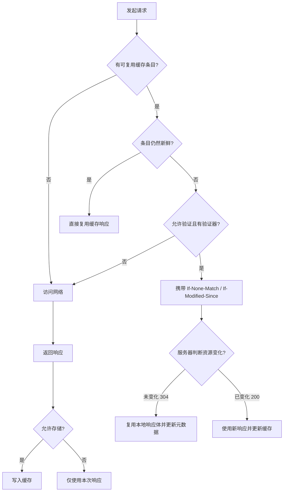

# 浏览器缓存：别只背“强缓存和协商缓存”

缓存题真正想考的不是头字段拼写，而是你能不能回答三个问题：

1. 这个响应能不能被存下来？
2. 下次使用前需不需要问服务器？
3. 线上发布后，旧页面和新资源如何安全切换？

## 1. 先看缓存决策树



面试里常说“强缓存”和“协商缓存”，它们是便于理解的中文分类，不是 HTTP 规范里的两个正式缓存类型：

- **强缓存**：缓存条目仍新鲜，直接复用，不向源服务器验证；
- **协商缓存**：条目过期或策略要求验证，客户端带验证条件询问服务器，未变化时收到 `304` 并复用本地响应体。

## 2. `Cache-Control` 到底怎么读

### 2.1 常见响应指令

| 指令 | 重点含义 | 易错点 |
|---|---|---|
| `max-age=3600` | 从响应生成时间起，在 3600 秒内可视为新鲜 | 不是“浏览器收到后固定 3600 秒”这么简单，还涉及 `Age`、`Date` 等年龄计算 |
| `s-maxage=3600` | 主要覆盖共享缓存的新鲜度 | 浏览器私有缓存通常看 `max-age` |
| `no-cache` | 可以存，但复用前必须验证 | 不是“不缓存” |
| `no-store` | 缓存不应存储请求或响应 | 不要把它当成解决所有敏感数据问题的唯一手段 |
| `private` | 响应只适合私有缓存 | 常用于用户个性化响应，避免共享 CDN 缓存 |
| `public` | 明确允许共享缓存存储 | 带授权信息时是否可共享还要结合规范规则和代理配置 |
| `must-revalidate` | 过期后必须成功验证，不能随意使用陈旧响应 | 离线容错要考虑 `stale-*` 策略 |
| `immutable` | 新鲜期内资源内容不会变化 | 适合带内容哈希的静态资源 |
| `stale-while-revalidate=30` | 可先使用一定时间内的陈旧响应，同时后台验证 | CDN 和浏览器支持 / 行为要实际验证 |
| `stale-if-error=86400` | 上游错误时允许在窗口内使用陈旧响应 | 是可用性策略，不代表永远忽略错误 |

典型配置：

```http
# HTML 入口：可以保存，但每次使用前验证，确保尽快拿到新资源清单
Cache-Control: no-cache
ETag: "html-v42"

# 带内容哈希的静态资源：内容变更会产生新 URL，可长期缓存
Cache-Control: public, max-age=31536000, immutable
```

### 2.2 `Expires` 为什么还存在

`Expires` 使用绝对时间：

```http
Expires: Sun, 09 Aug 2026 12:00:00 GMT
```

它受时钟和格式影响；当 `Cache-Control: max-age` 同时存在时，现代缓存通常优先使用 `max-age`。面试回答不需要说“Expires 已经完全没用”，兼容旧链路或遗留配置时仍可能看到它。

### 2.3 启发式缓存

即使响应没写显式新鲜度，缓存也可能基于 `Last-Modified` 等信息估算一个新鲜期，这就是启发式缓存。它不是你应该依赖的发布策略：关键资源应明确设置缓存头，避免不同客户端、代理或实现给出意外结果。

## 3. `ETag` 与 `Last-Modified`

### 3.1 两组请求如何协商

服务器第一次返回：

```http
HTTP/1.1 200 OK
Cache-Control: no-cache
ETag: "product-list-v8"
Last-Modified: Sun, 09 Aug 2026 08:20:00 GMT
```

客户端再次验证：

```http
GET /api/products HTTP/1.1
If-None-Match: "product-list-v8"
If-Modified-Since: Sun, 09 Aug 2026 08:20:00 GMT
```

未变化：

```http
HTTP/1.1 304 Not Modified
Cache-Control: no-cache
ETag: "product-list-v8"
```

`304` 没有新的响应体，浏览器把已有响应体与新的元数据组合使用。

### 3.2 为什么通常更偏向 `ETag`

`Last-Modified` 是时间验证器，粒度和可靠性受到文件系统时间、快速重复修改、内容未变但时间变等因素影响。`ETag` 是服务器为某个表示版本生成的标识，可以表达更精确的版本变化。

但不要背成“`ETag` 永远优先且一定是文件哈希”：

- ETag 的生成策略由服务器决定；
- 分布式节点若生成不一致，会降低命中率；
- 动态压缩可能产生强 / 弱验证器差异；
- 如果生成 ETag 的计算成本过高，也可能不划算；
- HTTP 条件请求对不同方法和头字段有更完整的优先规则。

## 4. Memory Cache、Disk Cache 是什么层次

DevTools 里常见 `(memory cache)`、`(disk cache)`，它们描述的是浏览器实现中的存放位置或命中来源，不等于 HTTP 语义里的“强缓存 / 协商缓存”。

- Memory Cache 通常速度快、生命周期短，可能随进程或页面状态释放；
- Disk Cache 容量更大、可跨页面或会话复用，但仍受淘汰策略影响；
- 是否进内存、磁盘、何时提升 / 淘汰，是浏览器实现细节；
- 不要在业务代码里依赖“某资源一定来自内存缓存”。

一个条目可以因为 HTTP 新鲜度直接使用，同时其字节恰好位于内存；也可以先从磁盘读出后再验证。这两组概念不要混为一谈。

## 5. 刷新、重新加载、强制重新加载

这是最容易被说死的部分。不同浏览器、版本、DevTools 状态和请求类型可能有差异，稳妥答案是：

| 操作 | 常见倾向 | 不应说成 |
|---|---|---|
| 普通页面访问 | 按正常缓存语义复用新鲜响应 | 一定访问服务器 |
| 地址栏回车 / 普通刷新 | 常对主文档进行验证，子资源尽量按缓存规则处理 | 所有资源一定跳过强缓存 |
| 强制重新加载 | 尽量绕过本地 HTTP Cache 并重新获取 | 能绕过 CDN、Service Worker 或所有中间缓存 |
| DevTools 的 Disable cache | DevTools 打开期间影响该浏览器上下文的网络缓存使用 | 生产用户也会自动禁用缓存 |

验证时以 Network 面板里的 `Status`、`Size / Transferred`、请求头和响应头为准，不要只看瀑布条颜色。

### 最小实验

用 Node.js 建一个小服务器，每次返回同一 ETag：

```js
// cache-server.mjs
import http from 'node:http';

const etag = '"demo-v1"';

http
  .createServer((req, res) => {
    if (req.url === '/data.json') {
      if (req.headers['if-none-match'] === etag) {
        // 客户端已经有 v1，返回 304，让浏览器继续使用本地响应体
        res.writeHead(304, { ETag: etag, 'Cache-Control': 'no-cache' });
        res.end();
        return;
      }

      res.writeHead(200, {
        'Content-Type': 'application/json; charset=utf-8',
        'Cache-Control': 'no-cache',
        ETag: etag,
      });
      res.end(JSON.stringify({ version: 1, message: '观察 Network 面板' }));
      return;
    }

    res.writeHead(200, { 'Content-Type': 'text/html; charset=utf-8' });
    res.end(`
      <button id="load">请求数据</button>
      <script>
        document.querySelector('#load').onclick = async () => {
          // 连续点击时，浏览器会携带 If-None-Match 进行验证
          const response = await fetch('/data.json');
          console.log(await response.json());
        };
      </script>
    `);
  })
  .listen(3000, () => console.log('打开 http://localhost:3000'));
```

运行：

```bash
node cache-server.mjs
```

预期：第一次 `/data.json` 返回 `200`，之后服务器可返回 `304`；Fetch API 最终仍给业务代码一个可读取的合成响应，代码通常不需要自己拼接 304 与缓存体。

## 6. 三种经常混淆的“缓存”

| 机制 | 缓存的是什么 | 谁控制 | 典型命中场景 |
|---|---|---|---|
| HTTP Cache | 请求 / 响应表示及元数据 | HTTP 头 + 浏览器 / 代理策略 | 重复请求 JS、CSS、图片、接口 |
| Cache Storage | `Request` / `Response` 对 | 页面或 Service Worker 代码显式读写 | 离线壳、运行时缓存策略 |
| BFCache | 冻结的完整页面状态，含 DOM 与 JS heap | 浏览器页面生命周期策略 | 前进 / 后退历史导航 |

Service Worker 的 Cache Storage 不会自动遵守所有 HTTP Cache 语义：代码如果 `cache.match()` 后永远返回旧响应，它就真的可能永远旧。反过来，`fetch()` 穿过 Service Worker 后，底层仍可能使用 HTTP Cache。

## 7. 发布策略：为什么“文件名加哈希”比清缓存靠谱

理想的静态资源发布：

```text
index.html                 Cache-Control: no-cache
assets/app.a81c2f.js       Cache-Control: max-age=31536000, immutable
assets/vendor.91fd03.js    Cache-Control: max-age=31536000, immutable
```

构建后内容变化，文件名也变化：

```text
assets/app.a81c2f.js  →  assets/app.f7b991.js
```

这样做的好处：

- 新 HTML 引用新 URL，不会误用旧内容；
- 旧 HTML 暂时仍能引用旧资源，适合滚动发布；
- CDN 和浏览器可以放心长期缓存不可变资源；
- 回滚时旧资源仍存在，不必等全网缓存失效。

### 线上常见事故：HTML 已更新，旧 chunk 被删了

用户在发布前打开页面，运行时再懒加载旧 chunk；发布系统只保留新文件，结果出现 `ChunkLoadError`。

处理方式：

1. 静态资源使用内容哈希；
2. 至少保留一段时间的旧版本资源；
3. HTML 短缓存或每次验证；
4. chunk 加载失败时只做一次受控刷新，并避免死循环；
5. Service Worker 有版本化和激活策略，不能突然让新旧页面混用不兼容资源。

```js
async function importWithOneRetry(loader) {
  try {
    return await loader();
  } catch (error) {
    const retryKey = 'chunk-reload-once';

    if (!sessionStorage.getItem(retryKey)) {
      // 只刷新一次，避免资源持续失败时进入无限刷新循环
      sessionStorage.setItem(retryKey, '1');
      location.reload();
      return new Promise(() => {});
    }

    sessionStorage.removeItem(retryKey);
    throw error;
  }
}
```

## 8. CDN 缓存要多想一层

浏览器缓存是私有缓存，CDN 通常是共享缓存。项目里还要考虑：

- 缓存键是否包含 query、`Vary` 指定的请求头、设备或语言维度；
- 个性化响应是否错误地被共享；
- `s-maxage` 与 `max-age` 是否分离；
- purge / invalidation 是否只清了某个节点；
- 源站 ETag 在压缩、转码和多个节点之间是否稳定；
- stale 策略在上游故障时是否符合业务新鲜度要求。

不要用随机 query 参数长期“破缓存”，它会破坏 CDN 命中和资源治理。版本号或内容哈希更可控。

## 9. 面试追问

### `no-cache` 和 `no-store` 的区别？

`no-cache` 允许存储，但每次复用前要验证；`no-store` 表示缓存不应存储该请求或响应。敏感页面还需要配合认证、权限、页面生命周期和客户端状态清理，不能只靠一个头。

### POST 能缓存吗？

HTTP 语义并没有一句“POST 永远不能缓存”。在满足显式新鲜度等条件时可以缓存响应，但通用浏览器和共享缓存的实际支持、缓存键与复用方式有限。业务设计中不要默认 POST 响应会像 GET 一样被常规缓存。

### 为什么资源明明 304，Network 里还是有耗时？

因为协商缓存仍要经过网络往返和服务器 / CDN 验证。304 节省的是响应体传输与部分处理，不是零成本。想真正避免往返，需要让内容可长期新鲜并通过版本化 URL 失效。

### `ETag` 会不会泄露用户？

如果服务端故意给用户生成长期唯一的 ETag，理论上可形成重新识别手段。正常静态资源 ETag 应标识资源版本，而不是用户身份；隐私场景还要考虑缓存分区和清理行为。

## 10. 检查清单

- HTML 与带 hash 的静态资源是否采用不同策略？
- 用户个性化响应是否标记 `private`，CDN 是否避免误缓存？
- `Vary` 是否造成缓存键爆炸？
- Service Worker 是否有明确版本、清理和回退策略？
- 发布时旧 chunk 是否保留？
- BFCache 恢复时是否误以为发生了重新请求？
- 性能测试是否关闭了 DevTools 的 Disable cache 干扰？

## 参考资料

- [RFC 9111：HTTP Caching](https://www.rfc-editor.org/rfc/rfc9111)
- [MDN：HTTP caching](https://developer.mozilla.org/en-US/docs/Web/HTTP/Guides/Caching)
- [MDN：Cache-Control](https://developer.mozilla.org/en-US/docs/Web/HTTP/Reference/Headers/Cache-Control)
- [MDN：ETag](https://developer.mozilla.org/en-US/docs/Web/HTTP/Reference/Headers/ETag)
- [MDN：Cache API](https://developer.mozilla.org/en-US/docs/Web/API/Cache)
- [web.dev：Back/forward cache](https://web.dev/articles/bfcache)
