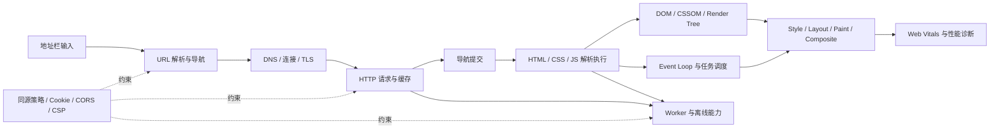

# 浏览器面试题：先搭一条主线，再补细节

> 技术基线：2026 年 8 月。涉及浏览器内部实现时，默认以 Chromium 的公开架构为例；Web 标准语义以 WHATWG、W3C、RFC 和 MDN 为准。

浏览器题最容易陷入两个极端：要么背一串名词，要么从 DNS 一路讲到 GPU，讲了十分钟还没回答问题。更稳的方式是先建立一条因果链：**导航找到资源，缓存决定要不要请求，解析和执行生成页面，事件循环安排工作，渲染流水线把结果送到屏幕，性能工具再验证每一段。**

这套文档不是题库堆砌，而是一份可以反复回到主线的复习地图。

## 1. 一张图看懂整套知识

你可以把面试追问理解成在这张图上不断放大：

- “输入 URL 后发生了什么”考的是全链路；
- “为什么 CSS 会影响首屏”是在放大解析与渲染；
- “Promise 为什么比定时器先执行”是在放大 Event Loop；
- “刷新后为什么还是旧资源”是在放大缓存、Service Worker 和发布策略；
- “页面看起来加载快，但点按钮卡”是在放大 INP、长任务与主线程竞争。

## 2. 推荐阅读路线

### 路线 A：准备面试，只剩 1 天

1. 先读[网络与导航](./browser-network-navigation.md)中的“从 URL 输入到页面展现”；
2. 读[浏览器缓存](./browser-cache.md)的决策树和刷新差异；
3. 读[渲染流水线](./browser-rendering-pipeline.md)的阻塞关系；
4. 读[进程与 Event Loop](./browser-process-event-loop.md)的任务顺序；
5. 最后读[性能实战](./browser-performance-practice.md)的 5 个场景题。

### 路线 B：想真正补齐浏览器基础

按下面顺序读：

1. [网络与导航](./browser-network-navigation.md)
2. [缓存](./browser-cache.md)
3. [存储与安全](./browser-storage-and-security.md)
4. [渲染流水线](./browser-rendering-pipeline.md)
5. [进程、线程与 Event Loop](./browser-process-event-loop.md)
6. [Worker 与离线](./browser-workers-and-offline.md)
7. [性能诊断与优化](./browser-performance-practice.md)

这个顺序不是按 API 分类，而是按页面真实发生的先后关系安排。

## 3. 题目优先级

### P0：高频主干，必须能讲清楚

- 从 URL 输入到页面展现的全过程；
- 强缓存、协商缓存、刷新与资源指纹；
- Cookie、LocalStorage、SessionStorage、IndexedDB 的区别；
- DOM、CSSOM、Render Tree 和关键渲染路径；
- `async`、`defer`、module script 的执行差异；
- 回流、重绘、合成，以及如何定位掉帧；
- 浏览器多进程架构，渲染进程里有哪些线程；
- task、microtask、`requestAnimationFrame` 的顺序；
- Web Worker 和 Service Worker 的区别；
- LCP、INP、CLS 分别反映什么问题。

### P1：中高级追问，经常用来拉开差距

- HTTP/2 与 HTTP/3 解决了什么，没有解决什么；
- BFCache 和 HTTP Cache 为什么不是一回事；
- `Cache-Control: no-cache` 为什么不是“不缓存”；
- Cookie 的 `SameSite`、`HttpOnly`、`Secure`、`Partitioned`；
- CORS 能不能防 CSRF，CSP 能不能替代输入校验；
- preload scanner 为什么不能完全解决脚本阻塞；
- 微任务过多为什么会延迟渲染；
- 结构化克隆与 Transferable 的差别；
- 如何从 Performance 面板证明是 JavaScript、Layout 还是 Paint 慢。

### P2：知道边界，不必背实现细节

- Chromium 的 Site Isolation 与进程复用；
- QPACK、QUIC 连接迁移、0-RTT 的限制；
- Storage Partitioning 的浏览器实现差异；
- 合成层拆分策略与 GPU 内存成本；
- `notRestoredReasons`、Long Animation Frames 等诊断 API 的兼容边界。

## 4. 核心题怎么回答才不散

以“从 URL 输入到页面展现”为例，建议准备三档答案。

### 30 秒版：先把骨架说出来

> 浏览器先判断输入是搜索词还是 URL，完成 URL 规范化并发起导航。随后经过缓存检查、DNS、连接建立和 TLS，发送 HTTP 请求。收到响应后，浏览器进程把导航提交给合适的渲染进程；渲染进程解析 HTML 和 CSS，执行 JavaScript，构建渲染树，再经过样式计算、布局、绘制、光栅化和合成把页面显示出来。过程中还会受到重定向、Service Worker、HTTP Cache、资源优先级和主线程长任务影响。

这段话的价值不是“面面俱到”，而是让面试官知道你有完整地图。

### 3～5 分钟版：沿关键转折展开

只展开有因果关系的节点：

1. 输入与导航：搜索词 / URL 分流，当前页面是否允许离开；
2. 网络：DNS、连接复用、TCP + TLS 或 QUIC、HTTP 版本；
3. 响应处理：重定向、缓存、Content-Type、安全策略；
4. 导航提交：浏览器进程与渲染进程协作；
5. 解析执行：DOM、CSSOM、脚本阻塞、子资源发现；
6. 渲染：style、layout、paint、raster、composite；
7. 可交互：首屏出现不代表主线程已经空闲。

### 高级版：让追问自然落地

不要主动背所有底层细节，而是给出可以继续追问的“钩子”：

- 如果连接可复用，就不一定重新做 DNS、TCP 和 TLS；
- HTTP/3 基于 QUIC，不再是“TCP 三次握手之后再 TLS”；
- 缓存并不只发生一次，导航请求和子资源各自有缓存决策；
- HTML 到达后可以流式解析，不必等完整响应结束；
- 页面首次绘制、LCP 出现和真正可交互是三个不同时间点；
- 历史导航命中 BFCache 时，整条常规加载链可能被跳过。

完整版见[从 URL 输入到页面展现](./browser-network-navigation.md#2-核心题从-url-输入到页面展现)。

## 5. 快速判断题

### “浏览器是多线程的吗？”

是，但这句话不够完整。现代浏览器通常是**多进程 + 每个进程内部多线程**。页面 JavaScript 通常在渲染进程的主线程执行，但网络、合成、光栅化、Worker 等工作可能位于其他线程或进程。具体进程数量是实现策略，不要说“一个标签页永远对应一个进程”。

### “CSS 会阻塞 DOM 构建吗？”

通常不会阻止 HTML parser 继续生成 DOM，但样式表会影响渲染，并可能间接推迟脚本执行：经典同步脚本可能需要等待前面尚未加载完成的样式表，因为脚本可能读取样式信息。详细边界见[资源阻塞关系](./browser-rendering-pipeline.md#4-css-和-javascript-到底阻塞什么)。

### “`localStorage` 能放 Token 吗？”

技术上能，安全上要看威胁模型。`localStorage` 可被同源 JavaScript 读取，一旦发生 XSS，Token 容易被窃取；`HttpOnly` Cookie 不能被 JavaScript 读取，但要同时处理 CSRF、SameSite、会话失效等问题。不存在脱离业务边界的万能答案。

### “Promise 一定比 `setTimeout` 先执行吗？”

在同一轮同步代码结束后，已入队的 Promise reaction 属于 microtask，通常会在下一次 task（如定时器回调）前执行。但比较的前提是它们已经按预期入队；网络、嵌套事件循环、不同 agent 或未完成的异步操作不能靠这句话概括。

### “用了 HTTP/2 就不需要合并请求了吗？”

不能这么绝对。HTTP/2 的多路复用降低了大量连接带来的成本，但请求头、调度、服务端处理、缓存粒度和资源优先级仍有成本。更常见的做法是让构建工具按路由和缓存边界拆包，而不是把所有资源合成一个巨型文件。

## 6. 面试表达的几个小技巧

1. **先限定范围。** 例如：“下面以 Chromium 的公开架构为例。”
2. **先说结论，再说原因。** 不要用背景知识淹没答案。
3. **区分标准和实现。** Event Loop 有标准模型，Memory Cache / Disk Cache 的具体分层更多是实现细节。
4. **把优化说成验证闭环。** “我会先录 Performance trace，看长任务和 Layout，再决定拆任务还是改 DOM。”比“少操作 DOM”更可信。
5. **承认边界。** 浏览器策略会变化，涉及配额、进程数量、存储分区和 BFCache 资格时，不要背死数字。

## 7. 专题导航

| 专题 | 解决的问题 | 最值得记住的一句话 |
|---|---|---|
| [网络与导航](./browser-network-navigation.md) | URL、DNS、TLS、HTTP、导航提交 | URL 全流程不是固定八步，而是一棵会被缓存、复用和 BFCache 改写的决策树 |
| [缓存](./browser-cache.md) | 新鲜度、验证、刷新、发布 | `no-cache` 是“可存但使用前验证”，`no-store` 才是“不应存储” |
| [存储与安全](./browser-storage-and-security.md) | Cookie、Web Storage、IndexedDB、安全边界 | 存储选型先看谁要读、存多久、数据多大、能否承受 XSS / CSRF |
| [渲染流水线](./browser-rendering-pipeline.md) | 解析、阻塞、布局、绘制、合成 | DOM 改动是否昂贵，要看它触发了流水线的哪一段 |
| [进程与 Event Loop](./browser-process-event-loop.md) | 多进程、线程、任务与帧 | 微任务优先不代表可以无限排微任务，渲染也需要拿回主线程 |
| [Worker 与离线](./browser-workers-and-offline.md) | 并行计算、跨页共享、请求代理 | Worker 解决的不是同一个问题：Web Worker 算，SharedWorker 共享，Service Worker 代理网络 |
| [性能实践](./browser-performance-practice.md) | 指标、定位、优化、复验 | 不从 trace 和用户指标出发的优化，大概率只是经验猜测 |
| [原题去向](./source-question-map.md) | 原文保留、合并、修正、降级 | 可以追溯每个原始区段为什么被这样处理 |

## 参考资料

- [WHATWG HTML：Web application APIs](https://html.spec.whatwg.org/multipage/webappapis.html)
- [MDN：How browsers work](https://developer.mozilla.org/en-US/docs/Web/Performance/Guides/How_browsers_work)
- [Chromium：Multi-process Architecture](https://www.chromium.org/developers/design-documents/multi-process-architecture/)
- [web.dev：Learn performance](https://web.dev/learn/performance/)
