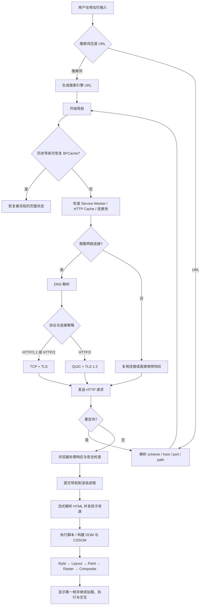

# 浏览器网络与导航：从地址栏到第一帧

“从 URL 输入到页面展现”是浏览器题里最经典的一道。原答案常被背成 DNS、TCP、HTTP、渲染几步，但真实浏览器不会每次都完整走一遍：连接可能复用，资源可能命中缓存，Service Worker 可能接管请求，后退时甚至可能直接恢复 BFCache 快照。

所以更准确的理解是：**它不是固定流水账，而是一棵带短路分支的决策树。**

## 1. 全链路总览



这张图省略了很多实现细节，但保留了面试最重要的转折：是否短路、连接怎么建、响应如何提交、渲染何时开始。

## 2. 核心题：从 URL 输入到页面展现

### 2.1 30 秒回答

> 浏览器先判断输入是搜索词还是 URL，解析并规范化 URL 后发起导航。接着根据 Service Worker、HTTP Cache 和连接池决定是否需要访问网络；需要时完成 DNS，复用或建立 TCP + TLS / QUIC 连接并发送 HTTP 请求。响应经过重定向、类型和安全检查后，浏览器进程把导航提交给渲染进程。渲染进程流式解析 HTML，加载 CSS 和 JavaScript，构建 DOM、CSSOM 和渲染树，再经过样式计算、布局、绘制、光栅化和合成显示页面。历史导航若命中 BFCache，可能直接恢复整页状态。

### 2.2 3～5 分钟回答

#### 第一步：输入处理与导航启动

浏览器先处理地址栏文本：

- 如果像搜索词，就按默认搜索引擎规则生成搜索 URL；
- 如果是 URL，就解析 scheme、host、port、path、query、fragment，并做必要的编码与规范化；
- 当前页面可能触发 `beforeunload`。它不应该被无条件注册，因为它既不可靠，也可能影响页面生命周期优化；
- 浏览器进程创建一次导航，UI 显示 loading 状态。

`#fragment` 的变化通常是同文档导航，不一定重新请求主文档；`history.pushState()` 也不会天然触发文档请求。这是常见追问。

#### 第二步：先看能不能绕开完整网络链路

浏览器可能检查或利用：

- 已存在且可复用的连接；
- HTTP Cache 中的新鲜响应；
- 控制当前页面的 Service Worker；
- DNS 缓存、连接预热结果；
- 历史导航对应的 BFCache 页面快照。

这里不要说“浏览器一定先查强缓存，再 DNS”。缓存、Service Worker、网络服务的内部调度属于实现细节，而且主文档与子资源会分别决策。面试中把它说成“在 Fetch / 网络栈中按请求上下文做缓存与拦截决策”更稳。

#### 第三步：DNS 把主机名解析成可连接地址

DNS 只负责域名相关解析，不解析 URL 端口。端口来自 URL 显式指定或 scheme 默认值，例如 HTTPS 通常默认 443。

解析可能涉及浏览器缓存、操作系统缓存、本地 hosts、递归解析器和权威 DNS。现代客户端还可能使用 DoH（DNS over HTTPS）。最终结果不一定只有一个 IPv4 地址，也可能有 IPv6、HTTPS / SVCB 记录等信息。

项目优化不要只会说 `dns-prefetch`：

```html
<!-- 仅提前解析域名，适合确定会访问但还不急着建连接的第三方域名 -->
<link rel="dns-prefetch" href="//static.example.com" />

<!-- 提前完成 DNS、连接和可能的 TLS，收益更大，资源消耗也更高 -->
<link rel="preconnect" href="https://api.example.com" crossorigin />
```

预连接不是越多越好。它会占用 socket、CPU 和网络资源，只应该给关键且高概率使用的 origin。

#### 第四步：建立或复用连接

对常见 HTTPS 请求，可以分成两类理解：

| 协议 | 传输基础 | 建连重点 |
|---|---|---|
| HTTP/1.1 | TCP，通常再叠加 TLS | 请求复用受限，浏览器常用多个连接提高并发 |
| HTTP/2 | TCP + TLS（浏览器常见部署） | 二进制分帧、多路复用、HPACK；TCP 丢包仍会影响同连接上的流 |
| HTTP/3 | QUIC over UDP，集成 TLS 1.3 握手 | 多个 QUIC stream 独立推进，连接层不再依赖 TCP |

如果已有可复用连接，就不一定重新做 DNS、TCP 和完整 TLS。HTTP/2 / HTTP/3 还可能在满足证书、DNS 和源合并规则时复用连接，但不要把它理解成任意域名都能共用。

##### 为什么 TCP 是三次握手？

面试回答抓住两个点：

1. 双方都要确认自己的发送、接收能力和对方的初始序列号；
2. 第三次确认让服务端知道客户端已经收到服务端的 SYN，避免仅靠两次交互留下不可靠的半开状态。

“四次能不能？”协议设计上当然可以增加交互，但没有必要，三次已经满足 TCP 建连需要；多一次只会增加延迟。

##### TLS 做了什么？

TLS 不是简单“交换一个对称密钥”。握手大致完成：

- 协商协议版本、密码套件和扩展；
- 服务端发送证书链，客户端验证域名、有效期、签名和信任链；
- 双方通过密钥交换导出会话密钥；
- 后续应用数据使用对称加密并提供完整性保护；
- ALPN 可协商 `h2`、`http/1.1` 或 HTTP/3 使用的 `h3`。

不要背“HTTPS 一定比 HTTP 多两个 RTT”这种固定数字。TLS 1.3、会话恢复、QUIC、连接复用都会改变握手成本。

#### 第五步：发送 HTTP 请求，处理响应与重定向

请求中常见信息包括方法、目标、请求头、Cookie 和请求体。响应包含状态码、响应头和响应体。

```http
GET /products/42 HTTP/1.1
Host: shop.example.com
Accept: text/html,application/xhtml+xml
Accept-Encoding: gzip, br
Cookie: session=...
```

浏览器拿到响应后不会只看 `200`：

- `301`、`302`、`303`、`307`、`308` 可能触发新导航；
- `304` 表示可以复用本地缓存的响应体，不是“服务器返回一个空页面”；
- `Content-Type` 帮助浏览器判断如何处理内容；
- `Content-Encoding` 决定解压方式；
- CSP、CORP、COOP、COEP、X-Content-Type-Options 等策略可能改变加载或隔离行为；
- `Set-Cookie` 会受 Cookie 属性和第三方 Cookie 策略约束。

重定向会重新进入 URL 处理和请求决策。过长的重定向链会消耗往返时间，也可能让预连接和缓存策略失效。

#### 第六步：提交导航

以 Chromium 的公开架构来讲，浏览器进程负责导航协调，网络服务处理网络请求。确定响应是一个可展示文档后，浏览器选择或创建合适的渲染进程，把响应数据和导航信息交给它。随后更新地址栏、历史记录、页面安全状态，并让旧文档退出或进入 BFCache。

这里的关键边界：

- “收到第一个字节”不等于“导航已经提交”；
- “一个标签页一个渲染进程”不是永久规则，Site Isolation、iframe、进程复用和资源压力都会影响分配；
- 浏览器进程与渲染进程通过 IPC 协作，不是 JavaScript 直接调用网络进程。

#### 第七步：解析 HTML，加载子资源

HTML 可以流式到达并流式解析。主线程上的 HTML parser 生成 token 和 DOM 节点；preload scanner（预加载扫描器）会尽量提前发现 `img`、`link`、`script` 等资源，减少必须等 DOM 构建到对应位置才发请求的延迟。

但 preload scanner 不是魔法：

- JavaScript 动态拼出的 URL 可能无法提前发现；
- CSS 中更深层的资源要等样式表到达后才能发现；
- 发现资源不代表它会立刻高优先级下载；
- 同步脚本仍可能暂停 parser。

解析和渲染细节见[浏览器渲染流水线](./browser-rendering-pipeline.md)。

#### 第八步：生成帧并显示

渲染进程完成 DOM、CSSOM 和样式计算后，确定元素几何信息，生成绘制记录，进行光栅化并合成图层。第一帧出现后，图片、字体、异步脚本和接口数据仍可能继续改变页面。

所以要区分：

- FCP：页面第一次绘制内容；
- LCP：视口内主要内容完成绘制的时间；
- `DOMContentLoaded`：DOM 解析完成并考虑 defer / module 等脚本后的事件；
- `load`：文档及依赖资源加载完成；
- 可交互：用户输入能否快速得到下一帧反馈，不能由 `load` 单独代表。

### 2.3 高级追问版：把短路分支讲清楚

#### 追问 1：缓存发生在哪个阶段？

更准确的说法是：**每个 fetch 都可能经过缓存决策，而不是整个页面只检查一次。** 主文档导航、CSS、JS、图片、接口请求都有自己的请求上下文和缓存键。Service Worker Cache 与 HTTP Cache 也是两套机制。详见[浏览器缓存](./browser-cache.md)。

#### 追问 2：HTTP/2 和 HTTP/3 的核心区别是什么？

HTTP/2 在一个 TCP 连接上用 stream 多路复用，但 TCP 仍要求连接级有序字节流；底层丢包时，多个 HTTP/2 stream 的交付可能一起等待。HTTP/3 把 HTTP 语义映射到 QUIC stream，丢包通常只阻塞受影响 stream 的有序数据。

注意两点：

- HTTP/3 不是“不再丢包”或“完全没有队头阻塞”，单个 stream 内仍需有序，QPACK 等机制也有自己的阻塞权衡；
- HTTP/3 使用 UDP 只是承载方式，QUIC 自己实现了可靠传输、拥塞控制、流控和安全握手。

#### 追问 3：为什么后退有时瞬间恢复？

可能命中 BFCache。它保留的是被冻结的完整页面状态，包括 DOM 和 JavaScript heap，而不是只缓存响应体。恢复时可通过 `pageshow` 的 `persisted` 判断：

```js
window.addEventListener('pageshow', (event) => {
  if (event.persisted) {
    // 页面从 BFCache 恢复，旧的内存状态还在；此时按业务需要刷新易过期数据
    refreshPriceIfNeeded();
  }
});
```

BFCache 资格和淘汰条件有浏览器差异，不要再背“只要有 `unload` / `no-store` 就绝对不能进入”的旧版清单。应该用 DevTools 的 BFCache 检查器和 `notRestoredReasons`（在支持的浏览器中）验证。

#### 追问 4：页面关闭连接为什么不是每次都四次挥手？

因为连接通常会持久化并复用，HTTP/2 / HTTP/3 更不会“一次请求结束就关连接”。真正关闭时，TCP 的全双工方向需要分别结束，才会出现常说的四次挥手；但抓包还可能看到合并 ACK、RST、超时回收等不同路径。HTTP/3 使用 QUIC，也不套用 TCP 四次挥手。

## 3. URL、Origin 和 Site 别混在一起

```text
https://shop.example.com:443/products?id=42#reviews
│       │                │   │          │
│       host             port path       fragment
scheme
```

- URL 描述资源位置；
- Origin（源）通常由 scheme + host + port 组成；
- Site（站点）是 Cookie、SameSite、存储分区等规则中的另一层概念，通常围绕 schemeful registrable domain；
- fragment 不发送给服务器，由客户端处理；
- DNS 解析 host，不解析 path、query 或 port。

## 4. 一段可以运行的导航观察代码

### 验证目标

观察当前页面属于哪种导航类型，并区分普通加载与 BFCache 恢复。

```js
const [navigation] = performance.getEntriesByType('navigation');

if (navigation) {
  console.table({
    // navigate、reload、back_forward 等值用于判断本次文档导航类型
    type: navigation.type,
    // responseStart - requestStart 可粗略观察等待首字节阶段，不能直接等同于纯服务端耗时
    requestToFirstByte: navigation.responseStart - navigation.requestStart,
    // domContentLoadedEventEnd 是事件完成时刻，不等于页面已经完全可交互
    domContentLoaded: navigation.domContentLoadedEventEnd,
    loadEventEnd: navigation.loadEventEnd,
  });
}

window.addEventListener('pageshow', (event) => {
  console.log(
    event.persisted
      ? '本次页面从 BFCache 恢复'
      : '本次页面经历了常规加载或未命中 BFCache',
  );
});
```

### 运行方式

在任意 HTTPS 页面 DevTools Console 中执行，然后刷新、跳转到同站点另一页再后退，比较输出。是否命中 BFCache 取决于页面和浏览器，不命中时使用 DevTools 的 BFCache 面板查看原因。

## 5. 常见误区

1. **“每次访问都按 DNS → TCP → TLS 顺序重走。”** 忽略了缓存、连接复用、预连接、Service Worker 和 BFCache。
2. **“HTTP/3 是基于 TCP 的新版 HTTP。”** HTTP/3 基于 QUIC，QUIC 通常承载在 UDP 上。
3. **“拿到 HTML 后浏览器才开始解析。”** HTML 可以边到达边解析。
4. **“页面显示出来就加载完成了。”** 首次绘制之后仍可能有资源、脚本和任务影响交互。
5. **“端口也由 DNS 解析。”** 普通 URL 的端口来自 URL 或 scheme 默认值。
6. **“304 没有用缓存。”** 304 正是协商后复用本地响应体。
7. **“一个 tab 永远对应一个 renderer process。”** 这是过度简化。

## 6. 项目里怎么用这条链路定位问题

### 首屏慢

先在 Network 看：

- 是否有重定向链；
- DNS、连接、TLS 和 TTFB 哪段长；
- 主文档是否被错误缓存或不缓存；
- LCP 资源何时被发现、优先级是否足够；
- 是否被同步脚本和关键 CSS 卡住。

再到 Performance 看主线程：HTML 到达后是否被长任务、样式计算或布局拖住。

### 接口偶发慢

不要只看“后端耗时”。区分：排队、DNS、连接、TLS、上传、Waiting (TTFB)、下载，以及浏览器主线程什么时候真正处理响应。HTTP/2 / HTTP/3 下多个请求还会共享连接级资源和拥塞窗口。

### 用户说返回上一页后数据旧

这可能不是缓存头问题，而是 BFCache 恢复了旧页面状态。监听 `pageshow`，只对确实需要新鲜度的数据做轻量刷新，不要粗暴 `location.reload()` 破坏返回体验。

## 参考资料

- [WHATWG HTML：Loading web pages](https://html.spec.whatwg.org/multipage/browsing-the-web.html)
- [WHATWG URL Standard](https://url.spec.whatwg.org/)
- [RFC 9110：HTTP Semantics](https://www.rfc-editor.org/rfc/rfc9110)
- [RFC 9113：HTTP/2](https://www.rfc-editor.org/rfc/rfc9113)
- [RFC 9000：QUIC](https://www.rfc-editor.org/rfc/rfc9000)
- [RFC 9114：HTTP/3](https://www.rfc-editor.org/rfc/rfc9114)
- [Chromium：Inside look at modern web browser](https://developer.chrome.com/blog/inside-browser-part1)
- [Chrome Developers：Page Lifecycle API](https://developer.chrome.com/docs/web-platform/page-lifecycle-api)
