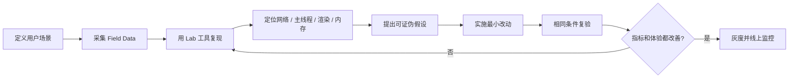

# 浏览器性能实战：从指标到证据，再到复验

性能优化不是“压缩、缓存、懒加载”三个词。更可靠的流程是：

```text
用户问题 → 指标量化 → 工具复现 → 找到瓶颈阶段 → 最小改动 → 同条件复验 → 线上监控
```

如果没有测量和复验，很多优化只是把成本从一个地方挪到另一个地方。

## 1. 性能闭环



### Field 与 Lab 要一起用

- **Field data（真实用户数据）**：真实设备、网络、地域和用户行为，适合看分位数和长期趋势；
- **Lab data（实验室数据）**：环境可控、能录 trace 和反复对比，适合定位原因。

Lighthouse 得分不是用户体验本身；本地 Mac 上流畅也不代表中低端 Android 流畅。

## 2. Core Web Vitals

截至 2026 年 8 月，核心用户体验指标仍主要看 LCP、INP、CLS。常用“良好”阈值应在页面 / origin 的第 75 百分位评估：

| 指标 | 关注点 | 良好 | 常见问题 |
|---|---|---:|---|
| LCP | 最大主要内容何时显示 | ≤ 2.5s | TTFB 慢、资源发现晚、图片慢、CSS / JS 阻塞、渲染延迟 |
| INP | 交互到下一帧呈现的延迟 | ≤ 200ms | 主线程长任务、事件处理重、同步布局、框架渲染范围大 |
| CLS | 页面生命周期内意外布局位移 | ≤ 0.1 | 图片无尺寸、动态插入、字体切换、广告位无占位 |

阈值用于体验分类，不是“达到 2.49 秒就不用优化”。还要结合业务转化、设备分布和竞争环境。

### 2.1 LCP 拆解

可以把 LCP 粗略拆为：

```text
TTFB
+ resource load delay
+ resource load duration
+ element render delay
```

- TTFB 长：服务端、CDN、重定向、连接阶段；
- load delay 长：浏览器太晚发现 LCP 资源，常见于 CSS 背景图、JS 动态插入、错误懒加载；
- load duration 长：资源过大、网络慢、优先级低；
- render delay 长：主线程忙、CSS 未就绪、图片解码或元素被隐藏。

### 2.2 INP 不是只看事件函数

一次交互可以拆成：

```text
Input delay → Event processing → Presentation delay
```

- Input delay：输入到 handler 开始，通常被前面的 task 卡住；
- Processing：事件回调和其同步 / 微任务工作；
- Presentation delay：样式、布局、绘制和下一帧等待。

所以 handler 只运行 20ms，也可能有 300ms INP：前面排了 150ms 长任务，后面又触发大布局。

### 2.3 CLS

只看“页面抖不抖”还不够。CLS 会按布局位移 session window 聚合，用户主动交互后的某些预期变化不计入同样的意外位移逻辑。常见修复：

```css
.hero-image {
  width: 100%;
  /* 资源未返回前就保留几何空间 */
  aspect-ratio: 16 / 9;
}

.ad-slot {
  /* 按广告可能尺寸预留，避免内容加载后把正文整体推开 */
  min-height: 250px;
}
```

## 3. 在页面中采集指标

生产项目更推荐使用经过维护的 `web-vitals` 库，下面的原生 API 示例用于理解边界：

```js
function observePerformance(type, callback) {
  if (!PerformanceObserver.supportedEntryTypes?.includes(type)) return;

  const observer = new PerformanceObserver((list) => {
    for (const entry of list.getEntries()) callback(entry);
  });

  observer.observe({ type, buffered: true });
}

observePerformance('largest-contentful-paint', (entry) => {
  console.log('LCP candidate', entry.startTime, entry.element);
});

observePerformance('layout-shift', (entry) => {
  if (!entry.hadRecentInput) {
    // 生产上需要按 CLS session window 聚合，不能简单把全生命周期所有值直接相加
    console.log('Unexpected layout shift', entry.value, entry.sources);
  }
});

document.addEventListener('visibilitychange', () => {
  if (document.visibilityState === 'hidden') {
    // 页面隐藏时使用 sendBeacon 上报，减少卸载阶段阻塞
    navigator.sendBeacon('/rum', JSON.stringify({ type: 'page-hidden' }));
  }
});
```

注意：

- entry 支持范围要检测；
- SPA 软导航、iframe、后台页面和 BFCache 恢复要单独设计会话边界；
- 不要上报完整 URL query、DOM 文本或用户输入，避免隐私泄露；
- 指标必须带版本、路由、设备、网络和实验分组，否则无法归因。

## 4. DevTools 三板斧

### Network

看加载链：

- Queueing / Stalled；
- DNS、Initial connection、SSL；
- Request sent、Waiting (TTFB)、Content Download；
- Priority、Initiator、是否命中 memory / disk cache；
- 响应压缩、缓存头、重定向；
- LCP 资源何时被发现。

### Performance

看主线程和帧：

- Long Task；
- Scripting、Recalculate Style、Layout、Paint；
- forced reflow；
- interactions 和 Event Timing；
- screenshots 与视觉变化；
- raster / compositor 工作。

### Memory

看增长和保留：

- Heap snapshot 对比；
- Allocation instrumentation on timeline；
- detached DOM tree；
- listener、timer、closure、缓存 Map 的 retaining path；
- JS heap 是否在 GC 后回落。

## 5. 资源提示：不是越多越好

| 能力 | 目的 | 适合 | 风险 |
|---|---|---|---|
| `dns-prefetch` | 提前 DNS | 低成本准备第三方域名 | 收益有限，隐私 / 策略可能限制 |
| `preconnect` | 提前 DNS + 连接 + TLS | 高概率关键 origin | 连接资源浪费 |
| `preload` | 当前导航高优先级获取资源 | 关键字体、LCP 图片、关键脚本 | `as` / `crossorigin` 错误会重复下载；滥用抢带宽 |
| `modulepreload` | 提前获取模块及依赖 | ESM 关键模块图 | 要和构建产物、跨源设置匹配 |
| `prefetch` | 为未来导航低优先级准备 | 高概率下一页资源 | 可能浪费流量，浏览器可忽略 |
| `prerender` | 提前加载并渲染未来页面 | 极高概率且副作用可控的导航 | 资源和隐私成本高，页面必须适配生命周期 |

示例：

```html
<!-- 关键 LCP 图像当前页一定会用，preload 的 URL、类型和跨源属性必须与真正请求一致 -->
<link
  rel="preload"
  as="image"
  href="/hero-1280.avif"
  type="image/avif"
  fetchpriority="high"
/>

<!-- 字体预加载必须声明 font 类型和 crossorigin，否则可能无法复用 -->
<link
  rel="preload"
  as="font"
  href="/fonts/app.woff2"
  type="font/woff2"
  crossorigin
/>
```

## 6. 代码、图片和 CSS 优化要围绕关键路径

### JavaScript

- route-level code splitting，避免首屏加载整站代码；
- 删除无用 polyfill 和重复依赖；
- 延后非关键第三方脚本；
- 把大计算放 Worker 或切片；
- 减少 hydration / framework rendering 的范围；
- 对输入响应优先提交必要 UI，次要工作后置。

动态 import：

```js
button.addEventListener('click', async () => {
  // 只有用户进入编辑流程时才下载编辑器，降低首屏脚本解析和执行成本
  const { openEditor } = await import('./editor.js');
  openEditor();
});
```

代码拆分不是越碎越好。碎片过多会增加请求、模块解析、调度和缓存管理成本，要按路由、功能和长期缓存边界拆。

### 图片

- 选 AVIF / WebP 等合适格式，并保留兼容回退；
- 提供响应式尺寸，避免手机下载桌面大图；
- 非首屏图片 lazy loading；
- 首屏 LCP 图片不要错误懒加载；
- 设置尺寸避免 CLS；
- CDN 变换要把格式、尺寸和质量纳入缓存键。

```html
<picture>
  <!-- 浏览器按格式支持和视口尺寸选择资源，避免移动端下载桌面大图 -->
  <source
    type="image/avif"
    srcset="/hero-640.avif 640w, /hero-1280.avif 1280w"
  />
  <source
    type="image/webp"
    srcset="/hero-640.webp 640w, /hero-1280.webp 1280w"
  />
  
</picture>
```

### CSS

- 内联极少量真正关键 CSS，避免把整站样式塞进 HTML；
- 删除未使用 CSS，按页面拆分；
- 控制 DOM 规模和样式失效范围；
- 动画优先使用可合成属性，但验证图层成本；
- 用 containment / virtualization 隔离复杂区域。

## 7. BFCache：最快的页面是不用重建的页面

前进 / 后退命中 BFCache 时，浏览器恢复完整页面状态。优化重点不是“预缓存 HTML”，而是避免不必要地破坏资格，并正确处理恢复：

```js
window.addEventListener('pageshow', (event) => {
  if (!event.persisted) return;

  // 内存中的 UI 会被恢复，但价格、权限等数据可能已经过期
  revalidateTimeSensitiveData();
});

window.addEventListener('pagehide', () => {
  // pagehide 比 unload 更适合页面生命周期清理；不要假设每次都一定触发
  pauseExpensivePolling();
});
```

不要依赖 `unload` 做可靠上报，优先 `visibilitychange` + `sendBeacon`。BFCache 不命中时，用浏览器工具和 `notRestoredReasons`（若支持）确认原因，不用旧清单猜。

## 8. 场景题 1：首屏慢

### 回答框架

> 我先确认慢的是 TTFB、LCP 资源下载，还是资源到达后的主线程渲染。Network 看重定向、连接、主文档和 LCP 请求；Performance 看 HTML 到达后是否被长脚本、CSS 或 Layout 卡住。然后只针对最大阶段改动，并用相同设备和网络复验 LCP 分解。

### 常见证据与改动

| 证据 | 可能原因 | 改动 |
|---|---|---|
| TTFB 长 | 服务端慢、缓存 miss、跨区、重定向 | CDN / edge cache、服务端 profiling、去重定向 |
| LCP 请求很晚才开始 | CSS 背景图、JS 动态插入、错误 lazy | 让资源出现在 HTML、preload、提高优先级 |
| 下载快但 LCP 很晚 | 主线程长任务、CSS 阻塞、隐藏动画 | 拆 JS、减少 hydration、优化关键 CSS |
| 资源特别大 | 图片尺寸 / 格式错误 | 响应式图片、压缩、CDN 变换 |

## 9. 场景题 2：点击按钮卡

### 定位

1. Performance 录制一次点击；
2. 看 input delay 是否被前置长任务占用；
3. 展开事件 handler；
4. 检查微任务、框架 commit、同步 layout；
5. 看下一帧是否被 paint / raster 拖慢。

### 优化

- 先更新按钮反馈，再做非关键工作；
- 拆分超过一帧预算的计算；
- 降低状态更新影响范围；
- 避免事件后立刻读写交错；
- 计算移到 Worker；
- 第三方脚本延迟或隔离。

```js
button.addEventListener('click', async () => {
  button.disabled = true;
  button.textContent = '处理中…';

  // 先让浏览器有机会呈现反馈，再开始可延后的重计算
  await new Promise((resolve) => requestAnimationFrame(resolve));
  await runExpensiveWorkInWorker();

  button.textContent = '完成';
  button.disabled = false;
});
```

这段代码只是改善反馈时机；真正的大计算仍应离开主线程或拆分，不能用一个 rAF 隐藏问题。

## 10. 场景题 3：滚动掉帧

先判断：

- scroll handler 是否同步做大计算；
- 是否频繁读取布局并写样式；
- sticky / fixed、阴影、滤镜是否造成大面积重绘；
- 图片是否边滚边解码；
- DOM 是否过大；
- 主线程是否被其他 task 占用。

```js
let ticking = false;

window.addEventListener(
  'scroll',
  () => {
    if (ticking) return;
    ticking = true;

    requestAnimationFrame(() => {
      ticking = false;
      // 每帧最多做一次轻量视觉更新；不要在这里遍历几千个节点
      progress.style.transform = `scaleX(${getScrollProgress()})`;
    });
  },
  { passive: true },
);
```

`passive: true` 主要帮助浏览器知道 handler 不会取消滚动，并不自动让 handler 变快。

## 11. 场景题 4：发布后用户一直看到旧内容

按层排查：

1. HTML 是否长期强缓存；
2. JS / CSS 是否有内容 hash；
3. CDN 缓存键和 purge 是否正确；
4. Service Worker 是否 Cache First 永不更新；
5. 新旧 chunk 是否共存；
6. 用户是 BFCache 恢复还是重新导航；
7. 接口缓存和页面静态资源缓存是否混为一谈。

处理原则见[浏览器缓存](./browser-cache.md#7-发布策略为什么文件名加哈希比清缓存靠谱)和[Service Worker 更新](./browser-workers-and-offline.md#53-skipwaiting-为什么不能无脑用)。

## 12. 场景题 5：页面用久了内存一直涨

### 不要只盯着任务管理器数字

浏览器可能保留已分配堆、图片、GPU 资源和缓存，任务管理器不立即下降不等于泄漏。判断泄漏要看：重复执行同一操作并 GC 后，某类对象是否持续不可回收。

### 常见来源

- 全局 Map / 数组无上限；
- 未移除的事件监听和观察器；
- 定时器 / rAF 循环；
- detached DOM 被闭包或第三方库引用；
- 未关闭 WebSocket、BroadcastChannel、Worker；
- 图片 bitmap、canvas、WebGL 资源；
- SPA 路由切换后组件清理不完整。

可取消的组件示例：

```js
function mountSearch(input) {
  const controller = new AbortController();
  let timerId;

  input.addEventListener(
    'input',
    () => {
      clearTimeout(timerId);
      timerId = setTimeout(() => runSearch(input.value), 200);
    },
    { signal: controller.signal },
  );

  return () => {
    // 一个清理入口同时移除监听并停止定时器，降低路由切换后的残留风险
    controller.abort();
    clearTimeout(timerId);
  };
}
```

### 验证流程

1. 记录基线 heap snapshot；
2. 重复进入 / 退出目标页面 5～10 次；
3. 在可控环境触发 GC；
4. 再拍 snapshot，按 constructor 和 retained size 比较；
5. 查看 retaining path 找真正持有者；
6. 修复后重复相同步骤。

## 13. 性能预算比“事后救火”省钱

可在 CI 或发布流程设置：

- 首屏 JavaScript / CSS 体积预算；
- 关键路由 Lighthouse / trace 基线；
- LCP 图片大小和预加载数量；
- 第三方脚本数量；
- 线上 Web Vitals p75 告警；
- 新版本与基线的 statistically meaningful 对比。

预算要按业务页面和设备分层。后台管理页与营销落地页不必用同一套体积上限，但都应有趋势和回归门槛。

## 14. 面试中的常见误区

1. “性能优化就是资源压缩。”——资源到达后还有解析、执行、布局、绘制和交互。
2. “Lighthouse 100 分就完成。”——实验室单次分数不能替代真实用户分位数。
3. “所有图片都 lazy loading。”——LCP 图片被懒加载会更慢。
4. “preload 越多越快。”——它会抢占带宽和优先级。
5. “防抖节流可以解决所有卡顿。”——handler 本身和渲染成本仍可能很高。
6. “内存上涨就是 JS 泄漏。”——还可能是图片、GPU、缓存或堆保留策略，需要证据。
7. “SSR 一定提升 LCP。”——TTFB、HTML 流、CSS、hydration 都可能成为新瓶颈。
8. “平均值不错就行。”——体验指标通常应关注 p75，必要时还看尾部用户。

## 参考资料

- [web.dev：Web Vitals](https://web.dev/articles/vitals)
- [web.dev：Largest Contentful Paint](https://web.dev/articles/lcp)
- [web.dev：Interaction to Next Paint](https://web.dev/articles/inp)
- [web.dev：Cumulative Layout Shift](https://web.dev/articles/cls)
- [Chrome Developers：Performance panel](https://developer.chrome.com/docs/devtools/performance)
- [Chrome Developers：Memory problems](https://developer.chrome.com/docs/devtools/memory-problems)
- [MDN：PerformanceObserver](https://developer.mozilla.org/en-US/docs/Web/API/PerformanceObserver)
- [web.dev：Back/forward cache](https://web.dev/articles/bfcache)
- [MDN：Speculation Rules API](https://developer.mozilla.org/en-US/docs/Web/API/Speculation_Rules_API)
