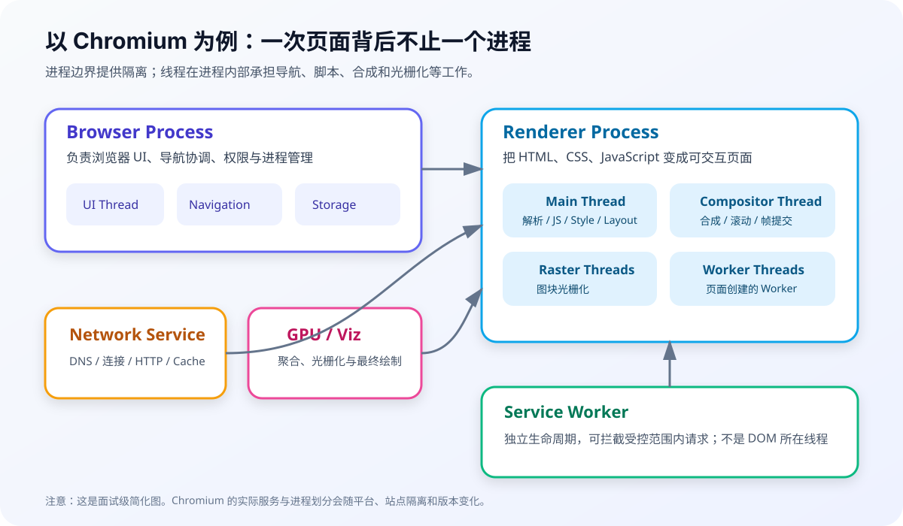
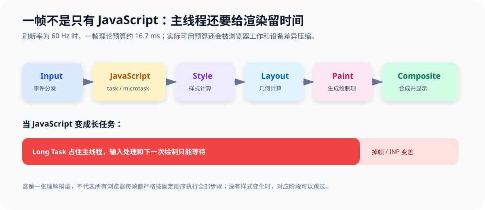
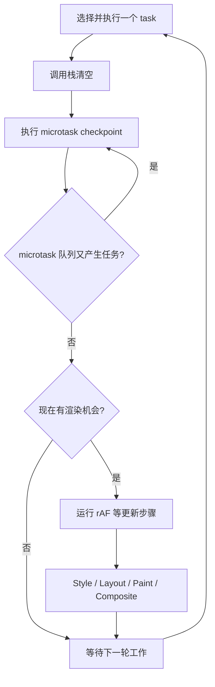

# 浏览器进程、线程与 Event Loop：JavaScript 单线程不等于浏览器单线程

先给结论：

> 现代浏览器通常采用多进程架构，每个进程内部又可以有多个线程。页面 JavaScript 一般在渲染进程主线程执行；网络、合成、光栅化、Worker、存储等工作可以由其他线程或进程处理。Event Loop 决定某个 agent 如何取 task、清 microtask，并在合适的渲染机会更新页面。

下面涉及内部架构的部分，以 Chromium 的公开资料为例。进程数量、线程实现和调度策略都可能随版本、平台和资源压力变化。

## 1. 浏览器多进程架构



常见职责可以这样理解：

| 组件 | 典型职责 | 面试边界 |
|---|---|---|
| Browser process | 地址栏、导航协调、权限、窗口、历史、进程管理 | 不直接执行页面业务 JavaScript |
| Renderer process | HTML / CSS 解析、DOM、JavaScript、布局与绘制准备 | 可能承载一个或多个 frame，不等于永远一个 tab 一个进程 |
| Network service | DNS、连接、TLS、HTTP、缓存等网络能力 | Chromium 中可运行在独立进程，具体形态是实现策略 |
| GPU process | GPU 命令、跨页面图形能力隔离 | 合成与光栅工作不应简单归结为“全在 GPU 进程” |
| Utility processes | 音频、数据解码、存储等沙箱化服务 | 会随平台和版本变化 |

### 为什么要多进程

- 稳定性：单个渲染进程崩溃不必带走整个浏览器；
- 安全性：沙箱与 Site Isolation 降低站点间数据泄露风险；
- 响应性：UI、网络、页面脚本不全部挤在一个执行上下文；
- 资源治理：浏览器可以冻结、丢弃或限制后台页面。

代价是内存、IPC、上下文切换和资源协调成本更高。

## 2. 进程和线程怎么区别

面试不必背操作系统教科书，可以用浏览器场景回答：

- 进程通常拥有独立虚拟地址空间，是安全隔离和故障边界；
- 同一进程内的线程共享大部分内存资源，通信方便，但错误和数据竞争也更容易互相影响；
- 跨进程需要 IPC 与序列化 / 共享内存等机制，成本更高，但边界更清楚；
- JavaScript 的“单线程”通常指一个页面 agent 的 JS 执行栈不会同时跑两段普通脚本，不代表浏览器只有一条线程。

原文中的僵尸进程、PV 信号量、物理地址换算属于操作系统专题，不是浏览器主线。除非岗位明确偏客户端 / 内核，否则不应抢占这里的复习篇幅。

## 3. 渲染进程里有哪些关键线程

简化理解：

- **Main thread**：DOM、样式、布局、绝大多数 JavaScript、事件回调；
- **Compositor thread**：处理合成相关工作、滚动和输入命中测试中的部分路径；
- **Raster worker threads**：把绘制内容光栅化为像素 tile；
- **Worker threads**：执行 Web Worker 等独立 worker agent；
- 还可能有媒体、IO 等线程，具体不要背成固定清单。



图里最重要的不是“线程名字”，而是：主线程繁忙会推迟 JavaScript、样式和布局，但一些已经准备好的合成属性动画或滚动仍可能由合成路径继续处理。

## 4. Event Loop 的核心模型



这是学习模型，不要把它背成“每轮一定渲染一次”。浏览器会根据刷新率、页面可见性、主线程繁忙程度和内部调度决定 rendering opportunity。

### Task（宏任务）

常见来源：

- 首段 script；
- 用户输入事件；
- 定时器回调；
- `MessageChannel` 消息；
- 网络相关事件回调；
- history / 生命周期等事件。

“宏任务”是常用教学词，HTML 标准更常使用 task 和 task queue / task source。

### Microtask

常见来源：

- Promise reaction；
- `queueMicrotask()`；
- `MutationObserver` 回调；
- 一些规范定义的异步完成步骤。

当前 task 结束、调用栈清空后，event loop 会执行 microtask checkpoint，通常一直清到队列为空。microtask 中继续排 microtask，就会继续执行。

## 5. 一道经典输出题

```js
console.log('script start');

// 定时器回调进入后续 task，不会插入当前同步调用栈
setTimeout(() => {
  console.log('timeout');
}, 0);

Promise.resolve().then(() => {
  console.log('promise 1');
  queueMicrotask(() => {
    console.log('microtask 2');
  });
});

requestAnimationFrame(() => {
  console.log('rAF');
});

console.log('script end');
```

通常先看到：

```text
script start
script end
promise 1
microtask 2
```

之后 `timeout` 和 `rAF` 的先后**不应脱离运行环境做永久保证**。定时器属于 task，rAF 属于渲染更新步骤；页面加载时机、刷新周期和调度都会影响谁先出现。面试里最稳的是解释各自属于哪种调度机制，而不是把所有浏览器输出背成固定序列。

## 6. 微任务过多为什么会卡渲染

```js
let count = 0;

function keepQueueingMicrotasks() {
  queueMicrotask(() => {
    count += 1;

    if (count < 100_000) {
      // microtask checkpoint 通常会继续清空新加入的 microtask，渲染机会被持续推迟
      keepQueueingMicrotasks();
    }
  });
}

keepQueueingMicrotasks();
```

“Promise 比 setTimeout 快”不是优化建议。大量微任务同样占用主线程，而且由于 checkpoint 要持续清理，更容易让渲染和输入 task 等不到机会。

需要主动让出主线程时，可以按场景选择：

- 把计算放进 Web Worker；
- 分片后通过 task 继续，例如 `scheduler.yield()`（先检查兼容性并准备回退）；
- 使用 `MessageChannel` 或定时器建立新的 task 边界；
- 把纯视觉更新放进 `requestAnimationFrame`，但不要在一个 rAF 里做大计算。

```js
async function processItems(items) {
  for (let index = 0; index < items.length; index += 1) {
    handleItem(items[index]);

    if (index % 200 === 0) {
      if (globalThis.scheduler?.yield) {
        // 让浏览器有机会处理更高优先级输入和渲染工作
        await scheduler.yield();
      } else {
        // 回退方案创建新的 task；延迟精度和节流策略由浏览器决定
        await new Promise((resolve) => setTimeout(resolve, 0));
      }
    }
  }
}
```

## 7. `requestAnimationFrame` 在哪一段

rAF 回调在浏览器准备更新渲染时运行，适合读取即将用于下一帧的状态并提交视觉变化：

```js
let latestX = 0;
let scheduled = false;

window.addEventListener('pointermove', (event) => {
  latestX = event.clientX;

  if (!scheduled) {
    scheduled = true;

    requestAnimationFrame(() => {
      scheduled = false;
      // 高频输入只在一帧内合并成一次视觉写入，减少无意义的重复更新
      indicator.style.transform = `translateX(${latestX}px)`;
    });
  }
});
```

注意：

- rAF 频率与显示刷新和浏览器调度有关，不固定为 60Hz；
- 后台 tab 通常会被暂停或大幅节流；
- rAF 回调太长仍会掉帧；
- rAF 前后的微任务、ResizeObserver、渲染步骤有标准和实现细节，不建议背一条包打天下的顺序口诀。

## 8. 标签页之间怎么通信

| 方案 | 适合场景 | 关键边界 |
|---|---|---|
| `BroadcastChannel` | 同 origin 多页面广播 | 简洁；不持久化，注意关闭 channel |
| `storage` event | 基于 LocalStorage 的简单通知 | 当前写入页面通常收不到自己的事件；数据是字符串 |
| SharedWorker | 多页面共享同一个 worker 状态 | 支持与生命周期要验证；按 origin / agent cluster 等规则隔离 |
| Service Worker `clients` | 受控页面与 SW 通信 | 生命周期独立，不适合当永远在线的内存中心 |
| `postMessage` | window / iframe / opener 明确通信 | 必须校验 `origin` 和消息结构 |
| 服务端 WebSocket / SSE | 跨设备、跨浏览器实例同步 | 需要服务端连接和重连治理 |

BroadcastChannel 示例：

```js
const channel = new BroadcastChannel('account-events');

channel.addEventListener('message', (event) => {
  if (event.data?.type === 'LOGOUT') {
    // 仍要由服务端判定会话是否有效，广播只负责改善页面同步体验
    location.assign('/login');
  }
});

function notifyLogout() {
  channel.postMessage({ type: 'LOGOUT', at: Date.now() });
}

window.addEventListener('pagehide', () => channel.close());
```

`postMessage` 的安全写法：

```js
window.addEventListener('message', (event) => {
  if (event.origin !== 'https://pay.example.com') return;
  if (event.data?.type !== 'PAYMENT_RESULT') return;

  // origin 校验后仍要校验消息结构，不能相信任意对象字段
  handlePaymentResult(event.data.payload);
});
```

发送时也应写明确的 `targetOrigin`，不要无条件用 `*`。

## 9. IPC 怎么理解

浏览器进程和渲染进程地址空间隔离，不能直接共享任意对象引用。IPC 消息通常要经过接口定义、序列化或共享内存传输，并受到权限与沙箱校验。

以页面发起网络请求为例，可以简化为：

```text
JavaScript fetch
  → Renderer 内的 Fetch 实现
  → IPC 请求 Network Service
  → 网络栈执行 DNS / 连接 / HTTP
  → IPC 回传响应元数据和数据流
  → Promise 在页面 Event Loop 中继续
```

这解释了为什么 `fetch()` 返回 Promise 并不会“新开一条 JS 线程”，以及为什么网络完成后回调仍要等页面主线程有机会执行。

## 10. Long Task、INP 与主线程竞争

单个 task 占用主线程超过 50ms 时，Long Tasks API 可暴露一部分长任务信息。长任务期间，用户输入即使到达，也可能要等待当前 task、相关微任务和渲染更新。

```js
if ('PerformanceObserver' in window) {
  const observer = new PerformanceObserver((list) => {
    for (const entry of list.getEntries()) {
      console.warn('发现长任务', {
        startTime: entry.startTime,
        duration: entry.duration,
      });
    }
  });

  try {
    // longtask 的支持范围需要检测；生产上要结合采样与隐私策略
    observer.observe({ type: 'longtask', buffered: true });
  } catch {
    console.info('当前浏览器不支持 longtask entry type');
  }
}
```

INP 不只测 event handler 时间，它关注一次交互从输入到下一帧呈现的整体延迟。拆长任务、减少同步布局、控制框架渲染范围、避免输入后排大量微任务，都是围绕这条链路优化。

## 11. 垃圾回收为什么也会影响页面

JavaScript 引擎会自动回收不可达对象，但“自动”不等于“没有成本”：

- 大量短命对象增加分配和 minor GC 压力；
- 长期存活的大对象进入老生代，扫描 / 压缩成本更高；
- 闭包、事件监听、定时器、缓存和 detached DOM 可能让对象仍可达；
- GC 调度由引擎决定，主线程上的部分工作可能形成停顿。

不要为了少建几个普通对象做玄学优化。先用 Memory 面板、heap snapshot、allocation instrumentation 和真实用户卡顿数据证明问题。

## 12. 常见误区

1. “JavaScript 单线程，所以网络请求也在主线程执行。”——网络由其他组件处理，回调回到对应 Event Loop。
2. “每个 tab 都有独立进程。”——进程分配受站点隔离、iframe、复用和资源策略影响。
3. “微任务永远比一切都先。”——它在规定 checkpoint 执行，不是跨 agent、跨未完成异步操作的全局优先级。
4. “每执行一个 task 就渲染一帧。”——浏览器没有义务每轮都渲染。
5. “rAF 不会卡。”——长 rAF 一样占主线程。
6. “多线程一定更快。”——通信、复制、同步和调度都有成本。
7. “页面崩溃一定是整个浏览器崩溃。”——多进程架构就是为了缩小故障边界，但共享服务失败仍可能影响多个页面。

## 参考资料

- [WHATWG HTML：Event loops](https://html.spec.whatwg.org/multipage/webappapis.html#event-loops)
- [MDN：Microtask guide](https://developer.mozilla.org/en-US/docs/Web/API/HTML_DOM_API/Microtask_guide)
- [MDN：requestAnimationFrame](https://developer.mozilla.org/en-US/docs/Web/API/Window/requestAnimationFrame)
- [Chromium：Multi-process Architecture](https://www.chromium.org/developers/design-documents/multi-process-architecture/)
- [Chrome Developers：Inside look at modern web browser](https://developer.chrome.com/blog/inside-browser-part1)
- [MDN：Long Tasks API](https://developer.mozilla.org/en-US/docs/Web/API/PerformanceLongTaskTiming)
- [web.dev：Optimize Interaction to Next Paint](https://web.dev/articles/optimize-inp)
