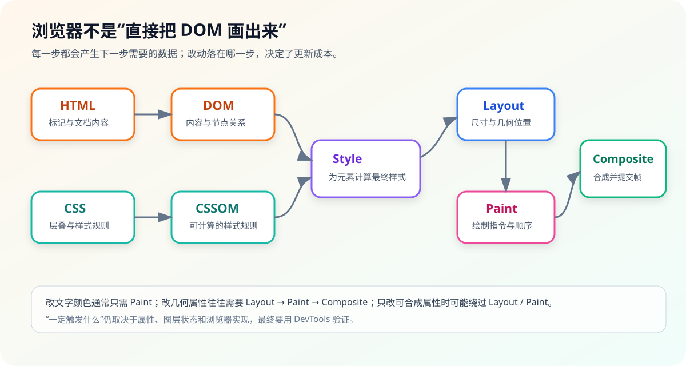
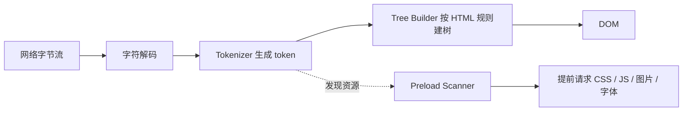
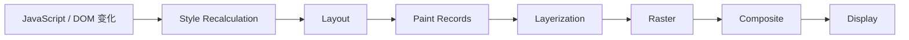

# 浏览器渲染流水线：页面为什么会出现、卡住和掉帧

面试中常见一句话：“浏览器把 HTML 变成 DOM，把 CSS 变成 CSSOM，再生成 Render Tree，最后 layout 和 paint。”这句话没错，但还不够解释下面的问题：

- CSS 到底阻塞什么？
- 脚本为什么会卡住首屏？
- 改 `transform` 为什么通常比改 `top` 更平滑？
- 页面掉帧时，究竟是 JavaScript、Layout、Paint 还是合成慢？

这一篇就沿着一帧真正经过的阶段来讲。

## 1. DOM、CSSOM、Render Tree 的关系



这张图要抓住三个边界：

1. DOM 表达文档结构，不等于屏幕上的像素；
2. CSSOM 表达可参与级联和计算的样式规则；
3. Render Tree / layout tree 是实现层概念，只包含需要参与布局和绘制的对象，并不和 DOM 节点一一对应。

例如：

- `display: none` 的元素通常不生成布局盒；
- `::before` 可能生成渲染对象，但它不是普通 DOM 子节点；
- `visibility: hidden` 通常仍占布局空间，只是不绘制可见内容；
- 文本换行可能把一个 DOM text node 变成多个布局片段。

## 2. 从字节到 DOM

浏览器接收 HTML 字节后，需要解码、分词、构建节点。HTML parser 具有容错和状态机规则，不是简单正则匹配。



### Preload Scanner 能做什么

主 parser 被同步脚本暂停时，浏览器仍可能扫描后续 HTML，提前发现声明式资源。这能减少网络空闲，但无法提前知道所有资源：

- JavaScript 计算出的 URL；
- 要等 CSS 下载后才知道的背景图或字体；
- 运行时组件条件渲染出的资源；
- 被错误标记优先级或跨源属性不匹配的预加载。

所以“有预解析就不会被脚本阻塞”是错误结论。

## 3. CSS 从规则变成计算样式

CSS parser 生成规则结构后，浏览器还要做：

1. selector matching；
2. cascade（级联）、继承和默认值处理；
3. 把相对值、变量等计算成当前元素的 computed style；
4. 判断哪些元素需要布局、绘制或合成更新。

选择器匹配和样式失效范围取决于引擎实现。项目里不用为了“选择器从右往左匹配”过度微优化普通选择器；更值得关注的是巨大的 DOM、频繁切换影响大量后代的 class、复杂 `:has()` 使用以及布局抖动。

## 4. CSS 和 JavaScript 到底阻塞什么

### 4.1 经典同步脚本

```html
<!-- 前置样式表可能让后面的同步脚本等待样式就绪 -->
<link rel="stylesheet" href="critical.css" />
<!-- 普通同步脚本执行期间会暂停 HTML parser -->
<script src="app.js"></script>
<p>后续内容</p>
```

经典、没有 `async` / `defer` 的外部脚本通常会：

1. 暂停 HTML parser；
2. 等脚本下载；
3. 如果前面存在尚未就绪、会影响脚本观察结果的样式表，还要等待样式表；
4. 执行脚本；
5. parser 再继续。

原因不是浏览器“笨”，而是脚本可能执行 `document.write()`、修改 DOM，或者读取依赖样式的布局信息，后续解析结果会被改变。

### 4.2 CSS 的准确说法

- CSS 通常不阻止 HTML parser 继续构建 DOM；
- CSS 是 render-blocking resource：没有足够样式信息时，浏览器不应随便绘制错误页面；
- 前置样式表可能阻塞同步脚本执行，从而间接阻塞 parser；
- 非关键 CSS 可以通过媒体条件、拆分或延迟策略降低首屏影响，但要避免无样式内容闪烁。

### 4.3 `async`、`defer` 与 module

| 脚本形式 | 下载 | 执行时机 | 顺序特点 | `DOMContentLoaded` |
|---|---|---|---|---|
| 普通 `<script>` | parser 遇到后下载 | 下载后立即执行，暂停 parser | 文档顺序 | 执行后 parser 才继续 |
| `async` | 并行下载 | 下载完成尽快执行，执行时可暂停 parser | 不保证文档顺序 | 不保证在事件前完成 |
| `defer` | 并行下载 | 解析完成后、事件前执行 | 通常保持文档顺序 | 等 defer 脚本完成 |
| `type="module"` | 并行获取模块图 | 默认表现类似 defer | 按模块依赖与规范执行 | 通常等待模块求值；top-level await 会进一步影响时机 |

最小观察实验：

```html
<script>
  console.log('1：同步脚本开始');

  document.addEventListener('DOMContentLoaded', () => {
    console.log('4：DOMContentLoaded');
  });

  Promise.resolve().then(() => {
    // 当前同步脚本结束后先清空 microtask，再继续 parser 后续工作
    console.log('2：当前 task 的 microtask');
  });

  console.log('3：同步脚本结束');
</script>
```

输出通常是 `1 → 3 → 2 → 4`。它验证的是当前上下文中的队列关系，不代表所有异步资源都有固定全局顺序。

## 5. 一帧是怎么生成的



术语在不同引擎和 DevTools 中会略有差异，面试时理解职责比背线程归属更重要。

### 5.1 Style

确定受影响元素的计算样式。改 class 不一定导致全页面重算，引擎会做 style invalidation，但改动范围越大、依赖关系越复杂，成本越高。

### 5.2 Layout（回流 / 重排）

计算元素几何位置和尺寸。它可能沿包含块、文本换行、百分比尺寸等关系传播。常见触发：

- 改宽高、边距、字体、内容；
- DOM 插入 / 删除；
- 容器尺寸变化；
- 读取某些几何属性时，为保证结果最新而触发同步布局。

### 5.3 Paint（重绘）

把背景、文字、边框、阴影等生成绘制指令。颜色变化可能只需 paint，不必重新 layout，但大面积模糊、阴影和滤镜会让绘制 / 光栅成本很高。

### 5.4 Raster 与 Composite

绘制记录会被分块光栅化为像素；合成器把不同图层 / surface 组合成最终帧。某些 `transform`、`opacity` 动画可在不重新 layout 和 paint 的情况下更新合成属性，因此通常更稳定。

但“上 GPU”不是免费优化：图层会占 GPU 内存，过多图层会增加管理、上传和合成成本。`will-change` 应在确实需要时短期使用，不要全局铺开。

## 6. 回流、重绘、合成怎么回答

可以这样说：

> 回流是几何信息需要重新计算；重绘是视觉内容需要重新生成绘制记录；合成是把已光栅化的图层按属性组合成最终帧。影响几何的改动通常会连带后续 paint 和 composite，纯颜色变化通常跳过 layout，合成属性动画在条件满足时可以跳过 layout 和 paint。但具体是否升级为独立层、失效范围多大，要以浏览器 trace 为准。

### 6.1 Layout Thrashing：读写交错

低效写法：

```js
const cards = [...document.querySelectorAll('.card')];

for (const card of cards) {
  card.style.width = '300px';
  // 写入后立刻读取布局信息，浏览器可能被迫同步刷新布局
  console.log(card.offsetHeight);
}
```

改为先读后写：

```js
const cards = [...document.querySelectorAll('.card')];

// 第一阶段统一读取，复用当前布局结果
const heights = cards.map((card) => card.offsetHeight);

requestAnimationFrame(() => {
  // 第二阶段统一写入，把视觉更新安排到下一次渲染机会附近
  cards.forEach((card, index) => {
    card.style.width = `${Math.max(300, heights[index] * 2)}px`;
  });
});
```

`requestAnimationFrame` 不是万能防回流 API。回调里反复读写仍会抖动，回调本身太长也会错过帧预算。

## 7. 动画为什么优先 `transform`

低效场景：

```css
/* left 会改变几何位置，动画期间通常需要重复布局 */
.box {
  position: absolute;
  left: 0;
  transition: left 300ms;
}

.box.open {
  left: 300px;
}
```

更常见的选择：

```css
/* transform 在条件满足时可以只更新合成属性，但仍需用 trace 验证 */
.box {
  transform: translateX(0);
  transition: transform 300ms;
}

.box.open {
  transform: translateX(300px);
}
```

`left` 改变几何位置，通常触发布局；`transform` 改变合成变换，在图层条件满足时可由合成路径高效处理。但仍要注意：

- 元素内容首次需要 paint / raster；
- 大图层移动会占内存和带宽；
- 滤镜、混合、clip、fixed 元素等可能让合成复杂；
- 文字在变换中可能出现清晰度变化；
- 最终以 Performance 和 Layers / Rendering 工具验证。

## 8. 图片、字体和 CLS

### 图片

为图片写 `width` / `height` 或 `aspect-ratio`，浏览器能在资源到达前预留空间：

```html
<!-- 显式尺寸让浏览器在图片到达前预留空间，减少布局位移 -->

```

`fetchpriority="high"` 只应该给真正的关键 LCP 候选，不要给所有图片。首屏图片也不要无脑 `loading="lazy"`。

### 字体

字体可能延迟文字展示或在切换字体时改变布局。常见手段：

- 只预加载首屏确实需要的字体；
- 使用 WOFF2 和子集化；
- 合理选择 `font-display`；
- 用 fallback metrics / `size-adjust` 等减少切换位移；
- 避免一页加载大量字重。

## 9. CSS Containment 与虚拟列表

对复杂页面，减少“改一处影响全局”的传播比小型语法优化更有效：

```css
.product-card {
  /* 告诉浏览器该组件布局和绘制影响可以更独立地处理 */
  contain: layout paint;
}

.long-section {
  /* 屏外内容先使用估算尺寸，进入视口附近再真正渲染 */
  content-visibility: auto;
  contain-intrinsic-size: auto 600px;
}
```

`contain` 可能改变定位、尺寸和溢出语义；`content-visibility` 也要考虑可访问性、查找和滚动定位。不是复制两行 CSS 就自动提速。

超长列表通常还需要 virtualization：只创建视口附近 DOM，控制节点数量和框架 diff 成本。

## 10. 如何在 DevTools 证明问题在哪

1. 打开 Performance，开启 screenshots，录制卡顿操作；
2. 看 Main thread 是否有 Long Task；
3. 展开 task，区分 Scripting、Recalculate Style、Layout、Paint；
4. 查看 forced reflow 警告和调用栈；
5. 打开 Rendering 的 Paint flashing / Layout Shift Regions；
6. 如果主线程轻但帧仍慢，检查 raster、GPU、超大图层和图片解码；
7. 修复后用相同设备、相同操作重新录制，不凭感觉验收。

## 11. SSR 与 CSR 放在渲染链里理解

SSR（服务端渲染）通常让服务器先返回带内容的 HTML，CSR（客户端渲染）通常依赖 JavaScript 获取数据并创建主要 UI。

| 维度 | SSR | CSR |
|---|---|---|
| 初始 HTML | 通常已有内容 | 可能只有壳 |
| 首屏依赖 | 服务端响应、HTML、CSS、hydration | JS 下载、执行、接口和渲染 |
| 交互成本 | 仍需 hydration 或局部激活 | 应用启动后直接管理交互 |
| 服务端成本 | 更高，需要缓存、流式和容量治理 | 静态托管简单，API 压力仍存在 |

不要回答“SSR 一定更快”。如果服务端 TTFB 很长、HTML 巨大、hydration 是长任务，体验也会差；CSR 经过良好缓存、代码拆分和数据预取，也可能很快。现代框架还会混合 SSR、SSG、streaming、islands、React Server Components 等策略。

## 12. 常见误区

1. “DOM 构建完成后才下载资源。”——预加载扫描器会提前发现声明式资源。
2. “CSS 阻塞 DOM 解析。”——通常不直接阻塞 parser，但会阻塞渲染并可能间接阻塞脚本 / parser。
3. “重绘一定触发回流。”——方向反了；布局变化通常需要后续绘制，纯视觉变化不一定布局。
4. “用了 transform 就一定创建独立 GPU 层。”——提升策略由引擎决定。
5. “`requestAnimationFrame` 每 16.7ms 调一次。”——它跟随渲染机会和刷新率，后台页还会被节流。
6. “DOMContentLoaded 就是页面可交互。”——主线程后续长任务仍可能让交互延迟。

## 参考资料

- [MDN：Critical rendering path](https://developer.mozilla.org/en-US/docs/Web/Performance/Guides/Critical_rendering_path)
- [MDN：How browsers work](https://developer.mozilla.org/en-US/docs/Web/Performance/Guides/How_browsers_work)
- [WHATWG HTML：The script element](https://html.spec.whatwg.org/multipage/scripting.html#the-script-element)
- [web.dev：How the browser renders a web page](https://web.dev/articles/howbrowserswork)
- [Chrome Developers：Rendering performance](https://developer.chrome.com/docs/devtools/rendering/performance)
- [MDN：CSS containment](https://developer.mozilla.org/en-US/docs/Web/CSS/CSS_containment)
