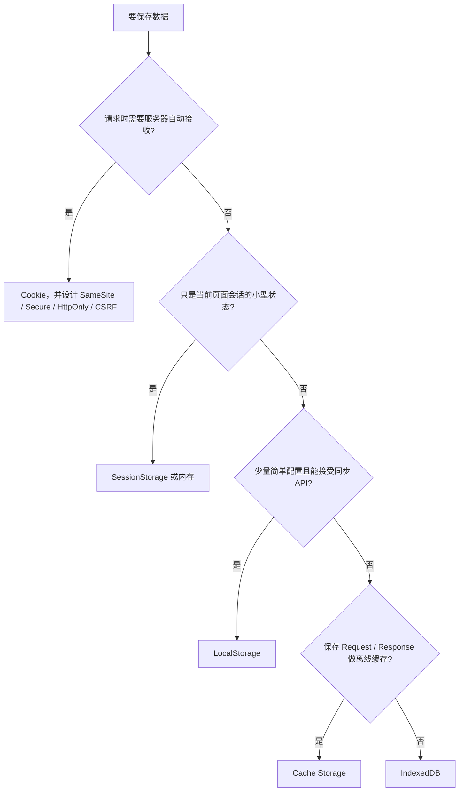

# 浏览器存储与安全：先问数据边界，再选 API

“Cookie、LocalStorage、SessionStorage 有什么区别”如果只回答容量和生命周期，很难体现实战能力。真正的选型顺序应该是：

1. 数据由服务器还是前端读取？
2. 要跨请求、跨标签页、跨会话还是只活在当前页面？
3. 数据量和查询复杂度多大？
4. 同步读取会不会阻塞主线程？
5. 遇到 XSS、CSRF、第三方上下文和存储分区时会怎样？

## 1. 常用存储能力对比

| 能力 | Cookie | LocalStorage | SessionStorage | IndexedDB | Cache Storage |
|---|---|---|---|---|---|
| 主要用途 | 会话、请求状态、小型服务端可见数据 | 少量同源键值配置 | 单个页面会话的临时键值 | 大量结构化数据、索引、事务 | 显式保存 Request / Response |
| 是否自动随 HTTP 请求发送 | 是，受 Domain / Path / SameSite 等约束 | 否 | 否 | 否 | 否 |
| JavaScript 可读 | 默认可读；`HttpOnly` 时不可读 | 可读 | 可读 | 可读 | 可读，通常也由 Service Worker 使用 |
| API 模型 | `document.cookie` 较原始，也有 Cookie Store API（兼容性需确认） | 同步 | 同步 | 异步、事务式 | Promise 异步 |
| 生命周期 | 由 Expires / Max-Age 或会话规则决定 | 通常跨会话，直到清理或淘汰 | 当前 top-level browsing context 的页面会话 | 持久化，仍受配额和清理策略影响 | 持久化，仍受配额和清理策略影响 |
| 适合大数据 | 否 | 否 | 否 | 是 | 适合响应对象，不适合任意关系查询 |
| 典型风险 | CSRF、Cookie 泄露、作用域过宽 | XSS 窃取、同步阻塞、序列化错误 | XSS、错误理解标签页隔离 | XSS 读取、版本升级和事务复杂度 | 缓存污染、版本失控、旧响应长期存在 |

**配额不是跨浏览器固定常数。** Storage manager 会根据设备空间、origin、浏览器策略和用户设置分配并淘汰；不要再背“LocalStorage 永远 5 MB，IndexedDB 永远无限”。

## 2. Cookie：它首先是 HTTP 状态机制

服务器设置：

```http
Set-Cookie: __Host-session=opaque-id; Path=/; Secure; HttpOnly; SameSite=Lax
```

浏览器在满足作用域与策略时发送：

```http
Cookie: __Host-session=opaque-id
```

### 2.1 常见属性

| 属性 | 作用 | 边界 |
|---|---|---|
| `Domain` | 指定可接收 Cookie 的域范围 | 不写时通常是 host-only；不要为了“方便”放大到整个父域 |
| `Path` | 控制请求路径匹配 | 不是可靠的安全隔离机制 |
| `Expires` / `Max-Age` | 控制持久时间 | `Max-Age` 一般更直接；客户端仍可能清理 Cookie |
| `Secure` | 只通过安全连接发送 | 不能防止服务端泄露或 XSS 发起同源请求 |
| `HttpOnly` | 禁止 JavaScript 通过常规 API 读取 | 能降低会话值被 XSS 直接窃取的风险，但 XSS 仍可冒用会话操作页面 |
| `SameSite` | 限制跨站请求携带 | `Lax`、`Strict`、`None` 的选择取决于登录跳转、嵌入和跨站流程 |
| `Partitioned` | 请求第三方 Cookie 采用分区存储键（CHIPS） | 需要 `Secure`；支持与策略以浏览器文档为准 |

`SameSite=None` 通常要同时设置 `Secure`。现代浏览器对未显式设置 SameSite 的行为、安全前缀和第三方 Cookie 有持续演进，不应把某个版本的默认策略当永久标准。

### 2.2 `__Host-` 与 `__Secure-` 前缀

- `__Secure-`：要求 `Secure`；
- `__Host-`：要求 `Secure`、`Path=/`，且不能设置 `Domain`，作用域更收敛。

前缀由支持的 user agent 强制校验，可以减少配置错误，但不能替代服务端会话安全。

### 2.3 Cookie、Session、Token 不是同一维度

- Cookie 是浏览器存储和发送状态的一种机制；
- Session 常指服务端保存的会话状态，Cookie 里只放不透明 session id；
- Token 是凭证格式或授权表示，可以放在 Cookie、内存或其他客户端位置；
- JWT 是 Token 的一种格式，不等于“无状态就天然更安全”。

常见两种架构：

```text
方案 A：HttpOnly Cookie + 服务端 Session
浏览器 --Cookie(session id)--> 服务端 --查 Session--> 用户状态

方案 B：Access Token + Refresh Token
前端/浏览器 --Authorization: Bearer ...--> API
```

选型看系统边界。Web 同源业务常用 `HttpOnly + Secure + SameSite` Cookie 承载会话，再配合 CSRF 防护；需要跨端、跨服务授权时可能使用 Bearer Token，但要严控存储、有效期、刷新、撤销和受众范围。

## 3. Web Storage：简单，但同步

```js
const preference = {
  theme: 'dark',
  pageSize: 20,
};

// 只存小型、不敏感、读取频率可控的配置；JSON.stringify 不是数据库事务
localStorage.setItem('preference', JSON.stringify(preference));

function readPreference() {
  try {
    const raw = localStorage.getItem('preference');
    return raw ? JSON.parse(raw) : null;
  } catch (error) {
    // 用户手动改值、旧版本格式或写入中断都可能导致解析失败
    console.warn('本地偏好读取失败，回退默认配置', error);
    return null;
  }
}
```

### 3.1 LocalStorage

适合少量同源配置，例如主题、草稿标记、非敏感 UI 状态。它的 API 是同步的，读写和序列化发生在主线程，不适合大量数据或高频写入。

`storage` 事件可以通知同 origin 的其他文档：

```js
window.addEventListener('storage', (event) => {
  if (event.key === 'logout-at' && event.newValue) {
    // 事件通常在其他文档触发，不在执行 setItem 的当前页面触发
    location.assign('/login');
  }
});
```

更明确的标签页消息可使用 `BroadcastChannel`，详见[标签页通信](./browser-process-event-loop.md#8-标签页之间怎么通信)。

### 3.2 SessionStorage

它按 origin 和 top-level browsing context 的页面会话隔离。常规新标签页、复制标签页、`window.open` 与恢复会话的初始行为存在细节，不要简化成“关闭 tab 前全局共享”。

适合当前页面流程的临时状态，例如多步骤表单草稿、一次性刷新标记。它仍能被同源脚本读取，不适合存放希望抵御 XSS 的秘密。

## 4. IndexedDB：浏览器里的异步事务数据库

IndexedDB 适合：

- 离线业务数据；
- 大量结构化记录；
- 需要索引查询、游标、事务；
- 不希望大规模同步序列化阻塞主线程。

最小示例：

```js
function openDatabase() {
  return new Promise((resolve, reject) => {
    const request = indexedDB.open('interview-demo', 1);

    request.onupgradeneeded = () => {
      const database = request.result;

      if (!database.objectStoreNames.contains('notes')) {
        const store = database.createObjectStore('notes', {
          keyPath: 'id',
          autoIncrement: true,
        });

        // 按更新时间查询时不必扫描全部记录
        store.createIndex('updatedAt', 'updatedAt');
      }
    };

    request.onsuccess = () => resolve(request.result);
    request.onerror = () => reject(request.error);
    request.onblocked = () => {
      // 旧页面长期占用旧版本连接时，数据库升级会被阻塞
      console.warn('数据库升级被其他页面阻塞，请关闭旧页面后重试');
    };
  });
}

async function addNote(text) {
  const database = await openDatabase();

  await new Promise((resolve, reject) => {
    const transaction = database.transaction('notes', 'readwrite');
    const store = transaction.objectStore('notes');

    store.add({ text, updatedAt: Date.now() });

    // 应以事务完成作为整组写入成功的边界，而不是只看单个 request 成功
    transaction.oncomplete = resolve;
    transaction.onerror = () => reject(transaction.error);
    transaction.onabort = () => reject(transaction.error);
  });

  database.close();
}
```

### 易错边界

- schema 变更只在 `versionchange` / `onupgradeneeded` 流程做；
- 事务生命周期与事件循环有关，不要在事务中等待无关的长异步操作；
- 多标签页升级要处理 `versionchange` 和 `blocked`；
- 写入成功不等于数据永不丢失，仍受用户清理、隐私模式、配额和系统压力影响；
- localForage 是对多种存储后端的封装，不应替代对底层语义的理解。

## 5. Cache Storage 不是通用键值数据库

Cache Storage 以 `Request` 为键保存 `Response`，适合离线资源和网络响应：

```js
const cache = await caches.open('article-v1');
const request = new Request('/api/article/42');
const response = await fetch(request);

if (response.ok) {
  // clone 的原因是响应体流通常只能消费一次；缓存和业务读取要各自持有一份
  await cache.put(request, response.clone());
}

const cached = await cache.match(request);
console.log(cached ? await cached.json() : '未命中缓存');
```

它不会替你自动完成版本失效、用户隔离和数据新鲜度。带认证的响应如果以错误的 key 缓存，可能造成跨用户数据泄露。

## 6. Same-Origin Policy：浏览器安全的底座

同源通常要求 scheme、host、port 都相同：

```text
https://a.example.com:443
https://b.example.com:443  // host 不同，不同源
http://a.example.com:80    // scheme 不同，不同源
https://a.example.com:8443 // port 不同，不同源
```

同源策略主要限制一个源的脚本读取另一个源的敏感资源。它并不是“禁止所有跨源请求”：图片、表单、导航等跨源能力一直存在，Fetch / XHR 的**读取**需要 CORS 等授权。

## 7. CORS：服务器授权浏览器把响应交给脚本

简单请求可能直接发送，并在响应阶段检查 CORS；不满足简单请求条件时，浏览器通常先发 preflight：

```http
OPTIONS /orders HTTP/1.1
Origin: https://shop.example.com
Access-Control-Request-Method: PATCH
Access-Control-Request-Headers: content-type, x-request-id
```

服务端授权：

```http
Access-Control-Allow-Origin: https://shop.example.com
Access-Control-Allow-Methods: PATCH
Access-Control-Allow-Headers: Content-Type, X-Request-Id
Access-Control-Allow-Credentials: true
Vary: Origin
```

客户端带凭证：

```js
// 跨源携带 Cookie 时，服务端必须返回匹配的 CORS 凭证响应头
await fetch('https://api.example.com/orders/42', {
  method: 'PATCH',
  credentials: 'include',
  headers: { 'Content-Type': 'application/json' },
  body: JSON.stringify({ status: 'paid' }),
});
```

关键点：

- CORS 是浏览器强制的读取策略，不是服务端鉴权；
- 非浏览器客户端不受同样限制；
- `Access-Control-Allow-Origin: *` 不能与 credentialed response 随意组合；
- 动态回显 Origin 必须先做白名单校验，并正确设置 `Vary: Origin`；
- CORS 不能阻止 CSRF，因为攻击者未必需要读取响应。

## 8. XSS、CSRF、CSP 分别解决什么

### 8.1 XSS

攻击者让恶意脚本在你的 origin 下执行。它可以读取页面数据、LocalStorage，发起用户权限内请求，并篡改 UI。

主要防线：

- 按上下文输出编码，不把不可信字符串拼进 HTML / URL / CSS / JavaScript；
- 避免直接使用 `innerHTML`，确需富文本时使用经过审计的 sanitizer；
- 模板、Markdown、SVG、DOM clobbering 等入口都要考虑；
- CSP 作为纵深防御，限制脚本来源和内联执行；
- 敏感会话 Cookie 使用 `HttpOnly`，降低直接窃取难度。

```js
const message = new URLSearchParams(location.search).get('message') ?? '';

// textContent 把输入当文本，不会把其中的标签作为 HTML 执行
document.querySelector('#message').textContent = message;
```

### 8.2 CSRF

攻击者诱导已登录用户向目标站点发请求，浏览器可能自动携带 Cookie。防线包括：

- `SameSite=Lax` / `Strict`，按业务选择；
- CSRF Token，并让服务器校验；
- 校验 `Origin`，必要时结合 `Referer`；
- 重要操作要求重新认证或用户确认；
- 不用 GET 做有副作用的状态修改。

### 8.3 CSP

示例策略：

```http
Content-Security-Policy: default-src 'self'; script-src 'self' 'nonce-r4nd0m'; object-src 'none'; base-uri 'none'; frame-ancestors 'none'
```

CSP 能显著提高注入脚本成功的门槛，也能用 Report-Only 先观测违规。但它不能替代正确编码、依赖治理和输入验证。滥用 `'unsafe-inline'` 或宽泛域名会削弱效果。

## 9. Storage Partitioning：第三方上下文不再共享一个大桶

现代浏览器正在把第三方上下文中的存储和网络状态按 top-level site 等维度分区，减少跨站跟踪。例如同一个 `cdn.example` iframe 嵌在 `news.example` 与 `shop.example` 下时，看到的存储可能不再是同一份。

要注意：

- Cookie 的 `Partitioned`（CHIPS）与更广义的存储分区相关，但不是完全相同的机制；
- 各浏览器覆盖的存储类型、网络缓存和迁移策略不同；
- 嵌入式登录、支付、客服和 SSO 不应默认依赖第三方存储永远可用；
- 必要时评估 Storage Access API、顶层跳转或服务器端协议方案，并做真实浏览器测试。

## 10. 怎么选：一套实用判断



再补一条：**高价值秘密尽量不要交给可执行的前端 JavaScript 长期持有。** 一旦同源脚本环境失守，任何 JS 可读存储都可能被读取。

## 11. 常见面试误区

1. “Cookie 只能存 4 KB、LocalStorage 固定 5 MB。”——具体上限和计数方式有实现差异，不要把经验值当标准保证。
2. “HttpOnly 可以防 XSS。”——它只限制 Cookie 被脚本直接读取，XSS 本身仍然存在。
3. “CORS 能防 CSRF。”——CORS 主要限制读取，不保证请求没发出去。
4. “JWT 放 LocalStorage 就是前后端分离最佳实践。”——忽略了 XSS、撤销、过期和刷新链路。
5. “SessionStorage 在整个浏览器会话共享。”——它有页面会话和 browsing context 边界。
6. “IndexedDB 是异步的，所以怎么用都不卡。”——大量序列化、反序列化和结果处理仍会消耗主线程。
7. “隐私模式等于不存任何数据。”——通常只是存储生命周期和持久化策略不同，不能用来做安全假设。

## 参考资料

- [MDN：Using HTTP cookies](https://developer.mozilla.org/en-US/docs/Web/HTTP/Guides/Cookies)
- [MDN：Set-Cookie](https://developer.mozilla.org/en-US/docs/Web/HTTP/Reference/Headers/Set-Cookie)
- [MDN：Web Storage API](https://developer.mozilla.org/en-US/docs/Web/API/Web_Storage_API)
- [MDN：IndexedDB API](https://developer.mozilla.org/en-US/docs/Web/API/IndexedDB_API)
- [MDN：Storage quotas and eviction criteria](https://developer.mozilla.org/en-US/docs/Web/API/Storage_API/Storage_quotas_and_eviction_criteria)
- [MDN：Same-origin policy](https://developer.mozilla.org/en-US/docs/Web/Security/Same-origin_policy)
- [MDN：CORS](https://developer.mozilla.org/en-US/docs/Web/HTTP/Guides/CORS)
- [MDN：Content Security Policy](https://developer.mozilla.org/en-US/docs/Web/HTTP/Guides/CSP)
- [Chrome Developers：Cookies Having Independent Partitioned State](https://privacysandbox.google.com/cookies/chips)
