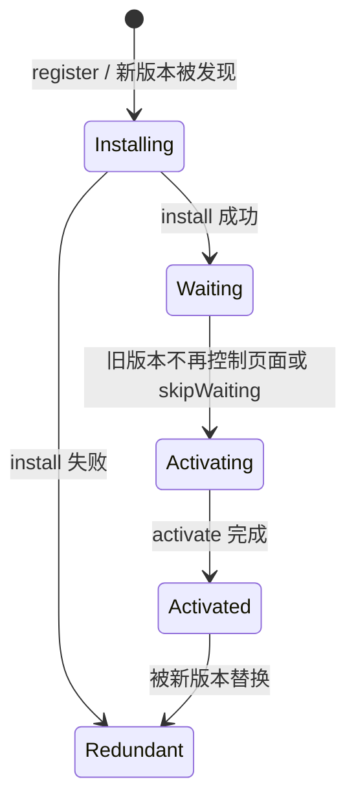

# Worker 与离线能力：别把三个 Worker 当同一种东西

先用一句话区分：

- **Web Worker / Dedicated Worker**：给当前页面开一个专用后台执行环境，适合 CPU 计算；
- **SharedWorker**：多个同源页面通过 port 连接到共享 worker，适合跨页面共享连接或内存状态；
- **Service Worker**：运行在页面之外的事件驱动网络代理，可拦截受控范围内的请求，配合 Cache Storage 做离线与更新。

原文把 SharedWorker 的名称写乱了，这里统一使用标准术语 **SharedWorker**。

## 1. 能力对比

| 维度 | Web Worker | SharedWorker | Service Worker |
|---|---|---|---|
| 谁创建 / 连接 | 一个页面或 worker 创建 | 多个同源页面连接 | 浏览器按注册和 scope 管理 |
| 典型关系 | 一对一 | 多对一 | 一份注册控制多个页面 |
| 主要用途 | CPU 密集计算、解析、转换 | 跨 tab 共享连接 / 状态 | 请求拦截、离线缓存、后台事件 |
| 能否直接操作 DOM | 不能 | 不能 | 不能 |
| 生命周期 | 通常跟创建者关联 | 与连接者和浏览器策略相关 | 事件驱动，可随时启动 / 终止 |
| 主要通信 | `postMessage` | `MessagePort` | `postMessage`、Clients API、事件 |
| 能否拦截页面请求 | 不能 | 不能 | 可以，限注册 scope 和控制关系 |
| 环境要求 | 一般受同源和 URL 规则约束 | 支持范围需确认 | 通常要求 secure context，localhost 例外 |

不要说“Worker 是真正多线程所以一定更快”。把工作搬过去之前要考虑启动、消息复制、序列化、线程调度和结果合并成本。

## 2. Web Worker：把大计算移出主线程

### 2.1 最小可运行示例

目录：

```text
worker-demo/
├── index.html
├── main.js
└── compute.worker.js
```

`index.html`：

```html
<!doctype html>
<!-- 入口页面只负责交互，耗时计算交给 Web Worker -->
<html lang="zh-CN">
  <head>
    <meta charset="UTF-8" />
    <title>Web Worker 演示</title>
  </head>
  <body>
    <button id="start">开始计算</button>
    <span id="result">尚未开始</span>
    <script type="module" src="./main.js"></script>
  </body>
</html>
```

`main.js`：

```js
const button = document.querySelector('#start');
const result = document.querySelector('#result');

// module worker 可以使用 ESM；new URL 让构建工具和浏览器正确解析相对路径
const worker = new Worker(new URL('./compute.worker.js', import.meta.url), {
  type: 'module',
});

worker.addEventListener('message', (event) => {
  result.textContent = `质数数量：${event.data.count}`;
  button.disabled = false;
});

worker.addEventListener('error', (event) => {
  console.error('Worker 执行失败', event.message);
  button.disabled = false;
});

button.addEventListener('click', () => {
  button.disabled = true;
  result.textContent = '计算中，主线程仍可响应滚动和点击';
  worker.postMessage({ type: 'COUNT_PRIMES', limit: 2_000_000 });
});

window.addEventListener('pagehide', () => {
  // 页面明确不再需要结果时终止 worker，释放相关资源
  worker.terminate();
});
```

`compute.worker.js`：

```js
function isPrime(value) {
  if (value < 2) return false;

  for (let divisor = 2; divisor * divisor <= value; divisor += 1) {
    if (value % divisor === 0) return false;
  }

  return true;
}

self.addEventListener('message', (event) => {
  if (event.data?.type !== 'COUNT_PRIMES') return;

  let count = 0;

  for (let value = 2; value <= event.data.limit; value += 1) {
    if (isPrime(value)) count += 1;
  }

  // Worker 只能把结果发回，不能直接修改页面 DOM
  self.postMessage({ count });
});
```

运行：

```bash
python3 -m http.server 3000 --directory worker-demo
```

打开 `http://localhost:3000`。预期：计算期间按钮状态和页面滚动仍可由主线程处理。若把同样循环直接放在 click handler 里，页面会明显失去响应。

### 2.2 什么适合放 Worker

- 大型 JSON / CSV 解析；
- 图片、音视频数据处理；
- 搜索索引、压缩、加密、几何计算；
- 离线数据合并；
- 可分块、输入输出边界清晰的纯计算。

不适合：

- 大量依赖 DOM 尺寸和页面状态的逻辑；
- 每次只算几十微秒，却高频复制大对象；
- 需要频繁跨线程来回确认的细粒度操作；
- 只是等待网络，Fetch 本身不会靠 Web Worker 才异步。

## 3. 结构化克隆与 Transferable

`postMessage()` 默认使用 structured clone algorithm（结构化克隆算法）。它能复制许多内建类型和循环引用，但函数、DOM 节点等不能直接克隆。

大 `ArrayBuffer` 默认复制会有成本，可以转移所有权：

```js
const buffer = new ArrayBuffer(16 * 1024 * 1024);
const worker = new Worker('./binary.worker.js');

// 第二个参数把底层 buffer 所有权转移给 worker，避免复制 16 MB 数据
worker.postMessage({ buffer }, [buffer]);

console.log(buffer.byteLength); // 转移后，发送方 buffer 通常被 detach，长度变为 0
```

Worker：

```js
self.addEventListener('message', (event) => {
  const view = new Uint8Array(event.data.buffer);

  // 在 Worker 中原地处理，减少主线程占用和跨线程复制
  for (let index = 0; index < view.length; index += 1) {
    view[index] ^= 0xff;
  }

  self.postMessage({ buffer: view.buffer }, [view.buffer]);
});
```

Transferable 是“转移”，不是“两个线程同时无锁共享”。真正共享内存可用 `SharedArrayBuffer` + Atomics，但需要正确的跨源隔离头（COOP / COEP），并承担数据竞争、死锁和复杂同步成本。普通业务不要为了炫技使用。

## 4. SharedWorker：多个页面共享一个执行环境

SharedWorker 通过 port 与每个页面通信。

页面：

```js
// 多个同源页面使用相同名称连接到共享 Worker
const worker = new SharedWorker('./shared-worker.js', {
  type: 'module',
  name: 'socket-hub',
});

worker.port.start();
worker.port.postMessage({ type: 'SUBSCRIBE', pageId: crypto.randomUUID() });

worker.port.addEventListener('message', (event) => {
  console.log('共享 Worker 消息', event.data);
});
```

`shared-worker.js`：

```js
const ports = new Set();

self.addEventListener('connect', (event) => {
  const [port] = event.ports;
  ports.add(port);
  port.start();

  port.addEventListener('message', (messageEvent) => {
    if (messageEvent.data?.type !== 'SUBSCRIBE') return;

    for (const clientPort of ports) {
      // 每个页面都通过自己的 MessagePort 接收广播
      clientPort.postMessage({
        type: 'CLIENT_COUNT',
        count: ports.size,
      });
    }
  });
});
```

真实项目还要处理页面离开、port 异常、worker 被回收和浏览器兼容性。不能把 SharedWorker 当成永不丢失的内存数据库；关键状态仍要持久化或由服务器作为事实来源。

如果只是同源 tab 广播事件，`BroadcastChannel` 往往更简单；如果要跨设备同步，应该由 WebSocket / SSE + 服务端处理。

## 5. Service Worker：可编程网络代理

### 5.1 生命周期不是“注册后立刻接管”



核心状态：

1. **register**：页面请求注册脚本；
2. **installing**：下载和执行脚本，通常预缓存应用壳；
3. **waiting**：新 worker 等旧版本不再控制客户端；
4. **activating / activated**：清理旧缓存并开始处理事件；
5. 浏览器可以在空闲时终止 worker，下一次事件再启动。

所以不要在 Service Worker 全局变量里保存必须可靠存在的业务状态。

### 5.2 最小离线示例

目录：

```text
sw-demo/
├── index.html
├── app.js
├── sw.js
└── offline.html
```

页面注册：

```js
// app.js
// 页面只负责注册；安装、激活和请求拦截逻辑位于 sw.js
if ('serviceWorker' in navigator) {
  window.addEventListener('load', async () => {
    try {
      const registration = await navigator.serviceWorker.register('/sw.js', {
        scope: '/',
      });
      console.log('Service Worker 注册成功', registration.scope);
    } catch (error) {
      console.error('Service Worker 注册失败', error);
    }
  });
}
```

Service Worker：

```js
// sw.js
const STATIC_CACHE = 'static-v1';
const APP_SHELL = ['/', '/index.html', '/app.js', '/offline.html'];

self.addEventListener('install', (event) => {
  event.waitUntil(
    caches.open(STATIC_CACHE).then((cache) => {
      // addAll 是原子式预缓存入口之一；任一关键资源失败都应让本次安装失败
      return cache.addAll(APP_SHELL);
    }),
  );
});

self.addEventListener('activate', (event) => {
  event.waitUntil(
    caches
      .keys()
      .then((keys) =>
        Promise.all(
          keys
            .filter((key) => key !== STATIC_CACHE)
            .map((key) => caches.delete(key)),
        ),
      )
      .then(() => {
        // 让已打开页面尽快进入控制范围；升级兼容性仍需由应用设计保证
        return self.clients.claim();
      }),
  );
});

self.addEventListener('fetch', (event) => {
  const request = event.request;

  if (request.mode === 'navigate') {
    event.respondWith(
      fetch(request).catch(async () => {
        // 文档导航离线时返回明确的 fallback，不把任意 API 响应塞给页面
        return (await caches.match('/offline.html')) ?? Response.error();
      }),
    );
    return;
  }

  if (request.method === 'GET' && new URL(request.url).origin === location.origin) {
    event.respondWith(
      caches.match(request).then(async (cached) => {
        if (cached) return cached;

        const response = await fetch(request);

        if (response.ok) {
          const cache = await caches.open(STATIC_CACHE);
          // response body 是流，返回与缓存需要各自的一份
          await cache.put(request, response.clone());
        }

        return response;
      }),
    );
  }
});
```

运行：

```bash
python3 -m http.server 3000 --directory sw-demo
```

localhost 可用于安全上下文开发。首次访问并等待 Service Worker 激活后，在 DevTools Application 面板确认控制状态，再勾选 Offline 刷新。预期导航显示 `offline.html`，已缓存静态资源可继续读取。

### 5.3 `skipWaiting()` 为什么不能无脑用

它让新 worker 跳过 waiting，更快激活，但当前页面可能仍运行旧版 JavaScript，却突然被新版 Service Worker 拦截并返回新版 API / 资源，造成版本撕裂。

更稳的升级流程：

1. 检测 `registration.waiting`；
2. 告知用户有新版本；
3. 用户确认后给 waiting worker 发消息；
4. worker 调用 `skipWaiting()`；
5. 页面监听 `controllerchange`，只刷新一次；
6. 新旧服务端接口和静态资源保留兼容窗口。

页面：

```js
let refreshing = false;

navigator.serviceWorker.addEventListener('controllerchange', () => {
  if (refreshing) return;
  refreshing = true;

  // controller 真正切换后再刷新，避免注册状态与控制状态错位
  location.reload();
});
```

Worker：

```js
self.addEventListener('message', (event) => {
  if (event.data?.type === 'SKIP_WAITING') {
    // 只有页面确认升级后才跳过 waiting，避免自动造成版本撕裂
    self.skipWaiting();
  }
});
```

## 6. 常见缓存策略

| 策略 | 行为 | 适合 |
|---|---|---|
| Cache First | 先缓存，未命中再网络 | 内容哈希静态资源、字体 |
| Network First | 先网络，失败 / 超时回缓存 | 需要较新内容的页面或 API |
| Stale While Revalidate | 先返回缓存，同时后台更新 | 可接受短暂陈旧的列表、头像 |
| Network Only | 只走网络 | 不应缓存的敏感写操作 |
| Cache Only | 只读预缓存 | 完全版本化的离线应用壳 |

策略要按请求类型拆分，不能整个站点统一 Cache First。

Stale While Revalidate 简化实现：

```js
async function staleWhileRevalidate(request) {
  const cache = await caches.open('runtime-v1');
  const cached = await cache.match(request);

  const networkPromise = fetch(request).then(async (response) => {
    if (response.ok) {
      // 异步更新缓存，下次请求拿到新版本
      await cache.put(request, response.clone());
    }
    return response;
  });

  return cached ?? networkPromise;
}
```

生产实现还要处理超时、opaque response、缓存上限、认证用户、错误响应、并发去重和版本清理。

## 7. Service Worker、HTTP Cache、BFCache 的关系

请求大致可能经过：

```text
页面 fetch / 导航
  → 是否被 Service Worker 控制
      → SW 可以直接返回 Cache Storage 响应
      → 或调用 fetch 继续走网络栈与 HTTP Cache
  → 返回页面
```

BFCache 则位于页面历史导航生命周期，它恢复整个页面，不靠 Service Worker 的 `fetch` 事件重新构建页面。三者不是上下级替代关系。

## 8. Worker 中的错误处理与取消

Worker 的任务如果耗时很长，用户已经离开或输入变化，应该支持取消：

```js
// main.js
let worker = new Worker('./search.worker.js');
let requestId = 0;

function search(query) {
  requestId += 1;
  worker.postMessage({ type: 'SEARCH', requestId, query });
}

worker.addEventListener('message', (event) => {
  if (event.data.requestId !== requestId) {
    // 丢弃旧查询结果，避免慢结果覆盖新输入
    return;
  }

  renderResults(event.data.items);
});
```

对于无法在内部合作取消的纯计算，可以终止 worker 并重建；但频繁创建也有成本。更复杂场景可用消息标志或 `SharedArrayBuffer` / Atomics（仅在明确需要且安全隔离满足时）。

## 9. 常见误区

1. “Web Worker 可以直接操作 DOM。”——不能，需要消息把结果交给主线程。
2. “postMessage 都是零拷贝。”——默认结构化克隆；可转移对象要显式 transfer。
3. “Service Worker 是一直运行的后台线程。”——它是事件驱动的，浏览器可随时终止。
4. “注册成功后当前页面立刻受控。”——首次注册通常要等激活和下一次导航，除非特定流程接管。
5. “Cache Storage 会自动按 HTTP 头过期。”——显式缓存策略和清理由代码负责。
6. “离线就是所有请求 Cache First。”——这样很容易把用户数据和接口永久缓存旧。
7. “SharedWorker 能永久保存跨页状态。”——生命周期与支持范围不适合承担唯一事实来源。
8. “Service Worker 更新只改缓存名就行。”——还要处理新旧页面兼容、waiting、激活与资源保留。

## 参考资料

- [HTML Standard：Web workers](https://html.spec.whatwg.org/multipage/workers.html)
- [MDN：Web Workers API](https://developer.mozilla.org/en-US/docs/Web/API/Web_Workers_API)
- [MDN：SharedWorker](https://developer.mozilla.org/en-US/docs/Web/API/SharedWorker)
- [Service Workers Specification](https://w3c.github.io/ServiceWorker/)
- [MDN：Service Worker API](https://developer.mozilla.org/en-US/docs/Web/API/Service_Worker_API)
- [MDN：Structured clone algorithm](https://developer.mozilla.org/en-US/docs/Web/API/Web_Workers_API/Structured_clone_algorithm)
- [MDN：Transferable objects](https://developer.mozilla.org/en-US/docs/Web/API/Web_Workers_API/Transferable_objects)
- [web.dev：Service worker lifecycle](https://web.dev/articles/service-worker-lifecycle)
