# 网络与浏览器面试题

> 题目来源：字节跳动、阿里巴巴、百度、腾讯、滴滴、小红书等大厂前端面试复盘（2023–2026）
> 共 17 道题，按「浏览器架构 → 渲染 → 事件循环 → HTTP → TCP → 跨域存储 → 安全 → 性能」递进
> 每题含：口述版（分点简答）+ 学习版（详细展开 + 图示）+ 追问链路 + 追问答案

---

## 层级一：浏览器架构与渲染基础

### Q1 浏览器输入 URL 到页面显示，经历了哪些过程？

> 频率：`高频必问` 来源：字节 / 阿里 / 百度 / 滴滴

#### 口述版

- **DNS 解析**：将域名解析为 IP 地址（浏览器缓存 → OS 缓存 → 路由器 → 递归查询 DNS 服务器）
- **TCP 三次握手**：客户端与服务器建立可靠连接
- **发送 HTTP/HTTPS 请求**：浏览器构造请求头，HTTPS 还需要 TLS 握手
- **服务器处理并响应**：返回 HTML、CSS、JS 等资源
- **浏览器渲染**：解析 HTML→构建 DOM→解析 CSS→构建 CSSOM→合并 Render Tree→Layout→Paint→Composite
- **TCP 四次挥手**：资源加载完成后断开连接（HTTP/1.1 keep-alive 可复用）

#### 学习版

**完整流程序列图**

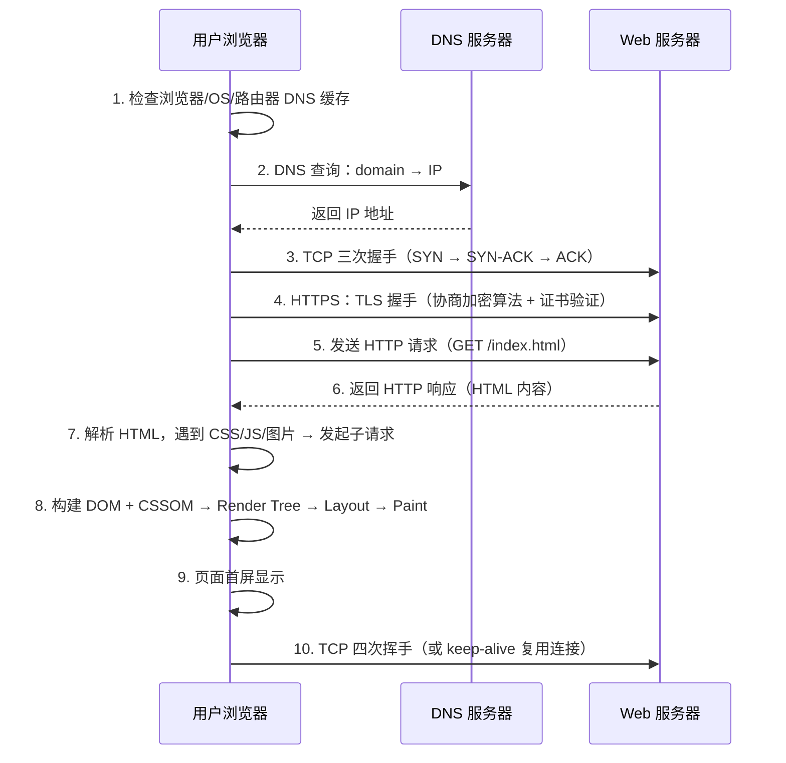

**各阶段详解**

| 阶段 | 关键点 | 常见优化 |
|------|--------|---------|
| DNS 解析 | 递归查询，涉及多级缓存 | DNS 预解析 `<link rel="dns-prefetch">` |
| TCP 握手 | 1.5 RTT 建立连接 | HTTP/2 多路复用减少连接数 |
| TLS 握手 | TLS 1.2 需 2-RTT，TLS 1.3 仅 1-RTT | 升级到 TLS 1.3，Session Resumption |
| HTTP 请求 | 请求头（Cookie/User-Agent/Cache 相关字段） | 减少请求数、压缩资源、CDN |
| 服务器处理 | 路由→业务逻辑→数据库→渲染 | 服务端缓存、数据库索引 |
| 浏览器渲染 | 关键渲染路径（CRP） | 减少阻塞资源、懒加载、代码分割 |

---

**① TCP 三次握手展开**

三次握手目的是让客户端和服务器互相确认"我能发、我能收"，建立可靠连接。

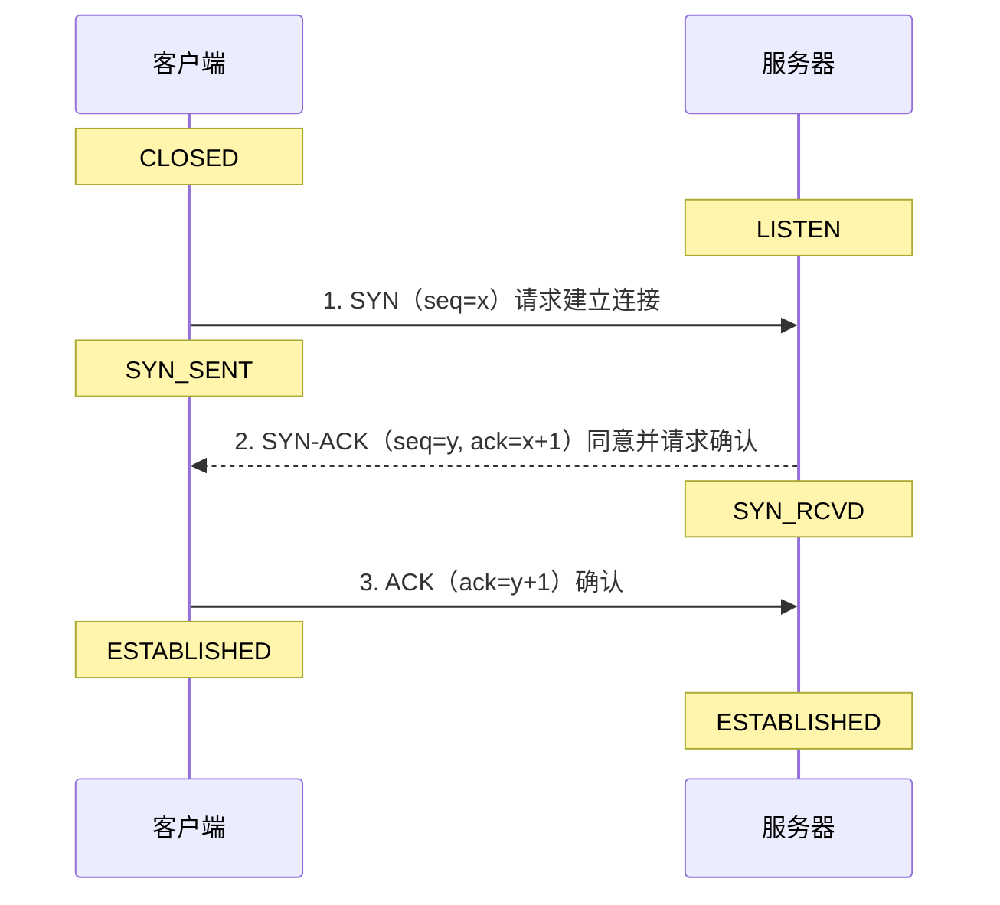

- 第一次（SYN）：客户端发 SYN，进入 SYN_SENT，服务器确认"客户端能发送"
- 第二次（SYN-ACK）：服务器发 SYN+ACK，进入 SYN_RCVD，客户端确认"服务器能收发"
- 第三次（ACK）：客户端发 ACK，双方进入 ESTABLISHED，服务器确认"客户端能接收"

**为什么不能是两次？**
- 两次握手时，服务器发完 SYN-ACK 就认为连接建立，但客户端可能根本没收到（网络丢失）
- 更严重：历史遗留的 SYN 包（延迟导致重传）到达服务器后，服务器会建立无效连接，浪费资源
- 三次握手确保双方都确认了"我能发，我能收"这两件事，无效连接不会建立

---

**② TLS 握手展开**

HTTPS = HTTP + TLS，在 TCP 之上加密通信。握手过程协商出对称密钥，之后用对称加密传输数据。

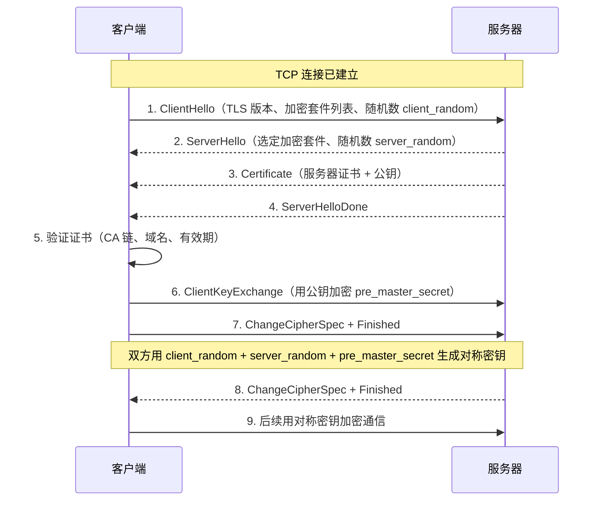

- **非对称加密**用在哪：第 6 步，客户端用服务器公钥加密 `pre_master_secret`，保证密钥安全传输
- **对称加密**用在哪：第 9 步之后，双方用协商出的密钥加密所有数据，速度快
- 为什么不全用非对称：RSA 加密比对称加密慢 100 倍以上，不适合大量数据传输

**TLS 1.2 vs TLS 1.3**
- TLS 1.2：2-RTT 完成握手（ClientHello → ServerHello+Certificate → ClientKeyExchange → Finished）
- TLS 1.3：1-RTT 完成握手（合并步骤，且支持 0-RTT 恢复）
- TLS 1.3 还移除了不安全的加密算法（如 RSA 密钥交换），只保留 ECDHE 等

---

**③ 浏览器渲染阻塞关系展开**

浏览器解析 HTML 时，CSS 和 JS 会互相影响，理解阻塞关系才能优化首屏加载。

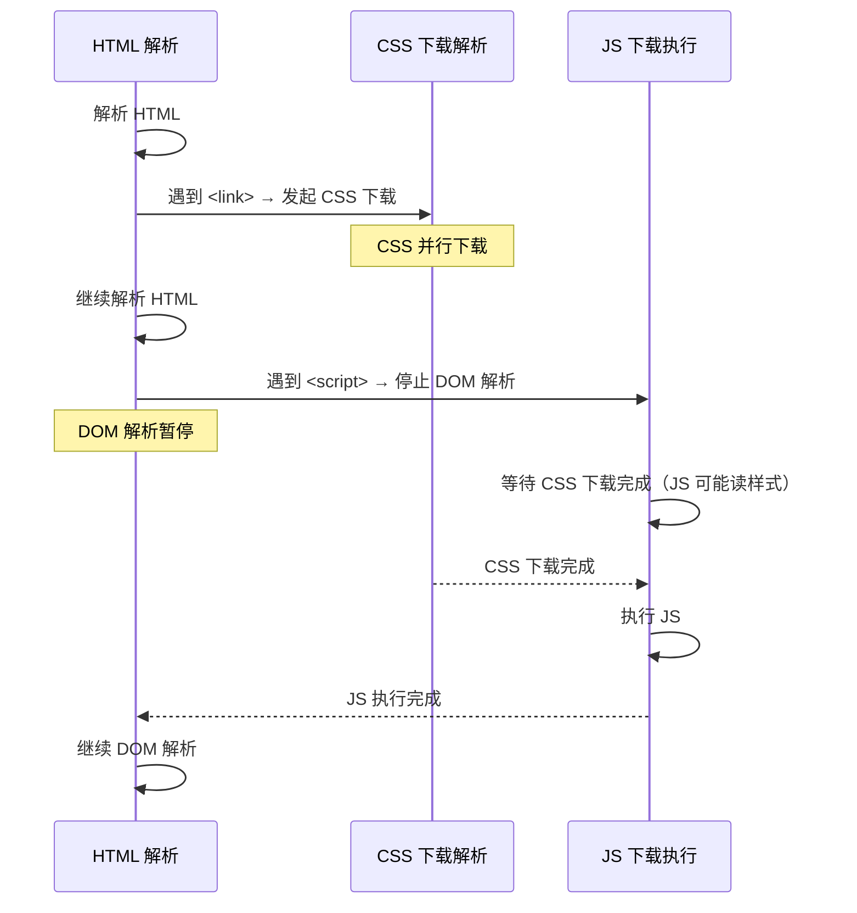

- **CSS 不阻塞 DOM 解析**：CSS 下载和 HTML 解析并行进行
- **CSS 阻塞渲染**：CSSOM 未完成时无法合并 Render Tree，页面不会渲染
- **JS 阻塞 DOM 解析**：JS 可能修改 DOM，必须执行完才能继续解析
- **CSS 阻塞 JS 执行**：JS 可能调用 `getComputedStyle` 读样式，必须等 CSSOM 完成

**defer vs async 时序对比**

```
HTML 解析:  ████████████████████████████████████████████
                                                        ↓ DOMContentLoaded

无属性:     ████[停止]──[下载JS]──[执行JS]──[继续解析]████
async:      ████[继续解析]██████[执行JS]████████████████  ← 下载完立即打断执行
defer:      ████[继续解析]████████████████████[执行JS]    ← DOMContentLoaded 前按序执行
```

- **无属性**：遇到 `<script>` 立即暂停 HTML 解析，下载+执行完再继续
- **async**：HTML 解析和下载并行，下载完立即打断 HTML 解析去执行（顺序不确定）
- **defer**：HTML 解析和下载并行，等 HTML 解析完成后、DOMContentLoaded 前按顺序执行
- **推荐**：需要操作 DOM 的脚本用 `defer`，第三方独立脚本（分析/广告）用 `async`

**DNS 解析详细流程**

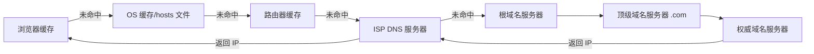

#### 追问链路

- DNS 解析的具体过程？浏览器、操作系统、路由器各自的 DNS 缓存生效顺序？
- TCP 三次握手每一步都发了什么？为什么不是两次？
- 页面渲染发生在哪一步？和 JS 执行是什么关系？

#### 追问答案

**DNS 解析缓存顺序**
- 顺序：浏览器缓存（约 1min TTL）→ OS hosts 文件 → OS DNS 缓存 → 路由器缓存 → ISP DNS（递归） → 根域名服务器（迭代）
- 每级命中就直接返回，不继续向上查询
- `dns-prefetch` 可在页面解析阶段提前并行解析第三方域名，减少请求延迟

**TCP 三次握手为什么是三次**
- 第一次：客户端发 SYN，服务器确认"客户端能发送"
- 第二次：服务器发 SYN+ACK，客户端确认"服务器能接收和发送"
- 第三次：客户端发 ACK，服务器确认"客户端能接收"
- 两次不够：服务器无法确认客户端的接收能力，可能浪费资源（历史遗留 SYN 包导致错误连接）

**页面渲染和 JS 执行的关系**
- JS 执行会阻塞 DOM 解析（JS 可能修改 DOM），CSS 解析会阻塞 JS 执行（JS 可能读取样式）
- 所以 `<script>` 标签默认放在 body 末尾，或使用 `defer`/`async`
- `defer`：HTML 解析完成后、DOMContentLoaded 前按顺序执行
- `async`：下载完立即执行，不保证顺序，适合独立脚本（如统计埋点）

---

### Q2 浏览器是多进程还是多线程？有哪些进程？

> 频率：`中频` 来源：字节 / 阿里

#### 口述版

- 浏览器是**多进程**架构，每个标签页（渲染进程）相互隔离
- 主要进程：**浏览器主进程**（UI/地址栏）、**渲染进程**（每个 Tab）、**GPU 进程**（绘制）、**网络进程**（请求）、**插件进程**
- JS 是**单线程**的，但渲染进程内有多个线程：JS 引擎线程、GUI 渲染线程、事件触发线程、定时器线程、异步 HTTP 请求线程
- JS 引擎线程和 GUI 渲染线程**互斥**——JS 执行时页面停止渲染

#### 学习版

**浏览器进程架构**

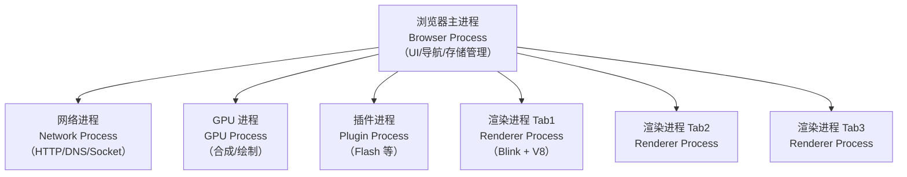

**渲染进程内的线程**

| 线程 | 职责 | 互斥关系 |
|------|------|---------|
| JS 引擎线程 | 解析执行 JS 代码 | 与 GUI 线程互斥 |
| GUI 渲染线程 | 解析 HTML/CSS，绘制页面 | 与 JS 线程互斥 |
| 事件触发线程 | 管理事件队列（Event Loop） | — |
| 定时器线程 | 处理 setTimeout/setInterval | — |
| 异步 HTTP 请求线程 | 处理 XHR/fetch 响应 | — |

**为什么每个 Tab 是独立进程**
- **安全隔离**：一个 Tab 崩溃不影响其他 Tab
- **内存隔离**：不同网站的内存相互隔离，防止恶意站点读取其他站点数据（Spectre 漏洞防御）
- **性能独立**：一个 Tab 的 JS 死循环不卡死整个浏览器

#### 追问链路

- 浏览器进程（主进程）、渲染进程、GPU 进程、网络进程各负责什么？
- JS 是单线程的，为什么浏览器是多线程的？
- JS 引擎线程和 GUI 渲染线程为什么互斥？

#### 追问答案

**各进程职责**
- 浏览器主进程：管理 UI（地址栏、书签、前进后退）、协调其他进程、处理用户输入、管理存储
- 渲染进程：解析 HTML/CSS/JS，执行渲染流水线，每个 Tab 一个（或多个同 origin Tab 共享）
- GPU 进程：处理图形渲染，将各层合成为最终画面，发给显示器
- 网络进程：负责所有网络请求（HTTP/HTTPS/WebSocket/DNS），独立出来防止网络阻塞影响 UI

**JS 单线程 vs 浏览器多线程**
- JS 单线程：避免 DOM 操作的并发冲突（如两个线程同时修改同一 DOM，结果不可预测）
- 浏览器多线程：渲染/网络/定时器等任务不需要操作 DOM，可以并行，提高效率
- 本质：JS 操作 DOM 必须串行；其他任务可以并行；通过 Event Loop 协调异步回调

**JS 和 GUI 线程为什么互斥**
- JS 可以修改 DOM 结构和 CSS 样式
- 如果 JS 执行时 GUI 同时渲染，会读到 JS 修改了一半的不一致 DOM，导致渲染结果错误
- 所以两者必须交替执行：JS 执行 → 暂停渲染；JS 执行完 → 触发渲染
- 这也是为什么长时间运行的 JS 会让页面"卡住"（GUI 线程被阻塞）

---

### Q3 浏览器渲染页面的完整流程是什么？

> 频率：`高频` 来源：字节 / 阿里 / 百度

#### 口述版

- **解析 HTML**，构建 **DOM 树**；遇到 CSS 解析构建 **CSSOM 树**；遇到 JS 暂停解析
- DOM + CSSOM 合并生成 **Render Tree**（只包含可见节点，`display:none` 不在其中）
- **Layout（回流）**：计算每个节点的几何位置和大小
- **Paint（重绘）**：将节点转为像素，按层绘制到位图
- **Composite（合成）**：GPU 将多个图层合并，输出到屏幕

#### 学习版

**渲染流水线**

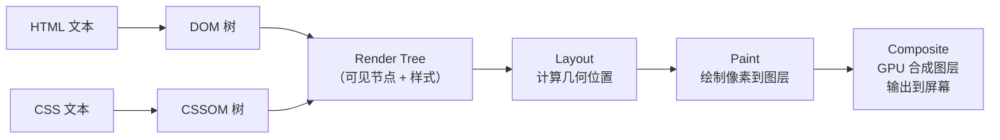

**各阶段详解**

| 阶段 | 做了什么 | 触发条件 |
|------|---------|---------|
| DOM 构建 | 字节→字符→Token→Node→DOM | HTML 加载 |
| CSSOM 构建 | 解析 CSS 规则，构建样式树 | CSS 加载（阻塞渲染） |
| Render Tree | 合并 DOM 和 CSSOM，过滤不可见节点 | DOM/CSSOM 构建完成 |
| Layout | 计算节点几何信息（位置/尺寸） | 几何属性变化时重新计算 |
| Paint | 把节点绘制成像素（颜色/边框/阴影） | 视觉属性变化时重绘 |
| Composite | GPU 将各图层合成最终画面 | Paint 完成后 |

**什么会阻塞渲染**

```
CSS：阻塞渲染（CSSOM 未完成，Render Tree 无法合并）
JS：阻塞 DOM 解析（默认同步，需等 JS 执行完才继续解析 HTML）
图片/字体：不阻塞渲染（但会触发重绘）
```

**display:none vs visibility:hidden**

- `display:none`：不在 Render Tree 中，修改触发回流+重绘
- `visibility:hidden`：在 Render Tree 中（只是不可见），修改只触发重绘

**CSS 阻塞 JS 的原因**

- CSSOM 构建完成之前，如果遇到 `<script>` 标签，JS 不能执行（因为 JS 可能调用 `getComputedStyle`、`element.style` 等读取样式）
- 所以实际阻塞顺序是：CSS 下载+解析 → JS 执行 → 继续 DOM 解析
- **预加载扫描器（Preload Scanner）**：浏览器在主线程被 JS 阻塞时，后台线程会扫描剩余 HTML，提前发起 CSS/JS/图片等资源的下载请求，减少等待时间

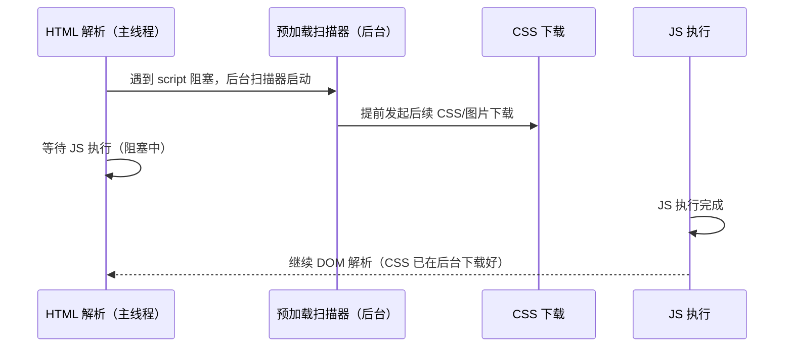

#### 追问链路

- DOM 树和 CSSOM 树是怎么构建的？同步还是异步？
- Render Tree 和 DOM 树有什么区别？`display:none` 在哪个树里？
- 什么操作会阻塞渲染？HTML/CSS/JS 分别怎么影响？

#### 追问答案

**DOM 和 CSSOM 的构建过程**
- DOM：HTML 字节 → 字符 → Token（标签/文本）→ Node → DOM Tree（深度优先）
- CSSOM：CSS 字节 → 字符 → Token → StyleRule → CSSOM Tree
- 两者**并行**构建（浏览器会同时下载 CSS 和解析 HTML），但 CSSOM 必须完整才能生成 Render Tree

**Render Tree 和 DOM Tree 的区别**
- DOM Tree 包含所有节点（包括 `<head>`、`display:none` 等）
- Render Tree 只包含**需要渲染的可见节点**，每个节点包含了样式信息
- `display:none` 的节点：在 DOM Tree 中存在，但**不在** Render Tree 中
- `visibility:hidden` / `opacity:0` 的节点：在 DOM Tree 和 Render Tree 中都存在

**各资源对渲染的影响**
- HTML：是 DOM 构建的基础，边下载边解析，不阻塞自身
- CSS：阻塞 Render Tree 构建（进而阻塞渲染），不阻塞 DOM 解析；但会阻塞其后的 JS 执行
- JS（无 defer/async）：阻塞 DOM 解析，因为 JS 可能修改 DOM；且等待 CSS 下载完（JS 可能读样式）
- 图片/字体：不阻塞 DOM/CSSOM/渲染，但加载完成后会触发重绘（或回流，字体影响布局）

---

## 层级二：重排、重绘与性能

### Q4 重排（reflow）和重绘（repaint）的区别是什么？

> 频率：`高频` 来源：字节 / 阿里 / 百度 / 小红书

#### 口述版

- **重排（reflow）**：几何属性变化（宽高、位置、margin）→ 重新计算 Layout → 必然触发重绘，代价高
- **重绘（repaint）**：视觉属性变化（颜色、背景、阴影）→ 跳过 Layout 直接 Paint，代价中
- **合成（composite）**：只改 `transform`/`opacity` → 跳过 Layout 和 Paint，只在 GPU 合成，代价最低
- 触发顺序：重排 > 重绘 > 合成，越靠前代价越大

#### 学习版

**三种更新路径**

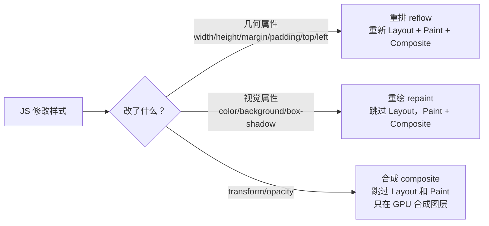

**触发重排的常见操作**

| 类型 | 具体操作 |
|------|---------|
| 几何属性 | 改 width/height/padding/margin/border |
| 位置属性 | 改 top/left/position/float |
| 字体 | 改 font-size/font-family/line-height |
| 结构变化 | 增删 DOM 节点、改 display |
| 读取布局 | `offsetWidth`、`scrollTop`、`getBoundingClientRect()` |
| 视口变化 | 窗口 resize |

**为什么读取 offsetWidth 也会触发重排**

浏览器有"批处理"优化：会积攒多次样式修改，统一在下一帧 Layout。但如果你读取 `offsetWidth` 等布局相关属性，浏览器必须**立即**执行 Layout 以返回最新值——这叫**强制同步布局（Force Synchronous Layout）**。

```js
// ❌ 强制同步布局，每次循环都触发重排
for (let i = 0; i < list.length; i++) {
  list[i].style.width = box.offsetWidth + 'px'; // 读 offsetWidth 触发重排
}

// ✅ 先读后写，只触发一次重排
const width = box.offsetWidth;
for (let i = 0; i < list.length; i++) {
  list[i].style.width = width + 'px';
}
```

#### 追问链路

- 哪些操作会触发重排？哪些只触发重绘？
- `transform` 和 `opacity` 为什么既不重排也不重绘？
- 读 DOM 属性（`offsetHeight`）会触发重排吗？为什么？

#### 追问答案

**只触发重绘不触发重排的属性**
- `color`、`background-color`、`background-image`
- `border-color`、`outline`、`box-shadow`
- `visibility`（改为 hidden 时不触发回流，但 display:none 会）
- `text-decoration`、`border-radius`

**transform/opacity 为什么走合成层**
- 浏览器会把有 `transform`/`opacity` 动画的元素提升为独立的合成层（Compositing Layer）
- 合成层的更新由 GPU 独立完成，不需要 CPU 重新计算 Layout 和 Paint
- 这就是用 `transform: translateX()` 代替改 `left` 做动画性能更好的原因
- 注意：滥用 `will-change: transform` 创建太多合成层会增加内存压力

**读 offsetHeight 为什么触发重排**
- 浏览器默认把多次样式修改攒在一起，延迟到下一帧统一 Layout（批处理优化）
- `offsetHeight`、`scrollTop`、`clientWidth`、`getBoundingClientRect()` 等需要返回实时几何值
- 如果返回的是"批处理前"的旧值，就没有意义，所以浏览器必须立即 flush 队列执行 Layout
- 结论：交替读写布局属性会让每次写都触发一次重排，性能极差

---

### Q5 怎么减少重排和重绘？

> 频率：`中频` 来源：字节 / 百度

#### 口述版

- **批量修改 DOM**：用 `DocumentFragment` 或先 `display:none` 再批量修改
- **读写分离**：先集中读取布局属性，再集中写入，避免交替读写
- **用 class 替代内联样式**：一次性切换 class，触发一次重排而非多次
- **动画用 transform/opacity**：走合成层，不触发重排重绘
- **虚拟列表**：大量 DOM 节点时只渲染可见区域

#### 学习版

**六种优化手段**

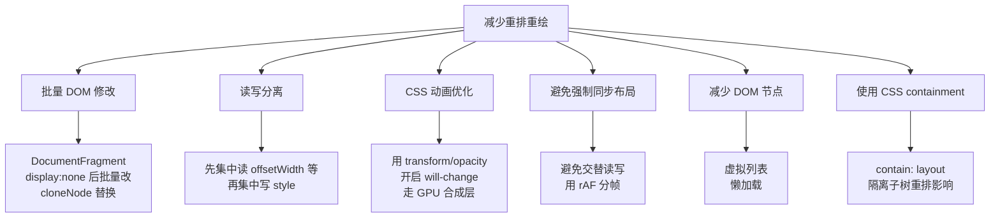

**DocumentFragment 批量操作示例**

```js
// ❌ 每次 appendChild 都可能触发重排
const list = document.getElementById('list');
for (let i = 0; i < 1000; i++) {
  const li = document.createElement('li');
  li.textContent = `Item ${i}`;
  list.appendChild(li); // 触发重排 1000 次
}

// ✅ 用 DocumentFragment，只触发一次重排
const fragment = document.createDocumentFragment();
for (let i = 0; i < 1000; i++) {
  const li = document.createElement('li');
  li.textContent = `Item ${i}`;
  fragment.appendChild(li); // 在内存中操作，不触发重排
}
list.appendChild(fragment); // 一次性插入，触发一次重排
```

**will-change 的正确用法**

```css
/* ✅ 在动画开始前加，动画结束后移除 */
.box.animating {
  will-change: transform;
}

/* ❌ 不要对所有元素常驻 will-change，内存爆炸 */
* { will-change: transform; }
```

#### 追问链路

- 批量修改 DOM 有哪些方法？
- 为什么 `transform` 做动画比改 `left/top` 性能好？
- `will-change` 是什么？什么时候该用，什么时候不该用？

#### 追问答案

**批量修改 DOM 的方法**
- `DocumentFragment`：在内存中构建 DOM 子树，一次性插入，只触发一次重排
- `display:none` 后批量操作：隐藏元素不在渲染树中，修改不触发重排；操作完再显示（共 2 次重排）
- `cloneNode` + 替换：克隆节点在内存中修改，用 `replaceChild` 一次性替换
- 用 CSS class 替代多条内联 style：一次 className 变更 = 一次重排

**transform vs left/top 性能差异**
- `left/top` 是几何属性，修改触发完整重排流水线（Layout → Paint → Composite）
- `transform` 只影响合成层，完全在 GPU 上计算，不触发 Layout 和 Paint
- 具体表现：60fps 动画，`transform` 几乎不消耗主线程 CPU；`left/top` 每帧都消耗

**will-change 的使用规范**
- 作用：提前告知浏览器该元素将发生变化，让浏览器提前为其创建合成层
- 正确用法：动画前通过 JS 添加，动画结束后移除（避免常驻）
- 不该用的场景：静态元素、变化不频繁的元素（创建合成层消耗内存，得不偿失）
- 每个合成层占用独立的 GPU 内存，层数过多可能导致内存压力和页面崩溃

---

## 层级三：事件循环与异步

### Q6 说说浏览器的 Event Loop 机制

> 频率：`高频必问` 来源：字节 / 阿里 / 百度 / 小红书

#### 口述版

- JS 是单线程的，Event Loop 是它处理异步任务的机制
- 任务分两类：**宏任务**（setTimeout/setInterval/I/O/UI 渲染）和**微任务**（Promise.then/MutationObserver/queueMicrotask）
- 每轮循环：执行一个宏任务 → 清空所有微任务队列 → 浏览器渲染 → 取下一个宏任务
- 微任务优先级高于宏任务，同一轮循环内微任务会全部执行完

#### 学习版

**Event Loop 完整循环**

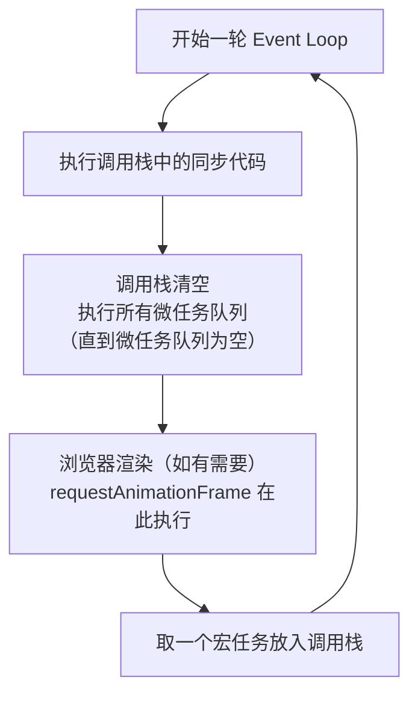

**宏任务 vs 微任务**

| 类型 | 具体 API | 执行时机 |
|------|---------|---------|
| 宏任务 | `setTimeout`/`setInterval` | 下一轮 Event Loop |
| 宏任务 | `MessageChannel`/`postMessage` | 下一轮 Event Loop |
| 宏任务 | `requestAnimationFrame` | 浏览器渲染前（每帧） |
| 宏任务 | `I/O 事件`/`UI 渲染` | 适时调度 |
| 微任务 | `Promise.then`/`catch`/`finally` | 当前轮调用栈清空后立即 |
| 微任务 | `MutationObserver` | 当前轮调用栈清空后立即 |
| 微任务 | `queueMicrotask()` | 当前轮调用栈清空后立即 |

**关键规则**
- 一轮 Event Loop 只取**一个**宏任务，但会清空**所有**微任务
- 微任务中产生的新微任务，也会在本轮被执行（不推迟到下一轮）
- `requestAnimationFrame` 在每帧渲染前执行，频率与显示器刷新率一致（60Hz → 约 16.67ms/次）

#### 追问链路

- 宏任务和微任务分别有哪些？执行优先级怎么排？
- `requestAnimationFrame` 是宏任务还是微任务？在哪个阶段执行？
- 微任务里产生新的微任务，会在本轮还是下一轮执行？

#### 追问答案

**优先级排序**
- 同步代码（调用栈）> 微任务 > requestAnimationFrame > 渲染 > 宏任务
- 微任务会"插队"在当前宏任务执行完之后立即执行，不会等到下一帧

**rAF 的定位**
- `requestAnimationFrame` 不是普通的宏任务，也不是微任务，而是**渲染帧内的特殊回调**
- 执行时机：在浏览器每帧渲染的"绘制"步骤之前执行，由浏览器根据显示器刷新率（60Hz → 16.67ms/帧）调度
- 适合做动画：和显示器同步，不会丢帧；和 setTimeout(fn, 16) 的区别是 rAF 由浏览器精确调度，不受 JS 阻塞影响
- 注意：rAF 的回调里产生的 Promise 微任务，会在该帧的 rAF 执行完后、渲染前清空

**Node.js vs 浏览器 Event Loop 的差异**
- 浏览器：宏任务 → 微任务 → 渲染（rAF → Layout → Paint → Composite）→ 下一个宏任务
- Node.js：没有渲染阶段，Event Loop 分 6 个阶段（timers → I/O callbacks → idle → poll → check → close callbacks）
- Node.js 的 `process.nextTick` 优先级高于 Promise.then（在每个阶段切换时立即执行）
- Node.js 的 `setImmediate` 类似 setTimeout(fn, 0)，在 check 阶段执行

**微任务产生新微任务**
- 在本轮 Event Loop 中立即执行，不推迟到下一轮
- 这意味着如果微任务不断产生新的微任务，可能会无限循环阻塞渲染
- 示例：`Promise.resolve().then(() => Promise.resolve().then(...))` 会持续添加微任务

---

### Q7 给定一段代码，说出输出顺序

> 频率：`高频` 来源：字节 / 阿里（必考代码题）

#### 口述版

- 分析顺序：同步代码先跑 → Promise.then/async-await 进微任务队列 → setTimeout 进宏任务队列
- `await` 后面的代码等价于 `.then()` 的回调（微任务）
- 每次宏任务执行完，清空所有微任务，再取下一个宏任务

#### 学习版

**经典代码题**

```js
console.log('1');

setTimeout(() => {
  console.log('2');
  Promise.resolve().then(() => console.log('3'));
}, 0);

Promise.resolve()
  .then(() => {
    console.log('4');
    setTimeout(() => console.log('5'), 0);
  })
  .then(() => console.log('6'));

async function asyncFn() {
  console.log('7');
  await Promise.resolve();
  console.log('8');
}

asyncFn();
console.log('9');
```

**完整执行分析**

```
【调用栈 - 同步代码】
console.log('1')       → 输出 1
setTimeout(cb1, 0)     → cb1 加入宏任务队列
Promise.resolve().then → then1 加入微任务队列
asyncFn() 调用:
  console.log('7')     → 输出 7
  await Promise.resolve() → await 后的代码（输出8）加入微任务队列
console.log('9')       → 输出 9

【清空微任务队列】
执行 then1：console.log('4') → 输出 4
             setTimeout(cb2) → cb2 加入宏任务队列
执行 .then('6') → 输出 6   （then1 执行完，链上的 then2 进入微任务队列，立即执行）
执行 await 后的代码：console.log('8') → 输出 8

【宏任务队列：[cb1, cb2]，取 cb1】
cb1 执行：console.log('2') → 输出 2
          Promise.resolve().then → then3 加入微任务队列

【清空微任务队列】
then3：console.log('3') → 输出 3

【宏任务队列：[cb2]，取 cb2】
cb2 执行：console.log('5') → 输出 5
```

**最终输出顺序：1 → 7 → 9 → 4 → 6 → 8 → 2 → 3 → 5**

**async/await 转换规则**

```js
// 这两段代码等价：
async function fn() {
  await somePromise;
  console.log('after await');
}

// 等价于：
function fn() {
  somePromise.then(() => {
    console.log('after await'); // 这行是微任务
  });
}
```

#### 追问链路

- `async/await` 本质是 Promise，`await` 后面的代码相当于什么？
- `Promise.resolve().then()` 和 `setTimeout(fn, 0)` 谁先执行？
- 如果微任务里又产生了新的微任务，会在本轮还是下一轮执行？

#### 追问答案

**await 后面的代码相当于什么**
- `await expr` 之后的代码 = `expr.then(continuation)` 中的 `continuation`
- 即微任务（Promise.then 回调）
- 注意：`await` 右边的表达式本身是同步执行的，只有 `await` 之后的代码才是微任务

**Promise.then vs setTimeout(0)**
- `Promise.then` 是微任务，`setTimeout(0)` 是宏任务
- 同一个宏任务内，微任务永远先于下一个宏任务执行
- 即使 setTimeout 先注册，Promise.then 也先执行

**微任务产生新微任务的执行时机**
- 本轮 Event Loop 内立即执行（不推迟）
- 规则：只要微任务队列不为空，就持续执行，直到清空为止
- 风险：递归产生微任务可能阻塞渲染（永远不进入"渲染"和"下一个宏任务"阶段）

---

## 层级四：HTTP 与网络

### Q8 HTTP 缓存机制是什么？强缓存和协商缓存有什么区别？

> 频率：`高频` 来源：字节 / 阿里 / 百度

#### 口述版

- **强缓存**：命中时**不发请求**，直接从本地读取（状态码 200 from cache）
  - 字段：`Cache-Control: max-age=N`（优先）/ `Expires: 日期`
- **协商缓存**：发请求到服务器**验证**是否过期，未变则返回 304 Not Modified
  - 字段：`ETag`/`If-None-Match`（优先）/ `Last-Modified`/`If-Modified-Since`
- 优先级：强缓存 > 协商缓存；`Cache-Control` > `Expires`；`ETag` > `Last-Modified`

#### 学习版

**缓存判断流程**

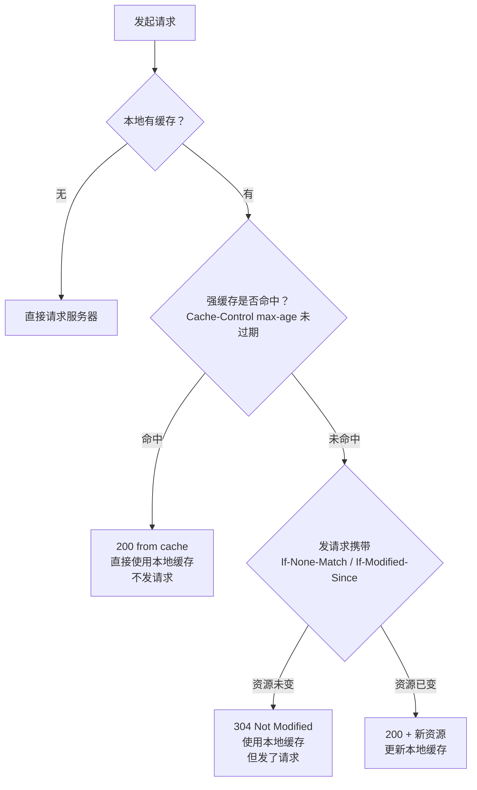

**强缓存 vs 协商缓存对比**

| 对比项 | 强缓存 | 协商缓存 |
|--------|--------|---------|
| 是否发请求 | ❌ 不发 | ✅ 发（但可能 304） |
| 响应状态码 | 200（from disk/memory cache） | 304 |
| 响应头字段 | `Cache-Control`、`Expires` | `ETag`、`Last-Modified` |
| 请求头字段 | 无（直接使用本地缓存） | `If-None-Match`、`If-Modified-Since` |
| 精确度 | 时间精度（秒级，可能有偏差） | ETag 内容哈希，精确 |

**ETag vs Last-Modified**

| 对比项 | ETag | Last-Modified |
|--------|------|--------------|
| 基于 | 文件内容哈希 | 文件最后修改时间 |
| 精度 | 内容变了才变，不受时间影响 | 秒级，1 秒内多次修改检测不到 |
| 适用场景 | 文件内容频繁变化，或需要精确控制 | 文件修改不频繁，可接受秒级精度 |
| 服务器开销 | 较大（需要计算哈希） | 较小（读文件修改时间） |

**Cache-Control 常用指令**

```
max-age=N       缓存 N 秒（相对时间，优先级高于 Expires）
no-cache        不用强缓存，每次都发请求验证（协商缓存）
no-store        完全不缓存，每次都重新下载
public          可被代理服务器缓存
private         只能被浏览器缓存（默认）
must-revalidate 过期后必须向服务器验证，不能直接使用旧缓存
```

#### 追问链路

- `Cache-Control` 和 `Expires` 有什么区别？谁优先？
- `ETag` 和 `Last-Modified` 各自原理？谁优先？
- `no-cache` 和 `no-store` 的区别？

#### 追问答案

**Cache-Control vs Expires**
- `Expires`：HTTP/1.0 字段，值是绝对时间（GMT 格式），依赖客户端和服务器时钟一致
- `Cache-Control: max-age`：HTTP/1.1 字段，值是相对秒数（从响应时间算），不依赖时钟同步
- 优先级：`Cache-Control` 优先于 `Expires`（存在 Cache-Control 时忽略 Expires）

**ETag vs Last-Modified 优先级**
- 两者都存在时，浏览器优先使用 `ETag`/`If-None-Match` 进行协商
- 服务器也优先响应 ETag 匹配的结果
- 原因：ETag 更精确（基于内容哈希），Last-Modified 有秒级精度问题

**no-cache vs no-store**
- `no-cache`：允许缓存，但每次使用前必须向服务器验证（走协商缓存流程）；如果服务器说没变，用本地缓存
- `no-store`：完全禁止缓存，每次都从服务器下载全新资源，不存入任何缓存（包括磁盘/内存）
- 场景：`no-cache` 用于需要实时性但带宽有限的内容；`no-store` 用于敏感数据（如银行交易记录）

---

### Q9 HTTP/1.1、HTTP/2、HTTP/3 有什么区别？

> 频率：`中频` 来源：字节 / 阿里 / 百度

#### 口述版

- **HTTP/1.1**：文本协议、持久连接（keep-alive）、管道化（但很少用）、队头阻塞
- **HTTP/2**：二进制分帧、多路复用（一个连接并发多请求）、头部压缩（HPACK）、Server Push
- **HTTP/3**：基于 QUIC（UDP），解决了 TCP 队头阻塞，0-RTT 连接迁移，握手更快

#### 学习版

**三个版本对比**

| 特性 | HTTP/1.1 | HTTP/2 | HTTP/3 |
|------|----------|--------|--------|
| 传输层 | TCP | TCP | QUIC（基于 UDP） |
| 数据格式 | 文本 | 二进制分帧 | 二进制分帧 |
| 连接复用 | keep-alive（串行） | 多路复用（并行） | 多路复用 + 连接迁移 |
| 头部 | 明文，重复传输 | HPACK 压缩 | QPACK 压缩 |
| 队头阻塞 | 有（HTTP 层 + TCP 层） | 有（TCP 层） | 无（QUIC 层解决） |
| Server Push | 无 | 有 | 有（更灵活） |
| 握手 RTT | TCP 1.5 + TLS 1-2 | 同 1.1 | QUIC 1-RTT（0-RTT 恢复） |

**HTTP/1.1 的队头阻塞**

```
HTTP/1.1 一个连接上：
  请求1 ──────> 响应1
                          请求2 ──────> 响应2
                                          请求3 ────> 响应3
  必须等前一个请求的响应回来，才能发下一个请求（keep-alive 也一样）
  → 浏览器只能开 6 个并发连接缓解
```

**HTTP/2 的多路复用**

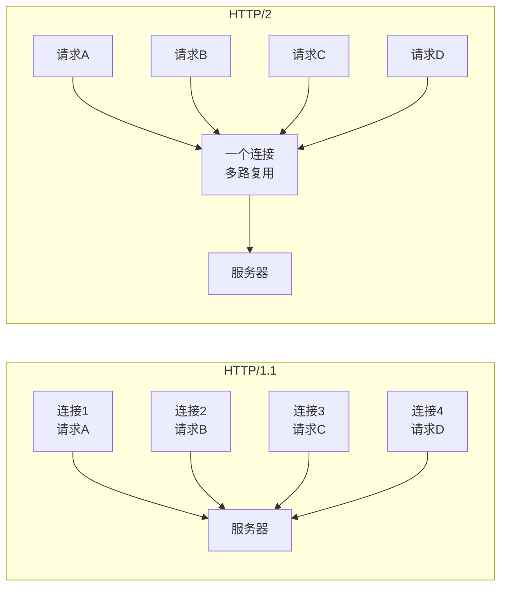

**HTTP/2 仍然有队头阻塞（TCP 层）**

- HTTP/2 在应用层解决了队头阻塞（多个请求并行）
- 但 TCP 层仍然有：如果某个包丢失，整个连接上所有请求都要等待重传
- HTTP/3 用 QUIC（UDP）解决这个问题：每个流独立，一个流丢包不影响其他流

#### 追问链路

- HTTP/2 的多路复用解决了 HTTP/1.1 的什么问题？
- HTTP/3 为什么从 TCP 换成 UDP？
- HTTP/2 的 Server Push 是什么？实际用得多吗？

#### 追问答案

**多路复用解决了什么**
- HTTP/1.1 队头阻塞：一个连接上多个请求必须串行，前一个慢了后面全等
- 浏览器为缓解只能开 6 个并发连接（每域名限制），连接数多但每个仍串行
- HTTP/2 一个连接上多个请求/响应并行传输（二进制帧交错），彻底消除应用层队头阻塞

**HTTP/3 为什么换 UDP**
- TCP 是"有序可靠"的，丢一个包会阻塞整个连接上所有流（TCP 层队头阻塞）
- QUIC 基于 UDP，每个流独立可靠传输，一个流丢包不影响其他流
- QUIC 还集成了 TLS 1.3，握手更快（1-RTT，恢复时 0-RTT）
- 连接迁移：网络切换（WiFi→4G）时连接 ID 不变，不需要重新握手

**Server Push 的实际使用**
- 服务器可以主动推送资源（如请求 HTML 时主动推送 CSS/JS）
- 理论上减少请求延迟，但实际用得不多
- 原因：客户端缓存难以预测（已缓存还会被推）、调试困难、Nginx 等代理支持有限
- HTTP/3 对 Server Push 做了改进，但依然不是主流方案

---

### Q10 HTTPS 的工作原理是什么？握手过程是怎样的？

> 频率：`高频` 来源：字节 / 阿里 / 腾讯

#### 口述版

- HTTPS = HTTP + TLS/SSL，在 TCP 之上加密通信
- 握手过程：客户端发支持的加密套件 → 服务器返回证书和公钥 → 客户端验证证书 → 协商出对称密钥 → 后续用对称加密通信
- **非对称加密**用于握手阶段协商密钥（安全但慢）；**对称加密**用于传输数据（快）
- 证书由 CA 签发，防止中间人冒充服务器

#### 学习版

**TLS 1.2 握手流程**

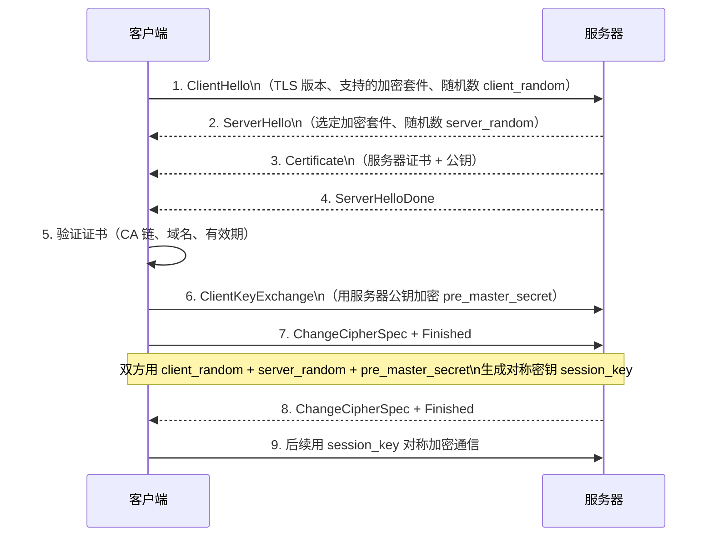

**对称加密 vs 非对称加密**

| 类型 | 特点 | 用途 |
|------|------|------|
| 对称加密 | 加密解密用同一密钥，速度快 | 传输数据（握手后） |
| 非对称加密 | 公钥加密、私钥解密，速度慢 | 握手阶段协商对称密钥 |

**证书验证机制**
- 服务器证书由 CA（证书颁发机构）签发，CA 本身的证书预装在操作系统/浏览器中
- 客户端用 CA 的公钥验证服务器证书的签名 → 确认证书未被篡改
- 证书包含：域名、有效期、公钥、CA 签名
- 验证项：CA 链有效、域名匹配、未过期、未被吊销（CRL/OCSP）

#### 追问链路

- 对称加密和非对称加密分别用在哪？为什么不能全用非对称？
- 证书是怎么验证的？中间人能伪造吗？
- HTTPS 一定比 HTTP 慢吗？优化手段有哪些？

#### 追问答案

**为什么不全用非对称加密**
- 非对称加密计算量大（RSA 加密 1KB 数据比对称加密慢 100 倍以上）
- 对称加密速度快，适合大量数据传输
- 折中方案：握手用非对称加密协商出对称密钥（保证密钥安全传输），之后用对称加密通信（保证速度）

**证书验证和中间人攻击**
- 中间人想伪造证书：必须有 CA 私钥才能签发，CA 私钥是高度保护的
- 中间人替换证书：客户端会验证 CA 签名，发现签名对不上（中间人没有 CA 私钥），拒绝连接
- 中间人自己当 CA：客户端不信任非系统预装的 CA，除非用户手动安装（这就是企业代理、抓包工具的原理）

**HTTPS 优化手段**
- TLS 1.3：握手从 2-RTT 降到 1-RTT，恢复连接时 0-RTT
- Session Resumption（会话恢复）：复用之前的密钥，跳过完整握手
- OCSP Stapling：服务器预先获取证书状态，减少客户端查询 CA 的延迟
- HTTP/2 over TLS：多路复用弥补 TLS 的握手开销
- 实际 HTTPS 比 HTTP 慢约 10-20%（握手开销），但安全收益远大于性能损失

---

## 层级五：TCP 与实时通信

### Q11 TCP 三次握手和四次挥手，为什么握手是三次、挥手是四次？

> 频率：`中频` 来源：百度 / 腾讯 / 字节

#### 口述版

- **三次握手**：SYN → SYN-ACK → ACK，目的是双方确认"我能发、我能收"
- 两次握手不够：服务器无法确认客户端能接收，可能建立无效连接
- **四次挥手**：FIN → ACK → FIN → ACK，因为 TCP 是全双工，两个方向需要分别关闭
- 挥手比握手多一次：关闭时服务器先 ACK（告知收到关闭请求），再单独发 FIN（服务器可能还有数据要发完）

#### 学习版

**三次握手详细流程**

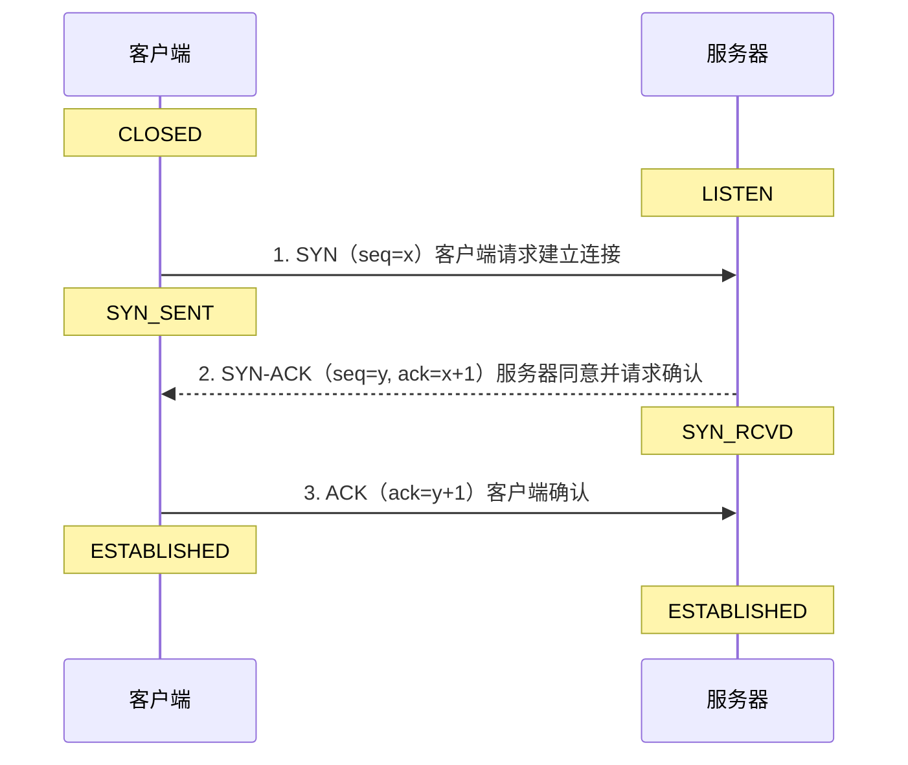

**四次挥手详细流程**

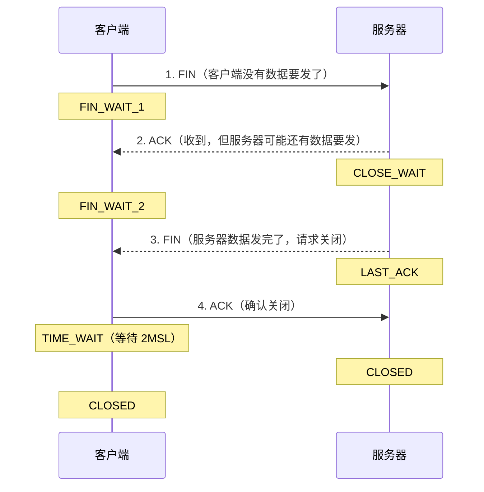

**TIME_WAIT 状态的作用**

- 客户端发出最后的 ACK 后，不能立刻关闭
- 等待时间：2MSL（Maximum Segment Lifetime，约 1-4 分钟）
- 原因1：保证最后的 ACK 能到达服务器（如果服务器重发 FIN，客户端还能再次 ACK）
- 原因2：防止旧连接的迟到数据包被新连接误收（等 2MSL 后旧包都过期了）

#### 追问链路

- 三次握手能不能改成两次？为什么？
- 四次挥手为什么需要 TIME_WAIT？等待多久？
- SYN 攻击是什么？怎么防御？

#### 追问答案

**三次握手能否改成两次**
- 不行。两次握手服务器发 SYN-ACK 后就认为连接建立，但客户端可能根本没收到
- 更严重：历史遗留的 SYN 包（网络延迟导致的重传包）可能让服务器建立无效连接，浪费资源
- 三次握手确保：双方都确认了"我能发，我能收"这两件事

**TIME_WAIT 等待时长**
- 等待 2MSL（2 × Maximum Segment Lifetime）
- MSL 通常是 1-2 分钟，所以 TIME_WAIT 约等待 2-4 分钟
- 高并发服务器 TIME_WAIT 过多会导致端口耗尽，优化手段：`SO_REUSEADDR`、`SO_REUSEPORT`

**SYN 攻击（SYN Flood）**
- 攻击者发大量伪造 IP 的 SYN 包，服务器分配连接资源并回 SYN-ACK，但等不到 ACK
- 半连接队列被占满，正常连接无法建立
- 防御方案：
  - SYN Cookie：不分配资源，用 hash 编码连接信息在 SYN-ACK 中，ACK 到来才分配
  - 限制 SYN 速率、增大半连接队列
  - 防火墙过滤异常 IP

---

### Q12 WebSocket 和 HTTP 有什么区别？什么场景用 WebSocket？

> 频率：`中频` 来源：字节 / 阿里

#### 口述版

- HTTP 是**请求-响应**模型（半双工），客户端发请求，服务器才能响应
- WebSocket 是**全双工**长连接，建立后服务器可以主动推送消息
- WebSocket 通过 HTTP 握手升级协议（Upgrade: websocket），之后不走 HTTP
- 适用场景：实时聊天、在线协作、股票行情、游戏、实时通知等

#### 学习版

**WebSocket 建立连接流程**

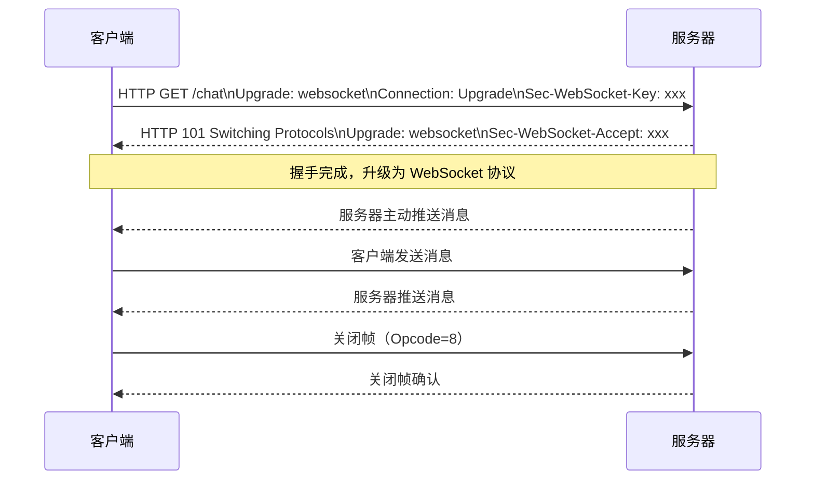

**轮询 vs 长轮询 vs SSE vs WebSocket**

| 方案 | 原理 | 优点 | 缺点 |
|------|------|------|------|
| 轮询 | 定时发 HTTP 请求 | 简单 | 浪费带宽，延迟高 |
| 长轮询 | 请求挂起，有数据才返回 | 实时性好于轮询 | 服务器连接占用多 |
| SSE | 单向流（服务器→客户端） | 简单，自动重连 | 只能服务器推，不能客户端发 |
| WebSocket | 全双工长连接 | 实时双向，低延迟 | 实现复杂，需要状态管理 |

**断线重连实现**

```js
function createWebSocket(url) {
  let ws;
  let reconnectTimer;

  function connect() {
    ws = new WebSocket(url);

    ws.onopen = () => {
      clearTimeout(reconnectTimer);
      console.log('connected');
    };

    ws.onmessage = (event) => {
      console.log('message:', event.data);
    };

    ws.onclose = () => {
      // 断开后 3 秒重连
      reconnectTimer = setTimeout(connect, 3000);
    };

    ws.onerror = (err) => {
      ws.close();
    };
  }

  connect();
  return () => ws; // 返回获取当前 ws 实例的函数
}
```

#### 追问链路

- WebSocket 怎么建立连接？握手阶段用的什么协议？
- 轮询、长轮询、SSE、WebSocket 各自的优缺点？
- WebSocket 断线重连怎么实现？心跳机制是什么？

#### 追问答案

**WebSocket 握手协议**
- 握手阶段用 HTTP，这是为了兼容现有的 HTTP 基础设施（防火墙、代理等）
- 客户端发 HTTP GET 请求，携带 `Upgrade: websocket`、`Connection: Upgrade`、`Sec-WebSocket-Key`（随机 base64）
- 服务器返回 101 Switching Protocols，携带 `Sec-WebSocket-Accept`（对 Key 做 SHA-1 哈希）
- 101 响应后，连接升级为 WebSocket 协议，不再走 HTTP

**各实时通信方案对比**
- 轮询：最简单，但浪费资源，每次都是新请求
- 长轮询：服务器挂起请求直到有数据，比轮询节省请求次数，但每次响应后还需新建请求
- SSE（Server-Sent Events）：HTTP 长连接，服务器单向推送，适合通知/实时日志，不需要客户端发消息
- WebSocket：真正的全双工，延迟最低，适合需要双向实时通信的场景

**心跳机制**
- WebSocket 长连接可能被中间代理/防火墙静默断开（超时无活动）
- 心跳：客户端定时发 ping 帧，服务器回 pong 帧；如果一定时间没收到 pong，判断断线并重连
- 实现：`setInterval` 每 30 秒发一个心跳包，如果 5 秒内没收到响应就触发重连逻辑

---

## 层级六：跨域与存储

### Q13 什么是同源策略？跨域有哪些解决方案？

> 频率：`高频` 来源：字节 / 阿里 / 百度 / 小红书

#### 口述版

- **同源**：协议 + 域名 + 端口三者完全相同
- **同源策略**：浏览器限制非同源页面的 DOM 访问、Cookie/Storage 读取、AJAX 请求
- 主要方案：**CORS**（推荐，服务器设置响应头）、**Nginx 反向代理**（开发/生产通用）、**JSONP**（老方案，只支持 GET）、**postMessage**（跨窗口通信）

#### 学习版

**同源判断示例**

```
基准 URL：https://www.example.com:443/page

https://www.example.com:443/other    ✅ 同源
http://www.example.com:443/page      ❌ 协议不同
https://api.example.com:443/page     ❌ 域名不同（子域也算不同）
https://www.example.com:8080/page    ❌ 端口不同
```

**CORS 跨域（推荐方案）**

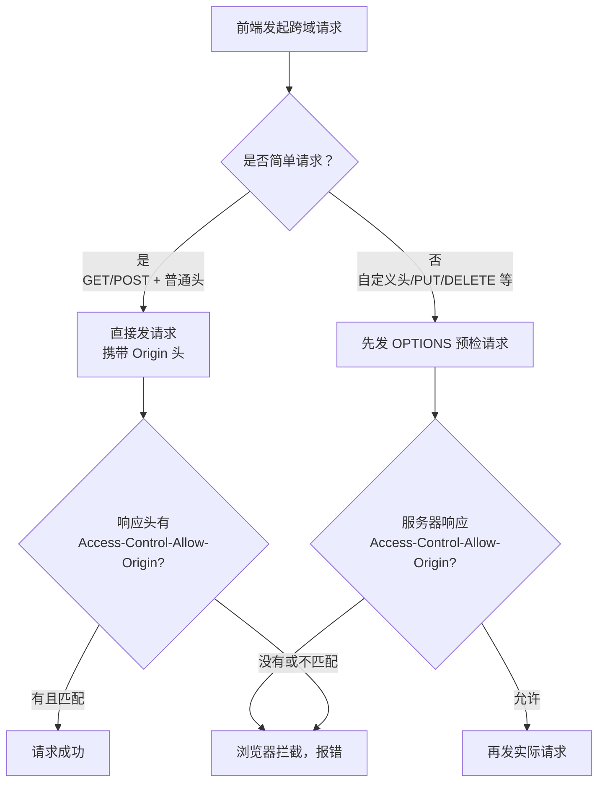

**CORS 关键响应头**

```
Access-Control-Allow-Origin: https://www.example.com  （允许的来源，* 表示所有）
Access-Control-Allow-Methods: GET, POST, PUT          （允许的方法）
Access-Control-Allow-Headers: Content-Type, Authorization （允许的请求头）
Access-Control-Allow-Credentials: true               （允许携带 Cookie）
Access-Control-Max-Age: 86400                        （预检结果缓存时间，秒）
```

**Nginx 反向代理跨域**

```nginx
# 前端请求 /api/xxx → Nginx 转发到 http://backend:8080/xxx
location /api/ {
    proxy_pass http://backend:8080/;
    # 同源了，不需要 CORS 头
}
```

**JSONP 代码示例**

```js
// 客户端
function jsonp(url, callbackName) {
  return new Promise((resolve) => {
    window[callbackName] = (data) => {
      resolve(data);
      document.body.removeChild(script);
      delete window[callbackName];
    };
    const script = document.createElement('script');
    script.src = `${url}?callback=${callbackName}`;
    document.body.appendChild(script);
  });
}

// 使用
jsonp('https://api.other.com/data', 'handleData').then(data => console.log(data));
// 服务器返回：handleData({"name": "zoe"})  → 浏览器执行这段 JS → 调用 window.handleData
```

**postMessage 跨域（iframe / 跨标签页通信）**

```js
// 发送方（父页面 origin: https://a.com）
const iframe = document.getElementById('myIframe');
iframe.contentWindow.postMessage(
  { type: 'greeting', data: 'hello' },
  'https://b.com'  // 目标 origin，安全起见不要用 '*'
);

// 接收方（iframe 内 origin: https://b.com）
window.addEventListener('message', (event) => {
  if (event.origin !== 'https://a.com') return; // 验证来源
  console.log('收到消息:', event.data);
  event.source.postMessage({ type: 'reply', data: 'hi' }, event.origin);
});
```

适用场景：嵌入第三方 iframe、微前端跨应用通信、浏览器标签页之间通信

#### 追问链路

- CORS 的简单请求和非简单请求有什么区别？预检请求什么时候发？
- JSONP 的原理是什么？为什么只支持 GET？
- Nginx 反向代理解决跨域的原理是什么？

#### 追问答案

**简单请求 vs 非简单请求**

简单请求同时满足：
- 方法：GET / POST / HEAD
- 请求头只包含：`Accept`、`Accept-Language`、`Content-Language`、`Content-Type`（且值为 `application/x-www-form-urlencoded`、`multipart/form-data`、`text/plain`）

不满足以上条件的就是非简单请求，需要先发 `OPTIONS` 预检请求。常见触发：
- 使用 `PUT`/`DELETE`/`PATCH` 方法
- 携带 `Authorization`、`X-Custom-Header` 等自定义头
- `Content-Type: application/json`

**JSONP 原理**
- 利用 `<script>` 标签不受同源策略限制的特点
- 客户端动态创建 `<script src="http://api.com/data?callback=handleData">`
- 服务器返回 `handleData({...})` 这段 JS 代码，浏览器执行，调用本地的 `handleData` 函数
- 只支持 GET：因为 `<script>` 标签只能发 GET 请求
- 缺点：安全风险（XSS）、只能 GET、错误处理困难，现在基本不用

**Nginx 反向代理原理**
- 前端和 Nginx 在同一域（同源），不存在跨域
- Nginx 收到请求后，在服务器端向后端 API 转发，服务器之间没有同源策略限制
- 本质：把"浏览器跨域"变成"服务器间通信"，绕过了浏览器的同源策略检查

---

### Q14 Cookie、localStorage、sessionStorage、IndexedDB 有什么区别？

> 频率：`中频` 来源：字节 / 阿里

#### 口述版

- **Cookie**：4KB 限制，每次请求自动携带，有过期时间，可设置 HttpOnly/Secure
- **localStorage**：5-10MB，永久存储，同源共享，不随请求发送
- **sessionStorage**：5-10MB，会话级（关闭标签页消失），不共享
- **IndexedDB**：几百 MB 到 GB 级，异步 API，支持索引查询，适合大量结构化数据

#### 学习版

**四种存储对比**

| 对比项 | Cookie | localStorage | sessionStorage | IndexedDB |
|--------|--------|-------------|----------------|-----------|
| 存储大小 | ~4KB | ~5-10MB | ~5-10MB | 数百MB-GB |
| 生命周期 | 可设置过期时间 | 永久（手动清除） | 标签页关闭即删 | 永久（手动清除） |
| 随请求发送 | ✅ 自动携带 | ❌ | ❌ | ❌ |
| 访问方式 | 同步 | 同步 | 同步 | 异步 |
| 作用域 | 可跨子域 | 同源 | 同源 + 同标签页 | 同源 |
| 服务器可访问 | ✅（HttpOnly） | ❌ | ❌ | ❌ |
| 数据格式 | 字符串 | 字符串 | 字符串 | 对象/Blob/文件 |

**Cookie 的安全属性**

```
HttpOnly   JS 无法通过 document.cookie 访问（防 XSS 窃取 Cookie）
Secure     只在 HTTPS 连接中传输
SameSite   控制跨站请求是否携带 Cookie：
  Strict   完全禁止跨站携带（最严格，但可能影响正常跳转）
  Lax      导航到目标网址的 GET 请求允许，其他跨站不允许（默认值）
  None     允许跨站携带（必须同时设置 Secure）
```

**IndexedDB 使用场景**

- 离线应用（PWA）：缓存大量数据供离线使用
- 大量结构化数据：如通讯录、聊天记录、文档草稿
- 文件缓存：存储图片/视频 Blob
- 复杂查询：支持建立索引，比 localStorage 的 key-value 更灵活

#### 追问链路

- Cookie 的 `HttpOnly`、`Secure`、`SameSite` 各有什么作用？
- localStorage 和 sessionStorage 的作用域区别？关浏览器后 sessionStorage 还在吗？
- 什么场景下用 IndexedDB？

#### 追问答案

**Cookie 安全属性作用**
- `HttpOnly`：JS 代码无法读取该 Cookie（`document.cookie` 不可见），防止 XSS 攻击窃取会话 Cookie
- `Secure`：只在 HTTPS 连接中发送，明文 HTTP 连接不携带，防止中间人嗅探
- `SameSite=Lax`（现代浏览器默认）：跨站请求不携带 Cookie，有效防御 CSRF 攻击

**sessionStorage 的作用域**
- 同源 + 同一个标签页（Tab）
- 不同标签页之间不共享（即使同源）
- 关闭标签页后清空（关闭浏览器也清空）
- 刷新页面不清空（页面刷新 = 同一会话）
- 通过 `window.open()` 或 `<a target="_blank">` 打开的新标签页，会复制父页面的 sessionStorage（但之后独立存在）

**IndexedDB 使用场景**
- 数据量超过 localStorage 上限（>5MB）时
- 需要存储二进制数据（Blob/ArrayBuffer）时
- 需要复杂查询（范围查询、索引搜索）时
- PWA 离线功能：把服务端数据缓存到 IndexedDB，断网时仍可使用
- 代替方案：小数据用 localStorage，大量数据首选 IndexedDB

---

## 层级七：前端安全

### Q15 XSS 攻击是什么？怎么防御？

> 频率：`高频` 来源：字节 / 阿里 / 百度

#### 口述版

- **XSS（跨站脚本攻击）**：攻击者在页面注入恶意 JS，借助受害者浏览器执行
- 三种类型：**存储型**（注入存到数据库，访问页面就触发）、**反射型**（URL 参数直接插入页面）、**DOM 型**（前端 JS 操作 DOM 时未过滤输入）
- 防御核心：**输入转义**（编码特殊字符）、**CSP**（内容安全策略限制脚本来源）、**HttpOnly Cookie**（防止 Cookie 被窃取）

#### 学习版

**XSS 攻击流程**

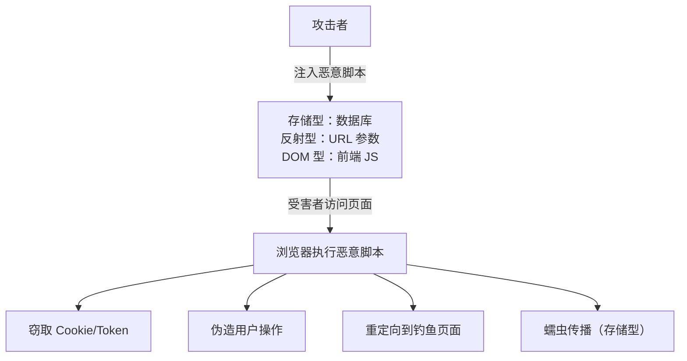

**三种 XSS 对比**

| 类型 | 攻击方式 | 持久化 | 典型场景 |
|------|---------|--------|---------|
| 存储型 | 恶意脚本存入数据库 | ✅ 永久 | 评论区、用户资料 |
| 反射型 | URL 参数直接插入页面 | ❌ 一次性 | 搜索结果、错误页 |
| DOM 型 | 前端 JS 直接操作 DOM | ❌ 一次性 | `innerHTML`、`eval` 等 |

**防御方案**

```js
// ❌ 危险：直接插入 HTML
element.innerHTML = userInput;

// ✅ 安全：用 textContent（自动转义）
element.textContent = userInput;

// ✅ 安全：转义 HTML 特殊字符
function escapeHtml(str) {
  return str
    .replace(/&/g, '&amp;')
    .replace(/</g, '&lt;')
    .replace(/>/g, '&gt;')
    .replace(/"/g, '&quot;')
    .replace(/'/g, '&#039;');
}
```

**CSP（内容安全策略）**

```http
# 只允许加载同源脚本，禁止内联脚本和 eval
Content-Security-Policy: default-src 'self'; script-src 'self'

# 允许特定域名的脚本
Content-Security-Policy: script-src 'self' https://cdn.example.com
```

#### 追问链路

- 存储型、反射型、DOM 型 XSS 的区别？
- `innerHTML` 和 `textContent` 哪个有 XSS 风险？为什么？
- CSP 如何防 XSS？

#### 追问答案

**三种 XSS 区别**
- 存储型：恶意脚本被存入服务器数据库，所有访问该页面的用户都会中招，危害最大
- 反射型：恶意脚本在 URL 参数中，服务器直接将参数反射到 HTML 输出，只有点击恶意链接的用户中招
- DOM 型：纯前端漏洞，服务器返回的 HTML 没有问题，但前端 JS 用 `innerHTML`/`document.write` 等将未经过滤的用户输入插入 DOM

**innerHTML vs textContent**
- `innerHTML`：直接将字符串解析为 HTML，`<script>` 和事件属性（`onerror`）会被执行 → XSS 风险
- `textContent`：将字符串作为纯文本插入，所有 HTML 标签都被转义显示，不执行脚本 → 安全
- 规则：显示用户输入时，能用 textContent/innerText 就不用 innerHTML

**CSP 如何防 XSS**
- 通过 HTTP 响应头 `Content-Security-Policy` 告诉浏览器只信任特定来源的脚本
- `script-src 'self'`：只允许同源脚本执行，禁止内联脚本（`<script>alert()</script>`）和 `eval()`
- 即使攻击者注入了恶意脚本标签，因为来源不在白名单内，浏览器拒绝执行
- 配合 `nonce`/`hash`：允许特定内联脚本执行（提前生成随机 nonce，注入脚本无法预知）

---

### Q16 CSRF 攻击是什么？和 XSS 有什么区别？怎么防御？

> 频率：`高频` 来源：字节 / 阿里

#### 口述版

- **CSRF（跨站请求伪造）**：诱导已登录用户访问恶意页面，自动发起伪造请求，利用浏览器自动携带 Cookie 的机制
- 和 XSS 的区别：XSS 是注入脚本在目标站点执行；CSRF 是借用用户身份在目标站点发请求（不需要获取 Cookie）
- 防御：**SameSite Cookie**（最简单）、**CSRF Token**（最通用）、**验证 Referer/Origin**

#### 学习版

**CSRF 攻击流程**

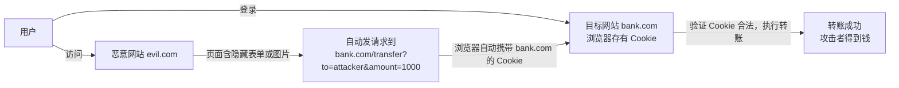

**XSS vs CSRF 对比**

| 对比项 | XSS | CSRF |
|--------|-----|------|
| 攻击方式 | 注入恶意脚本在目标站点执行 | 借用用户身份发伪造请求 |
| 是否需要获取 Cookie | 是（目的之一就是偷 Cookie） | 否（浏览器自动带，不需要获取） |
| 攻击位置 | 目标网站本身 | 第三方恶意网站 |
| 本质 | 代码注入漏洞 | 身份利用漏洞 |

**防御方案对比**

| 方案 | 原理 | 优点 | 缺点 |
|------|------|------|------|
| SameSite Cookie | 跨站请求不携带 Cookie | 简单，无需代码改动 | 老浏览器不支持；某些场景需要跨站 |
| CSRF Token | 每次请求带随机 Token，服务端验证 | 最通用，防护彻底 | 需要前后端配合，Ajax 需手动带 Token |
| Referer/Origin 验证 | 验证请求来源域名 | 简单 | Referer 可被伪造/关闭；有些场景没有 Referer |
| 双重 Cookie | Cookie + 请求参数各带一份相同值 | 不需要服务端存储 Token | 子域攻击可绕过 |

**CSRF Token 实现**

```js
// 服务端：生成 Token 存入 Session，并在表单/响应中下发
// <meta name="csrf-token" content="abc123">

// 前端：每次请求自动带上 Token
fetch('/api/transfer', {
  method: 'POST',
  headers: {
    'X-CSRF-Token': document.querySelector('meta[name="csrf-token"]').content,
    'Content-Type': 'application/json',
  },
  body: JSON.stringify({ to: 'user2', amount: 100 }),
});
// 恶意网站无法读取你网站的 meta 标签（同源策略），所以无法伪造 Token
```

#### 追问链路

- CSRF 是怎么利用用户登录态的？
- Token 防御和 SameSite Cookie 防御各有什么优缺点？
- 如果 XSS 和 CSRF 同时发生，怎么防？

#### 追问答案

**CSRF 如何利用登录态**
- 用户登录 bank.com 后，浏览器保存了 bank.com 的 Cookie（包含 Session ID）
- 用户访问 evil.com，该页面有 ``
- 浏览器加载图片时，自动向 bank.com 发起 GET 请求，并自动携带 bank.com 的 Cookie
- bank.com 看到 Cookie 合法，认为是用户本人操作，执行了转账
- 关键：攻击者不需要知道 Cookie 的值，只需要浏览器自动携带它

**SameSite vs CSRF Token 优缺点**
- SameSite：
  - 优点：只需设置 Cookie 属性，零代码改动
  - 缺点：SameSite=Strict 会破坏某些跨站跳转场景（如从邮件链接直接跳转）；Lax 允许 GET 请求跨站（GET CSRF 仍可能成功）
- CSRF Token：
  - 优点：防护全面（GET/POST 都可防），兼容性好
  - 缺点：需要前后端改造，每个请求都需要携带 Token，API 设计复杂度增加

**XSS + CSRF 同时存在**
- XSS 可以帮助绕过 CSRF 防御：攻击者通过 XSS 读取 CSRF Token 或 Cookie，再用 Token 发起 CSRF 请求
- 防御原则：先防 XSS（XSS 被利用后所有其他防御都可能失效）
- 叠加防御：同时使用 `HttpOnly` Cookie（防 XSS 窃取）+ CSRF Token（防 CSRF）+ CSP（防 XSS 执行）

---

## 层级八：性能优化综合

### Q17 前端性能优化有哪些手段？（从网络到渲染）

> 频率：`高频` 来源：字节 / 阿里 / 百度 / 小红书

#### 口述版

- **网络层**：CDN 加速、HTTP/2 多路复用、资源压缩（gzip/brotli）、减少请求数（合并/内联）
- **加载层**：代码分割（按需加载）、懒加载图片/组件、预加载关键资源（`<link rel="preload">`）
- **渲染层**：减少重排重绘（transform/opacity 动画）、虚拟列表、骨架屏
- **缓存层**：合理设置 Cache-Control、Service Worker 离线缓存

#### 学习版

**性能优化全景图**

```mermaid
graph TD
  P[前端性能优化] --> N[网络传输优化]
  P --> L[资源加载优化]
  P --> R[渲染性能优化]
  P --> C[缓存策略]

  N --> N1[CDN 分发]
  N --> N2[HTTP/2 多路复用]
  N --> N3[gzip/Brotli 压缩]
  N --> N4[减少 DNS 查询]

  L --> L1[代码分割\ndynamic import]
  L --> L2[图片懒加载\nIntersectionObserver]
  L --> L3[preload/prefetch]
  L --> L4[Tree Shaking]

  R --> R1[transform 做动画]
  R --> R2[虚拟列表]
  R --> R3[React.memo / useMemo]
  R --> R4[Web Worker 卸载计算]

  C --> C1[强缓存 max-age]
  C --> C2[内容哈希文件名]
  C --> C3[Service Worker]
```

**defer vs async**

```html
<!-- 默认：下载和执行都阻塞 HTML 解析 -->
<script src="app.js"></script>

<!-- async：下载不阻塞，下载完立即执行（阻塞 HTML 解析） -->
<!-- 适合独立脚本，不依赖 DOM，不依赖其他脚本（如统计、广告） -->
<script async src="analytics.js"></script>

<!-- defer：下载不阻塞，HTML 解析完成后按顺序执行，在 DOMContentLoaded 前 -->
<!-- 适合依赖 DOM 的脚本，保证执行顺序 -->
<script defer src="app.js"></script>
```

**关键渲染路径（CRP）优化**

```mermaid
flowchart LR
  A[HTML 下载] --> B[DOM 解析]
  C[CSS 下载] --> D[CSSOM 解析]
  B --> E[Render Tree]
  D --> E
  E --> F[Layout → Paint → Composite]
  G[JS 下载] -->|阻塞 DOM| B

  style G fill:#ff9999
  style C fill:#ffcc99
```

优化策略：
- CSS 放 `<head>`（尽早开始 CSSOM 构建）
- JS 放 `</body>` 前或用 `defer`（不阻塞 DOM 解析）
- 关键 CSS 内联到 `<style>`（消除 CSSOM 阻塞）
- 用 `<link rel="preload">` 预加载字体、关键图片

**图片优化清单**

| 优化项 | 说明 |
|--------|------|
| 格式选择 | WebP > AVIF（现代） / JPEG（照片） / PNG（透明） |
| 懒加载 | `loading="lazy"` 或 IntersectionObserver |
| 响应式图片 | `srcset` + `sizes`，按设备分辨率加载合适大小 |
| CDN 图床 | 自动转格式、按需缩放 |
| 雪碧图/SVG Symbol | 合并小图标减少请求数 |

**各优化手段的量化参考**

| 手段 | 典型收益 | 适用场景 |
|------|---------|---------|
| gzip 压缩 | 文本资源体积减少 60-80% | JS/CSS/HTML |
| Brotli 压缩 | 比 gzip 再小 15-25% | 支持 HTTPS 的现代浏览器 |
| HTTP/2 多路复用 | 减少 TCP 连接数，消除应用层队头阻塞 | 有多个资源的页面 |
| CDN 加速 | 全球 RTT 从 200ms 降到 20ms | 静态资源 |
| 代码分割 | 首屏 JS 体积减少 50%+ | SPA 应用 |
| 图片懒加载 | 首屏请求数减少 70%+ | 长页面 |
| Service Worker 缓存 | 离线访问，缓存命中时加载 < 100ms | PWA |
| `<link rel="preconnect">` | DNS+TCP+TLS 提前 300-500ms | 第三方域名资源 |

#### 追问链路

- 首屏加载优化有哪些手段？
- `defer` 和 `async` 的区别？分别什么时候用？
- 关键渲染路径（CRP）怎么优化？

#### 追问答案

**首屏加载优化**
- 代码分割：只加载首屏需要的代码（React.lazy、dynamic import），其余按需加载
- SSR/SSG：服务端渲染直接返回 HTML，减少客户端渲染时间，LCP 更快
- 预渲染：静态页面直接生成 HTML，CDN 缓存，首字节时间极短
- 骨架屏：在内容加载完成前展示占位骨架，用户感知更好（感知性能提升）
- 压缩资源：Brotli 比 gzip 压缩率高 20-30%，减少传输体积

**defer vs async 使用场景**
- `async`：独立脚本，不依赖 DOM，不依赖其他脚本（统计、广告、第三方工具）；多个 async 执行顺序不保证
- `defer`：需要操作 DOM，需要按顺序执行的应用脚本；多个 defer 按 HTML 出现顺序执行
- 两者共同点：都不阻塞 HTML 解析（下载并行进行）
- 无任何属性：下载 + 执行都阻塞 HTML 解析（老式写法，不推荐）

**CRP 优化核心**
- 减少关键资源数量：内联关键 CSS，延迟非关键 CSS（`media` 属性或 JS 加载）
- 减少关键资源大小：压缩 CSS/JS/HTML，移除未使用的代码（Tree Shaking、PurgeCSS）
- 减少关键路径长度（RTT 数）：CDN 缩短网络距离，HTTP/2 并行请求，preload 提前下载

---

## 面试速查表

| 题号 | 核心一句话 | 频率 | 大厂来源 |
|------|-----------|------|---------|
| Q1 | DNS→TCP握手→HTTPS→HTTP请求→服务器响应→浏览器渲染 | 高频必问 | 字节/阿里/百度/滴滴 |
| Q2 | 浏览器多进程（Tab隔离）；渲染进程内多线程；JS引擎和GUI渲染线程互斥 | 中频 | 字节/阿里 |
| Q3 | HTML→DOM + CSS→CSSOM → Render Tree → Layout → Paint → Composite | 高频 | 字节/阿里/百度 |
| Q4 | 几何属性变化=重排；视觉属性=重绘；transform/opacity=只合成（最轻） | 高频 | 字节/阿里/百度/小红书 |
| Q5 | DocumentFragment批量操作；读写分离；transform代替left/top做动画 | 中频 | 字节/百度 |
| Q6 | 一轮循环：一个宏任务→清空所有微任务→渲染→下一个宏任务；微任务优先 | 高频必问 | 字节/阿里/百度/小红书 |
| Q7 | 同步→微任务→宏任务；await后=.then回调（微任务）；输出1→7→9→4→6→8→2→3→5 | 高频代码题 | 字节/阿里 |
| Q8 | 强缓存不发请求；协商缓存发请求验证；Cache-Control>Expires；ETag>Last-Modified | 高频 | 字节/阿里/百度 |
| Q9 | HTTP/2多路复用解决应用层队头阻塞；HTTP/3 QUIC解决TCP层队头阻塞 | 中频 | 字节/阿里/百度 |
| Q10 | 握手=非对称协商密钥；通信=对称加密；证书=CA防中间人 | 高频 | 字节/阿里/腾讯 |
| Q11 | 握手三次=双方确认收发能力；挥手四次=全双工各自关闭；TIME_WAIT等2MSL | 中频 | 百度/腾讯/字节 |
| Q12 | WebSocket全双工长连接；HTTP升级握手；适合实时聊天/协作/行情 | 中频 | 字节/阿里 |
| Q13 | 同源=协议+域名+端口；CORS推荐；Nginx反向代理通用；JSONP只GET老方案 | 高频 | 字节/阿里/百度/小红书 |
| Q14 | Cookie随请求发/4KB；localStorage永久/5MB；sessionStorage标签页级；IndexedDB大容量 | 中频 | 字节/阿里 |
| Q15 | XSS注入脚本借浏览器执行；防御：转义输入+CSP+HttpOnly | 高频 | 字节/阿里/百度 |
| Q16 | CSRF借用户身份发伪造请求；防御：SameSite+CSRF Token；和XSS本质不同 | 高频 | 字节/阿里 |
| Q17 | 网络（CDN/HTTP2/压缩）→加载（代码分割/懒加载）→渲染（transform/虚拟列表）→缓存 | 高频 | 字节/阿里/百度/小红书 |

