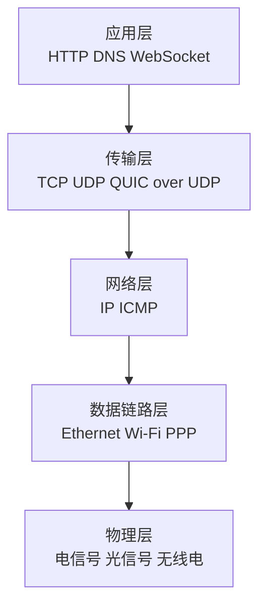
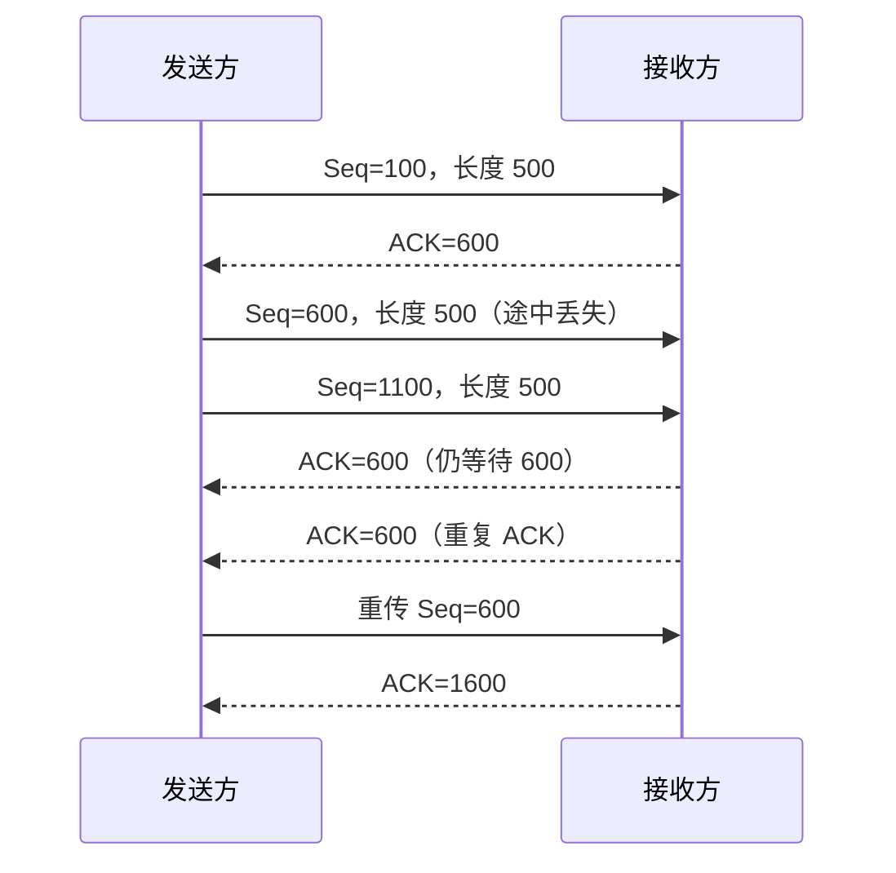
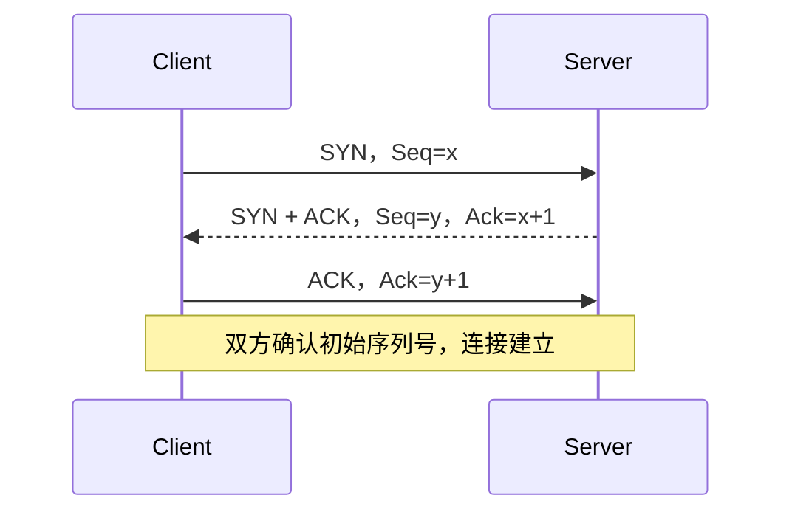
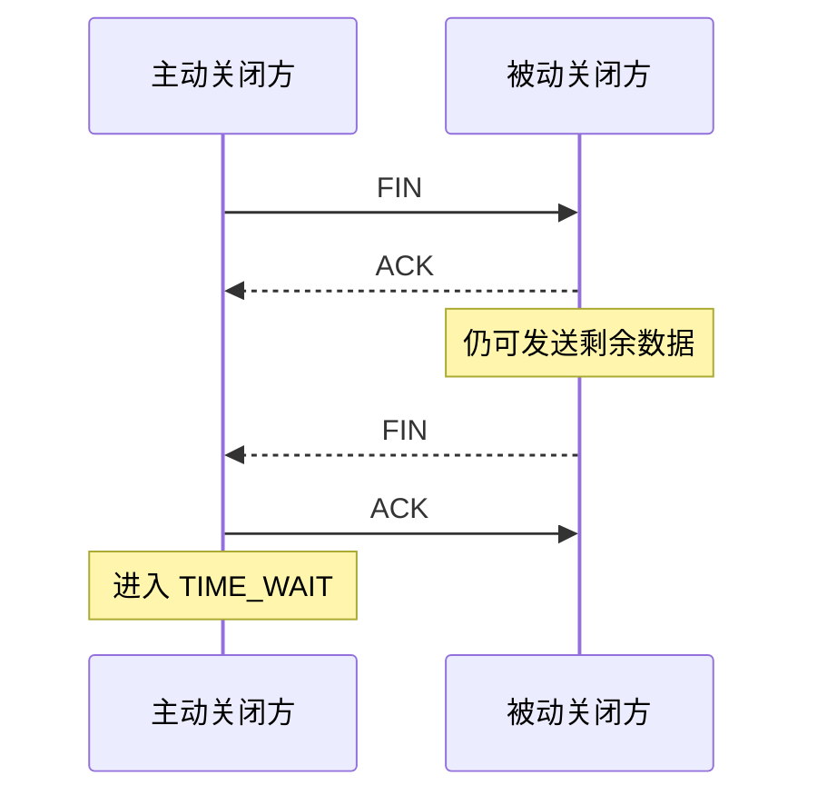
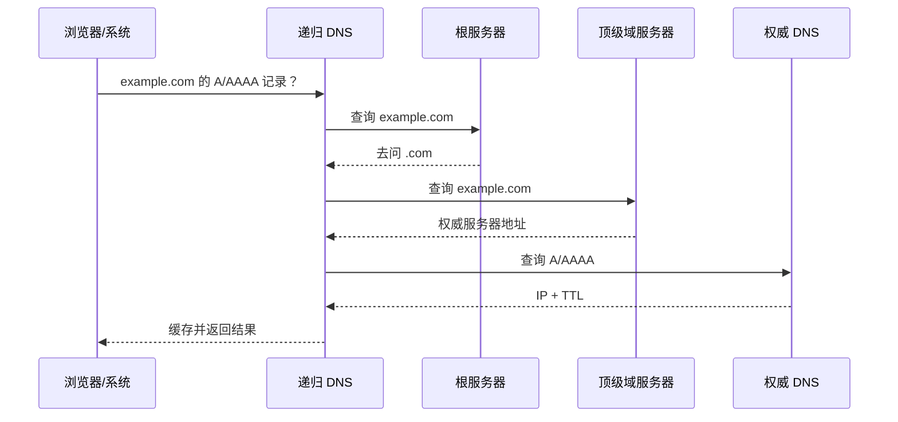
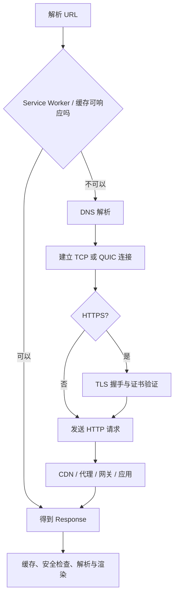

# 网络基础与一次请求的完整链路

> 这一篇解决 HTTP 之前的问题：数据为什么能找到目标、为什么能按顺序到达、连接为什么要握手，以及输入 URL 后各层到底做了什么。

## 1. 先建立一张分层地图

### 30～60 秒回答

网络分层不是为了背 7 个名字，而是为了把变化隔离开：应用层关心“发送什么业务数据”，传输层关心“进程之间怎么传”，网络层关心“跨网络送到哪台主机”，链路层关心“当前这一跳怎么传”。OSI 七层更偏概念教学，工程中更常用 TCP/IP 四层或五层模型。



| 常见模型 | 层次 | 前端常见协议或对象 |
|---|---|---|
| OSI 七层 | 应用、表示、会话、传输、网络、数据链路、物理 | 适合解释职责，不代表真实协议一定严格按层实现 |
| TCP/IP 四层 | 应用、传输、网际、网络接口 | 更接近互联网协议族 |
| 五层模型 | 应用、传输、网络、数据链路、物理 | 教学中常见，兼顾两者 |

### 为什么偏偏是七层

七层不是自然规律，而是一种抽象方案。层数更多，职责描述更细；层数更少，工程沟通更直接。面试时不要回答“因为网络本来就有七层”，应该回答“OSI 用七层建立通用参考模型，实际互联网协议栈并不总是严格对应”。

### PPP 属于哪一层

PPP（Point-to-Point Protocol）负责点到点链路上的封装、链路建立和认证，通常归到**数据链路层**。它不是 HTTP 请求链路的高频重点，知道定位和职责即可。

---

## 2. TCP 与 UDP 到底差在哪

### 快速回答

TCP 提供面向连接、可靠、有序的字节流，并实现流量控制和拥塞控制；UDP 提供无连接的数据报服务，保留消息边界，但不替应用保证送达、顺序和去重。选型不是“TCP 慢、UDP 快”这么简单，而是看应用愿意在哪一层承担可靠性、时延和拥塞控制成本。

| 维度 | TCP | UDP |
|---|---|---|
| 抽象 | 字节流，没有消息边界 | 数据报，保留一报一报的边界 |
| 建连 | 需要建立连接 | 发送前不需要连接握手 |
| 可靠与有序 | 协议提供确认、重传、排序、去重 | 应用自己决定是否实现 |
| 流量/拥塞控制 | 内建 | UDP 本身不提供，应用协议可自行提供 |
| 广播/组播 | 不支持 | 可支持 |
| 常见场景 | HTTP/1.1、HTTP/2、SSH、数据库连接 | DNS、实时音视频、QUIC 的承载 |

### 常见误区：UDP 一定比 TCP 快

“头部更小、没有连接握手”只说明 UDP 的基础机制更轻，不代表整个应用一定更快。应用如果需要可靠性，仍要实现确认、重传、拥塞控制和加密。QUIC 使用 UDP，是为了在用户态建立可演进的传输协议，不是为了放弃可靠性。

---

## 3. TCP 如何保证可靠传输

TCP 的可靠性不是某一个机制提供的，而是一组机制共同完成：

1. **序列号**：标记字节在数据流中的位置；
2. **确认号 ACK**：告诉对方下一个期望收到的字节；
3. **校验和**：发现传输中的比特错误；
4. **重传**：超时或重复 ACK 表明可能丢包时重新发送；
5. **接收窗口**：避免发送方压垮接收方；
6. **拥塞控制**：避免发送方压垮网络；
7. **有序重组与去重**：应用最终看到连续、有序的字节流。



### 滑动窗口解决什么

如果每发一个报文都等 ACK，带宽时延积稍大，链路就会闲着。滑动窗口允许发送方在未收到全部 ACK 前连续发送一定数量的数据。

- **接收窗口 `rwnd`**：接收方还能接多少，解决流量控制；
- **拥塞窗口 `cwnd`**：发送方估计网络还能承受多少，解决拥塞控制；
- 实际可发送窗口通常受二者较小值限制。

### 拥塞控制讲到什么程度够用

面试中至少能说清这条主线：

- 慢启动：开始保守探测容量，窗口快速增长；
- 拥塞避免：接近阈值后更谨慎地增长；
- 快速重传：多个重复 ACK 提示丢包，不必只等超时；
- 快速恢复：丢一个包不一定把发送速率完全打回起点；
- 现代实现可能采用 CUBIC、BBR 等算法，不能把教材中的 Reno 流程说成所有系统唯一实现。

---

## 4. 为什么 TCP 是三次握手

### 快速回答

三次握手让双方都确认自己的发送能力和对方的接收能力正常，同时交换并确认双方的初始序列号。两次不足以让服务端确认客户端收到了自己的初始序列号，也更难排除网络中的历史连接请求；四次可以做到，但第三次已经完成必要确认，没有额外价值。



### 第三次能携带应用数据吗

在常规 TCP 语义下，客户端发送第三次 ACK 时连接状态已经允许携带数据；前两次带 `SYN` 的报文通常不承载普通应用数据。TCP Fast Open 是额外扩展，不能和普通三次握手混为一谈。

### 面试官继续问：两次为什么不够

只做两次时，客户端知道服务端收到了自己的 `SYN`，也知道服务端能发送；但服务端不知道客户端是否收到了服务端的 `SYN` 和初始序列号。三次把这个闭环补上。

---

## 5. 为什么关闭连接通常是四次挥手

TCP 是全双工连接，两个方向要分别关闭。收到对方的 `FIN` 只代表“对方不再发送”，本端可能还有数据没发完，因此 ACK 和自己的 FIN 往往分开发送。



如果被动关闭方收到 `FIN` 后恰好也没有数据要发，它可以把 ACK 和 FIN 合并，所以抓包中不一定永远能看到四个独立报文。

### 为什么要等待 `2MSL`

主动关闭方保留 `TIME_WAIT`，主要有两个目的：

1. 如果最后一个 ACK 丢失，对方会重发 FIN，本端还能重新确认；
2. 让旧连接中的延迟报文在网络中消失，避免污染相同四元组的新连接。

`MSL` 是报文段在网络中允许存活的最大时间。具体操作系统的 `TIME_WAIT` 时长属于实现选择，不要把某个固定秒数说成协议永恒规定。

### “HTTP 三次握手、HTTP 四次挥手”错在哪

握手和挥手属于 **TCP 连接管理**，不是 HTTP 自己的流程。HTTP/1.1、HTTP/2 常运行在 TCP 上，所以经常一起出现；HTTP/3 使用 QUIC，就不会走 TCP 三次握手。

---

## 6. DNS：浏览器如何把域名变成地址

### 快速回答

浏览器需要先把域名解析为可连接的 IP 地址。系统会依次利用浏览器/系统缓存、hosts、递归解析器；缓存未命中时，递归解析器通常从根、顶级域和权威 DNS 获取结果。实际环境还可能涉及 CNAME、CDN 调度、IPv4/IPv6、DoH/DoT 和 Happy Eyeballs。



### CDN 为什么会影响 DNS 结果

CDN 常通过 CNAME、Anycast 或调度系统把用户导向合适的边缘节点。返回地址可能考虑运营商、地理位置、节点健康和负载，因此同一域名在不同网络、不同时间得到的结果可能不同。

### DNS 安全要点

- 传统 DNS 查询通常不加密，可能被观察或篡改；
- DNSSEC 用签名验证数据来源和完整性，但不负责隐藏查询内容；
- DoH/DoT 保护客户端到解析器的传输，不自动保证权威数据正确；
- HTTPS 证书仍会验证域名，因此“DNS 被改”不必然等于 HTTPS 内容可以被无感替换。

---

## 7. 输入 URL 后发生了什么

### 60 秒回答主线

1. 解析 URL，确定协议、主机、端口、路径和安全策略；
2. 检查 HSTS、Service Worker、浏览器缓存和可能的重定向记录；
3. 解析 DNS，选择可用地址；
4. 建立传输连接：HTTP/1.1、HTTP/2 通常使用 TCP，HTTP/3 使用 QUIC；
5. HTTPS 场景完成 TLS 握手、证书验证和密钥协商；
6. 发送 HTTP 请求，经过代理、CDN、网关到达应用；
7. 服务端返回响应，浏览器处理缓存、重定向、内容类型和安全策略；
8. 如果是 HTML，进入解析、子资源发现、渲染和脚本执行流程。



### 不要把它背成固定流水线

真实浏览器会并发、复用和提前执行很多步骤：DNS 可能被预解析，连接可能已经存在，HTTP/2 或 HTTP/3 可以复用，Service Worker 可能直接合成响应，缓存命中也可能跳过网络。面试时先讲逻辑阶段，再主动说明“实际实现会并发和复用”，比背一条绝对时序更准确。

### 一个可验证 DNS 和连接信息的 Node.js 示例

```js
import dns from 'node:dns/promises';
import https from 'node:https';

const host = 'example.com';

// 同时查询 IPv4 和 IPv6，观察系统解析结果
const addresses = await dns.lookup(host, { all: true });
console.log(addresses);

const request = https.get(`https://${host}`, (response) => {
  // reusedSocket 可以帮助判断这次请求是否复用了已有连接
  console.log({
    statusCode: response.statusCode,
    httpVersion: response.httpVersion,
    reusedSocket: request.reusedSocket,
  });

  response.resume(); // 消费响应体，让连接有机会被正确复用或释放
});

request.on('error', (error) => {
  console.error(error);
});
```

---

## 8. 高频追问与易错点

### TCP 只能一对一，UDP 才能一对多吗

TCP 的单条连接由源/目标地址和端口标识，是两个端点之间的字节流；服务端当然可以同时维护大量 TCP 连接。UDP socket 可以收发多个对端的数据报，也能用于广播和组播。不要把“单条连接一对一”说成“TCP 服务只能服务一个客户端”。

### 滑动窗口等于拥塞控制吗

不等于。接收窗口主要保护接收方，拥塞窗口主要保护网络。两者都会限制发送量，但观察对象不同。

### HTTPS 的安全层属于 OSI 哪一层

TLS 位于应用协议与传输协议之间，很难机械塞进 OSI 单层。面试时说“HTTP over TLS over TCP”比争论它严格属于表示层还是传输层更有价值。

### 前端需要懂到路由算法吗

通常不需要推导 BGP 算法，但应该理解 DNS/CDN、连接复用、丢包和 RTT 为什么会影响页面性能，以及为什么 HTTP/3 不能消灭所有网络延迟。

---

## 9. 延伸阅读

- [RFC 9293：Transmission Control Protocol](https://www.rfc-editor.org/rfc/rfc9293.html)
- [RFC 768：User Datagram Protocol](https://www.rfc-editor.org/rfc/rfc768.html)
- [RFC 1034：Domain Names - Concepts and Facilities](https://www.rfc-editor.org/rfc/rfc1034.html)
- [MDN：How does the Internet work?](https://developer.mozilla.org/en-US/docs/Learn_web_development/Howto/Web_mechanics/How_does_the_Internet_work)

下一篇：[HTTP 语义与报文](./02-http-semantics-and-messages.md)
