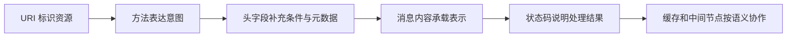

# HTTP 语义与报文：别把方法和状态码背成字典

> HTTP 的核心不是“浏览器发请求，服务器回数据”这句废话，而是一套统一语义：资源如何被标识、请求想做什么、响应表示什么、缓存和中间节点可以怎样处理。

## 1. HTTP 到底是什么

### 30～60 秒回答

HTTP 是应用层、无状态、可扩展的请求—响应协议。客户端围绕 URI 表达对资源的操作意图，服务器通过状态码、头字段和内容返回结果。HTTP 的“语义”与底层传输版本相对独立：HTTP/1.1 使用文本报文，HTTP/2 和 HTTP/3 使用二进制帧，但 GET、状态码、缓存等语义保持一致。



---

## 2. HTTP 无状态中的“状态”是什么

### 快速回答

HTTP 无状态是指：协议不会自动把当前请求与之前请求的业务上下文关联起来。服务器每次都应该仅凭当前请求中可见的信息理解它。它不等于服务器不能保存数据库数据，也不等于应用不能有登录状态；Cookie、Session、Token 只是应用在无状态请求之间显式携带关联信息。

举个例子：

- 用户修改昵称后，数据库当然会保存新昵称；
- 下一次请求是否属于同一个登录用户，HTTP 协议不会自动知道；
- 浏览器通过 Cookie 或 `Authorization` 把身份凭据再次带上，应用才恢复会话上下文。

### 为什么无状态有价值

无状态让请求更容易被代理、缓存、重试和分发到不同服务器，但业务状态必须显式设计。把 Session 放到单机内存里会重新引入节点黏性，这属于应用架构选择，不是 HTTP 自己“变成了有状态协议”。

---

## 3. HTTP 消息长什么样

HTTP/1.1 的消息可以直观看到起始行、头字段、空行和可选消息体：

```http
GET /products/42?currency=CNY HTTP/1.1
Host: shop.example.com
Accept: application/json
If-None-Match: "product-42-v7"
Authorization: Bearer <token>

```

```http
HTTP/1.1 200 OK
Content-Type: application/json; charset=utf-8
Cache-Control: private, max-age=60
ETag: "product-42-v8"
Content-Length: 52

{"id":42,"name":"机械键盘","price":699}
```

HTTP/2、HTTP/3 不再按上面的文本格式在线路中传输，但开发者看到的请求方法、状态码和头字段语义仍然类似。

### 请求头和响应头怎么分类更好记

不要背一张无限长清单，可以按职责分组：

| 类别 | 常见字段 | 解决的问题 |
|---|---|---|
| 内容协商 | `Accept`、`Accept-Language`、`Accept-Encoding` | 客户端希望得到什么表示 |
| 内容描述 | `Content-Type`、`Content-Length`、`Content-Encoding` | 当前消息内容是什么 |
| 缓存 | `Cache-Control`、`ETag`、`Last-Modified`、`Vary` | 能否复用、如何验证 |
| 条件请求 | `If-None-Match`、`If-Modified-Since`、`If-Match` | 满足条件才传输或修改 |
| 身份与会话 | `Authorization`、`WWW-Authenticate`、`Cookie`、`Set-Cookie` | 身份凭据和会话 |
| 来源与代理 | `Origin`、`Referer`、`Forwarded`、`Via` | 请求从哪里来、经过哪里 |
| 连接与升级 | `Connection`、`Upgrade`、`Keep-Alive` | 逐跳连接控制或协议升级 |
| 安全策略 | `Content-Security-Policy`、`Strict-Transport-Security` | 浏览器安全约束 |

注意：有些头字段是端到端语义，有些是逐跳语义。HTTP/2、HTTP/3 禁止继续照搬部分 HTTP/1.1 连接专用字段，例如 `Connection`。

---

## 4. GET、POST、PUT：先谈语义，再谈实现

### GET 与 POST 的高质量回答

- GET 表示获取资源的当前表示，语义上是安全方法，也是幂等方法；
- POST 表示让目标资源按自身规则处理提交内容，通常会创建下级资源、触发动作或执行非幂等操作；
- URL 长度限制主要来自浏览器、服务器、代理和产品实现，不是 HTTP 规范给 GET 规定一个统一的固定上限；
- POST 请求体也不是天然加密，是否保密取决于 HTTPS；
- GET 并非“绝对不能带请求体”，但其内容没有通用定义，许多实现和中间节点不支持，因此工程上不应依赖；
- 缓存和重试应该看方法语义、状态码和缓存字段，不要只用“GET 能缓存、POST 不能缓存”概括全部情况。

### POST 与 PUT 的区别

PUT 表示用当前请求中的表示创建或替换目标 URI 的状态，通常由客户端知道目标 URI；POST 则让目标资源决定如何处理，服务端常为新资源分配 URI。

```http
PUT /users/42 HTTP/1.1
Content-Type: application/json

{"name":"Lin"}
```

上面的意图是“让 `/users/42` 成为这个表示”。重复发送相同 PUT，请求的目标状态应保持一致，所以 PUT 语义上幂等。

```http
POST /users HTTP/1.1
Content-Type: application/json

{"name":"Lin"}
```

这里通常表示“请用户集合创建一个新成员”。重复提交可能创建多个用户，因此一般不幂等。实际 API 是否做到幂等，还取决于幂等键、业务约束和服务端实现。

### 安全、幂等、可缓存不是一回事

| 方法 | 安全 | 幂等 | 默认常见用途 |
|---|---:|---:|---|
| GET | 是 | 是 | 获取表示 |
| HEAD | 是 | 是 | 只获取响应元数据 |
| OPTIONS | 是 | 是 | 查询通信选项，也用于 CORS 预检 |
| PUT | 否 | 是 | 创建或完整替换目标资源 |
| DELETE | 否 | 是 | 删除目标资源 |
| POST | 否 | 否 | 提交处理、创建下级资源、触发动作 |
| PATCH | 否 | 不保证 | 局部修改 |

- **安全**：客户端没有请求改变服务端状态；日志和计费等附带影响不改变其语义分类；
- **幂等**：相同请求执行一次和多次，对服务端预期状态的效果相同；
- **可缓存**：是否允许缓存，需要结合方法定义、状态码和显式缓存控制。

---

## 5. 为什么会多一次 OPTIONS 请求

浏览器对某些跨源请求会先发送 CORS 预检请求：

```http
OPTIONS /api/orders HTTP/1.1
Origin: https://app.example.com
Access-Control-Request-Method: POST
Access-Control-Request-Headers: content-type, x-request-id
```

服务器允许后返回：

```http
HTTP/1.1 204 No Content
Access-Control-Allow-Origin: https://app.example.com
Access-Control-Allow-Methods: POST
Access-Control-Allow-Headers: Content-Type, X-Request-Id
Access-Control-Max-Age: 600
```

预检不是“POST 天生会多发一次”，而是浏览器针对**非简单跨源请求**确认服务器是否允许。完整的同源策略、凭据和预检缓存见[浏览器安全边界](./06-browser-security-boundaries.md)。

---

## 6. 状态码：先看类别，再看具体语义

| 类别 | 含义 | 高频状态码 |
|---|---|---|
| 1xx | 临时信息，最终响应还没完成 | `100`、`101`、`103` |
| 2xx | 请求已成功处理 | `200`、`201`、`204`、`206` |
| 3xx | 需要重定向或可复用已有表示 | `301`、`302`、`303`、`304`、`307`、`308` |
| 4xx | 客户端请求存在问题或无权限 | `400`、`401`、`403`、`404`、`409`、`412`、`429` |
| 5xx | 服务端或上游处理失败 | `500`、`502`、`503`、`504` |

### 101 Switching Protocols

`101` 表示服务器接受客户端的协议升级请求，例如经典 HTTP/1.1 WebSocket 握手。它不是“服务器内部正在更新协议版本”，也不用于 HTTP/2 的所有建连方式。

### 206 Partial Content

客户端通过 `Range` 请求部分字节，服务端成功返回范围时使用 `206`：

```http
GET /video.mp4 HTTP/1.1
Range: bytes=1000000-1999999
```

```http
HTTP/1.1 206 Partial Content
Content-Range: bytes 1000000-1999999/8000000
Content-Length: 1000000
```

常见场景包括视频拖动、断点续传、大文件分片读取。多段范围响应还可能使用 `multipart/byteranges`。

### 401 与 403

- `401 Unauthorized` 实际更接近“尚未完成身份认证”，响应常配合 `WWW-Authenticate`；
- `403 Forbidden` 表示服务端理解身份或请求，但拒绝授权访问。

### 502、503、504

- `502 Bad Gateway`：网关从上游收到无效响应；
- `503 Service Unavailable`：服务暂时不可用，可配 `Retry-After`；
- `504 Gateway Timeout`：网关等待上游超时。

---

## 7. 302、303、307、308 到底怎么区分

| 状态码 | 典型语义 | 后续方法 |
|---|---|---|
| 302 Found | 临时重定向，历史客户端行为不够一致 | POST 常被改为 GET |
| 303 See Other | 让客户端用 GET 获取另一个资源 | 明确改为 GET（HEAD 除外） |
| 307 Temporary Redirect | 临时重定向 | 保留原方法和请求体 |
| 308 Permanent Redirect | 永久重定向 | 保留原方法和请求体 |

提交表单后跳到结果页，常用 `303` 实现 Post/Redirect/Get；API 迁移且必须保留请求体时，使用 `307` 或 `308` 更明确。

### 301 和 308 都是永久重定向，区别是什么

核心仍是方法处理：历史上 `301` 对 POST 可能改成 GET，而 `308` 明确保留方法和请求体。永久重定向还会被浏览器和中间缓存长期记住，上线前要格外谨慎。

---

## 8. Connection: keep-alive 到底做了什么

### 快速回答

持久连接允许多个 HTTP 请求复用同一个传输连接，减少重复握手和慢启动成本。HTTP/1.1 默认使用持久连接，除非显式 `Connection: close`；HTTP/2、HTTP/3 通过长寿命连接承载多个并发流，不再使用 `Connection: keep-alive` 这种逐跳方式控制。

### 它和 TCP Keepalive 不是一回事

- HTTP keep-alive：复用连接发送多个 HTTP 请求；
- TCP keepalive：操作系统在连接长期空闲时发送探测，判断对端是否还活着；
- 应用心跳：业务协议主动探活，常见于 WebSocket。

三者解决的问题不同。

### 一个 Node.js 连接复用示例

```js
import https from 'node:https';

const agent = new https.Agent({
  keepAlive: true, // 请求完成后保留空闲连接，供后续请求复用
  maxSockets: 20,  // 限制并发连接数量，避免无边界创建 socket
});

function request(path) {
  return new Promise((resolve, reject) => {
    const req = https.get(
      { hostname: 'example.com', path, agent },
      (res) => {
        res.resume(); // 消费响应体，否则连接可能无法回到空闲池
        res.on('end', () => resolve(res.statusCode));
      },
    );

    req.on('error', reject);
  });
}

await Promise.all([request('/a'), request('/b')]);
agent.destroy(); // 进程结束前主动释放连接池
```

---

## 9. 条件请求不只用于 304

`If-None-Match` 常用于缓存验证：资源没变返回 `304`。`If-Match` 则可以防止“丢失更新”：

```http
PUT /documents/42 HTTP/1.1
If-Match: "revision-7"
Content-Type: application/json

{"title":"新的标题"}
```

如果资源已经被别人更新到 `revision-8`，服务端可以返回 `412 Precondition Failed`，避免客户端用旧版本覆盖新数据。这说明 ETag 不只是前端性能字段，也能参与并发控制。

---

## 10. 常见误区与递进追问

### URL 参数比请求体更不安全吗

如果使用 HTTPS，路径、查询参数和请求体都会在 TLS 通道中加密；但 URL 更容易进入浏览器历史、访问日志、监控平台和 Referer，因此敏感信息不应放在 URL。安全风险来自暴露面，不是“GET 没加密、POST 加密”。

### POST 一定不能缓存吗

不是。HTTP 语义允许在具有显式新鲜度信息等条件下缓存 POST 响应，但共享缓存和浏览器实际支持比 GET 少，工程上不要默认依赖。

### DELETE 幂等，为什么第二次可能返回 404

幂等描述的是多次请求对目标状态的预期效果，不要求每次响应完全相同。第一次删除后资源不存在，第二次返回 404，最终状态仍然是“不存在”。

### Host 为什么重要

同一 IP 可以托管多个站点。HTTP/1.1 的 `Host` 和 HTTP/2、HTTP/3 的 `:authority` 帮助服务器选择目标虚拟主机，也参与缓存键、路由和安全校验。

---

## 11. 延伸阅读

- [RFC 9110：HTTP Semantics](https://www.rfc-editor.org/rfc/rfc9110.html)
- [RFC 9112：HTTP/1.1](https://www.rfc-editor.org/rfc/rfc9112.html)
- [MDN：HTTP request methods](https://developer.mozilla.org/en-US/docs/Web/HTTP/Reference/Methods)
- [MDN：HTTP response status codes](https://developer.mozilla.org/en-US/docs/Web/HTTP/Reference/Status)

上一篇：[网络基础与请求链路](./01-network-foundation-and-request-lifecycle.md) ｜ 下一篇：[HTTP 缓存、CDN 与代理](./03-http-cache-cdn-and-proxy.md)
