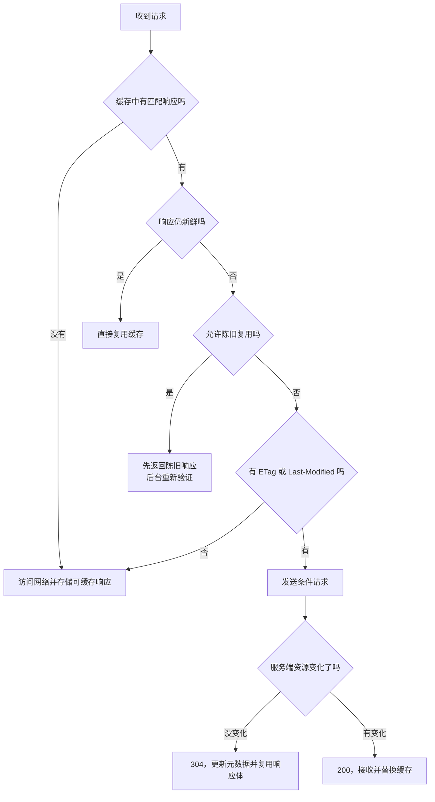
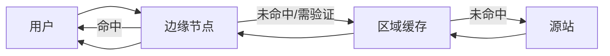
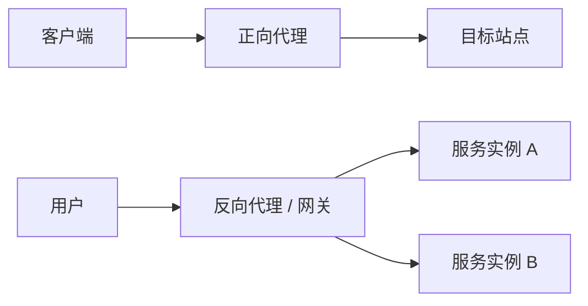

# HTTP 缓存、CDN 与代理：真正要会的是决策链

> “强缓存看 `Cache-Control`，协商缓存看 `ETag`”只是入门口诀。中高级面试更关心：谁在缓存、缓存键是什么、什么时候复用、什么时候验证、用户为什么还会看到旧资源。

## 1. 先说清楚缓存的目标

### 30～60 秒回答

HTTP 缓存通过复用已有响应，减少传输量和往返延迟。客户端先判断已有响应是否仍然新鲜；新鲜就直接复用，过期后可以携带验证器向服务端确认，未变化时收到 `304` 并继续使用本地内容。`Cache-Control` 决定可缓存性和新鲜度，`ETag`、`Last-Modified` 用于验证，但真实决策还受缓存位置、`Vary`、请求指令、认证信息和中间代理影响。



---

## 2. `Cache-Control`：最值得讲清楚的字段

### 响应侧常用指令

| 指令 | 含义 | 容易误解的点 |
|---|---|---|
| `max-age=600` | 响应可保持新鲜 600 秒 | 时间通常从响应生成时间计算，不是“浏览器打开页面后”才开始 |
| `s-maxage=600` | 共享缓存的新鲜时间 | 主要影响 CDN、代理，不覆盖私有缓存的 `max-age` |
| `public` | 允许共享缓存存储 | 不代表内容可以公开给任何用户 |
| `private` | 只允许私有缓存存储 | 浏览器仍可缓存，不等于 `no-store` |
| `no-cache` | 复用前必须验证 | 名字很误导，它仍然可以存储 |
| `no-store` | 不应存储请求或响应 | 适合高度敏感内容，但不是清除所有历史缓存的万能按钮 |
| `must-revalidate` | 过期后必须成功验证才能复用 | 离线时不能随意使用陈旧响应 |
| `immutable` | 新鲜期内内容不会变化 | 适合带内容哈希的静态资源 |
| `stale-while-revalidate=30` | 指定时间内可先返回陈旧内容，再后台验证 | 提升体验，但用户可能短暂看到旧数据 |
| `stale-if-error=86400` | 上游失败时允许使用陈旧响应 | 可提高可用性，需要接受数据陈旧风险 |

### 三个高频误区

1. `no-cache` 不是“不缓存”，而是“使用前重新验证”；
2. `private` 不是“绝对隐私”，只是阻止共享缓存复用；
3. HTML 不能一律 `no-store`。常见做法是让入口 HTML 可快速验证，而带哈希的 JS/CSS 长期缓存。

### 静态资源的典型策略

```http
Cache-Control: public, max-age=31536000, immutable
```

它适用于文件名包含内容哈希的资源，例如 `app.8f3a2c.js`。内容变化时生成新 URL，而不是要求所有缓存“立即忘掉旧文件”。

入口 HTML 可以使用：

```http
Cache-Control: no-cache
ETag: "home-v42"
```

浏览器可以存储 HTML，但复用前验证，从而较快发现新的资源清单。

---

## 3. `ETag` 与 `Last-Modified` 怎么选

### `ETag`

`ETag` 是服务端为某个表示生成的验证器。客户端后续发送：

```http
If-None-Match: "article-42-v8"
```

服务端判断仍是同一表示时返回 `304 Not Modified`，不传响应体。

优点：表达能力强，可以精确反映内容版本；缺点：需要生成和在多节点间保持一致，错误地把机器编号、压缩结果混入 ETag 可能降低缓存命中。

### `Last-Modified`

服务端提供最后修改时间，客户端发送：

```http
If-Modified-Since: Sun, 09 Aug 2026 08:00:00 GMT
```

它简单、直观，但时间精度和“修改时间是否真正代表内容变化”可能不够可靠。

### 两者同时存在怎么办

条件请求同时携带 `If-None-Match` 和 `If-Modified-Since` 时，`If-None-Match` 通常具有优先语义。工程上可以同时提供，让不同客户端和中间节点选择可用验证器。

### `304` 真的是“没有响应”吗

不是。`304` 仍然是一次网络往返，也会携带需要更新的响应头，只是没有重新发送完整表示。它节省带宽，但没有消除 RTT。

---

## 4. `Vary`：缓存键不只是 URL

服务器返回：

```http
Vary: Accept-Encoding, Accept-Language
```

表示缓存复用时还要考虑请求中的压缩能力和语言。如果遗漏 `Vary`，可能把中文响应发给英文用户；如果把变化频繁、取值很多的字段放进 `Vary`，又会让缓存碎片化。

### 不要随便写 `Vary: *`

它表示响应选择依赖未明确列出的请求信息，会极大限制缓存复用。更好的做法是明确真正影响表示的字段。

---

## 5. 浏览器里到底有哪些“缓存”

前端口中的缓存不是一个盒子：

| 位置/机制 | 特点 | 是否完全受 HTTP 缓存控制 |
|---|---|---|
| Memory Cache | 进程内、生命周期短、速度快 | 实现细节较多，不应依赖固定行为 |
| Disk Cache | 跨页面或进程复用，容量更大 | 主要遵循 HTTP 缓存语义 |
| Back/Forward Cache | 保存整页运行状态，支持前进后退快速恢复 | 不是普通 HTTP 响应缓存 |
| Service Worker Cache API | 应用代码显式读写 | 不会自动遵守 HTTP 缓存过期规则 |
| CDN/共享代理缓存 | 多用户共享、离用户更近 | 关注 `public`、`private`、`s-maxage`、认证等 |

DevTools 中看到 “from memory cache” 或 “from disk cache” 是浏览器实现提示，不是 RFC 要求的固定缓存层级。

---

## 6. Service Worker 与 HTTP 缓存是什么关系

Service Worker 可以拦截 `fetch`，自行决定从 Cache API、网络或合成响应中返回结果。Cache API 是脚本管理的键值存储，不会因为响应中有 `max-age` 就自动删除过期内容。

```js
self.addEventListener('fetch', (event) => {
  if (event.request.destination !== 'image') return;

  event.respondWith(
    caches.open('images-v1').then(async (cache) => {
      const cached = await cache.match(event.request);
      if (cached) return cached; // Cache API 命中后由应用决定是否直接使用

      const response = await fetch(event.request);
      if (response.ok) {
        await cache.put(event.request, response.clone()); // 响应流只能消费一次，因此先 clone
      }
      return response;
    }),
  );
});
```

这个示例演示 Cache First，但没有版本淘汰、容量治理、离线降级和错误恢复，不能直接当生产完整方案。

### 双层缓存会发生什么

Service Worker 内部调用 `fetch()` 时，网络请求本身仍可能使用浏览器 HTTP 缓存。因此调试“为什么拿到旧数据”时，要区分：

1. Service Worker 是否直接返回 Cache API；
2. `fetch` 是否命中 HTTP 缓存；
3. CDN 是否返回陈旧对象；
4. 源站数据是否真的更新。

---

## 7. CDN 的缓存链路

### 快速回答

CDN 把可缓存内容放在靠近用户的边缘节点。用户先访问边缘节点；命中时直接返回，未命中或过期时向上级缓存或源站回源。关键设计包括缓存键、TTL、回源验证、主动刷新、版本化 URL、故障时陈旧复用和防止热点同时回源。



### 缓存穿透、击穿、雪崩别混在一起

- **穿透**：请求本来就没有可缓存结果，例如大量不存在的 URL；
- **击穿**：一个热点对象失效，大量请求同时回源；
- **雪崩**：大量对象在相近时间失效或缓存系统整体异常，回源压力集中爆发。

应对方式包括负缓存、请求合并、过期时间抖动、分层缓存、限流和陈旧内容兜底。具体策略需要结合数据一致性要求。

### CDN 更新为什么推荐内容哈希

“刷新 CDN”很难保证所有中间层和浏览器立刻清除旧内容。把版本放进 URL，让新旧内容拥有不同缓存键，通常比强制失效更可靠。

---

## 8. 正向代理、反向代理与网关

### 正向代理

代理客户端访问外部服务，服务端主要看到代理。常见用途包括企业出口、访问控制、隐私保护和缓存。

### 反向代理

代表服务端接收请求，客户端不需要知道后端实例。常见用途包括 TLS 终止、负载均衡、缓存、压缩、限流和路由。

### API Gateway

网关通常也是反向代理，但更强调统一认证、协议转换、流量治理、观测和 API 生命周期管理。三个名词的边界来自职责重点，不是三个完全互斥的软件类别。



### Nginx 缓存和安全头示例

```nginx
proxy_cache_path /var/cache/nginx levels=1:2 keys_zone=api_cache:20m inactive=60m;

server {
    listen 443 ssl;
    server_name api.example.com;

    location /public-api/ {
        proxy_pass http://upstream_api;
        proxy_cache api_cache;

        # 仅缓存成功的公开 GET/HEAD 响应，敏感接口不要直接照搬
        proxy_cache_valid 200 5m;

        # 上游短暂失败时允许返回陈旧内容，提高可用性
        proxy_cache_use_stale error timeout updating http_500 http_502 http_503 http_504;

        # 避免同一热点资源过期时大量请求同时回源
        proxy_cache_lock on;

        add_header X-Cache-Status $upstream_cache_status always;
    }
}
```

生产环境还要设计缓存键、Cookie/Authorization 处理、用户隔离和主动失效，不能只打开 `proxy_cache`。

---

## 9. 一套更实用的前端缓存策略

### 带哈希静态资源

```text
/assets/app.8f3a2c.js
/assets/styles.b17d9a.css
```

使用长期缓存和 `immutable`。部署新版本时生成新 URL。

### HTML 入口

允许存储但要求验证，或者设置很短的新鲜期。目标是快速发现新资源清单，同时保留验证器降低传输量。

### 用户私有接口

根据数据敏感性使用 `private`、短 `max-age` 或 `no-store`。不要让 CDN 因错误缓存键把 A 用户的数据返回给 B 用户。

### 配置和灰度数据

要考虑“可缓存多久”和“最晚多久必须生效”是两个不同指标。可以使用短 TTL、ETag、版本号和失败时陈旧兜底组合。

---

## 10. 高频追问与误区

### 按下刷新和强制刷新有什么区别

浏览器刷新模式属于实现行为。普通刷新通常会重新验证部分资源，强制刷新更倾向绕过已有缓存，但 Service Worker、CDN 和应用内部缓存仍可能参与。不要把某个浏览器当前行为写成 HTTP 规范。

### `max-age=0` 和 `no-cache` 一样吗

它们经常都导致立即验证，但语义不同：`max-age=0` 表示响应立即陈旧，`no-cache` 明确要求复用前验证。与其他指令组合时差异更明显。

### 为什么资源已经改了，用户还看到旧版本

沿链路排查：URL 是否变化 → Service Worker Cache → 浏览器 HTTP 缓存 → CDN 边缘 → 上级缓存 → 源站 → 数据库。不要只盯着 DevTools 的一个 “Disable cache”。

### ETag 越精确越好吗

不一定。多节点生成不一致、压缩前后 ETag 混乱、每次动态渲染都生成新值，都会让验证器失去价值。ETag 应稳定代表“这个表示是否等价”。

---

## 11. 延伸阅读

- [RFC 9111：HTTP Caching](https://www.rfc-editor.org/rfc/rfc9111.html)
- [MDN：HTTP caching](https://developer.mozilla.org/en-US/docs/Web/HTTP/Guides/Caching)
- [MDN：Cache-Control](https://developer.mozilla.org/en-US/docs/Web/HTTP/Reference/Headers/Cache-Control)
- [MDN：Service Worker API](https://developer.mozilla.org/en-US/docs/Web/API/Service_Worker_API)

上一篇：[HTTP 语义与报文](./02-http-semantics-and-messages.md) ｜ 下一篇：[HTTP 版本演进与性能](./04-http-versions-and-performance.md)
