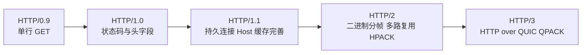
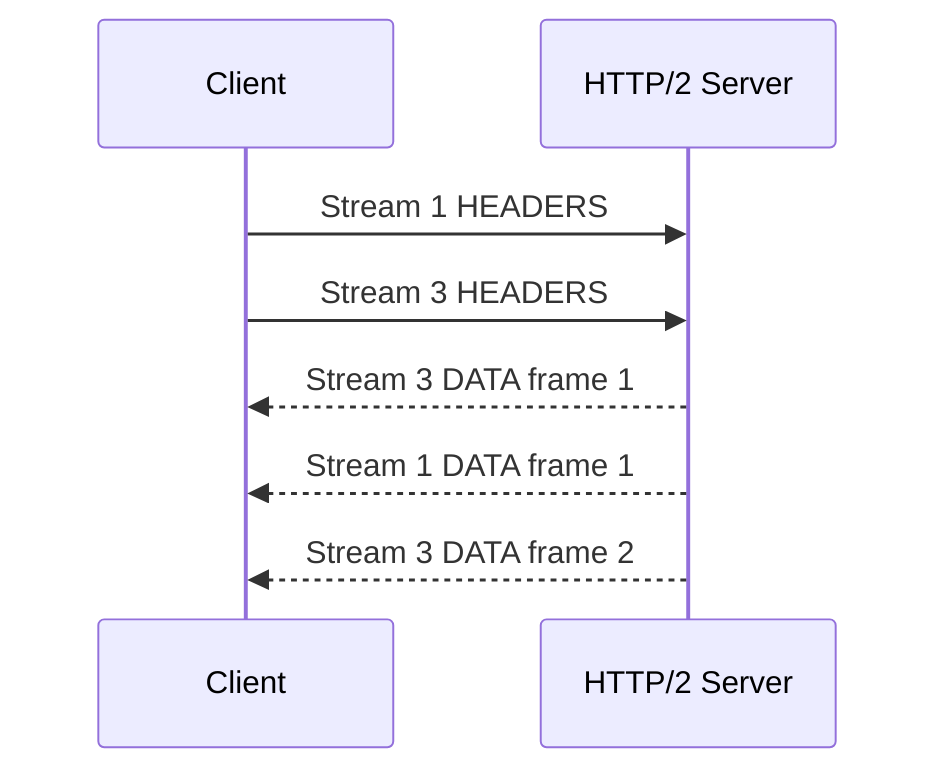
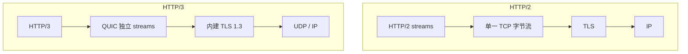

# HTTP 版本演进与性能：每一代到底解决了哪一层的问题

> 版本对比最怕背功能列表。真正的主线是：HTTP/1.x 如何使用连接，HTTP/2 如何把消息变成流和帧，HTTP/3 为什么要把传输从 TCP 换成 QUIC。

## 1. 一张演进图先建立全局认识



| 版本 | 主要承载 | 关键变化 | 仍然存在的问题 |
|---|---|---|---|
| HTTP/1.0 | TCP | 完整请求/响应格式、头字段、状态码 | 默认短连接、并发依赖多连接 |
| HTTP/1.1 | TCP | 默认持久连接、Host、分块传输、缓存与条件请求完善 | 同一连接响应顺序限制，常靠多连接并发 |
| HTTP/2 | TCP + 常见 TLS | 二进制帧、流、多路复用、HPACK、优先级、服务器推送 | 一个 TCP 连接丢包会阻塞其上所有流 |
| HTTP/3 | QUIC over UDP + TLS 1.3 | 流级别传输、QPACK、连接迁移、更紧密的握手 | UDP 部署、实现复杂度、0-RTT 重放等新权衡 |

### 30～60 秒回答

HTTP/1.1 通过持久连接降低重复握手，但一个连接里的响应处理仍受顺序限制，浏览器通常创建多条 TCP 连接并发。HTTP/2 把消息拆成带流 ID 的二进制帧，在一条 TCP 连接上并发多个流，并用 HPACK 压缩头部；但 TCP 丢包会卡住这条连接上的所有 HTTP/2 流。HTTP/3 把 HTTP 映射到 QUIC 的独立流上，单个流丢包不会阻塞其他流，同时支持连接迁移和更紧密的 TLS 1.3 握手。

---

## 2. HTTP/1.0 与 HTTP/1.1

### HTTP/1.0 的核心限制

早期实践常为每个请求建立一条 TCP 连接，重复承担握手、拥塞窗口重新增长和系统资源成本。虽然出现过非标准 `Connection: keep-alive` 扩展，但行为不够统一。

### HTTP/1.1 做了什么

- 默认持久连接；
- `Host` 支持基于名称的虚拟主机；
- 完善缓存、条件请求和 Range Request；
- `Transfer-Encoding: chunked` 允许不知道总长度时流式发送；
- 支持请求管线化语义，但浏览器实践受队头阻塞和服务端兼容影响，最终没有成为主流解法。

### 为什么浏览器会开多条连接

HTTP/1.1 在同一连接上很难安全地并发处理多个未完成请求和响应。多连接可以并行，但会增加握手、拥塞控制、内存和服务端连接数成本，所以它只是折中。

---

## 3. 队头阻塞发生在哪一层

“HTTP/2 解决了队头阻塞”只说了一半。

### HTTP/1.1 应用层队头阻塞

同一连接上的响应通常需要按请求顺序对应。前面响应慢，后面即使已经准备好，也很难越过它完整返回。

### HTTP/2 消除了消息层顺序阻塞

HTTP/2 把不同请求放进独立 stream，帧可以交错发送：



Stream 1 响应慢时，Stream 3 的帧仍可先发送，不需要等整个 Stream 1 完成。

### TCP 队头阻塞仍然存在

HTTP/2 的所有流共享一条有序 TCP 字节流。底层一个 TCP 段丢失时，后续字节即使已到达，也要等重传后才能按序交给 HTTP/2。于是一次丢包可能暂时影响所有流。

### HTTP/3 的改进

QUIC 为不同流维护独立的有序交付。某个流丢包时，该流等待重传，其他流可以继续向应用交付。注意：同一流内部仍然需要有序，网络拥塞和共享带宽也不会消失。

---

## 4. HTTP/2 的二进制分帧与多路复用

HTTP/2 把消息拆成 HEADERS、DATA、SETTINGS、WINDOW_UPDATE 等帧，每个帧带有 stream 标识。这样做带来三个重要能力：

1. 同一连接并发多条请求/响应流；
2. 独立控制每条流的生命周期和流量窗口；
3. 协议可以增加设置、优先级和错误处理机制，而不依赖文本解析技巧。

### 多路复用不是“同时执行 JavaScript”

它描述的是一条连接上帧的交错传输。服务端业务是否并行执行、浏览器如何调度资源，是更上层的实现问题。

### HTTP/2 也有流量控制

HTTP/2 在连接和 stream 层都有流量窗口，避免接收方被大量 DATA 帧压垮。这和 TCP 流量控制是不同层次的机制。

---

## 5. HPACK 为什么能压缩头部

HTTP 请求中大量字段重复，例如 `user-agent`、`accept`、Cookie 和自定义追踪头。HPACK 结合：

- 静态表：协议预定义的常见字段；
- 动态表：同一连接中双方逐步建立的字段表；
- 索引表示和 Huffman 编码。

后续请求可以发送“表中第几个条目”，而不是重复完整字符串。

### 头部压缩也会带来状态依赖

如果压缩上下文依赖之前的头部块，乱序或丢失会影响解码。HTTP/3 使用 QPACK，把表更新和请求流分离，并提供阻塞控制，适应 QUIC 流可以独立交付的特点。

### Cookie 太大仍然有成本

压缩只能降低重复传输，不能让无意义的 Cookie 免费。Cookie 仍影响首个请求、动态表、隐私和服务端解析成本，应控制作用域和体积。

---

## 6. HTTP/2 Server Push 为什么没有成为主流

Server Push 允许服务端在客户端明确请求前推送相关响应，但浏览器很难准确判断客户端是否已有缓存、资源优先级是否正确，推错内容会浪费带宽。Chrome 从 106 版本起移除了 HTTP/2 Server Push 支持，工程上更常使用 `preload`、`preconnect`、`103 Early Hints` 和良好的缓存策略。

面试中应该说“HTTP/2 规范提供过 Server Push，但浏览器实践价值有限、支持已明显收缩”，不要继续把它当作所有项目都应使用的现代优化手段。

---

## 7. HTTP/3 与 QUIC

### QUIC 不是“把 TCP 改成 UDP”

QUIC 运行在 UDP 之上，但自己实现了：

- 可靠传输与丢包恢复；
- 拥塞控制；
- 多条独立 stream；
- TLS 1.3 加密和身份认证；
- 连接 ID 与连接迁移；
- 用户态协议演进。

UDP 提供的是广泛可部署的数据报入口，QUIC 才是完整传输协议。



### 连接迁移为什么有用

TCP 连接通常和源/目标 IP、端口绑定。手机从 Wi-Fi 切到蜂窝网络，地址变化可能导致连接重建。QUIC 使用连接 ID 标识逻辑连接，在路径变化后可以验证新路径并继续连接，减少中断。

### 0-RTT 是零延迟吗

不是。0-RTT 表示客户端在恢复已有安全上下文时，可以在第一次发送中附带早期应用数据，减少等待；网络传播时间仍然存在。早期数据可能被重放，因此只应承载可安全重放、具备幂等保护的操作。

```js
// 服务端不能因为请求来自“安全连接”就忽略重放风险
async function createOrder(request) {
  const idempotencyKey = request.headers.get('Idempotency-Key');
  if (!idempotencyKey) {
    return new Response('Missing Idempotency-Key', { status: 400 });
  }

  // 用原子存储记录幂等键，避免重试或 0-RTT 重放创建多笔订单
  return orderService.createOnce(idempotencyKey, await request.json());
}
```

---

## 8. 协议协商：浏览器怎么知道用哪个版本

### HTTPS 下的 ALPN

客户端在 TLS 握手中通过 ALPN 表达支持的应用协议，例如 `h2` 或 `http/1.1`，服务端选择一个。HTTP/3 基于 QUIC，通常通过 Alt-Svc、DNS HTTPS 记录或已有配置发现可用端点，再使用 QUIC/TLS 协商 `h3`。

### 为什么第一次可能不是 HTTP/3

客户端需要先知道服务端支持 HTTP/3，而且 UDP 路径可用。浏览器可能先通过 TCP 访问，再从 `Alt-Svc` 学到 HTTP/3 端点；后续访问才更容易直接尝试 QUIC。不同浏览器和网络环境会并行探测或回退。

### 明文 HTTP/2 的 h2c

HTTP/2 规范存在明文使用方式，但公开 Web 浏览器主要使用 TLS 上的 `h2`。不要把“规范支持 h2c”误解成浏览器访问普通 `http://` 网站时普遍使用 HTTP/2。

---

## 9. 协议升级后，前端优化策略怎么变

### Domain Sharding

HTTP/1.1 时代把资源分散到多个域名，可以绕过单域连接数限制；在 HTTP/2、HTTP/3 下，这会拆散连接复用、增加 DNS 和握手，通常可能适得其反。

### 资源合并

把所有 JS/CSS 合成一个巨型文件能减少 HTTP/1.1 请求数，但会降低缓存粒度、延迟首屏执行。现代协议下应结合代码分割、缓存命中和执行成本判断，而不是盲目追求“请求越少越好”。

### 小图 Base64 内联

内联可以少一次请求，但会增加 HTML/CSS 体积、失去独立缓存和压缩边界。多路复用降低了额外请求的连接成本，不代表所有小资源都必须拆开。

### 性能瓶颈不只在协议

HTTP/3 无法修复：

- 过大的 JavaScript；
- 主线程长任务；
- 糟糕的缓存策略；
- 服务端慢查询；
- 第三方脚本阻塞；
- 图片未压缩和布局抖动。

协议优化应放在完整性能链路中评估。

---

## 10. 高频追问与误区

### HTTP/2 一定只有一条 TCP 连接吗

通常一个 Origin 会尽量复用较少连接，但连接合并、代理、证书、网络隔离键和故障恢复都会影响实际数量。不要把“一条连接多路复用”说成浏览器全局永远只有一条 TCP 连接。

### HTTP/3 完全没有队头阻塞吗

没有 TCP 那种跨 QUIC 流的有序交付阻塞，但单个流内部仍按序；QPACK 头部解码也可能等待动态表更新；拥塞和带宽竞争仍会影响所有流。

### HTTP/2 头部必须小写吗

HTTP/2、HTTP/3 的字段名使用小写，并用 `:method`、`:scheme`、`:authority`、`:path` 等伪头字段表达原先请求行的一部分。应用框架常会帮你转换，抓包或实现代理时才更容易看到差异。

### HTTP/2 比 HTTP/1.1 永远快吗

不保证。极低延迟、极少请求、代理实现、丢包、服务器配置和优先级策略都会影响结果。版本提供能力，性能仍要测量。

---

## 11. 延伸阅读

- [RFC 9112：HTTP/1.1](https://www.rfc-editor.org/rfc/rfc9112.html)
- [RFC 9113：HTTP/2](https://www.rfc-editor.org/rfc/rfc9113.html)
- [RFC 9114：HTTP/3](https://www.rfc-editor.org/rfc/rfc9114.html)
- [RFC 9000：QUIC](https://www.rfc-editor.org/rfc/rfc9000.html)
- [RFC 9204：QPACK](https://www.rfc-editor.org/rfc/rfc9204.html)
- [RFC 9218：Extensible Prioritization Scheme for HTTP](https://www.rfc-editor.org/rfc/rfc9218.html)
- [Chrome：Removing HTTP/2 Server Push](https://developer.chrome.com/blog/removing-push)

上一篇：[HTTP 缓存、CDN 与代理](./03-http-cache-cdn-and-proxy.md) ｜ 下一篇：[HTTPS、TLS 与证书](./05-https-tls-and-certificates.md)
