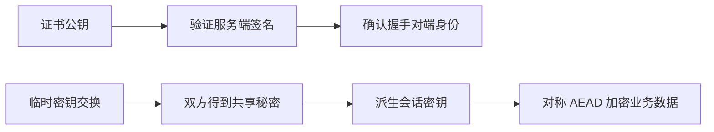
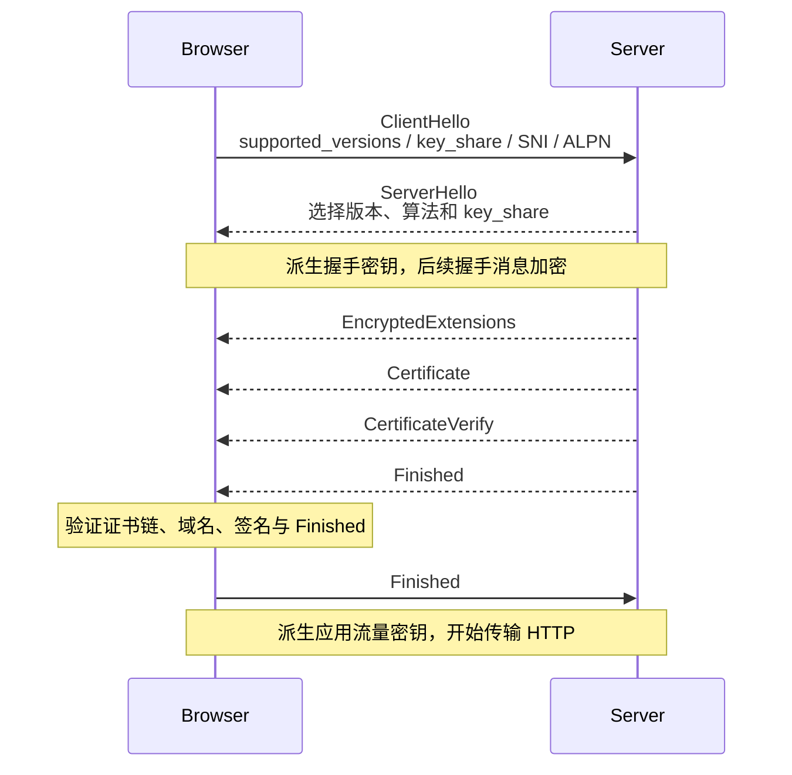
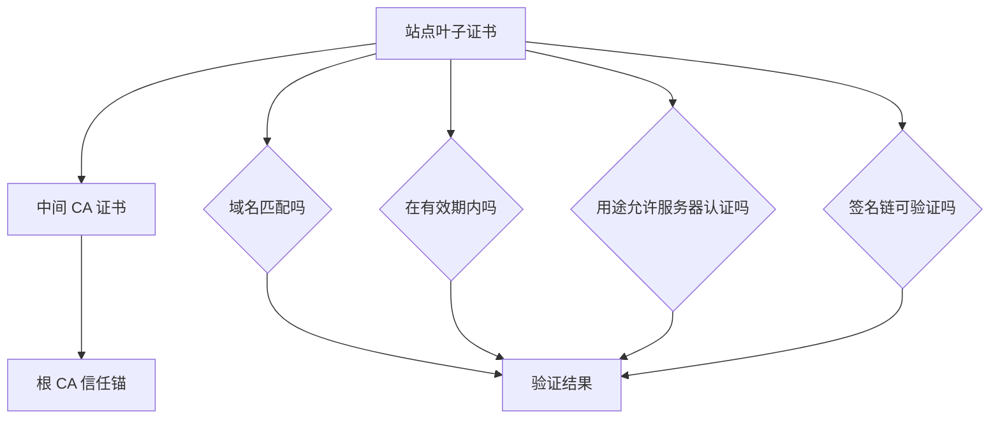

# HTTPS、TLS 与证书：安全来自机制组合，不是“套了一层 SSL”

> HTTPS 题目最常见的问题，是把公钥加密、数字签名、证书和对称密钥搅成一团。先分清每个机制负责什么，再看 TLS 如何把它们组合起来。

## 1. HTTP 与 HTTPS 的区别

### 30～60 秒回答

HTTPS 是运行在 TLS 安全通道上的 HTTP。TLS 通过密钥协商得到会话密钥，用对称加密保护传输内容，用 AEAD 等机制校验完整性，并通过证书和数字签名认证服务端身份。它能显著降低窃听、篡改和冒充风险，但不会自动解决 XSS、越权、弱口令或服务端漏洞。

| 维度 | HTTP | HTTPS |
|---|---|---|
| 传输内容 | 默认明文 | TLS 加密后传输 |
| 对端身份 | 协议本身不验证 | 通常通过证书链和域名验证服务端 |
| 完整性 | 缺少抗篡改保护 | TLS 记录层提供完整性与认证加密 |
| 常见默认端口 | 80 | 443 |
| 协议协商 | 明文 HTTP/1.1 等 | 可通过 ALPN 协商 HTTP/1.1、HTTP/2 等 |
| 安全边界 | 只能表达 HTTP 语义 | 保护传输通道，不保证应用本身无漏洞 |

“HTTPS 就是身披 SSL 的 HTTP”适合作为非常粗的比喻，但现代部署应说 TLS，不应继续把已经淘汰的 SSL 版本当成当前协议。

---

## 2. 四种密码学能力分别负责什么

### 对称加密

通信双方使用同一类会话密钥加解密，速度快，适合大量数据传输。难点是如何安全地让双方拥有同一密钥。

### 非对称密码

公钥和私钥成对出现。在现代 TLS 1.3 中，临时 Diffie-Hellman 密钥交换通常用于建立共享秘密；证书私钥主要用于签名握手信息、证明服务端身份，而不是拿 RSA 私钥直接解密所有业务数据。

### 哈希

把任意长度输入映射为固定长度摘要，适合完整性校验和签名结构。哈希不是加密，通常不可“解密回原文”。

### 数字签名

私钥对消息摘要或结构化握手内容签名，公钥验证。它回答的是“内容是否由持有对应私钥的一方签发且未被篡改”，不负责隐藏内容。



---

## 3. TLS 1.3 完整握手主线

### 快速回答

客户端发送 `ClientHello`，声明支持版本、密码套件、密钥份额、SNI 和 ALPN；服务端返回 `ServerHello` 并选择参数，双方据此得到握手密钥。服务端随后发送加密扩展、证书、证书签名和 Finished。客户端验证证书链、域名、有效期和签名，再发送自己的 Finished。完成后双方使用派生出的应用流量密钥传输 HTTP。



### 为什么既用非对称又用对称

非对称机制适合身份认证和在不安全网络中建立共享秘密，但计算成本较高；对称加密速度快，适合传输大量数据。TLS 把两者组合，各做擅长的部分。

### TLS 1.3 为什么更简洁

TLS 1.3 移除了大量旧算法和旧握手分支，把临时密钥交换和前向保密作为主线，并更早加密握手内容。具体密码套件主要描述 AEAD 和哈希，不再像旧版本那样把密钥交换、签名和加密算法全部塞在一个长名字中。

---

## 4. 浏览器如何验证证书

浏览器验证的不是“证书看起来像真的”，而是一条信任链：



主要检查包括：

1. 请求域名是否匹配证书 SAN；
2. 当前时间是否在有效期内；
3. 叶子证书是否被中间 CA 正确签发；
4. 中间证书能否一路连接到本地受信任根；
5. 证书用途、签名算法和密钥强度是否可接受；
6. 证书是否被吊销，实际检查方式受浏览器、平台和网络策略影响；
7. 服务端是否通过 `CertificateVerify` 证明自己持有叶子证书对应私钥。

### 为什么服务端通常不发送根证书

根证书已经预置在操作系统或浏览器的信任存储中。服务端应发送叶子证书和必要的中间证书，让客户端能构建到本地信任锚的路径。发送根证书不能让一个不受信任的根凭空变可信。

---

## 5. CA 证书可以伪造吗

任何人都能生成一张格式合法的自签名证书，也能在证书里写上别人的域名；真正困难的是让受害者的浏览器把它验证到受信任根，并证明攻击者持有对应私钥。

仍然存在几类现实风险：

- CA 错误签发或 CA 私钥泄露；
- 用户设备被安装了攻击者控制的根证书；
- 企业代理、杀毒软件主动进行 TLS 检查；
- 站点私钥泄露；
- DNS/BGP 被劫持且攻击者同时拿到可信证书；
- 用户忽略证书警告继续访问。

证书透明度（Certificate Transparency）帮助发现误签证书，但它不是实时阻止所有攻击的单一方案。

---

## 6. HTTPS 如何抵抗中间人攻击

### 攻击者能看到什么

TLS 通常会隐藏 HTTP 路径、头字段和消息体，但攻击者仍可能观察 IP、端口、包大小、时间和流量模式。域名是否暴露还取决于 DNS、SNI 加密等部署情况。

### 为什么中间人不能直接换公钥

服务端公钥绑定在证书中，证书由受信任 CA 签名。攻击者替换证书或握手签名时，浏览器无法验证到可信根，或者域名不匹配，因此会告警或终止连接。

### HTTPS 仍然挡不住什么

- 页面自身有 XSS，恶意脚本运行后能读取页面可访问的数据；
- 用户把密码输入钓鱼站点，钓鱼站点也可以拥有自己的合法 HTTPS 证书；
- 服务端鉴权、权限控制或数据库存在漏洞；
- 终端、浏览器扩展或供应链已经被控制；
- 业务接口允许重放、越权或批量滥用。

HTTPS 证明“你和证书对应的站点建立了加密通道”，不证明“这个站点值得信任”或“应用没有漏洞”。

---

## 7. 前向保密与会话恢复

### 前向保密

使用临时 Diffie-Hellman 密钥交换时，每次连接生成临时秘密。未来即使服务端证书私钥泄露，攻击者也不应仅凭旧抓包解密过去会话。

### Session Resumption

TLS 可以通过 PSK 和 session ticket 恢复之前的安全上下文，减少完整握手成本。Ticket 需要安全轮换和部署协调，否则可能扩大密钥泄露影响。

### 0-RTT 的风险

恢复连接时客户端可以发送 early data，但攻击者可能重放它。服务端应拒绝高风险非幂等操作进入 0-RTT，或使用业务幂等键和反重放机制。

```js
function canAcceptEarlyData(request) {
  const method = request.method.toUpperCase();

  // 只把业务上可安全重放的读取请求纳入候选范围
  if (!['GET', 'HEAD', 'OPTIONS'].includes(method)) return false;

  // 即使是 GET，也要确认接口不会触发扣费、发短信等副作用
  return request.headers.get('X-Safe-To-Replay') === '1';
}
```

这个函数只是表达判断思路，真正的 early data 状态通常由 TLS 终止层传给应用。

---

## 8. HSTS 与混合内容

### HSTS 解决第一次跳转之后的问题

服务端通过：

```http
Strict-Transport-Security: max-age=31536000; includeSubDomains
```

告诉浏览器在有效期内只使用 HTTPS 访问该域名。之后即使用户输入 `http://`，浏览器也会在发出明文请求前升级到 HTTPS。

HSTS 首次策略仍需通过可信 HTTPS 收到；预加载列表可以降低首次访问被降级的窗口，但加入和退出都需要谨慎规划。

### 混合内容

HTTPS 页面加载 HTTP 脚本、iframe 或其他主动内容，会破坏安全边界，现代浏览器通常阻止或升级部分请求。迁移 HTTPS 时要检查所有子资源、API、WebSocket 和下载链接。

### Nginx 配置示例

```nginx
server {
    listen 443 ssl;
    http2 on; # Nginx 1.25.1+ 推荐写法，旧版本可使用 listen 443 ssl http2
    server_name example.com;

    # 只有确认所有子域都支持 HTTPS 后，才启用 includeSubDomains
    add_header Strict-Transport-Security "max-age=31536000; includeSubDomains" always;

    # 禁止 MIME 嗅探，降低内容类型混淆风险
    add_header X-Content-Type-Options "nosniff" always;
}
```

不要在尚未完成全站 HTTPS 改造时贸然设置超长 HSTS，否则错误配置可能让站点长时间无法访问。上面的 `http2 on;` 是 Nginx 1.25.1 起提供的写法，部署到旧版本前要核对配置语法。

---

## 9. 如何自己观察 TLS

### cURL

```bash
# -v 展示连接、证书和协议协商信息；不要把生产 token 放进终端历史
curl -v --http2 https://example.com/
```

### Node.js

```js
import tls from 'node:tls';

const socket = tls.connect(
  {
    host: 'example.com',
    port: 443,
    servername: 'example.com', // 显式提供 SNI，也用于正确校验证书域名
    ALPNProtocols: ['h2', 'http/1.1'],
  },
  () => {
    console.log({
      authorized: socket.authorized,
      protocol: socket.getProtocol(),
      alpnProtocol: socket.alpnProtocol,
      cipher: socket.getCipher(),
      certificate: socket.getPeerCertificate(),
    });
    socket.end();
  },
);

socket.on('error', (error) => {
  console.error(error);
});
```

---

## 10. 高频追问与误区

### HTTPS 会把域名也完全隐藏吗

不能简单说会。DNS 查询、目标 IP 和传统明文 SNI 都可能暴露域名线索；DoH/DoT、ECH 等机制可以改善部分环节，但部署和支持需要单独判断。

### 证书过期后，已经建立的连接会立刻断吗

证书主要在握手时验证。已建立连接如何处理取决于连接生命周期和实现；新握手会因为过期验证失败。不要把证书验证想成每个 HTTP 请求都重新进行。

### HTTPS 比 HTTP 慢很多吗

TLS 有握手和加密成本，但现代硬件、TLS 1.3、会话恢复和连接复用已显著降低开销。真实网站中，HTTPS 还是使用 HTTP/2、HTTP/3 和许多现代浏览器能力的基础，不能只比较一次裸握手。

### TLS 属于传输层还是表示层

TLS 运行在应用协议与底层传输之间。OSI 归层只是一种解释，不要让归类问题掩盖真实协议栈：`HTTP → TLS → TCP`，或 `HTTP/3 → QUIC（内建 TLS）→ UDP/IP`。

---

## 11. 延伸阅读

- [RFC 9846：The Transport Layer Security Protocol Version 1.3](https://www.rfc-editor.org/rfc/rfc9846.html)
- [RFC 6066：TLS Extensions（包含 SNI）](https://www.rfc-editor.org/rfc/rfc6066.html)
- [RFC 7301：TLS ALPN](https://www.rfc-editor.org/rfc/rfc7301.html)
- [MDN：Transport Layer Security](https://developer.mozilla.org/en-US/docs/Web/Security/Defenses/Transport_Layer_Security)
- [MDN：Strict-Transport-Security](https://developer.mozilla.org/en-US/docs/Web/HTTP/Reference/Headers/Strict-Transport-Security)

上一篇：[HTTP 版本演进与性能](./04-http-versions-and-performance.md) ｜ 下一篇：[浏览器安全边界](./06-browser-security-boundaries.md)
