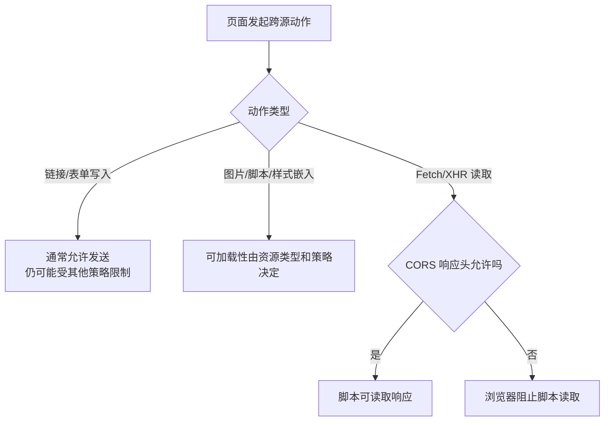
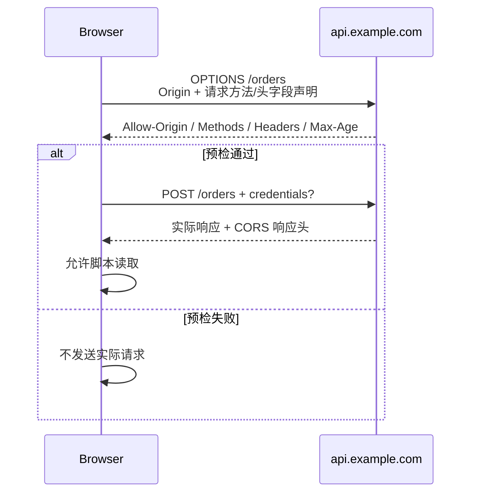

# 浏览器安全边界：同源策略、CORS、Cookie 与 CSP

> 浏览器安全题最容易混淆“请求能不能发”“响应能不能读”“凭据会不会带”“服务端是否授权”。这一篇先把边界划清，再谈每个机制。

## 1. Origin、Site 和 URL 不是同一个概念

### Origin

Origin 通常由 **scheme、host、port** 组成：

| URL | 与 `https://app.example.com` 是否同源 | 原因 |
|---|---:|---|
| `https://app.example.com/profile` | 是 | 路径不影响 Origin |
| `http://app.example.com` | 否 | scheme 不同 |
| `https://api.example.com` | 否 | host 不同 |
| `https://app.example.com:8443` | 否 | port 不同 |

### Site

Site 更接近 scheme 加可注册域，用于 SameSite Cookie 等策略。`app.example.com` 和 `api.example.com` 可以跨 Origin，但仍可能属于 same-site。

这就是为什么“跨域”和“跨站”不能随便互换：CORS 看 Origin，SameSite 看 Site。

---

## 2. 同源策略到底限制什么

### 30～60 秒回答

同源策略是浏览器的核心隔离机制，主要限制一个 Origin 的脚本读取另一个 Origin 的敏感数据。跨源写入、资源嵌入和读取的规则并不相同：表单可以跨源提交，图片可以跨源展示，但脚本通常不能随意读取跨源响应内容。CORS 是服务端声明跨源读取权限、浏览器负责执行的扩展机制。



### CORS 不是服务端鉴权

非浏览器客户端、后端服务和攻击脚本可以直接构造 HTTP 请求，不会替你执行浏览器 CORS 限制。服务端仍然必须验证身份、权限、输入和业务规则。

---

## 3. 简单请求与预检请求

满足限定方法、头字段和 Content-Type 等条件的跨源请求可以作为 CORS-safelisted request 直接发送，浏览器再根据响应头决定脚本能否读取。

非简单请求通常先发预检：



### 为什么 `application/json` 常触发预检

CORS safelisted 的 Content-Type 只包含有限类型，`application/json` 不在其中；再加上自定义头或非 safelisted 方法，就会预检。

### 预检缓存

`Access-Control-Max-Age` 可以让浏览器在一段时间内复用预检结果。预检缓存与普通 HTTP 响应缓存分开，浏览器还可能设置自己的最大值。

要把两种失败分开：**预检失败时，浏览器不会发送后续实际请求；简单请求或已通过预检的实际请求如果响应缺少正确 CORS 头，请求可能已经被服务端处理，只是浏览器不把响应暴露给 JavaScript。** 所以 CORS 不是鉴权，也不能替代 CSRF 防御。

---

## 4. 带凭据的 CORS

前端显式携带跨源凭据：

```js
const response = await fetch('https://api.example.com/profile', {
  credentials: 'include', // 允许在跨源请求中携带符合规则的 Cookie
});

if (!response.ok) {
  throw new Error(`Request failed: ${response.status}`);
}
```

服务端需要返回具体 Origin：

```http
Access-Control-Allow-Origin: https://app.example.com
Access-Control-Allow-Credentials: true
Vary: Origin
```

带凭据时不能使用 `Access-Control-Allow-Origin: *`。动态回显 Origin 前必须和可信白名单精确匹配，不能无条件复制请求头。

### 一个最小 Node.js 白名单示例

```js
import http from 'node:http';

const allowedOrigins = new Set([
  'https://app.example.com',
  'https://admin.example.com',
]);

http.createServer((request, response) => {
  const origin = request.headers.origin;

  if (origin && allowedOrigins.has(origin)) {
    response.setHeader('Access-Control-Allow-Origin', origin);
    response.setHeader('Access-Control-Allow-Credentials', 'true');
    response.setHeader('Vary', 'Origin'); // 防止共享缓存混用不同 Origin 的响应
  }

  if (request.method === 'OPTIONS') {
    response.setHeader('Access-Control-Allow-Methods', 'GET, POST');
    response.setHeader('Access-Control-Allow-Headers', 'Content-Type, X-CSRF-Token');
    response.setHeader('Access-Control-Max-Age', '600');
    response.writeHead(204).end();
    return;
  }

  // CORS 通过不等于业务授权通过，真实接口仍要验证身份和权限
  response.setHeader('Content-Type', 'application/json');
  response.end(JSON.stringify({ ok: true }));
}).listen(8080);
```

---

## 5. Cookie 的安全属性各管一件事

### `Secure`

只允许 Cookie 通过安全连接发送，降低明文链路泄露风险。它不阻止 JavaScript 读取，也不阻止符合条件的跨站请求携带。

### `HttpOnly`

阻止页面 JavaScript 通过 `document.cookie` 读取 Cookie，能降低会话 Cookie 被 XSS 直接窃取的风险。但 XSS 仍可能借浏览器自动携带 Cookie 发起操作。

### `SameSite`

控制跨站请求何时携带 Cookie：

- `Strict`：最严格，跨站导航通常也不携带；
- `Lax`：在部分顶层安全导航中允许，兼顾体验；
- `None`：允许跨站使用，现代浏览器要求同时设置 `Secure`。

### `Domain` 与 `Path`

它们控制 Cookie 的发送范围，但 `Path` 不是可靠安全边界，同一 Origin 的脚本和页面仍可能互相影响。能不设置 `Domain` 时，优先使用 host-only Cookie，缩小子域共享范围。

### Cookie 前缀

```http
Set-Cookie: __Host-session=<opaque>; Path=/; Secure; HttpOnly; SameSite=Lax
```

`__Host-` 前缀要求 `Secure`、`Path=/` 且不能设置 `Domain`，有助于防止较宽域 Cookie 覆盖。`__Secure-` 要求安全连接和 `Secure`，限制弱于 `__Host-`。

### Partitioned Cookie

`Partitioned` 用于按顶层站点分区第三方 Cookie 存储，设置时必须同时带上 `Secure`。它降低跨站追踪和状态混用，但不能直接替代第一方会话；旧浏览器和未实现 CHIPS 的环境还需要兼容策略。

---

## 6. Cookie、Session、Token 怎么比较

这三个词不在同一维度：

- Cookie 是浏览器存储和自动随请求发送的数据机制；
- Session 常指服务端保存会话状态，Cookie 里只放会话标识；
- Token 是凭据格式，可以放在 Cookie、内存或其他客户端存储中。

### Token 放 `localStorage` 就能防 CSRF 吗

不自动随请求发送，确实降低传统 Cookie 自动携带导致的 CSRF 面；但一旦出现 XSS，脚本可以直接读取 Token。把 Token 放 HttpOnly Cookie 能降低直接窃取，但又需要设计 CSRF 防御。选型是威胁模型权衡，不是“Token 天生比 Cookie 安全”。

### 一个更稳妥的会话 Cookie 示例

```http
Set-Cookie: __Host-session=<random-id>; Path=/; Secure; HttpOnly; SameSite=Lax
Cache-Control: no-store
```

服务端仍要处理会话固定攻击、过期、轮换、登出失效和异常登录检测。

---

## 7. CSP：限制页面能执行和加载什么

### 快速回答

Content Security Policy 通过响应头限制脚本、样式、图片、frame 等资源来源。严格 CSP 使用 nonce 或 hash 授权可信脚本，可以显著降低注入内容变成可执行脚本的机会；但它是纵深防御，不能替代输出编码、框架安全 API 和输入处理。

```http
Content-Security-Policy: default-src 'self'; script-src 'nonce-r4nd0m' 'strict-dynamic'; object-src 'none'; base-uri 'none'; frame-ancestors 'none'; report-to csp-endpoint
```

页面只给可信脚本相同 nonce：

```html
<script nonce="r4nd0m" src="/assets/app.js"></script>
```

nonce 必须对每个响应随机生成，不能写死在模板或前端 bundle 中。

### `unsafe-inline` 为什么危险

它允许内联脚本执行，会大幅削弱 CSP 对 XSS 的约束。迁移阶段可以先使用 `Content-Security-Policy-Report-Only` 收集违规，再逐步移除内联脚本和宽泛来源。

### `frame-ancestors`

用于限制哪些页面可以嵌入当前页面，是防点击劫持的现代控制方式。它和 `X-Frame-Options` 解决相近问题，但表达能力更强。

---

## 8. SRI：第三方资源被替换时怎么办

Subresource Integrity 让浏览器校验外部脚本或样式的内容哈希：

```html
<script
  src="https://cdn.example.com/library.min.js"
  integrity="sha384-BASE64_HASH"
  crossorigin="anonymous"
></script>
```

如果实际内容与哈希不一致，浏览器拒绝执行。SRI 适合版本固定的第三方静态资源；如果 URL 内容频繁变化，维护哈希会变得困难。跨源资源还需要正确的 CORS 响应。

SRI 防的是“资源内容被替换”，不判断库本身是否有逻辑漏洞，也不能覆盖运行时动态加载的所有依赖。

---

## 9. iframe、sandbox 与 postMessage

### `sandbox`

不带参数的 `sandbox` 会施加严格限制，再按需要添加能力：

```html
<iframe
  src="https://widget.example.com"
  sandbox="allow-scripts"
  referrerpolicy="no-referrer"
></iframe>
```

不要在同源 iframe 上同时轻易授予 `allow-scripts` 和 `allow-same-origin`，否则嵌入内容可能有能力移除沙箱限制。

### `postMessage`

发送时指定精确目标 Origin：

```js
iframe.contentWindow.postMessage(
  { type: 'PAYMENT_READY' },
  'https://pay.example.com', // 不使用 "*"，避免消息发给错误页面
);
```

接收时同时验证来源和数据结构：

```js
window.addEventListener('message', (event) => {
  if (event.origin !== 'https://pay.example.com') return;
  if (event.data?.type !== 'PAYMENT_RESULT') return;

  // 只使用经过结构校验的字段，不直接把消息内容插入 DOM
  renderPaymentResult(event.data.payload);
});
```

Origin 校验不能只用 `endsWith('example.com')`，否则 `evil-example.com` 也可能通过。

---

## 10. 常见安全响应头

| 响应头 | 作用 | 注意点 |
|---|---|---|
| `Strict-Transport-Security` | 强制后续 HTTPS | 只在 HTTPS 响应中生效，长 `max-age` 上线要谨慎 |
| `Content-Security-Policy` | 限制资源和脚本执行 | 优先 nonce/hash，先报告再收紧 |
| `X-Content-Type-Options: nosniff` | 禁止部分 MIME 嗅探 | 服务端仍要返回正确 `Content-Type` |
| `Referrer-Policy` | 控制 Referer 暴露 | 在分析需求与隐私之间取舍 |
| `Permissions-Policy` | 控制摄像头、麦克风等能力 | 语法和支持需按目标浏览器核对 |
| `Cross-Origin-Opener-Policy` | 隔离顶层浏览上下文组 | 会影响 opener 关系和第三方集成 |
| `Cross-Origin-Embedder-Policy` | 要求跨源嵌入资源明确授权 | 与 COOP 组合可建立 cross-origin isolation |
| `Cross-Origin-Resource-Policy` | 资源声明允许哪些站点加载 | 与 CORS 解决的问题不同 |

---

## 11. 高频追问与误区

### 请求已经发送并修改了数据，为什么浏览器还报 CORS

CORS 错误常表示脚本不能读取响应，不代表请求没有到达服务端。会产生副作用的接口必须做鉴权和 CSRF 防护，不能依赖 CORS 阻止攻击。

### `Access-Control-Allow-Origin: *` 安全吗

公开、无凭据资源可以使用 `*`；包含用户数据的凭据请求不能和 `*` 组合。是否安全取决于资源本来是否应该公开，而不是星号本身有罪。

### `HttpOnly` 能防 XSS 吗

它只能降低 Cookie 被脚本直接读取的风险。XSS 仍能修改页面、读取非 HttpOnly 数据、发起用户有权执行的请求。因此必须从源头防注入，并用 CSP 做纵深防御。

### CSP 能防所有 XSS 吗

不能。过宽来源、`unsafe-inline`、可控 nonce、JSONP、可信域上的可利用脚本都可能削弱策略。CSP 是强大的第二道防线，不是替代安全编码的第一道防线。

---

## 12. 延伸阅读

- [MDN：Same-origin policy](https://developer.mozilla.org/en-US/docs/Web/Security/Defenses/Same-origin_policy)
- [MDN：Cross-Origin Resource Sharing](https://developer.mozilla.org/en-US/docs/Web/HTTP/Guides/CORS)
- [MDN：Using HTTP cookies](https://developer.mozilla.org/en-US/docs/Web/HTTP/Guides/Cookies)
- [MDN：Content Security Policy](https://developer.mozilla.org/en-US/docs/Web/HTTP/Guides/CSP)
- [MDN：Subresource Integrity](https://developer.mozilla.org/en-US/docs/Web/Security/Defenses/Subresource_Integrity)
- [OWASP：HTTP Headers Cheat Sheet](https://cheatsheetseries.owasp.org/cheatsheets/HTTP_Headers_Cheat_Sheet.html)

上一篇：[HTTPS、TLS 与证书](./05-https-tls-and-certificates.md) ｜ 下一篇：[Web 攻击与防御](./07-web-attacks-and-defenses.md)
