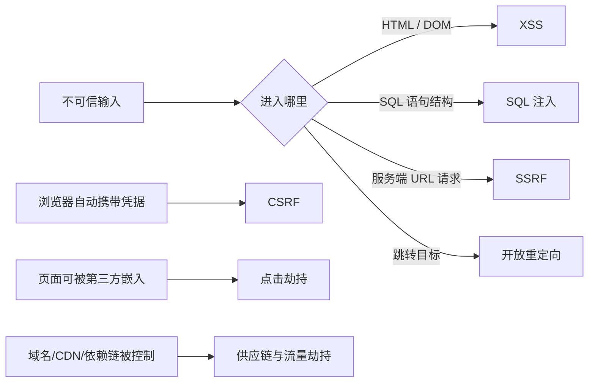
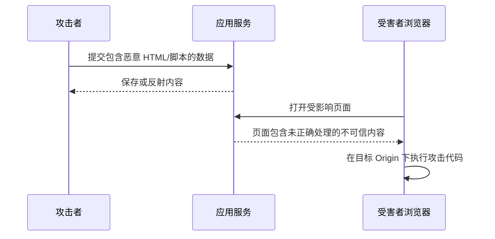
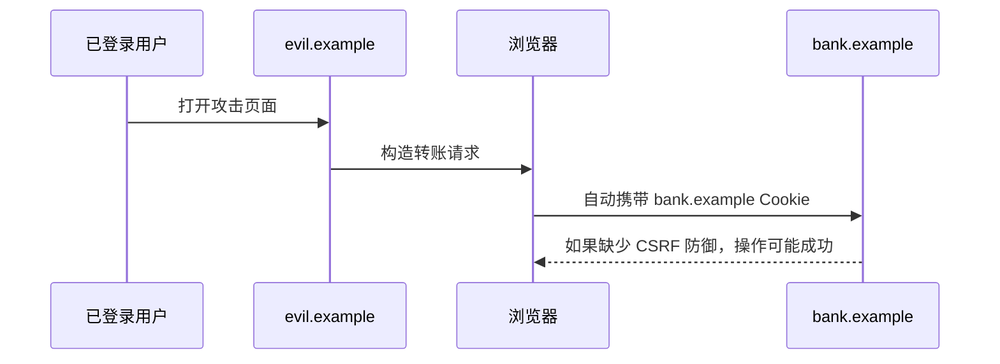

# Web 攻击与防御：从攻击前置条件开始回答

> 安全题不要背“过滤输入、加强校验”。先回答攻击者需要什么能力、数据经过哪条链路、最终在哪个信任边界被误用，再谈多层防御。

## 1. 一张威胁模型先把题目放对位置



任何防御都可以追问四个问题：

1. 不可信数据从哪里来；
2. 它进入了什么解释器或高权限动作；
3. 哪一层应该把“数据”和“代码/指令”分开；
4. 单层防御失败后还有没有第二道边界。

---

## 2. XSS：攻击者让脚本在你的 Origin 下执行

### 30～60 秒回答

XSS 的本质是应用把不可信数据当成可执行 HTML、JavaScript 或危险 URL 交给浏览器，使攻击代码获得当前页面 Origin 的能力。主要分为存储型、反射型和 DOM 型。核心防御是按输出上下文编码、避免危险 DOM sink、使用框架默认转义和安全模板；再用 CSP、Trusted Types、HttpOnly Cookie 等做纵深防御。

### 三种常见类型

- **存储型**：恶意内容进入数据库，之后影响所有查看者；
- **反射型**：恶意参数被当前响应直接反射；
- **DOM 型**：前端脚本在浏览器中把不可信数据传给危险 API，服务端响应本身未必包含攻击代码。



### 危险写法与安全写法

```js
const message = new URLSearchParams(location.search).get('message');

// ❌ innerHTML 会把字符串当 HTML 解析，输入可控时可能执行恶意内容
result.innerHTML = message;

// ✅ 只需要展示文本时使用 textContent
result.textContent = message;
```

React/Vue 模板默认会转义文本，但 `dangerouslySetInnerHTML`、`v-html`、直接 DOM API、富文本编辑器和服务端模板仍需要特别处理。

### “过滤 `<script>`”为什么不够

攻击载荷可以进入事件属性、SVG、URL、CSS、模板表达式和不同解析上下文。正确原则是：

- HTML 文本、HTML 属性、JavaScript 字符串、URL、CSS 使用各自适合的编码；
- 不把不可信字符串拼成代码；
- 富文本使用维护良好的 allowlist sanitizer；
- URL 只允许明确协议；
- CSP 限制脚本来源和执行方式。

### HttpOnly 能解决多少

它能阻止脚本直接读取会话 Cookie，但 XSS 仍能以用户身份发请求、修改页面、读取页面内容和窃取其他存储。因此 HttpOnly 是降低损失，不是修复 XSS。

---

## 3. CSRF：借用户身份发请求

### 快速回答

CSRF 利用浏览器会自动携带 Cookie 等凭据，让受害者在已登录状态下向目标站点发送攻击者构造的请求。攻击者通常不需要读取响应，只需要操作成功。防御包括使用 SameSite Cookie、CSRF Token、校验 Origin/Referer、避免 GET 产生副作用，并对高风险操作进行二次确认。



### SameSite 是强大基础，但不是全部

`SameSite=Lax` 能阻止很多跨站子请求携带 Cookie，但要考虑：

- 业务是否需要跨站登录、支付或嵌入；
- same-site 子域之间仍可能互相影响；
- 历史浏览器和特殊导航行为；
- XSS 可以绕过大多数 CSRF 防御，因为脚本已运行在同源上下文。

### Synchronizer Token

服务端为会话生成不可预测 token，页面提交时放进隐藏字段或自定义头，服务端验证：

```js
async function transferMoney(request, session) {
  const csrfToken = request.headers.get('X-CSRF-Token');

  // 使用恒定时间比较，避免泄露 token 差异；示例省略具体实现
  if (!csrfToken || !secureEqual(csrfToken, session.csrfToken)) {
    return new Response('Invalid CSRF token', { status: 403 });
  }

  // 通过 CSRF 校验后，仍然要做身份、权限、金额和风控校验
  return transferService.execute(await request.json(), session.userId);
}
```

### Origin 校验

对状态修改请求校验 `Origin`，缺失时谨慎回退到 `Referer`。代理层必须正确传递原始 Host/Origin，不能用字符串包含或后缀误判可信域。

---

## 4. XSS 与 CSRF 怎么比较

| 维度 | XSS | CSRF |
|---|---|---|
| 攻击核心 | 在目标 Origin 执行恶意脚本 | 借浏览器自动凭据发起伪造请求 |
| 是否通常能读响应 | 能，以页面脚本身份读取 | 通常不需要，也常受同源策略限制 |
| 关键前提 | 存在注入和执行入口 | 用户已登录、请求可被跨站构造、缺少验证 |
| 第一防线 | 上下文编码、安全 DOM API、模板转义 | SameSite、CSRF Token、Origin 校验 |
| 共同点 | 都需要服务端鉴权和纵深防御 | XSS 常能绕过 CSRF 防御 |

一句话记忆：**XSS 偷走或直接使用页面能力，CSRF 借浏览器现成的身份能力。**

---

## 5. 点击劫持

攻击者把目标页面透明嵌入 iframe，在上方布置诱导界面，让用户点击实际目标按钮。

防御优先使用：

```http
Content-Security-Policy: frame-ancestors 'none'
```

兼容旧环境时可配：

```http
X-Frame-Options: DENY
```

需要被特定合作方嵌入时，使用精确 `frame-ancestors` 来源，而不是完全放开。前端“检测自己是否在 iframe 并跳出”的脚本容易被绕过，不能当主要防线。

---

## 6. SQL 注入：前端转义不是根治

### 快速回答

SQL 注入发生在服务端把不可信数据拼接进 SQL 结构时。根本防御是参数化查询或安全 ORM API，让数据和 SQL 语法分离；同时使用最小数据库权限、输入约束、错误隐藏和监控。前端校验可以改善体验，但攻击者能绕过浏览器直接请求接口。

```js
// ❌ 用户输入被拼进 SQL 结构
const sql = `SELECT * FROM users WHERE email = '${email}'`;

// ✅ 参数化查询让驱动把 email 当数据处理
const result = await db.query(
  'SELECT id, email FROM users WHERE email = $1',
  [email],
);
```

动态表名、排序字段不能简单作为参数值绑定，应使用固定映射 allowlist。

---

## 7. SSRF：让服务器替攻击者访问内部资源

### 快速回答

SSRF 出现在服务端根据用户提供的 URL 发起请求，攻击者借服务器的网络位置访问内网、云元数据、管理接口或任意协议。防御应优先使用业务级目标 allowlist，并在解析、DNS、重定向和最终连接地址各阶段校验；同时做网络隔离、最小权限和响应限制。

### 为什么只检查字符串前缀不够

下面这些情况都可能绕过简单规则：

- 十进制、八进制、IPv6 等地址表示；
- 用户信息段和相似域名；
- DNS rebinding，解析结果前后变化；
- 允许的 URL 重定向到内网；
- 代理自动支持 `file:`、`gopher:` 等非预期协议；
- IPv4-mapped IPv6 地址。

```js
const allowedHosts = new Set(['images.example-cdn.com']);

function validateRemoteUrl(input) {
  const url = new URL(input);

  // 先收窄协议，避免底层客户端意外处理 file、gopher 等协议
  if (url.protocol !== 'https:') {
    throw new Error('Only HTTPS URLs are allowed');
  }

  // 使用业务 allowlist，而不是只做容易绕过的字符串前缀判断
  if (!allowedHosts.has(url.hostname)) {
    throw new Error('Host is not allowed');
  }

  // 禁止 URL 用户信息段，避免日志泄露和主机名视觉混淆
  if (url.username || url.password) {
    throw new Error('Credentials in URL are forbidden');
  }

  return url;
}
```

这只是第一层。生产实现还要固定 DNS 解析结果、拒绝私网和链路本地地址、限制重定向、控制端口、超时、响应大小，并在网络层阻止应用访问云元数据等敏感地址。

---

## 8. 开放重定向

登录后跳转参数如果未经限制：

```text
https://trusted.example/login?returnUrl=https://evil.example/phishing
```

攻击者可以借可信域名提高钓鱼成功率，也可能参与 OAuth token 泄露链。安全做法是只允许站内相对路径，或把外部目标映射为服务端维护的固定 ID。

```js
function normalizeReturnPath(input) {
  const url = new URL(input, 'https://trusted.example');

  // 只允许跳回本站，拒绝协议相对 URL 和外部 Origin
  if (url.origin !== 'https://trusted.example') return '/';
  return `${url.pathname}${url.search}${url.hash}`;
}
```

---

## 9. 文件上传不是“校验扩展名”

需要同时考虑：

- 文件内容和 MIME 类型；
- 文件名路径穿越；
- 图片/文档解析器漏洞；
- SVG、HTML 等主动内容；
- 存储位置是否能作为同源脚本执行；
- 大文件和压缩炸弹；
- 恶意软件扫描；
- 下载时的 `Content-Disposition` 与 `Content-Type`。

上传内容最好放到隔离域名或对象存储，以不可预测名称保存，并通过响应头强制下载或限定类型。

---

## 10. DDoS 与应用层滥用

### 网络层/传输层攻击

大量流量、连接或协议包耗尽带宽、连接表和网络设备能力，通常需要运营商、Anycast、DDoS 清洗和基础设施防护。

### 应用层攻击

攻击者请求昂贵接口、搜索、导出、登录或验证码，流量未必巨大，却能耗尽 CPU、数据库和第三方配额。

前端工程相关的防御重点包括：

- CDN/WAF 和分层限流；
- 以用户、IP、设备、接口成本组合限额；
- 缓存公开热点；
- 请求去重和异步任务；
- 验证码、风控和成本预算；
- 超时、熔断、降级和背压；
- 不把限流规则只放在可绕过的前端代码中。

---

## 11. DNS/CDN 劫持与供应链风险

### DNS/CDN 劫持

可能来源于 DNS 污染、域名账户泄露、错误 CNAME、CDN 配置权限失控或源站暴露。HTTPS 域名验证、DNSSEC、账户 MFA、最小权限、证书透明度监控和源站访问控制可以降低不同环节风险。

### 第三方脚本供应链

第三方脚本在页面 Origin 下通常拥有很高权限。风险控制包括：

- 减少第三方脚本数量和权限；
- 固定版本，不引用永远变化的 `latest`；
- 对稳定静态资源使用 SRI；
- 严格 CSP、隔离 iframe 或独立 Origin；
- lockfile、依赖审计、构建产物签名和变更审查；
- 不把密钥或高权限 token 暴露给前端运行环境。

---

## 12. 防御纵深速查

| 攻击 | 第一防线 | 第二防线 | 不能替代什么 |
|---|---|---|---|
| XSS | 上下文编码、安全 DOM API | CSP、Trusted Types、HttpOnly | 服务端授权 |
| CSRF | SameSite、CSRF Token、Origin 校验 | 二次确认、风控 | XSS 修复 |
| 点击劫持 | `frame-ancestors` | `X-Frame-Options` | 业务授权 |
| SQL 注入 | 参数化查询 | 最小权限、监控 | 服务端输入处理 |
| SSRF | 目标 allowlist、地址校验 | 网络隔离、最小权限 | 云环境安全配置 |
| DDoS | CDN/清洗/限流 | 缓存、降级、熔断 | 容量规划 |
| 供应链 | 减少依赖、固定版本 | SRI、CSP、隔离 | 依赖审查 |

---

## 13. 高频追问与误区

### 输入过滤和输出编码有什么区别

输入验证判断业务是否接受数据；输出编码根据数据进入的上下文，确保它不会变成代码。用户名可以合法包含 `<`，数据库可以保存，但输出到 HTML 时必须正确编码。

### WAF 能彻底解决 XSS 和 SQL 注入吗

不能。WAF 可以拦截部分已知模式和异常流量，但理解不了所有业务上下文，也可能被编码、协议差异和新载荷绕过。根治仍在应用安全设计。

### 前端隐藏按钮能实现权限控制吗

不能。隐藏按钮只改善界面，攻击者可以直接调用接口。权限必须在服务端按当前用户、资源和动作验证。

### HTTPS 能防 CDN 劫持吗

如果攻击者只能把流量导向没有可信证书的服务器，HTTPS 会阻止无感冒充；但 CDN 账户、源站配置或合法证书本身被控制时，HTTPS 不能判断内容是否符合你的业务意图。

---

## 14. 延伸阅读

- [OWASP：Cross Site Scripting Prevention Cheat Sheet](https://cheatsheetseries.owasp.org/cheatsheets/Cross_Site_Scripting_Prevention_Cheat_Sheet.html)
- [OWASP：Cross-Site Request Forgery Prevention Cheat Sheet](https://cheatsheetseries.owasp.org/cheatsheets/Cross-Site_Request_Forgery_Prevention_Cheat_Sheet.html)
- [OWASP：Server-Side Request Forgery Prevention Cheat Sheet](https://cheatsheetseries.owasp.org/cheatsheets/Server_Side_Request_Forgery_Prevention_Cheat_Sheet.html)
- [OWASP：SQL Injection Prevention Cheat Sheet](https://cheatsheetseries.owasp.org/cheatsheets/SQL_Injection_Prevention_Cheat_Sheet.html)
- [OWASP：Clickjacking Defense Cheat Sheet](https://cheatsheetseries.owasp.org/cheatsheets/Clickjacking_Defense_Cheat_Sheet.html)

上一篇：[浏览器安全边界](./06-browser-security-boundaries.md) ｜ 下一篇：[实时通信](./08-realtime-communication.md)
