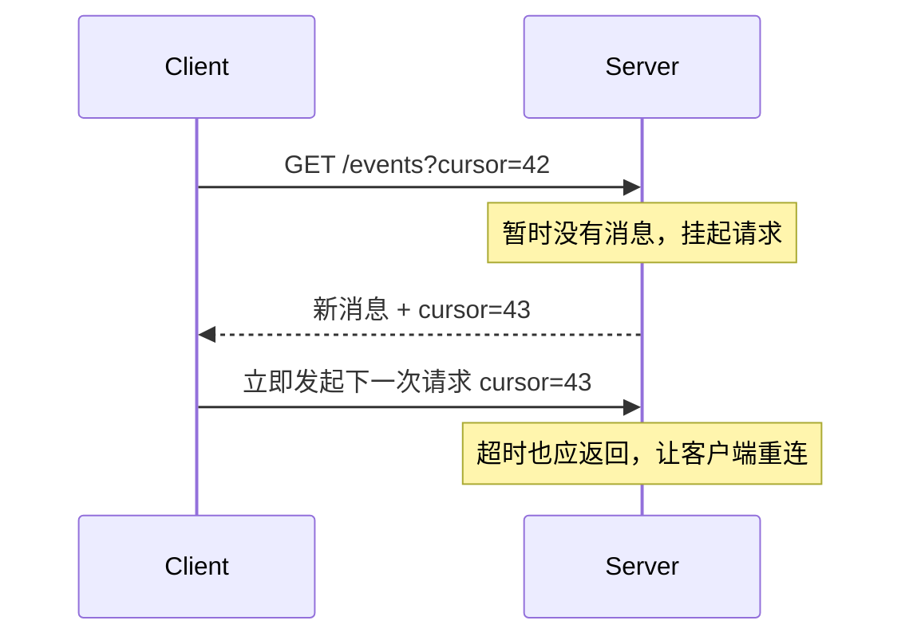
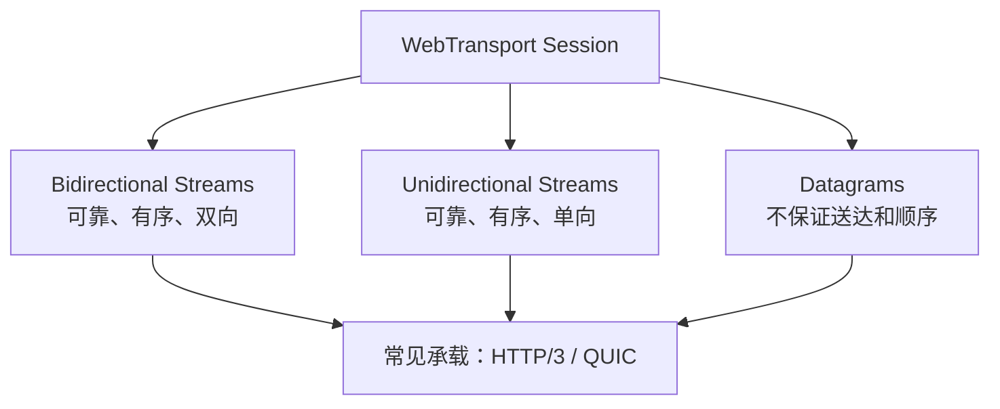
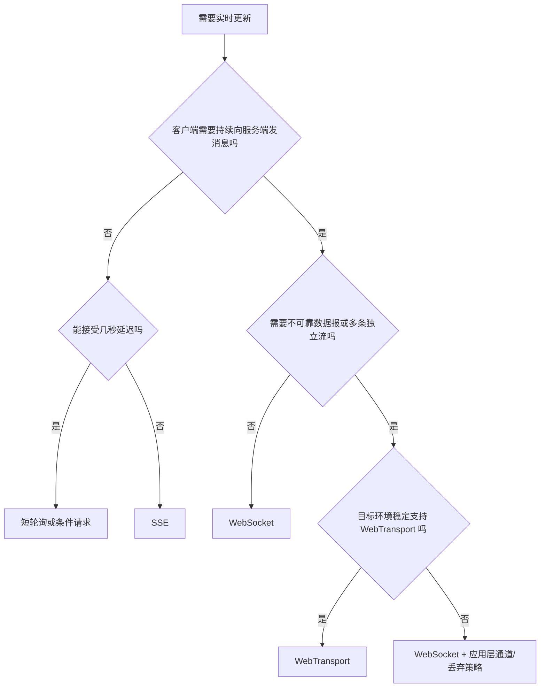

# 实时通信：短轮询、SSE、WebSocket 与 WebTransport 怎么选

> “实时”不是一种协议。先问清通信方向、消息可靠性、延迟、连接规模、代理环境和浏览器支持，再决定技术。

## 1. 方案总览

| 方案 | 通信方向 | 底层特点 | 优点 | 主要限制 |
|---|---|---|---|---|
| 短轮询 | 客户端定期请求 | 普通 HTTP | 最简单、兼容好 | 空请求多，实时性取决于间隔 |
| 长轮询 | 客户端请求挂起 | 普通 HTTP | 比短轮询减少空请求 | 请求超时、连接管理和并发成本 |
| SSE | 服务端 → 客户端 | `text/event-stream` | 自动重连、事件 ID、使用 HTTP | 主要单向，文本事件，连接策略受浏览器影响 |
| WebSocket | 全双工 | 独立消息协议 | 双向低延迟、生态成熟 | 需自行设计鉴权、心跳、重连、背压和消息语义 |
| WebTransport | 双向 streams + datagrams | 当前常见实现基于 HTTP/3/QUIC | 同时支持可靠流和不可靠数据报 | 属于较新的 Baseline 2026 能力，旧环境与基础设施兼容仍需评估 |

### 30～60 秒回答

只需要服务端持续推送文本事件时优先考虑 SSE；需要成熟的浏览器双向通信时通常选 WebSocket；能接受秒级延迟、业务规模小或基础设施简单时轮询反而更稳；需要多条独立流和不可靠数据报，且目标环境明确支持时再考虑 WebTransport。协议只解决传输，生产系统还必须设计鉴权、心跳、重连、顺序、幂等、限流和观测。

---

## 2. 短轮询与长轮询

### 短轮询

客户端每隔固定时间请求：

```js
let timer;

async function poll() {
  try {
    const response = await fetch('/api/notifications?after=cursor-42');
    const data = await response.json();
    renderNotifications(data.items);
  } finally {
    // 等本次请求结束后再安排下一次，避免慢网络下请求堆叠
    timer = setTimeout(poll, 5000);
  }
}

poll();
```

优点是简单、容易走现有 HTTP/CDN/鉴权体系；缺点是无更新时仍消耗请求，轮询间隔越短，资源消耗越高。

### 长轮询

客户端发起请求，服务端在有新消息或超时时才响应；客户端收到后立刻再次请求。



它减少空轮询，但服务端需要管理大量挂起请求，代理和负载均衡的超时配置也要协调。

---

## 3. SSE：单向推送往往够用

### 服务端响应格式

```http
HTTP/1.1 200 OK
Content-Type: text/event-stream
Cache-Control: no-cache
Connection: keep-alive

id: 43
event: notification
data: {"text":"构建完成"}

```

每个事件以空行结束。`id` 可以帮助断线后从 `Last-Event-ID` 继续，`retry` 可以建议重连时间。

### 浏览器端

```js
const source = new EventSource('/api/events', {
  withCredentials: true, // 跨源使用 Cookie 时，服务端还要正确配置 CORS
});

source.addEventListener('notification', (event) => {
  const message = JSON.parse(event.data);
  renderNotification(message);
});

source.onerror = () => {
  // EventSource 会自动尝试重连，这里主要记录状态和观测指标
  console.warn('SSE connection interrupted');
};
```

### Node.js 服务端示例

```js
import http from 'node:http';

http.createServer((request, response) => {
  if (request.url !== '/api/events') {
    response.writeHead(404).end();
    return;
  }

  response.writeHead(200, {
    'Content-Type': 'text/event-stream',
    'Cache-Control': 'no-cache',
    'Connection': 'keep-alive',
  });

  // 先发送注释行，尽快把响应头和连接刷新给客户端
  response.write(': connected\n\n');

  const timer = setInterval(() => {
    response.write(`event: heartbeat\ndata: ${Date.now()}\n\n`);
  }, 15000);

  request.on('close', () => {
    clearInterval(timer); // 客户端断开后及时释放定时器
  });
}).listen(8080);
```

生产环境还要关闭代理缓冲、设置空闲超时、处理慢客户端和连接数限制。

### SSE 的限制

- 经典 `EventSource` 主要是 GET，不能任意设置自定义请求头；
- 数据格式是 UTF-8 文本，二进制需要编码或改用其他方案；
- 客户端到服务端仍走普通 HTTP 请求；
- HTTP/1.x 下同源连接数限制更明显，HTTP/2 多路复用可以改善；
- 代理若缓冲响应，会让“实时推送”变成批量到达。

---

## 4. WebSocket 建连和数据流

经典 WebSocket 从 HTTP/1.1 Upgrade 开始：

```http
GET /chat HTTP/1.1
Host: example.com
Upgrade: websocket
Connection: Upgrade
Sec-WebSocket-Key: <random-base64>
Sec-WebSocket-Version: 13
Origin: https://app.example.com
```

服务端接受后：

```http
HTTP/1.1 101 Switching Protocols
Upgrade: websocket
Connection: Upgrade
Sec-WebSocket-Accept: <derived-value>
```

升级完成后不再传普通 HTTP 消息，而是传 WebSocket frame。HTTP/2 和 HTTP/3 还分别有 Extended CONNECT 机制，不一定出现传统 `101` 交换。

### 浏览器端示例

```js
const socket = new WebSocket('wss://realtime.example.com/chat');

socket.addEventListener('open', () => {
  socket.send(JSON.stringify({
    type: 'AUTH',
    token: getShortLivedSocketToken(), // 使用短期、最小权限凭据
  }));
});

socket.addEventListener('message', (event) => {
  const message = JSON.parse(event.data);
  handleMessage(message);
});

socket.addEventListener('close', (event) => {
  scheduleReconnect(event.code); // 使用退避和抖动，避免大量客户端同时重连
});
```

### `ws://` 与 `wss://`

HTTPS 页面通常应连接 `wss://`。`wss` 表示 WebSocket 运行在 TLS 通道上，提供的传输安全边界与 HTTPS 类似。

---

## 5. WebSocket 生产系统真正难在哪里

### 鉴权

浏览器 WebSocket 构造函数不能像 Fetch 一样自由设置 `Authorization` 请求头。常见方案包括：

- 同源或受控跨源 Cookie；
- URL 中的短期一次性 ticket，避免长期 token 出现在日志；
- 建连后第一条应用消息完成认证；
- 由反向代理在握手阶段注入经过验证的身份。

服务端必须校验 `Origin`，否则使用 Cookie 鉴权时可能发生 Cross-Site WebSocket Hijacking。

### 心跳

协议层有 Ping/Pong frame，但浏览器 JavaScript API 不直接暴露发送 Ping 的能力，应用常设计自己的 `PING`/`PONG` 消息。心跳周期要小于代理空闲超时，同时避免所有客户端在同一秒发送。

### 重连

```js
function reconnectDelay(attempt) {
  const base = Math.min(1000 * 2 ** attempt, 30000);
  const jitter = Math.random() * 1000;
  return base + jitter; // 指数退避加抖动，避免“惊群”
}
```

重连还需要携带最后确认的序列号，从服务端补发缺失消息，而不是只重新建立 socket。

### 背压

经典浏览器 `WebSocket` API 没有完整的流式背压机制。可以观察 `bufferedAmount`，在积压过大时暂停生产、丢弃低价值消息或断开慢客户端。

```js
function safeSend(socket, payload) {
  const MAX_BUFFERED_BYTES = 1_000_000;

  if (socket.readyState !== WebSocket.OPEN) return false;
  if (socket.bufferedAmount > MAX_BUFFERED_BYTES) {
    return false; // 让上层降级或丢弃可丢消息，避免内存持续增长
  }

  socket.send(JSON.stringify(payload));
  return true;
}
```

### 顺序和幂等

WebSocket 在一条连接上提供有序消息传输，但断线重连、服务端分片、消息队列和异步业务处理仍可能导致重复或应用层乱序。重要消息应包含 `messageId`、`sequence` 和确认状态。

---

## 6. WebTransport 是什么

### 快速回答

WebTransport 是浏览器提供的会话式传输 API，可以同时使用可靠的双向/单向流和不可靠数据报。当前浏览器的常见实现基于 HTTP/3/QUIC；W3C API 规范也描述了由 User Agent 选择受支持传输的空间，因此不要把 JavaScript API 误背成永远只能绑定一种线协议。截至 2026 年 8 月 9 日，MDN 将它标为 Baseline 2026 Newly available：新版本主流浏览器已开始普遍可用，但旧设备、代理、服务端和观测链路仍需单独验证，不能默认替代 WebSocket。



### 和 WebSocket 的核心差异

WebSocket 提供一条可靠有序消息通道；WebTransport 可以创建多条独立流，并发送允许丢失的数据报。某条可靠流阻塞时，其他流仍可推进，低价值实时状态可以走 datagram，不必为旧消息重传。

### 为什么不能直接替换

- 浏览器、代理、服务端和监控工具支持不如 WebSocket 成熟；
- 当前常见 HTTP/3 部署涉及证书、UDP 可达性和 QUIC 基础设施，要求更高；
- 业务需要自己选择流和数据报语义；
- 企业网络可能限制 UDP，需要回退方案。

---

## 7. 怎么选：从业务约束反推协议



### 典型场景

| 场景 | 推荐起点 | 原因 |
|---|---|---|
| 后台任务进度、通知 | SSE | 主要服务端推送，自动重连 |
| 聊天、在线协作 | WebSocket | 成熟双向通信，生态完整 |
| 低频状态刷新 | 短轮询 | 简单可靠，维护成本低 |
| 旧系统模拟推送 | 长轮询 | 服务端可在普通 HTTP 上渐进实现 |
| 快节奏游戏状态、实时媒体控制 | WebTransport 候选 | 需要 stream 和 datagram 混合语义 |

选型时再补充：用户规模、消息大小、历史补偿、跨地域、移动网络、代理超时、服务端广播模型和可观测性。

---

## 8. 反向代理配置要点

### WebSocket 的 Nginx 示例

```nginx
location /socket/ {
    proxy_pass http://realtime_upstream;
    proxy_http_version 1.1;

    # 将客户端 Upgrade 信息传递给上游，完成 WebSocket 升级
    proxy_set_header Upgrade $http_upgrade;
    proxy_set_header Connection "upgrade";

    # 空闲超时要和应用心跳周期协调
    proxy_read_timeout 60s;
}
```

### SSE

SSE 通常需要关闭代理缓冲，否则事件可能积累到缓冲区满后才发给客户端：

```nginx
location /events/ {
    proxy_pass http://event_upstream;
    proxy_buffering off; # 让事件尽快向客户端转发
    proxy_read_timeout 1h;
}
```

具体配置还要结合网关、负载均衡器和云平台限制。

---

## 9. 高频追问与误区

### WebSocket 是基于 TCP 还是 HTTP

经典 WebSocket 先通过 HTTP/1.1 Upgrade 建立，随后在同一 TCP/TLS 连接上传输 WebSocket frame。它借 HTTP 完成握手，但数据阶段不是普通 HTTP 请求响应。WebSocket 也定义了在 HTTP/2、HTTP/3 上通过 Extended CONNECT 建立的方式。

### SSE 是服务器主动发起 HTTP 请求吗

不是。连接仍由客户端建立，服务端保持响应流并持续写入事件。HTTP 请求—响应模型没有被反转。

### HTTP/2 能替代 WebSocket 吗

HTTP/2 多路复用改善普通请求和流式响应，但浏览器没有提供“直接操作任意 HTTP/2 双向 stream”的通用 API。业务双向消息仍常用 WebSocket，单向推送可用 SSE。

### WebSocket 天生比轮询节省资源吗

不一定。低频更新、用户很少时，短轮询可能更简单；长期连接会消耗连接状态、心跳、广播和网关资源。应比较整体成本，而不是只数 HTTP 请求。

---

## 10. 延伸阅读

- [WHATWG：WebSockets Standard](https://websockets.spec.whatwg.org/)
- [MDN：WebSocket API](https://developer.mozilla.org/en-US/docs/Web/API/WebSocket)
- [MDN：Server-sent events](https://developer.mozilla.org/en-US/docs/Web/API/Server-sent_events)
- [W3C：WebTransport](https://www.w3.org/TR/webtransport/)
- [RFC 8441：Bootstrapping WebSockets with HTTP/2](https://www.rfc-editor.org/rfc/rfc8441.html)
- [RFC 9220：Bootstrapping WebSockets with HTTP/3](https://www.rfc-editor.org/rfc/rfc9220.html)

上一篇：[Web 攻击与防御](./07-web-attacks-and-defenses.md) ｜ 返回：[知识总纲](./README.md)
