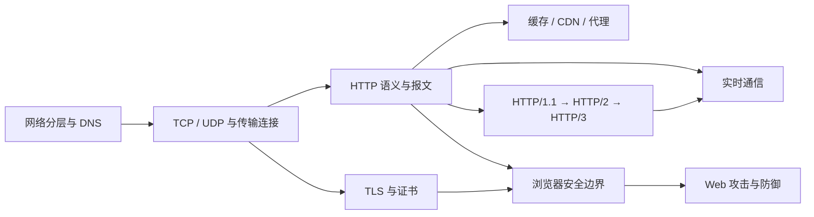

# 网络、HTTP 与 Web 安全面试知识总纲

> 这不是把 59 道旧题重新排个序，而是把它们串成一条能讲明白的链：**浏览器如何找到服务器 → 数据怎么可靠地送过去 → HTTP 如何表达请求 → 缓存和协议版本怎样影响性能 → HTTPS 如何建立信任 → 浏览器如何划定安全边界 → 攻击者会从哪里突破。**

适用人群：有 3～5 年经验、准备中高级前端面试的工程师。

资料核对日期：**2026 年 8 月 9 日**。HTTP 以 RFC 9110～9114 为主线，QUIC 以 RFC 9000 为主线，TLS 1.3 以 2026 年发布并替代 RFC 8446 的 RFC 9846 为当前基线。

---

## 1. 怎么使用这套文档

### 面试前 1 天

先看本页的知识地图和 P0 题单，再到对应专题阅读“快速回答”和“常见误区”。不要一上来背长答案，先确保每道题能在 30～60 秒内讲出主线。

### 面试前 1 周

按编号阅读 8 篇专题。每读完一篇，至少做到三件事：

1. 不看文档画出一张核心流程图；
2. 用自己的话回答文中的递进追问；
3. 在 DevTools、cURL 或最小代码中验证一个现象。

### 系统学习

按下面的依赖顺序学习，不建议跳着背：

这张图最重要的信息不是箭头数量，而是依赖关系：如果 TCP、HTTP 语义和 Origin 没讲清楚，后面的队头阻塞、CORS、CSRF、WebSocket 很容易变成互相冲突的口诀。

---

## 2. 专题导航

| 专题 | 重点问题 | 阅读入口 |
|---|---|---|
| 网络基础与请求链路 | TCP/UDP、DNS、三次握手、四次挥手、输入 URL | [01 网络基础与请求链路](./01-network-foundation-and-request-lifecycle.md) |
| HTTP 语义与报文 | 无状态、方法、幂等、状态码、头字段、长连接 | [02 HTTP 语义与报文](./02-http-semantics-and-messages.md) |
| 缓存、CDN 与代理 | 强缓存、协商缓存、Service Worker、回源、代理 | [03 HTTP 缓存、CDN 与代理](./03-http-cache-cdn-and-proxy.md) |
| HTTP 版本与性能 | 队头阻塞、多路复用、HPACK、QUIC、0-RTT | [04 HTTP 版本演进与性能](./04-http-versions-and-performance.md) |
| HTTPS、TLS 与证书 | 加密、签名、证书链、TLS 1.3、中间人、HSTS | [05 HTTPS、TLS 与证书](./05-https-tls-and-certificates.md) |
| 浏览器安全边界 | 同源策略、CORS、Cookie、CSP、SRI、安全响应头 | [06 浏览器安全边界](./06-browser-security-boundaries.md) |
| Web 攻击与防御 | XSS、CSRF、点击劫持、SSRF、注入、供应链 | [07 Web 攻击与防御](./07-web-attacks-and-defenses.md) |
| 实时通信 | 轮询、SSE、WebSocket、WebTransport、重连 | [08 实时通信](./08-realtime-communication.md) |
| 原题审计 | 旧题去了哪里、哪些合并、哪些纠错 | [09 原题归并映射](./09-original-question-map.md) |

---

## 3. P0：必须能讲透的 16 道题

| 编号 | 问题 | 合格线 |
|---|---|---|
| 1 | 输入 URL 后发生了什么？ | 能从 URL、缓存、DNS、连接、TLS、HTTP 一直讲到浏览器处理响应 |
| 2 | TCP 为什么需要三次握手？ | 能说明双方收发能力、初始序列号和历史报文问题 |
| 3 | TCP 如何保证可靠？ | 能串起序列号、确认、重传、滑动窗口、流量控制和拥塞控制 |
| 4 | HTTP 无状态是什么意思？ | 不把“服务器保存业务数据”和“协议请求关联”混为一谈 |
| 5 | GET 与 POST 有什么区别？ | 从语义、安全性、幂等性、缓存和工程约束回答，不背浏览器假限制 |
| 6 | 302、303、307、308 怎么选？ | 能说明重定向后是否保留请求方法和请求体 |
| 7 | 强缓存和协商缓存如何配合？ | 能画出 `Cache-Control`、`ETag`、`304` 决策链 |
| 8 | HTTP/2 解决了什么，没解决什么？ | 能区分应用层队头阻塞与 TCP 层队头阻塞 |
| 9 | HTTP/3 为什么基于 QUIC？ | 能说明独立流、连接迁移、握手成本和 UDP 只是承载层 |
| 10 | HTTPS 如何同时做到加密、完整性和认证？ | 能说清对称加密、签名、证书和密钥协商各自职责 |
| 11 | 浏览器如何验证证书？ | 能从域名、有效期、证书链、信任锚和吊销状态回答 |
| 12 | 同源策略和 CORS 是什么关系？ | 知道 CORS 是浏览器控制“读取响应”的机制，不等于服务端防火墙 |
| 13 | XSS 与 CSRF 的本质区别？ | 能从攻击能力、前置条件和防御重点比较 |
| 14 | Cookie 的 `SameSite`、`HttpOnly`、`Secure` 各防什么？ | 不把任何一个属性说成万能防御 |
| 15 | CSP 为什么能降低 XSS 风险？ | 能说明资源白名单、nonce/hash 和报告模式 |
| 16 | SSE、WebSocket、WebTransport 怎么选？ | 能结合方向、可靠性、代理兼容、复杂度和业务需求判断 |

---

## 4. 三条容易答错的主线

### HTTP/2 不等于“必须使用 HTTPS”

HTTP/2 规范本身定义了 `http` 和 `https` URI 的使用方式，但主流浏览器对公开 Web 的 HTTP/2 实际上通常只通过 TLS 协商。面试时要区分“协议规范允许什么”和“浏览器部署现实是什么”。

### HTTPS 不等于绝对安全

HTTPS 保护的是传输通道和对端身份确认，不会自动修复 XSS、弱口令、服务端越权、恶意依赖或终端被控制。它是安全基础设施，不是安全终点。

### UDP 不等于“不可靠应用”

UDP 自身不提供 TCP 那套可靠字节流，但应用层可以在 UDP 之上实现确认、重传、拥塞控制和加密。QUIC 正是典型例子，所以“HTTP/3 使用 UDP，因此不可靠”是错误结论。

---

## 5. 推荐的回答方式

遇到原理题，可以用这个顺序组织，而不是想到哪说到哪：

1. **一句话定义边界**：它是什么、不是什么；
2. **给出主流程**：参与者、关键状态、关键字段；
3. **解释为什么这样设计**：它解决了哪个旧问题，又引入了什么代价；
4. **落到前端场景**：DevTools、浏览器行为、Nginx/CDN、代码如何体现；
5. **补一个限制条件**：协议版本、浏览器实现、安全边界或异常路径。

例如回答“CORS 是什么”，不要只说“跨域解决方案”。更好的开头是：

> CORS 是服务端通过响应头声明跨源读取权限、浏览器负责执行的机制。请求能不能发出、服务端会不会处理、前端脚本能不能读取响应，是三个不同问题。

这句话先把边界说清楚，后面才有空间继续讲简单请求、预检、凭据和缓存。

---

## 6. 权威资料入口

- [RFC 9110：HTTP Semantics](https://www.rfc-editor.org/rfc/rfc9110.html)
- [RFC 9111：HTTP Caching](https://www.rfc-editor.org/rfc/rfc9111.html)
- [RFC 9112：HTTP/1.1](https://www.rfc-editor.org/rfc/rfc9112.html)
- [RFC 9113：HTTP/2](https://www.rfc-editor.org/rfc/rfc9113.html)
- [RFC 9114：HTTP/3](https://www.rfc-editor.org/rfc/rfc9114.html)
- [RFC 9000：QUIC](https://www.rfc-editor.org/rfc/rfc9000.html)
- [RFC 9846：TLS 1.3](https://www.rfc-editor.org/rfc/rfc9846.html)
- [MDN：HTTP](https://developer.mozilla.org/en-US/docs/Web/HTTP)
- [OWASP Cheat Sheet Series](https://cheatsheetseries.owasp.org/)

> 面试资料会过时，规范也会演进。看到“永远”“一定”“所有浏览器都”这类句子，先停一下，检查它说的是规范、主流实现，还是某个历史版本。
