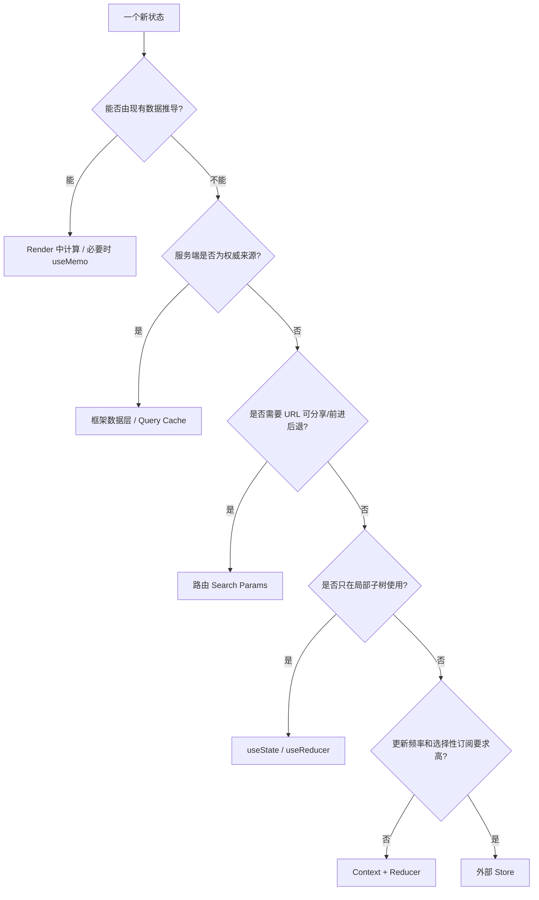
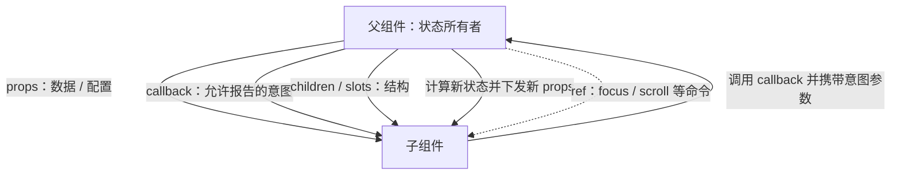
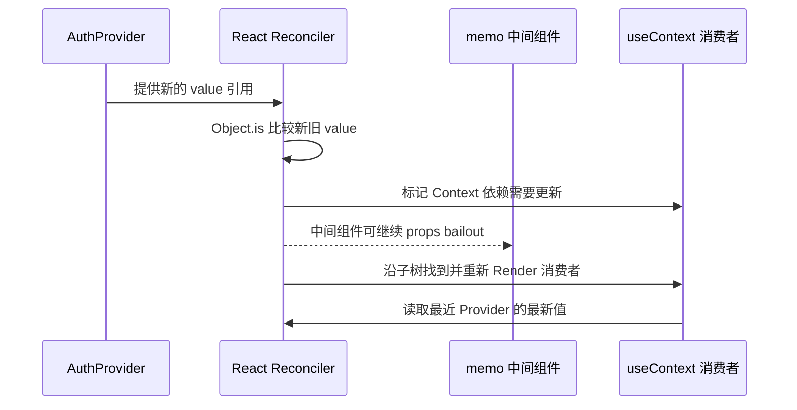
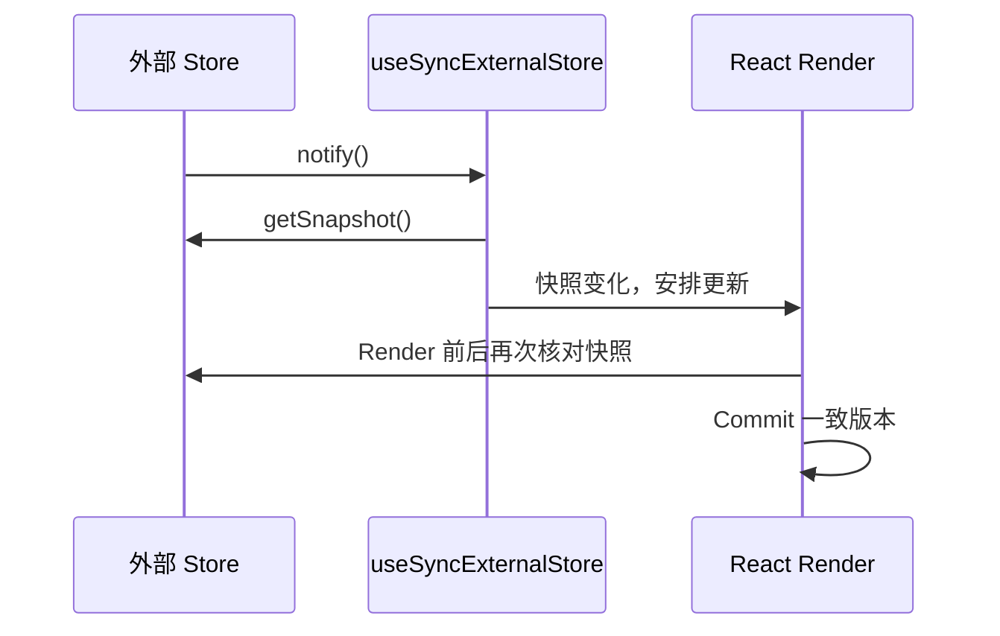
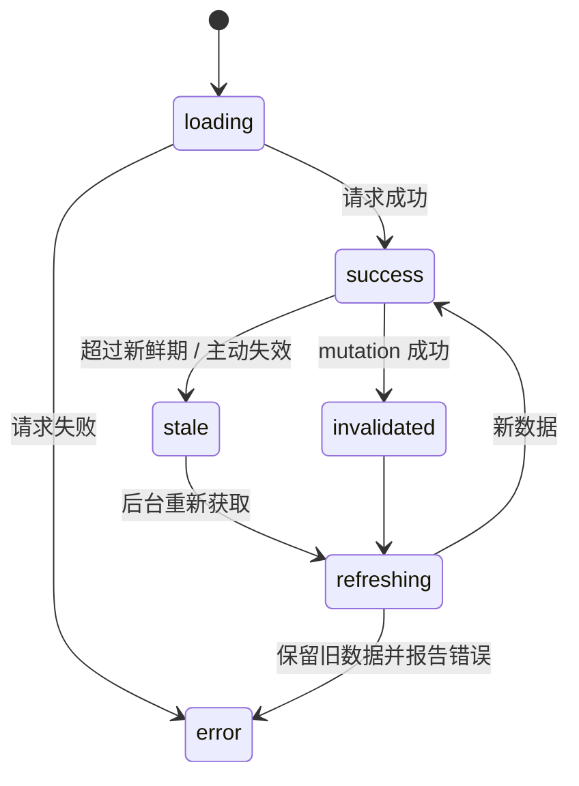
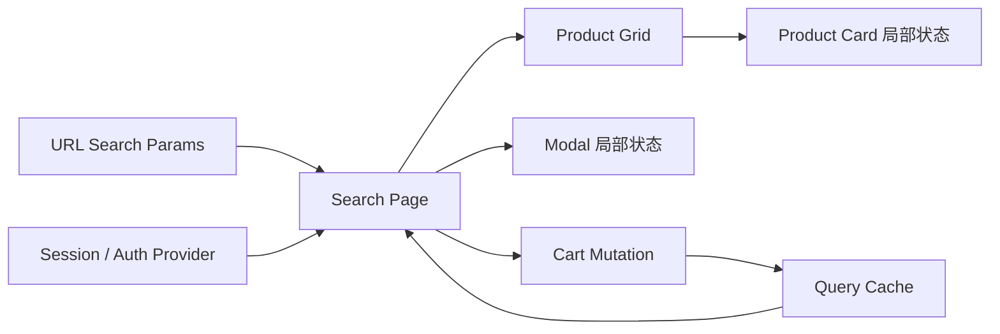

# React 组件通信与状态管理：从局部状态到外部 Store

> 核心原则：先判断“谁拥有状态、谁需要读取、谁能修改、状态属于客户端还是服务端”，再选择通信工具。不要因为跨了两层组件就立刻引入全局 Store。
> 难度标签：`基础必会` `进阶重点` `高级深挖` `历史兼容`

## 目录

- [1. 先给状态分类](#1-先给状态分类)
- [2. 父子组件通信：数据、意图、结构与命令](#2-父子组件通信数据意图结构与命令)
- [3. 兄弟、跨层、跨树与跨窗口通信](#3-兄弟跨层跨树与跨窗口通信)
- [4. Context 的机制与性能边界](#4-context-的机制与性能边界)
- [5. Reducer + Context](#5-reducer--context)
- [6. 外部 Store 与 useSyncExternalStore](#6-外部-store-与-usesyncexternalstore)
- [7. Redux、Zustand 与选型](#7-reduxzustand-与选型)
- [8. 服务端状态与 TanStack Query](#8-服务端状态与-tanstack-query)
- [9. URL、表单与跨窗口状态](#9-url表单与跨窗口状态)
- [10. 状态架构案例](#10-状态架构案例)
- [11. 面试速查](#11-面试速查)

---

## 1. 先给状态分类

### 面试问题

React 应用中的状态应该如何分类？为什么分类比“选 Redux 还是 Context”更重要？

### 30 秒回答

状态至少可分为局部 UI 状态、共享客户端状态、服务端缓存状态、URL 状态、表单状态和外部系统状态。它们的所有权、生命周期、一致性和持久化需求不同。Redux 或 Context 主要解决共享客户端状态，不能天然解决服务端缓存失效、URL 可分享性或表单校验。先分类能避免把所有数据塞进一个全局容器。



### 常见状态类型

| 类型 | 示例 | 默认归属 |
|---|---|---|
| 局部 UI | 弹窗开关、当前 Tab、输入焦点 | 最近使用组件 |
| 表单草稿 | 输入值、校验、dirty | 表单组件 / 表单库 |
| 共享客户端 | 主题、当前组织、编辑器会话 | Context 或 Store |
| 服务端状态 | 用户列表、库存、订单详情 | Query Cache / 框架数据层 |
| URL 状态 | 搜索词、分页、筛选器 | Router / URLSearchParams |
| 外部系统 | 在线状态、媒体查询、第三方 Store | `useSyncExternalStore` |
| 持久化状态 | 偏好设置、离线草稿 | 状态层 + storage 同步策略 |

### 最小状态原则

如果一个值可以从其他状态稳定计算，它不是独立状态：

```tsx
// 中文注释：该示例聚焦当前机制，省略无关工程细节。
const selectedItem = items.find((item) => item.id === selectedId) ?? null;
```

优先存 `selectedId`，而不是同时存整份 `selectedItem`，否则列表刷新后容易出现对象过期。

---

## 2. 父子组件通信：数据、意图、结构与命令

### 面试问题

父子组件有哪些通信方式？props、回调、`children` 和 ref 分别解决什么问题？

### 30 秒回答

父向子通过 props 传递数据和能力；子向父不是“反向修改父状态”，而是调用父组件传下来的领域回调，由父组件这个状态所有者决定是否更新；结构内容通过 `children` 或具名插槽式 props 组合；焦点、滚动、媒体播放等少量命令式能力通过 ref 暴露。默认模型是 **数据向下、意图向上、结构由组合注入、命令式能力最小化**。



### Props：传值也传“能力”

props 不仅能传字符串和对象，也能传函数、React 节点和策略对象。关键不在“能传什么”，而在于 **调用方是否仍然掌握所有权**。

```tsx
type QuantityInputProps = {
  value: number;
  min?: number;
  onChange: (nextValue: number) => void;
};

function QuantityInput({ value, min = 1, onChange }: QuantityInputProps) {
  return (
    <input
      type="number"
      min={min}
      value={value}
      onChange={(event) => {
        const nextValue = Math.max(min, Number(event.target.value));
        // 中文注释：子组件只报告用户意图，不直接拥有购物车业务状态
        onChange(nextValue);
      }}
    />
  );
}

function CartLine() {
  const [quantity, setQuantity] = useState(1);

  return (
    <QuantityInput
      value={quantity}
      onChange={(nextQuantity) => {
        // 中文注释：校验、埋点和服务端同步仍由状态所有者决定
        setQuantity(nextQuantity);
      }}
    />
  );
}
```

### 回调：传递领域意图，而不是泄漏 setter

```tsx
// ❌ 子组件拿到过强能力，可以写入任意订单结构
<CheckoutForm setOrder={setOrder} />

// ✅ 回调名称表达业务意图，父组件保留校验和状态所有权
<CheckoutForm
  onAddressChange={changeAddress}
  onCouponApply={applyCoupon}
  onSubmit={submitOrder}
/>
```

直接传 `setState` 并非语法错误；对简单叶子控件，`onChange={setValue}` 很自然。问题出现在业务组件获得了超出职责的写权限：它开始依赖父级状态结构，导致校验、日志、乐观更新和错误恢复散落到子组件。

### `children` 与具名插槽式 props：通信的是结构

React 没有专门的 slot 语法，但可以用 `children` 或多个 `ReactNode` props 实现结构注入：

```tsx
type DialogProps = {
  title: ReactNode;
  children: ReactNode;
  actions?: ReactNode;
};

function Dialog({ title, children, actions }: DialogProps) {
  return (
    <section role="dialog" aria-modal="true">
      <header>{title}</header>
      <div>{children}</div>
      {actions && <footer>{actions}</footer>}
    </section>
  );
}

function DeleteDialog() {
  return (
    <Dialog
      title="删除商品"
      actions={
        // 中文注释：调用方拥有按钮行为，Dialog 只负责布局
        <button type="button">确认删除</button>
      }
    >
      删除后不可恢复。
    </Dialog>
  );
}
```

这种模式能避免“中间层只为转发数据而理解业务”。如果被注入内容还需要从容器读取状态，可以进一步使用 Render Props，但要警惕嵌套过深和不必要的新函数引用。

### ref 与 `useImperativeHandle`：只暴露最小命令集

父组件需要触发焦点、选区、滚动或第三方实例方法时，可以暴露命令式句柄，而不是把整个内部 DOM 和 state 交出去。

```tsx
import {
  forwardRef,
  useImperativeHandle,
  useRef,
  useState,
  type ChangeEvent,
} from 'react';

type SearchInputHandle = {
  focus: () => void;
  clear: () => void;
};

type SearchInputProps = {
  onSearch: (keyword: string) => void;
};

const SearchInput = forwardRef<SearchInputHandle, SearchInputProps>(
  function SearchInput({ onSearch }, ref) {
    const inputRef = useRef<HTMLInputElement>(null);
    const [keyword, setKeyword] = useState('');

    useImperativeHandle(ref, () => ({
      focus() {
        // 中文注释：只暴露调用方真正需要的聚焦能力
        inputRef.current?.focus();
      },
      clear() {
        // 中文注释：内部状态如何清空仍由组件自己维护
        setKeyword('');
        onSearch('');
      },
    }), [onSearch]);

    function handleChange(event: ChangeEvent<HTMLInputElement>) {
      const nextKeyword = event.target.value;
      setKeyword(nextKeyword);
      onSearch(nextKeyword);
    }

    return <input ref={inputRef} value={keyword} onChange={handleChange} />;
  },
);

function SearchPage() {
  const searchInputRef = useRef<SearchInputHandle>(null);

  return (
    <>
      <SearchInput ref={searchInputRef} onSearch={() => {}} />
      <button onClick={() => searchInputRef.current?.focus()}>聚焦搜索框</button>
      <button onClick={() => searchInputRef.current?.clear()}>清空</button>
    </>
  );
}
```

> **版本边界**：上例使用 React 18 及大量现存项目兼容的 `forwardRef` 写法。React 19 支持函数组件直接把 `ref` 作为 prop 接收，新代码可按目标版本简化；但面试时不要把 React 19 的 ref prop 行为说成 React 18 通用能力。

### 为什么 ref 不是常规数据通道

ref 写入不会自动触发 Render，也绕过了单向数据流。若父组件持续读取子组件的 `getValue()` 再拼装业务状态，容易产生多个真相来源、时序不明确和测试困难。判断标准是：

- “请执行一个动作”，如 `focus()`、`scrollTo()`：ref 合理；
- “请持续告诉我业务值是什么”：优先受控 props / callback；
- “多个组件都要消费同一业务值”：提升状态、Context 或 Store；
- “需要访问第三方命令式实例”：ref 可以作为适配层，但要在卸载时清理。

### 高频追问

1. **子组件可以直接修改 props 吗？** 不应修改。props 是当前 Render 的输入快照；对象引用可变不代表修改它是合法的数据流。
2. **为什么回调也算父传子？** 因为函数本身仍是父组件传下去的能力，子组件只是调用它报告意图。
3. **`children` 会自动避免重渲染吗？** 不会。是否复用取决于 Element 身份、父级创建方式、组件边界和实际更新路径。
4. **为什么不直接暴露 DOM？** 暴露最小句柄能隐藏内部结构，降低调用方与具体标签、层级和第三方实现的耦合。

---

## 3. 兄弟、跨层、跨树与跨窗口通信

### 面试问题

兄弟组件、祖孙组件、Portal、任意模块和不同浏览器标签页应如何通信？

### 30 秒回答

兄弟组件共享状态时提升到最近公共父节点；跨层但语义稳定、更新频率可控的数据使用 Context；更新频繁且消费者多、需要 selector 或跨 React Root 时考虑外部 Store；可分享、可恢复的导航状态放 URL；Portal 只改变 DOM 挂载位置，不是数据通信方案；跨标签页使用 `BroadcastChannel` 或 `storage` 事件；Event Bus 只适合有明确协议的跨系统边界，不应作为 React 组件通信默认答案。

### 状态提升：把真相来源放到最近公共父节点

```tsx
function TemperatureCalculator() {
  const [celsius, setCelsius] = useState(0);

  return (
    <>
      <CelsiusInput value={celsius} onChange={setCelsius} />
      {/* 中文注释：华氏温度可由摄氏温度推导，不再保存第二份可写 state */}
      <FahrenheitOutput value={(celsius * 9) / 5 + 32} />
    </>
  );
}
```

“提升”不是越高越好。状态放得过高会扩大 Render 范围并让组件依赖变复杂；应提升到 **能够统一约束所有消费者的最近公共所有者**。只被一个叶子组件使用的状态则应下沉。

### 组件组合可替代一部分 props drilling

```tsx
function Page({ user }: { user: User }) {
  return (
    <Layout
      header={<UserMenu user={user} />}
      content={<Dashboard userId={user.id} />}
    />
  );
}
```

`Layout` 不需要理解 `user`，只负责摆放调用者传入的节点。这里解决的是“中间层不关心数据却被迫转发”的问题；如果深层许多组件都要独立读取和更新同一值，Context 或 Store 才更合适。

### Portal 不是通信机制

Portal 把子树提交到另一个 DOM 容器，但它仍属于原来的 React 树：可以继续读取原树 Context，React 事件也按 React 树传播。它适合 Modal、Tooltip 等视觉层级问题，却不能替代 props、Context 或外部 Store。

```tsx
function Modal({ children }: { children: ReactNode }) {
  const container = document.getElementById('modal-root');
  if (!container) return null;

  // 中文注释：只改变 DOM 挂载位置，不改变 React 所有权和 Context 关系
  return createPortal(children, container);
}
```

### 跨 React Root 或非 React 模块

两个独立 Root 之间没有共同组件祖先，不能直接做状态提升；可使用同一个外部 Store、URL 或显式消息协议。微前端场景还应约定：

- 事件名和 payload schema；
- 版本兼容与错误处理；
- 订阅作用域和卸载清理；
- 是否允许重放、去重和乱序；
- 日志、链路 ID 与调试面板。

### Event Bus 为什么不是默认答案

- 发布者和订阅者关系不能从组件树和 props 类型中直接看出；
- 字符串事件名容易漂移，payload 缺乏约束；
- 容易漏清理，造成重复订阅和闭包持有；
- 事件顺序、重放、错误恢复和测试隔离更难；
- SSR 中全局单例可能造成请求间状态污染。

Event Bus 可以用于跨微前端、WebSocket 消息分发、原生容器桥接等系统边界，但应被封装成有类型的领域适配器。组件内部依然通过 props、Context 或 Store 消费，不要让任意组件直接发布全局字符串事件。

### 通信方式选型表

| 方式 | 最适合 | 主要风险 / 边界 |
|---|---|---|
| props | 父向子数据、配置和能力 | 层级很深时中间层可能只做转发 |
| callback | 子组件报告领域意图 | 直接暴露 setter 会泄漏状态结构 |
| `children` / slot-like props | 注入结构、控制反转 | 不是自动性能优化，多层 Render Props 会嵌套 |
| 状态提升 | 兄弟共享、需要单一真相来源 | 提升过高扩大更新范围 |
| Context | 主题、语言、认证摘要等跨层值 | value 身份变化会广播给消费者，缺少 selector |
| 外部 Store | 高频共享、跨 Root、selector、时间旅行 | 引入协议和生命周期成本，需一致 snapshot |
| URL | 筛选、分页、资源 ID、可分享导航状态 | 需要解析、校验、历史栈和隐私设计 |
| ref / imperative handle | focus、scroll、媒体、第三方实例 | 不触发 Render，不能作为持续业务数据通道 |
| Portal | 跨 DOM 层级渲染 Modal / Tooltip | 不是数据通信，事件仍按 React 树传播 |
| `BroadcastChannel` / `storage` | 同源标签页和窗口同步 | 需要版本、去重、冲突和关闭清理 |
| Event Bus / message protocol | 跨框架、微前端、宿主桥接 | 隐式依赖、顺序、schema 和可观测性成本 |

### 面试官追问树

```text
组件通信有哪些方式？
  → 状态应该放在哪里？
    → 最近公共父节点和“越高越好”有什么区别？
  → Context 为什么会引起一批消费者更新？
    → selector Store 如何缩小订阅？
  → ref 为什么不能替代受控组件？
  → Portal 中 Context 和事件按哪棵树传播？
  → 两个 React Root 或两个标签页如何同步？
  → Event Bus 如何保证类型、清理、顺序和可观测性？
```

---

## 4. Context 的机制与性能边界

### 面试问题

Context 如何传播？为什么 `memo` 挡不住 Context 更新？如何避免一个 Context 让整页消费者重新渲染？

### 30 秒回答

Context 让组件读取最近 Provider 的值。消费者调用 `useContext` 时，React 会在当前 Fiber 上记录 Context 依赖；Provider 的 `value` 变化后，React 使用 `Object.is` 判断新旧值，并让订阅该 Context 的消费者参与后续 Render。`memo` 只比较 props，不能屏蔽组件自己读取的 Context。优化重点不是盲目缓存整个 value，而是按语义和更新频率拆分 Context、分离 state 与 dispatch、缩小 Provider 范围；需要 selector 和高频局部更新时使用外部 Store。

### 3 分钟展开

Context 同时包含两条容易混淆的更新路径：

1. **普通父子 Render 传播**：Provider 所在组件更新后，会像普通父组件一样重新计算 children；
2. **Context 依赖传播**：即使中间组件 props 没变或被 `memo` 包裹，真正读取该 Context 的后代仍必须观察到新值。

React 在 Render 消费者时记录“这个 Fiber 读取了哪个 Context 以及当时的值”。Provider 下次提供新 `value` 时，React 比较新旧引用；若不满足 `Object.is(oldValue, newValue)`，相关消费者的工作会被标记，后续 Render 重新读取最近 Provider 的值。

核心 Context API 没有字段级 selector：消费者即使只用 `value.user.name`，也订阅整个 `value`。只要 Provider value 引用变化，消费者就需要重新 Render 后才能确认输出是否变化。

### 数据大致存在哪里

> 下列结构是面试级简化示意，并非 React 源码原文。源码字段和传播策略可能随版本变化。

```js
const authContext = {
  currentValue: null, // 当前渲染器 / Provider 栈中的值，概念示意
};

const consumerFiber = {
  dependencies: {
    firstContext: {
      context: authContext,
      memoizedValue: previousAuthValue,
      next: null,
    },
  },
  lanes: 0,
};
```

面试不需要背 `dependencies.firstContext` 等字段，应该能回答 3 点：

- Provider 的值在 Render 过程中按嵌套关系压栈 / 恢复；
- 消费者 Fiber 记录读取依赖；
- value 变化后，React 标记相关消费者，避免被中间 `memo` 永久挡住。

### 传播链路



这张图说明 `memo` 的正确边界：它可以让不消费 Context 的中间组件跳过自己的工作，但不能让真正消费者继续使用旧 Context。

### React 19 与历史 Provider 写法

```tsx
const ThemeContext = createContext<'light' | 'dark'>('light');

function ThemeProvider({ children }: { children: ReactNode }) {
  const [theme, setTheme] = useState<'light' | 'dark'>('light');

  return (
    <ThemeContext value={theme}>
      {children}
      <button
        onClick={() => setTheme((value) => value === 'light' ? 'dark' : 'light')}
      >
        切换主题
      </button>
    </ThemeContext>
  );
}
```

React 19 支持把 Context 对象直接作为 Provider。React 18 及更早版本使用 `<ThemeContext.Provider value={theme}>`。这只是公开语法演进，不改变“最近 Provider + 消费者依赖”的主线。

### 为什么对象 value 容易扩大广播

```tsx
function AuthProvider({ children }: { children: ReactNode }) {
  const [user, setUser] = useState<User | null>(null);

  function logout() {
    setUser(null);
  }

  return (
    <AuthContext value={{ user, logout }}>
      {children}
    </AuthContext>
  );
}
```

每次 `AuthProvider` Render 都创建新对象和新函数，即使 `user` 没变，`Object.is` 仍得到 false。所有 AuthContext 消费者都会收到一个新 Context 版本。

最低成本修复是稳定函数和 value：

```tsx
function AuthProvider({ children }: { children: ReactNode }) {
  const [user, setUser] = useState<User | null>(null);

  const logout = useCallback(() => {
    setUser(null); // setState dispatch 身份稳定，不需要加入依赖
  }, []);

  const value = useMemo(
    () => ({ user, logout }),
    [user, logout], // 只有 user 或 logout 变化才创建新对象
  );

  return <AuthContext value={value}>{children}</AuthContext>;
}
```

但 `useMemo` 只能避免 Provider 因无关 Render 制造新引用。`user` 真正变化时，所有读取 AuthContext 的消费者仍会 Render；如果 Context 同时包含高频字段，架构仍需要拆分。

### state 与 dispatch 为什么适合拆成两个 Context

```tsx
type Action =
  | { type: 'added'; task: Task }
  | { type: 'toggled'; id: string };

const TasksStateContext = createContext<Task[] | null>(null);
const TasksDispatchContext = createContext<Dispatch<Action> | null>(null);

function TasksProvider({ children }: { children: ReactNode }) {
  const [tasks, dispatch] = useReducer(tasksReducer, []);

  return (
    <TasksStateContext value={tasks}>
      <TasksDispatchContext value={dispatch}>
        {children}
      </TasksDispatchContext>
    </TasksStateContext>
  );
}
```

`dispatch` 身份稳定。只派发动作、不读取任务列表的按钮订阅 DispatchContext 后，不需要因为 `tasks` 每次变化而响应 StateContext 广播。

### Context 穿透 `memo` 的具体例子

```tsx
const UserName = memo(function UserName() {
  const auth = useContext(AuthContext);
  return <strong>{auth.user?.name ?? '游客'}</strong>;
});
```

即使 `UserName` 没有 props，AuthContext 变化时仍必须 Render。`memo` 能比较的是父组件传入 props，不能否定组件内部声明的订阅。

如果想让 `memo` 只关注一个 primitive，可以加一层消费者桥接：

```tsx
const UserNameView = memo(function UserNameView({ name }: { name: string }) {
  return <strong>{name}</strong>;
});

function UserNameContainer() {
  const auth = useContext(AuthContext); // 容器响应整个 Context
  const name = auth.user?.name ?? '游客';
  return <UserNameView name={name} />; // name 未变时，昂贵视图可 bailout
}
```

这不会阻止容器执行，但可以隔离昂贵子树。若大量消费者都需要字段级订阅，应使用 selector Store，而不是到处手写桥接层。

### 默认值与嵌套 Provider 的边界

- `createContext(defaultValue)` 的 default 只在上方没有匹配 Provider 时使用，不是动态备用值；
- Provider 可以嵌套，消费者读取组件树中最近的那个；
- 把默认值设成真实权限对象可能掩盖漏包 Provider，关键依赖可用 `null` + 自定义 Hook 失败得更早；
- Provider 位置改变可能让消费者切换数据源，也可能因树身份变化重置子树状态。

```tsx
const AuthContext = createContext<AuthValue | null>(null);

function useAuth(): AuthValue {
  const value = useContext(AuthContext);

  if (value === null) {
    throw new Error('useAuth 必须在 AuthProvider 内调用');
  }

  return value;
}
```

### 什么时候 Context 足够，什么时候应使用外部 Store

| 场景 | Context | selector 外部 Store |
|---|---|---|
| 主题、语言、当前用户、依赖注入 | 很适合 | 通常没必要 |
| 中低频功能子树状态 | Reducer + Context 可用 | 复杂度高时考虑 |
| 高频进度、拖拽坐标、实时行情 | 容易扩大广播 | 更适合字段级订阅 |
| 大对象但消费者只读少数字段 | 核心 API 无 selector | selector 能缩小更新范围 |
| 并发一致快照 / hydration | React 管理的 Context | 外部 Store 应使用 `useSyncExternalStore` 协议 |
| DevTools、中间件、跨框架共享 | 能力有限 | 状态库通常更成熟 |

### 工程案例：Context 导致全页重渲染

**症状**：输入搜索词时，Header、用户菜单和权限按钮都重复 Render。

```tsx
// ❌ 搜索词与认证信息放在同一个高层 Context
<AppContext value={{ user, permissions, searchText, setSearchText }}>
  <EntireApplication />
</AppContext>
```

**定位步骤**：

1. React Profiler 录制一次输入；
2. 查看哪些组件因 Context 改变而 Render；
3. 检查 Provider value 是否每次创建新对象；
4. 区分“Provider 父组件普通重渲染”和“消费者 Context 依赖更新”；
5. 统计各字段更新频率和消费者集合。

**修复**：

```tsx
<AuthContext value={authValue}>
  <SearchProvider>
    <EntireApplication />
  </SearchProvider>
</AuthContext>
```

- 认证与搜索按语义 / 频率拆分；
- SearchProvider 下沉到搜索功能子树；
- 高频结果列表进一步使用局部 state、Transition 或 selector Store；
- 只在测量证明有价值时稳定 Provider value。

**验证**：再次录制相同输入，确认 AuthContext 消费者不再因 search 变化进入 Commit，并比较输入延迟和 Render duration，而不是只看控制台日志。

### 常见反例

- 认为 Context 会自动对 `value` 做深比较；实际比较的是引用语义；
- 给消费者加 `memo`，却期待它忽略自己订阅的 Context；
- 把 20 个高低频字段塞进一个“全局 Context”，再对 value 做复杂深比较；
- 每个页面都复制一套 Provider，导致状态所有权和生命周期不清晰；
- 为避免 Render 把可变对象放进 ref 并原地修改，结果消费者不更新；
- 把服务端缓存、URL 状态和表单状态全部放进 Context，混淆状态类型。

### 面试官追问树

1. Provider value 使用什么方式比较？
2. 消费者依赖记录在哪里？
3. 为什么中间 `memo` 组件可以跳过，但深层消费者仍更新？
4. `useMemo` 包住 Provider value 能解决哪些问题，不能解决哪些问题？
5. 为什么 state / dispatch 拆分有用？
6. 核心 `useContext` 是否支持字段 selector？
7. Context 与 `useSyncExternalStore` 的适用边界是什么？
8. 如何用 Profiler 证明 Context 拆分有效？

### 版本边界

React 19 支持 `<Context value={...}>` Provider 简写；React 18 及更早版本使用 `<Context.Provider>`。Context 依赖追踪、`Object.is` 比较和消费者响应是稳定心智模型，内部传播函数与字段不属于公共 API。

### 一句话收束

> Context 是“按 Provider 广播整份值”的依赖注入机制，不是字段级 Store；优化它要先拆语义和频率，再谈引用稳定。

---

## 5. Reducer + Context

### 面试问题

什么时候适合把 `useReducer` 与 Context 组合？

### 30 秒回答

当一个功能子树需要共享中等复杂的客户端状态，而且状态迁移可以由明确 action 描述时，Reducer + Context 是低依赖方案。常见做法是把 state 和 dispatch 拆成两个 Context，让只派发动作的组件不因 state 每次变化而重渲染。但高频大规模数据、selector、时间旅行或复杂中间件需求更适合外部 Store。

### 完整模式

```tsx
// 中文注释：该示例聚焦当前机制，省略无关工程细节。
type Task = { id: string; title: string; done: boolean };
type Action =
  | { type: 'added'; task: Task }
  | { type: 'toggled'; id: string }
  | { type: 'removed'; id: string };

const TasksContext = createContext<Task[] | null>(null);
const TasksDispatchContext = createContext<Dispatch<Action> | null>(null);

function tasksReducer(tasks: Task[], action: Action): Task[] {
  switch (action.type) {
    case 'added':
      return [...tasks, action.task];
    case 'toggled':
      return tasks.map((task) =>
        task.id === action.id ? { ...task, done: !task.done } : task,
      );
    case 'removed':
      return tasks.filter((task) => task.id !== action.id);
  }
}

function TasksProvider({ children }: { children: ReactNode }) {
  const [tasks, dispatch] = useReducer(tasksReducer, []);

  return (
    <TasksContext value={tasks}>
      <TasksDispatchContext value={dispatch}>
        {children}
      </TasksDispatchContext>
    </TasksContext>
  );
}
```

### Reducer 的边界

Reducer 应保持纯净：

```tsx
// ❌ 不要在 reducer 内请求接口或写 localStorage
function reducer(state: State, action: Action) {
  localStorage.setItem('state', JSON.stringify(state));
  return state;
}
```

持久化属于外部同步，可由订阅层、Effect 或 Store middleware 负责。领域命令可先执行异步操作，再 dispatch 结果事件。

---

## 6. 外部 Store 与 useSyncExternalStore

### 面试问题

为什么 React 提供 `useSyncExternalStore`？直接在 Effect 里订阅不行吗？

### 30 秒回答

外部 Store 的状态不由 React 更新队列管理。`useSyncExternalStore` 规定了 `subscribe`、`getSnapshot` 和服务端快照协议，让 React 在并发渲染与 hydration 中获得一致快照，避免 tearing（同一界面不同组件看到不同版本）。Redux、Zustand 等库可在内部使用这一接口接入 React。



### 最小 Store 示例

```tsx
type Listener = () => void;

let count = 0;
const listeners = new Set<Listener>();

const counterStore = {
  getSnapshot: () => count,
  subscribe(listener: Listener) {
    listeners.add(listener);
    return () => listeners.delete(listener); // 订阅必须返回清理函数
  },
  increment() {
    count += 1;
    listeners.forEach((listener) => listener());
  },
};

function Counter() {
  const value = useSyncExternalStore(
    counterStore.subscribe,
    counterStore.getSnapshot,
    () => 0, // SSR 快照应与客户端 hydration 初值协调
  );

  return <button onClick={counterStore.increment}>{value}</button>;
}
```

### Snapshot 必须可缓存

`getSnapshot()` 在 Store 未变化时必须返回 `Object.is` 相同的结果。若每次都创建新对象，React 会认为 Store 一直变化。可返回不可变状态对象，或对可变数据生成并缓存版本化快照。

---

## 7. Redux、Zustand 与选型

### 面试问题

Context、Redux、Zustand 怎么选？

### 30 秒回答

Context 是 React 的值传递机制，适合低频跨层共享；Redux Toolkit 提供强约束的事件驱动状态、DevTools、中间件和成熟生态，适合大型协作与可追踪业务流程；Zustand API 轻量、selector 直接，适合中小型共享客户端状态。选型依据应是状态规模、更新频率、团队约束、调试与持久化需求，而不是样板代码多少。

| 维度 | Context + Reducer | Redux Toolkit | Zustand |
|---|---|---|---|
| 依赖 | React 内置 | 外部库 | 外部库 |
| 更新粒度 | 以 Context 消费为主 | selector 订阅 | selector 订阅 |
| 约束与可追踪 | 中等 | 强 | 灵活 |
| 中间件 / DevTools | 自建 | 成熟 | 可选 |
| 典型规模 | 功能子树 | 中大型业务 | 小中型共享状态 |
| 学习成本 | 低到中 | 中 | 低 |

### 选择前的五个问题

1. 这是客户端状态还是服务端状态？
2. 是否真的跨越多个相距较远的功能域？
3. 更新是否高频，是否需要 selector？
4. 是否要求时间旅行、审计日志、持久化、中间件或跨标签页？
5. 团队更需要严格约束还是快速灵活？

### 常见反模式

- 把 API 响应永久复制进 Redux，同时又维护 Query Cache，形成双真相来源。
- 把每个输入框字符都写进全局 Store，扩大更新和调试噪声。
- Store 中保存 React Element、DOM 节点、Promise 或不可序列化临时对象，却又期望完整持久化和时间旅行。
- 组件直接依赖 Store 全量对象，不使用 selector，导致无关更新传播。

---

## 8. 服务端状态与 TanStack Query

### 面试问题

服务端状态为什么不等于全局状态？什么时候使用 TanStack Query 或框架数据层？

### 30 秒回答

服务端状态的权威来源在服务端，客户端持有的是带时效的缓存副本，需要处理加载、错误、去重、缓存失效、重试、预取和并发请求。普通全局 Store 只提供存取能力，不自动解决这些协议。使用 Next.js 等框架的数据获取能力或 TanStack Query，可以让缓存生命周期与请求语义更明确。

### 服务端状态生命周期



### Mutation 的职责

一次 mutation 不只是 `fetch`：

1. 校验并提交命令。
2. 决定是否乐观更新。
3. 成功后更新或失效相关查询。
4. 失败时回滚并展示可恢复错误。
5. 处理重复提交、幂等和并发冲突。

### 不应过度抽象

如果框架已在服务端组件或路由 loader 层完成请求、缓存和流式渲染，不必为了“统一”再把同一数据搬进客户端 Query Cache。根据渲染边界和交互需求选择所有者。

---

## 9. URL、表单与跨窗口状态

### URL 状态

分页、排序、筛选和当前资源 ID 如果需要可复制链接、刷新保留、浏览器前进后退，应优先放 URL：

```tsx
function usePageParam() {
  const [searchParams, setSearchParams] = useSearchParams();
  const page = Number(searchParams.get('page') ?? '1');

  function setPage(nextPage: number) {
    setSearchParams((current) => {
      current.set('page', String(nextPage)); // URL 成为分页真相来源
      return current;
    });
  }

  return [page, setPage] as const;
}
```

具体 API 由路由库决定，但所有权判断不变。

### 表单状态

小表单可受控；大型表单需要字段级订阅、校验、动态数组和性能优化时可使用 React Hook Form 等工具。服务端提交状态可结合 Action 能力，但客户端校验不是安全边界，服务端必须重新校验。

### 持久化与跨标签页

`localStorage` 是外部系统：

- 需要序列化版本和迁移策略；
- SSR 中不能直接访问 `window`；
- `storage` 事件通常通知同源的其他文档，不应假设写入方自己也收到；
- 敏感凭证不应因方便直接长期保存；
- 持久化失败、配额和隐私模式需要降级。

`BroadcastChannel` 更适合显式的同源标签页消息协议：

```tsx
import { useEffect } from 'react';

type SessionMessage =
  | { type: 'SIGNED_OUT'; sourceId: string }
  | { type: 'TOKEN_REFRESHED'; sourceId: string; expiresAt: number };

function useSessionChannel(onMessage: (message: SessionMessage) => void) {
  useEffect(() => {
    if (typeof BroadcastChannel === 'undefined') return;

    const channel = new BroadcastChannel('app-session-v1');

    channel.onmessage = (event: MessageEvent<SessionMessage>) => {
      // 中文注释：真实项目还应校验 payload、协议版本和来源
      onMessage(event.data);
    };

    return () => {
      // 中文注释：组件卸载时关闭 channel，避免持有监听器和资源
      channel.close();
    };
  }, [onMessage]);
}
```

跨窗口同步不是“把 state 广播一下”就结束，还要定义冲突策略：时间戳是否可信、谁是权威来源、重复消息是否幂等、离线窗口恢复后如何重新拉取，以及敏感数据是否根本不应进入广播 payload。

---

## 10. 状态架构案例

### 场景：电商搜索页

需求包含搜索词、筛选项、商品结果、购物车、登录用户和弹窗开关。

| 数据 | 推荐所有者 | 原因 |
|---|---|---|
| 搜索词、筛选、页码 | URL | 可分享、刷新保留、前进后退 |
| 商品列表与库存 | Query Cache / 框架 | 服务端权威、需缓存失效 |
| 购物车 | 服务端状态 + 乐观缓存 | 多端一致、需要 mutation |
| 登录用户 | 框架 session + Context 摘要 | 鉴权在服务端，客户端只消费 |
| 商品卡 hover | 卡片本地 state / CSS | 极局部、生命周期短 |
| 登录弹窗开关 | 页面局部 state | 不需要全局化 |
| 主题 | Context / 持久化偏好 | 低频跨层读取 |



### 架构评审问题

- 是否存在两个可写真相来源？
- 状态是否放得比消费范围更高？
- 组件是否订阅了比实际需要更大的对象？
- 服务端缓存是否有明确的 stale / invalidation 规则？
- URL、Store、表单和 Query Cache 之间的同步方向是否唯一？
- SSR 是否会泄漏请求级状态到全局单例？

---

## 11. 面试速查

### 高频问答

**Q：组件通信方式有哪些？**
A：props、回调、children / 插槽组合、状态提升、Context、外部 Store、ref 命令式句柄；跨系统边界还可能有事件或消息协议。

**Q：Context 能替代 Redux 吗？**
A：部分场景可以，但 Context 是广播值的机制，不自带 selector、middleware、DevTools 和完整状态约束；选型取决于需求。

**Q：为什么拆 state 和 dispatch Context？**
A：`dispatch` 引用通常稳定，只派发动作的组件无需订阅每次 state 变化。

**Q：什么是 tearing？**
A：同一次界面渲染中，不同组件读取到外部 Store 的不同版本；`useSyncExternalStore` 提供一致快照协议。

**Q：服务端数据放 Redux 有错吗？**
A：不是绝对错误，但要自行承担缓存、失效、去重、重试和 SSR 等协议；通常专业 Query Cache 或框架数据层更合适。

### 选择表

| 如果你需要…… | 优先考虑 |
|---|---|
| 单组件交互 | `useState` |
| 功能子树复杂迁移 | `useReducer` |
| 低频跨层值 | Context |
| 高频共享 + selector | 外部 Store |
| 服务端缓存与 mutation | Query Cache / 框架数据层 |
| 可分享筛选和分页 | URL |
| DOM 命令式操作 | ref |

## 参考资料

- [Passing Data Deeply with Context](https://react.dev/learn/passing-data-deeply-with-context)
- [Scaling Up with Reducer and Context](https://react.dev/learn/scaling-up-with-reducer-and-context)
- [`useContext`](https://react.dev/reference/react/useContext)、[`useReducer`](https://react.dev/reference/react/useReducer)、[`useSyncExternalStore`](https://react.dev/reference/react/useSyncExternalStore)
- Redux Toolkit、Zustand、TanStack Query 官方文档（仅用于选型边界，不在本专题展开源码）

## 关联专题

- [React 面试知识总纲](./react-interview-guide.md)
- [React 核心与组件模型](./react-core-and-component-model.md)
- [状态更新与渲染](./react-state-and-rendering.md)
- [Hooks 深入](./react-hooks-deep-dive.md)
- [性能与工程化](./react-performance-and-engineering.md)
