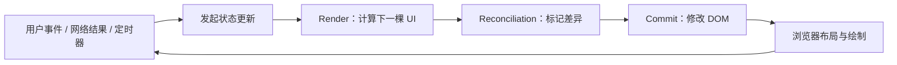
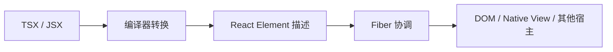
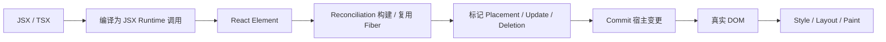
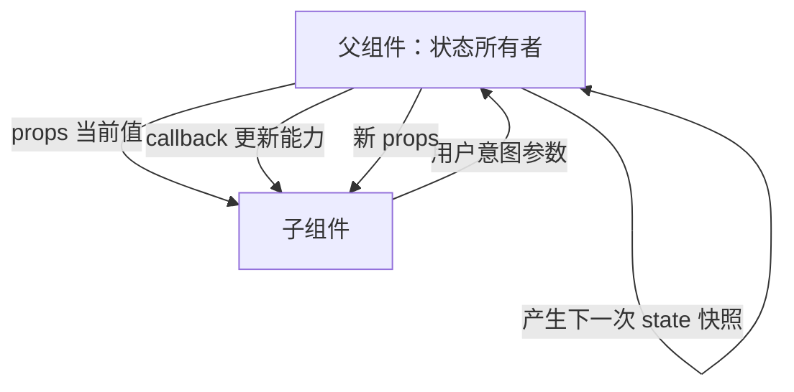
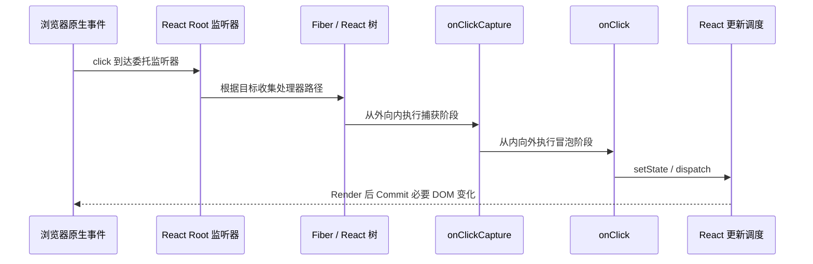
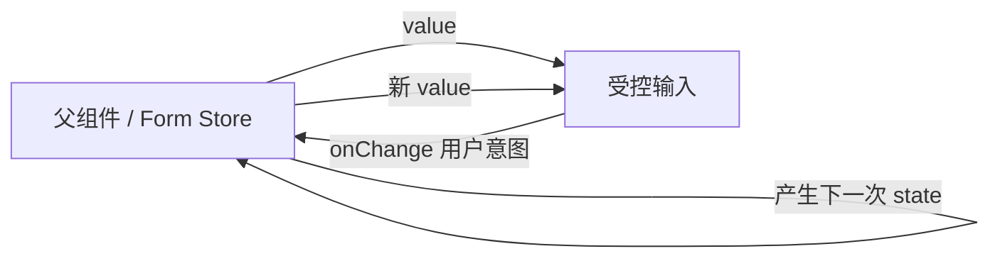
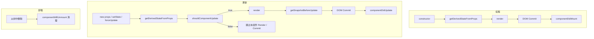

# React 核心与组件模型：从声明式 UI 到可组合组件

> 适用版本：以 React 19.x 函数组件为主；类组件、HOC 与旧生命周期仅作为遗留项目知识。
> 难度标签：`基础必会` `进阶重点` `高级深挖` `历史兼容`

## 目录

- [1. React 的核心心智模型](#1-react-的核心心智模型)
- [2. JSX 到底是什么](#2-jsx-到底是什么)
- [3. React Element、组件、Fiber、虚拟 DOM 与真实 DOM](#3-react-element组件fiber虚拟-dom-与真实-dom)
- [4. Props、State 与单向数据流](#4-propsstate-与单向数据流)
- [5. 组件设计、组合与逻辑复用](#5-组件设计组合与逻辑复用)
- [6. SyntheticEvent 与 React 事件系统](#6-syntheticevent-与-react-事件系统)
- [7. 受控与非受控组件](#7-受控与非受控组件)
- [8. 函数组件、类组件与生命周期](#8-函数组件类组件与生命周期)
- [9. React 与 Vue 3 怎么比较](#9-react-与-vue-3-怎么比较)
- [10. 面试速查](#10-面试速查)

---

## 1. React 的核心心智模型

### 面试问题

如何理解 React？它为什么强调声明式、组件化和单向数据流？

### 30 秒回答

React 是一个用于构建用户界面的声明式库。开发者不是逐条命令 DOM 怎么修改，而是根据当前 `props`、`state` 和 `context` **计算这一刻界面应该是什么样**。React 再通过协调过程比较前后描述，并在 Commit 阶段把必要变化应用到宿主环境。组件化负责拆分职责，单向数据流让状态来源和更新路径更容易追踪。

### 深入原理

可以把一次 UI 更新理解为一个函数：

```text
UI = render(props, state, context)
```

这不是说 React 组件在实现上永远是数学意义的纯函数，而是要求 **Render 阶段保持纯净**：相同输入应得到相同描述，不能在渲染期间修改外部变量、发请求或直接操作 DOM。



图中要区分两个概念：Render 是“算”，Commit 是“改”。Render 在并发渲染中可能暂停、放弃或重做；Commit 必须保持原子性，不能让用户看到更新一半的界面。

### 声明式与命令式的边界

```ts
// 命令式：调用者必须知道每一步 DOM 操作
function updateCounterImperatively(count: number) {
  const node = document.querySelector<HTMLSpanElement>('#count');
  if (node) {
    node.textContent = String(count); // 手动保证 DOM 与数据一致
  }
}

// 声明式：组件只描述当前 count 对应的界面
function Counter({ count }: { count: number }) {
  return <span id="count">{count}</span>;
}
```

声明式不意味着底层没有命令式操作，而是 React 把“如何更新宿主节点”的复杂度封装在渲染器中。动画、焦点、测量尺寸等场景仍需要受控地使用 `ref` 和 Effect。

### 常见追问

**React 是 MVC 还是 MVVM？**

React 主要解决 View 层，不强制完整 MVC / MVVM 架构。把 React 直接等同于某种完整架构会掩盖路由、数据获取、服务端状态、领域逻辑等额外职责。

**为什么前端框架普遍采用数据驱动视图？**

复杂交互中手工维护“数据状态”和“DOM 状态”的双向同步容易出现组合爆炸。数据驱动把 DOM 视为状态的派生结果，减少可变状态源。

### 易错点

- “虚拟 DOM 一定比原生 DOM 快”是错误结论；React 的价值是可预测的编程模型和跨更新的统一协调。
- “声明式就不用理解浏览器”也是错误的；布局、绘制、事件循环和网络仍决定真实性能。
- 组件函数是计算 UI 的入口，不应在函数体中执行不可重复的副作用。

---

## 2. JSX 到底是什么

### 面试问题

JSX 是什么？为什么浏览器不能直接执行 JSX？为什么 React 要引入 JSX？

### 30 秒回答

JSX 是 JavaScript 的语法扩展，用接近 HTML 的结构表达 UI，但它不是字符串，也不是 HTML。构建工具会把 JSX 转换为创建 React Element 的调用。浏览器原生 JavaScript 解析器通常不认识 JSX 语法，因此需要 Babel、TypeScript 或现代构建工具转换。

### 转换过程

```tsx
// 开发者编写的 JSX
const element = <button className="primary">保存</button>;
```

自动 JSX runtime 可近似理解为：

```ts
// 简化示意：真实生成代码由编译器和 JSX runtime 决定
const element = jsx('button', {
  className: 'primary',
  children: '保存',
});
```

结果是一个普通的描述对象，可近似表示为：

```ts
// 简化示意，并非 React Element 的完整内部结构
const element = {
  type: 'button',
  key: null,
  props: {
    className: 'primary',
    children: '保存',
  },
};
```



### JSX 的价值

1. **结构与行为共置**：一个交互组件的标记、事件和状态往往天然耦合。
2. **仍然是 JavaScript 表达式**：可以使用变量、函数、数组和条件表达式。
3. **利于静态分析与编译优化**：编译器能看到组件结构，而不是解析任意模板字符串。
4. **防止默认字符串注入**：React 会转义普通文本；只有显式使用 `dangerouslySetInnerHTML` 才绕过该保护。

### 条件渲染的推荐写法

```tsx
type ResultProps = {
  loading: boolean;
  error?: Error;
  items: Array<{ id: string; name: string }>;
};

function Result({ loading, error, items }: ResultProps) {
  if (loading) return <p>加载中…</p>;
  if (error) return <p role="alert">加载失败：{error.message}</p>;

  return (
    <ul>
      {items.map((item) => (
        // 使用稳定业务 ID，保证身份与状态正确对应
        <li key={item.id}>{item.name}</li>
      ))}
    </ul>
  );
}
```

### 易错点

- JSX 中的 `{}` 进入 JavaScript 表达式，不等于模板语言的字符串插值。
- `0 && <Panel />` 会渲染数字 `0`；应写成 `count > 0 && <Panel />`。
- 组件名必须大写开头，否则 JSX runtime 会把它当作宿主标签。
- `key` 不会作为普通 `props` 传入组件；需要业务值时应单独传递 `id`。

---

## 3. React Element、组件、Fiber、虚拟 DOM 与真实 DOM

### 面试问题

React Element、组件、Fiber、虚拟 DOM 和真实 DOM 分别是什么？虚拟 DOM 一定比直接操作 DOM 快吗？

### 30 秒回答

JSX 编译后产生 React Element，它是某次 Render 对 UI 的不可变描述；组件是计算这些描述的逻辑单元；Fiber 是 React 内部可变的工作节点，保存树关系、状态、更新队列、优先级和副作用标记；DOM 是浏览器渲染器最终操作的宿主对象。

“虚拟 DOM”是对内存中 UI 描述与协调模型的泛称，在 React 语境里通常涉及 Element 和 Fiber，但两者不能直接画等号。虚拟 DOM 不保证比一段精准的手写 DOM 操作更快，它的主要价值是让开发者用声明式方式描述 UI，再由统一协调器跨多次更新决定如何复用状态和提交必要宿主变化。


图中从左到右分别回答“想要什么”“React 如何完成”“浏览器最终呈现什么”。一个组件可以多次执行并产生新 Element；满足 `type + key + 位置` 等身份条件时，Fiber 与 DOM 可以复用并继续承载状态。

### 关键区别

| 概念 | 主要职责 | 是否跨渲染保留 | 是否可变 | 开发者是否直接操作 |
|---|---|---:|---:|---:|
| JSX | 表达 UI 的语法 | 否 | 源码可编辑 | 是 |
| React Element | 当前 UI 描述 | 通常否 | 开发期应视为不可变 | 可创建，不应修改 |
| Component | 根据输入计算 UI | 函数组件本身无持久实例 | 逻辑定义不等于状态容器 | 是 |
| Fiber | 调度、状态、协调工作单元 | 是，与 `alternate` 形成对应 | 是 | 否 |
| DOM | 浏览器宿主节点 | 身份匹配时可复用 | 是 | 通过 ref 有限操作 |

### 从 JSX 到像素的链路



React 只负责到宿主变更为止；样式计算、布局、绘制和合成仍由浏览器完成，所以 React Render 快不代表页面一定流畅。

### 虚拟 DOM 的价值

1. **声明式编程接口**：开发者描述状态对应的 UI，而不是维护每条 DOM 操作顺序。
2. **统一协调与状态身份**：根据 `type`、`key` 和树位置决定复用还是重置。
3. **跨平台渲染**：协调层可以连接 DOM、Native 或其他 Renderer。
4. **调度空间**：Fiber 让 Render 工作能够按优先级拆分、暂停或重做。
5. **工程一致性**：事件、Context、Suspense、错误边界等能力可以围绕组件树协作。

### 为什么不能说“一定更快”

```ts
function updateTextDirectly(node: Text, value: string) {
  // 中文注释：如果调用方已经精确知道目标节点，单次直接修改通常工作更少
  node.nodeValue = value;
}
```

React 更新还需要创建或读取 UI 描述、执行组件、协调 Fiber，才知道是否修改文本。因此在“只改一个已知节点”的微基准中，手写 DOM 可以更快。但真实业务需要处理条件分支、列表身份、清理、错误恢复和多次组合更新，手写命令式代码的正确性与维护成本会快速上升。

合理结论是：

- 虚拟 DOM 增加 JavaScript 协调成本，但减少开发者手工维护复杂 DOM 状态的成本；
- React 会尽量减少宿主变更，但并不保证得到理论最小编辑序列；
- 首次渲染、超大 DOM、昂贵组件计算和布局抖动仍需单独优化；
- 性能判断应看用户路径、Render、Commit、DOM、Layout 和 Paint，而不是只比较对象创建。

### 边界与反例

- React Element 不是 DOM 节点，也不提供 `focus()` 等宿主方法。
- Fiber 不是“新版虚拟 DOM 对象”的简单别名，而是工作与状态节点。
- 组件函数重新执行不等于 DOM 重建；Commit 是否发生取决于协调结果。
- `key` 不只优化列表性能，还参与组件状态身份判断。
- 虚拟 DOM 不能解决 10 万个真实节点造成的布局和绘制成本，仍需虚拟化。

### 高频追问

1. **为什么 Element 适合不可变？** 前后描述可以作为两个快照比较，也避免外部修改破坏协调假设。
2. **Fiber 为什么必须可变？** 工作进度、lane、flags、更新队列和树指针需要在调度中维护。
3. **React 会生成补丁对象列表吗？** 现代 Fiber 通常把变更信息记录在 Fiber flags 上，Commit 遍历相关节点执行宿主操作，不必套用旧教程里的独立 patch 数组模型。
4. **父组件 Render，子组件一定改 DOM 吗？** 不一定；子组件可能执行，但宿主输出相同就无需修改 DOM，也可能通过 bailout 跳过。
5. **虚拟 DOM 最大价值是什么？** 声明式、可组合且可统一协调的 UI 编程模型，而不是无条件击败手写 DOM。

### 关联专题

- [React 面试知识总纲](./react-interview-guide.md)
- 更新阶段和状态保留：[`react-state-and-rendering.md`](./react-state-and-rendering.md)
- Fiber 内部结构：[`react-fiber-concurrency-and-modern-react.md`](./react-fiber-concurrency-and-modern-react.md)
- Element 到 Fiber 的 Diff：[`react-diff-vue3-compare.md`](./react-diff-vue3-compare.md)

---

## 4. Props、State 与单向数据流

### 面试问题

`props` 和 `state` 有什么区别？为什么不能直接修改？什么数据应该进入 state？

### 30 秒回答

`props` 是父组件给当前组件的只读输入，`state` 是 React 按组件身份保存的内部记忆；二者在某次 Render 中都表现为只读快照。修改普通对象既不会向 React 发出更新请求，也会破坏历史快照、引用比较和并发重试，因此应创建新值并调用 setter / dispatch。

state 应只保存“会随时间变化、无法由现有 props / state 在 Render 中直接推导、且会影响 UI”的最小真相来源。能推导的数据不要复制进 state；两个组件共享的数据提升到最近公共所有者；只被叶子使用的状态尽量下沉。

### Props、State、Context 与 Ref

| 数据通道 | 谁提供 | 更新是否触发 Render | 适合保存什么 |
|---|---|---:|---|
| Props | 父组件 | 父组件传入新值时可能触发 | 组件输入、回调、组合节点 |
| State | React 按 Fiber 身份保存 | 是 | 当前组件拥有的 UI 状态 |
| Context | 最近 Provider | 消费值变化时触发消费者 | 跨层且语义稳定的依赖 |
| Ref | 当前组件持有 | 修改 `current` 不触发 | DOM、计时器、非渲染数据 |

### 单向数据流不是“只能向下通信”



数据值向下流，用户意图通过回调向上报告。子组件不是直接写父组件内存，而是调用父组件授予的能力，父组件仍然决定校验、更新和错误处理。

### 为什么不可直接修改

```tsx
interface Profile {
  name: string;
  address: { city: string };
}

function ProfileEditor({ initialProfile }: { initialProfile: Profile }) {
  const [profile, setProfile] = useState(initialProfile);

  function changeCityWrong(city: string) {
    // ❌ 原地修改没有调用 setter，React 不知道需要安排更新
    profile.address.city = city;
  }

  function changeCity(city: string) {
    setProfile((previous) => ({
      ...previous,
      // 中文注释：只复制发生变化的路径，未变化分支继续共享引用
      address: { ...previous.address, city },
    }));
  }

  return <input value={profile.address.city} onChange={(e) => changeCity(e.target.value)} />;
}
```

不可变更新的价值不只是“触发渲染”：旧 Render 的闭包仍可安全读取旧对象，浅比较能通过引用判断变化，低优先级工作被重做时也不会读到被后续代码偷偷修改的对象。

### 最小充分状态

```tsx
function NameForm() {
  const [firstName, setFirstName] = useState('Ada');
  const [lastName, setLastName] = useState('Lovelace');

  // ✅ 中文注释：fullName 完全可以从当前快照推导，无需额外 state 和 Effect
  const fullName = `${firstName} ${lastName}`;

  return <output>{fullName}</output>;
}
```

判断一个值是否应进入 state，可以依次问：

1. 它是否随时间变化？不变则常量或配置即可。
2. 能否从 props / 其他 state 推导？能则在 Render 中计算。
3. 是否只用于命令式流程、不影响 UI？可能放 ref。
4. 是否来自服务器并需要缓存、失效、去重？优先交给服务端状态工具。
5. 是否需要刷新、分享和前进后退保留？可能属于 URL。

### Props 复制进 State 的陷阱

```tsx
function UserEditor({ user }: { user: User }) {
  // ⚠️ 只读取首次 props；父组件切换 user 后，draft 不会自动重置
  const [draft, setDraft] = useState(user);

  return <Editor value={draft} onChange={setDraft} />;
}
```

这段代码不一定错误：如果需求是“以传入值初始化独立草稿”，它合理；但必须明确重置语义。常见方案：

- 完全受控：父组件持有 draft；
- 使用 `key={user.id}` 在切换身份时重建编辑器；
- 在领域事件中显式执行 reset；
- 不要用 Effect 无条件把每次 props 变化覆盖到用户正在编辑的 state。

### 状态提升、下沉与并置

- **提升**：两个兄弟需要同一真相来源，放到最近公共父组件。
- **下沉**：只有局部输入框使用的 state 放到叶子，避免扩大父树更新。
- **并置**：状态、更新逻辑和主要消费者尽量靠近，降低隐式依赖。
- **拆分**：不要为了少写 props 把所有状态放入单个 Context / Store。

### 边界与反例

- props 只读不代表其中对象在 JavaScript 层无法被修改，而是修改它违反 React 数据流契约。
- setter 更新不是立即改写当前闭包中的变量；下一次 Render 才获得新快照。
- state 是组件记忆，不是远程数据、缓存、URL、表单和全局领域状态的统一容器。
- 状态提升过高会扩大 Render 传播，过低又会产生多个真相来源。

### 高频追问

1. **为什么函数组件每次都能读到 state？** Hook 状态保存在 Fiber Hook 链表中，执行组件时按调用顺序取出。
2. **为什么函数式更新更安全？** 当下一值依赖前一值时，Updater 会按队列处理，避免闭包中的旧快照造成覆盖。
3. **可以把 props 保存进 state 吗？** 可以用于明确的初始草稿，但要定义后续 props 变化和重置规则。
4. **单向数据流会不会导致层层传递？** 会，先用组合和状态并置；跨层稳定依赖再用 Context，复杂订阅再用 Store。
5. **Immer 是否违反不可变原则？** 它允许 mutation 风格编写，但最终通过结构共享生成新快照，前提是不要泄漏并继续修改 draft。

---

## 5. 组件设计、组合与逻辑复用

### 面试问题

如何设计可复用组件？HOC、Render Props、自定义 Hook 分别是什么，怎么选？

### 30 秒回答

组件应围绕稳定职责设计，用明确 props 表达变化点，通过 `children`、插槽式 props 和受控 API 组合，而不是依赖组件继承。复用纯计算用普通函数，复用有状态逻辑优先自定义 Hook，复用 UI 结构使用组合组件；Render Props 和 HOC 在遗留项目、第三方库适配和横切增强中仍需掌握。

HOC 是“接收组件、返回增强组件”的函数；Render Props 是“把渲染函数作为 props，由组件调用”；自定义 Hook 是“调用其他 Hooks 并复用状态逻辑”。它们复用的主要是行为和数据，不会自动复用页面样式，也都可能隐藏依赖。

### 先设计组件状态模型

```tsx
type RequestState<T> =
  | { status: 'idle' }
  | { status: 'loading' }
  | { status: 'success'; data: T }
  | { status: 'error'; error: Error };

function UserPanel({ state }: { state: RequestState<User> }) {
  // 中文注释：联合类型让非法状态无法同时出现
  switch (state.status) {
    case 'idle': return <p>尚未加载</p>;
    case 'loading': return <p>加载中…</p>;
    case 'success': return <p>{state.data.name}</p>;
    case 'error': return <p role="alert">{state.error.message}</p>;
  }
}
```

相比 `isLoading + hasError + data` 的自由组合，判别联合能在类型层表达状态机，减少组件内部防御分支。

### 为什么组合通常优于继承

```tsx
type DialogProps = {
  title: ReactNode;
  children: ReactNode;
  actions?: ReactNode;
};

function Dialog({ title, children, actions }: DialogProps) {
  return (
    <section role="dialog" aria-labelledby="dialog-title">
      <h2 id="dialog-title">{title}</h2>
      <div>{children}</div>
      {actions && <footer>{actions}</footer>}
    </section>
  );
}
```

调用者通过 props 提供内容和行为，不需要继承后覆盖生命周期。组合让依赖显式、可以局部替换，也更符合函数组件模型。继承仍可用于普通领域类，但 React 组件间通常不靠继承共享 UI 逻辑。

### HOC：包装组件并注入能力

```tsx
type InjectedAuthProps = {
  currentUser: User;
};

function withAuth<P extends InjectedAuthProps>(
  WrappedComponent: ComponentType<P>,
) {
  function WithAuth(props: Omit<P, keyof InjectedAuthProps>) {
    const currentUser = useCurrentUser();

    if (!currentUser) return <LoginPage />;

    // 中文注释：HOC 负责横切认证，业务组件仍通过 props 接收用户
    return <WrappedComponent {...(props as P)} currentUser={currentUser} />;
  }

  WithAuth.displayName = `withAuth(${WrappedComponent.displayName ?? WrappedComponent.name})`;
  return WithAuth;
}
```

HOC 常见问题：

- 注入 props 可能与调用者 props 冲突；
- 多层 HOC 形成 wrapper hell，DevTools 树变深；
- 静态属性默认不会自动复制，需要明确 hoist 策略；
- `ref` 指向包装层而非内部组件，需要显式转发；
- TypeScript 泛型和默认 props 推导较复杂；
- 不要在 Render 内动态创建 HOC，否则每次得到新组件类型并重置子树状态。

### Render Props：由调用者决定怎么渲染

```tsx
type MousePosition = { x: number; y: number };

type MouseTrackerProps = {
  children: (position: MousePosition) => ReactNode;
};

function MouseTracker({ children }: MouseTrackerProps) {
  const [position, setPosition] = useState<MousePosition>({ x: 0, y: 0 });

  return (
    <div
      onPointerMove={(event) => {
        // 中文注释：组件拥有行为，调用者决定数据如何呈现
        setPosition({ x: event.clientX, y: event.clientY });
      }}
    >
      {children(position)}
    </div>
  );
}
```

Render Props 表达能力强，但多层嵌套会降低可读性，而且内联函数会形成新引用。它没有“被 Hooks 淘汰”，一些 Headless Component 和库 API 仍然适合这种控制反转。

### 自定义 Hook：复用状态与同步逻辑

```tsx
function useOnlineStatus() {
  const [online, setOnline] = useState(
    // 中文注释：SSR 阶段没有 navigator，初始值必须提供服务端安全的兜底
    () => (typeof navigator === 'undefined' ? true : navigator.onLine),
  );

  useEffect(() => {
    function handleOnline() { setOnline(true); }
    function handleOffline() { setOnline(false); }

    // 中文注释：setup 和 cleanup 必须成对，避免重复订阅
    window.addEventListener('online', handleOnline);
    window.addEventListener('offline', handleOffline);

    return () => {
      window.removeEventListener('online', handleOnline);
      window.removeEventListener('offline', handleOffline);
    };
  }, []);

  return online;
}
```

自定义 Hook 复用的是逻辑，每个调用组件仍拥有独立状态。若多个调用者必须共享同一份状态，应提升状态、使用 Context / Store 或共享外部资源，而不是误以为调用同一个 Hook 就会共享 state。

### 选型表

| 目标 | 首选 | 何时考虑其他方式 |
|---|---|---|
| 复用纯计算 | 普通函数 | 需要缓存时再测量 |
| 复用有状态逻辑 | 自定义 Hook | 需要兼容类组件时用 HOC / Render Props |
| 复用 UI 骨架 | 组合组件 / slots-like props | 高动态控制反转可用 Render Props |
| 横切注入能力 | Hook + 组合 | 遗留装饰器、路由、监控库可能使用 HOC |
| 捕获渲染错误 | Error Boundary / 框架边界 | 普通 Hook 不能等价捕获子树 Render 错误 |

### 边界与反例

- 抽象不是 props 越多越通用；大量布尔 props 往往意味着职责混杂。
- Hook 不能复用 UI 节点，只复用逻辑；组件组合才复用结构。
- HOC 必须在模块顶层稳定创建，不能在组件 Render 中调用 HOC 工厂。
- Render Props 中的函数引用是否需要稳定，要看下游是否真正依赖身份，而不是默认套 `useCallback`。
- 自定义 Hook 仍要遵守 Hook 规则和 Effect 清理，名字以 `use` 开头不会自动保证正确。

### 高频追问

1. **HOC 与普通组件有什么区别？** HOC 是组件工厂，输入组件类型、输出新组件类型；普通组件输入 props、输出 ReactNode。
2. **HOC 会修改原组件吗？** 推荐返回包装组件而不是 mutation 原组件，避免多个增强器互相污染。
3. **Render Props 和 children 有什么关系？** `children` 也可以是函数，本质是把渲染控制权交给调用者。
4. **为什么 Hook 更适合函数组件？** 不增加额外包装层，逻辑按关注点组合，并直接使用 React 状态与 Effect。
5. **什么时候不要抽自定义 Hook？** 只有一处使用、没有稳定概念边界，或抽取后参数与返回值比原逻辑更难理解时。

---

## 6. SyntheticEvent 与 React 事件系统

### 面试问题

什么是 React 合成事件？为什么要封装原生事件？捕获、冒泡、Portal 和原生监听器混用时有什么边界？

### 30 秒回答

React 事件处理器收到的是 SyntheticEvent，它提供接近标准 DOM Event 的接口，并统一部分浏览器差异。现代 React DOM 通常在 Root 容器级注册委托监听器，原生事件到达后根据 Fiber / React 树收集捕获和冒泡处理器，再在对应优先级与批处理上下文中执行。

`target` 是原始事件目标，`currentTarget` 是当前正在执行处理器的元素；`preventDefault()` 阻止默认行为，`stopPropagation()` 阻止继续传播。现代 React DOM 不再要求为了异步读取事件调用 `event.persist()`。需要非 React 事件、第三方库或特定监听选项时，仍可在 Effect 中使用原生 `addEventListener` 并正确清理。

### 分发链路



事件优先级会影响更新选择的 lane，例如点击、键盘输入等离散事件通常比连续指针移动更紧急。但 lane 与内部事件映射属于实现细节，面试时解释“事件进入 React 调度优先级体系”即可。

### SyntheticEvent 常用字段

```tsx
function LinkCard() {
  function handleClick(event: React.MouseEvent<HTMLAnchorElement>) {
    event.preventDefault();

    console.log(event.target);        // 中文注释：真正被点击的最深层节点
    console.log(event.currentTarget); // 中文注释：绑定当前 React handler 的 a 元素
    console.log(event.nativeEvent);   // 中文注释：底层原生事件，具体映射不应作为稳定契约
  }

  return (
    <a href="/orders" onClick={handleClick}>
      <span>查看订单</span>
    </a>
  );
}
```

不要依赖 `nativeEvent` 的具体事件类型映射实现；优先使用 SyntheticEvent 暴露的标准化接口。

### 捕获、冒泡与默认行为

```tsx
function Toolbar() {
  return (
    <div
      onClickCapture={() => {
        // 中文注释：捕获阶段从外向内执行，可用于埋点或路由级观察
        console.log('capture toolbar');
      }}
      onClick={() => console.log('bubble toolbar')}
    >
      <button
        onClick={(event) => {
          event.stopPropagation();
          // 中文注释：阻止后续冒泡，不等于阻止 button 的默认行为
          console.log('save');
        }}
      >
        保存
      </button>
    </div>
  );
}
```

- `preventDefault()`：取消链接跳转、表单提交等浏览器默认行为；
- `stopPropagation()`：停止当前事件继续传播；
- `return false`：不是 React 中同时完成两者的标准方式；
- 捕获处理器通常即使子节点在冒泡阶段停止传播也已执行，适合少量全局观察，但不要滥用。

### Portal 的事件传播

Portal 的 DOM 可能挂在另一个容器，但 React 事件按 **React 组件树** 传播：

```tsx
function Page() {
  return (
    <div onClick={() => console.log('React 父组件收到事件')}>
      {createPortal(
        <button>打开弹窗</button>,
        document.getElementById('modal-root')!,
      )}
    </div>
  );
}
```

按钮在 DOM 上不是外层 `div` 的子节点，但在 React 树中仍是其后代，所以 React `onClick` 可以冒泡到外层组件。若同时观察原生 DOM 冒泡，路径可能不同，排查时要区分两棵树。

### 什么时候使用原生监听器

```tsx
function EscapeListener({ onEscape }: { onEscape: () => void }) {
  useEffect(() => {
    function handleKeyDown(event: KeyboardEvent) {
      if (event.key === 'Escape') onEscape();
    }

    // 中文注释：监听 window 不属于 JSX 节点事件，需要手动订阅和清理
    window.addEventListener('keydown', handleKeyDown);
    return () => window.removeEventListener('keydown', handleKeyDown);
  }, [onEscape]);

  return null;
}
```

适用场景包括：`window` / `document`、第三方 DOM 库、自定义事件、需要特定 passive / capture / once 选项、React 未封装的事件。必须保证 handler 身份、监听参数和 cleanup 对称。

### 历史边界

- React 17 起，React DOM 的大多数委托监听从 `document` 调整到各自 Root 容器，更利于多版本和渐进升级；不要背成“所有事件都只绑定一个 document”。
- React 17 起 Web 端 SyntheticEvent 不再使用旧式事件池化，`persist()` 通常不再有实际作用；React Native 等其他 Renderer 应按自身版本确认。
- SyntheticEvent 的接口接近 DOM Event，但少数事件的 React 冒泡语义可能与原生事件不同。

### 常见错误

- 把 `stopPropagation()` 当成 `preventDefault()`；
- 用内联原生函数订阅，却在 cleanup 传入另一个函数，导致无法移除；
- 同时监听 React 和原生事件，却假设执行顺序永远固定；
- 在列表行上使用点击冒泡实现所有交互，导致按钮、链接和可访问性冲突；
- 继续回答“异步访问事件前必须 `event.persist()`”这一旧结论。

### 高频追问

1. **SyntheticEvent 是浏览器事件的完整复制吗？** 不是，它是标准化包装，并通过 `nativeEvent` 保留底层事件引用。
2. **为什么事件委托能减少监听器？** 多个后代共享 Root 级监听入口，分发时再根据 React 树找到处理器。
3. **React 事件为什么能参与 batching？** React 在受控事件分发上下文中执行处理器并安排更新；React 18 的自动批处理又扩展到更多异步来源。
4. **Portal 事件按 DOM 树还是 React 树冒泡？** React handler 按 React 树；原生监听器仍按 DOM 路径。
5. **可以使用原生事件吗？** 可以，但要明确监听目标、阶段、选项、更新优先级和清理。

---

## 7. 受控与非受控组件

### 面试问题

什么是受控组件和非受控组件？它只用于表单吗？大型表单如何避免性能问题？

### 30 秒回答

受控组件的关键状态由父组件或 React state 决定，组件通过 `value / checked / open` 等 props 接收当前值，通过 `onChange / onOpenChange` 报告意图；非受控组件把当前值保存在 DOM 或组件内部，只接收 `defaultValue / defaultOpen` 等初始值，调用者通过 ref 或提交事件读取。

受控适合即时校验、字段联动、统一重置和外部驱动；非受控适合文件输入、简单一次性表单、接入原生或第三方组件。大型表单不应简单把所有字段放到页面顶层并每次全树 Render，可以用状态下沉、字段级订阅、表单库和延迟昂贵派生计算。

### 受控是一种所有权模型



不仅原生输入框可以受控，弹窗、分页、手风琴和日期选择器都可以设计为：

```tsx
type DialogProps = {
  open: boolean;
  onOpenChange: (open: boolean) => void;
};
```

### 受控输入

```tsx
function ControlledSearch() {
  const [keyword, setKeyword] = useState('');
  const normalizedKeyword = keyword.trim().toLowerCase();

  return (
    <label>
      关键词
      <input
        value={keyword}
        onChange={(event) => {
          // 中文注释：立即保存原始输入，昂贵筛选不应阻塞输入回显
          setKeyword(event.target.value);
        }}
      />
      <output>{normalizedKeyword}</output>
    </label>
  );
}
```

常见属性对应：

| 控件 | 受控属性 | 初始非受控属性 |
|---|---|---|
| text / textarea / select | `value` | `defaultValue` |
| checkbox / radio | `checked` | `defaultChecked` |
| 自定义 Dialog | `open` | `defaultOpen` |

### 非受控输入

```tsx
function UncontrolledUpload() {
  const inputRef = useRef<HTMLInputElement>(null);

  function submit() {
    // 中文注释：文件值由浏览器维护，提交时通过 DOM ref 读取
    const file = inputRef.current?.files?.[0];
    if (file) upload(file);
  }

  return (
    <form onSubmit={(event) => { event.preventDefault(); submit(); }}>
      <input ref={inputRef} type="file" />
      <button type="submit">上传</button>
    </form>
  );
}
```

`<input type="file">` 不能像普通文本框那样由字符串 `value` 完全控制，通常采用非受控读取。

### `defaultValue` 为什么只管初始值

```tsx
function Draft({ initialText }: { initialText: string }) {
  return <textarea defaultValue={initialText} />;
}
```

挂载后，DOM 成为当前值所有者；父组件再改变 `initialText`，不会持续覆盖用户输入。如果需求是外部值始终生效，应使用 `value + onChange`；如果要重新初始化非受控子树，可以在明确身份变化时使用稳定 `key` 重建，但不要用随机 key。

### 受控 / 非受控切换警告

```tsx
// ❌ 首次 undefined 表示非受控，数据回来后字符串又变成受控
<input value={user?.name} onChange={handleChange} />

// ✅ 中文注释：从首次 Render 起就保持受控
<input value={user?.name ?? ''} onChange={handleChange} />
```

同一组件生命周期中切换所有权会让 React 和 DOM 对“谁是真相来源”的理解不一致。

### 大型表单性能

错误方向是看到输入 Render 就盲目加 `useMemo`。应先定位更新范围：

1. 每个字段状态是否提升到了整个页面根部？
2. Context value 是否每次按键广播所有字段？
3. 校验和搜索是否在输入处理器中同步执行昂贵计算？
4. 是否渲染了大量不可见字段和错误信息？
5. 是否需要字段级订阅或非受控注册模式？

```tsx
function SearchPage({ products }: { products: Product[] }) {
  const [keyword, setKeyword] = useState('');
  const deferredKeyword = useDeferredValue(keyword);

  return (
    <>
      <input value={keyword} onChange={(event) => setKeyword(event.target.value)} />
      {/* 中文注释：输入仍由紧急更新控制，昂贵结果树读取延迟值 */}
      <ProductResults products={products} keyword={deferredKeyword} />
    </>
  );
}
```

不能把受控 input 自身的 value 更新放进 Transition，否则输入可能无法正确同步；应延迟由输入驱动的昂贵子树。

### 如何选择

| 需求 | 建议 |
|---|---|
| 即时格式化、校验、字段联动 | 受控或字段级 Form Store |
| 文件输入 | 非受控 + ref / FormData |
| 简单提交时读取 | 非受控可接受 |
| 外部按钮需要重置 / 回填 | 受控更直接 |
| 第三方命令式组件 | 非受控适配层 + 明确 ref API |
| 100+ 字段复杂表单 | 字段级订阅、状态并置、表单库，按指标优化 |

### 高频追问

1. **受控组件一定更好吗？** 不是，它以可预测性换取更多状态更新和 API 约束。
2. **受控等于全局 Store 吗？** 不等于，状态通常应保持在最近所有者或表单作用域。
3. **为什么 `defaultValue` 更新不生效？** 它只声明初始 DOM 值，之后由 DOM 持有。
4. **如何重置非受控表单？** 可调用原生 `form.reset()`、操作明确 ref，或在身份变化时用稳定 key 重建。
5. **为什么输入卡顿？** 常见根因是父树更新、同步校验或大结果列表，不是 `value` 属性本身。

---

## 8. 函数组件、类组件与生命周期

### 面试问题

函数组件和类组件的本质区别是什么？类组件生命周期如何执行？为什么 Effect 不能机械等同生命周期？

### 30 秒回答

函数组件每次 Render 都会重新执行函数并形成新的闭包，跨 Render 状态由 Fiber 上的 Hooks 保存；类组件通常复用同一个实例，通过 `this.props`、`this.state`、实例字段和生命周期方法组织逻辑。两者都经历 Render 与 Commit，但表达副作用的方式不同。

类组件挂载核心顺序是 `constructor → getDerivedStateFromProps → render → componentDidMount`；更新是 `getDerivedStateFromProps → shouldComponentUpdate → render → getSnapshotBeforeUpdate → componentDidUpdate`；卸载调用 `componentWillUnmount`。前三类 Render 阶段方法必须保持纯净，Commit 阶段生命周期才能执行 DOM、订阅和副作用。

### 类组件生命周期总图



`forceUpdate` 通常会跳过 `shouldComponentUpdate` 对当前组件的阻止，但仍然要执行 Render / Reconciliation；不要把它当常规状态管理 API。

### 完整生命周期职责

| 方法 | 阶段 | 典型职责 | 禁区 / 边界 |
|---|---|---|---|
| `constructor` | Render | 初始化 state、绑定方法 | 不发请求、不订阅、不调用 `setState` |
| `getDerivedStateFromProps` | Render | 极少数根据 props 调整 state | 静态方法，无实例；容易产生重复状态 |
| `render` | Render | 纯计算 UI | 不执行副作用、不修改外部数据 |
| `componentDidMount` | Commit | 订阅、DOM、请求、第三方库 | 通常要有对应清理 |
| `shouldComponentUpdate` | Render | 性能提示 | 不能承担正确性语义，需比较所有相关输入 |
| `getSnapshotBeforeUpdate` | Commit 前 | DOM 修改前读取滚动位置等快照 | 返回值传给 `componentDidUpdate` |
| `componentDidUpdate` | Commit | 响应已提交变化、同步外部系统 | 调用 `setState` 必须有条件，避免循环 |
| `componentWillUnmount` | Commit | 取消订阅、计时器、请求 | cleanup 应可安全执行 |
| `getDerivedStateFromError` | Render 错误处理 | 切换 fallback state | 不做日志副作用 |
| `componentDidCatch` | Commit 错误处理 | 上报错误和组件栈 | 不能捕获边界自身、任意事件 / 异步错误 |

### `getSnapshotBeforeUpdate` 的典型场景

```tsx
class MessageList extends React.Component<Props> {
  listRef = React.createRef<HTMLDivElement>();

  getSnapshotBeforeUpdate(prevProps: Props) {
    const list = this.listRef.current;
    if (!list || prevProps.messages.length === this.props.messages.length) {
      return null;
    }

    // 中文注释：DOM 修改前记录底部距离，避免新增消息后滚动跳动
    return list.scrollHeight - list.scrollTop;
  }

  componentDidUpdate(_prevProps: Props, _prevState: {}, snapshot: number | null) {
    const list = this.listRef.current;
    if (list && snapshot !== null) {
      // 中文注释：DOM 已提交，用旧快照恢复用户视觉位置
      list.scrollTop = list.scrollHeight - snapshot;
    }
  }

  render() {
    return <div ref={this.listRef}>{this.props.messages.map(renderMessage)}</div>;
  }
}
```

这对应“Commit 前读 DOM，Commit 后写 DOM”的成对协议，不能简单用普通 `useEffect` 完全等价替代；函数组件通常结合 ref、`useLayoutEffect` 和组件结构重新设计。

### 类组件订阅必须形成闭环

```tsx
class ChatRoom extends React.Component<{ roomId: string }> {
  connection: Connection | null = null;

  componentDidMount() {
    this.connect();
  }

  componentDidUpdate(prevProps: { roomId: string }) {
    if (prevProps.roomId !== this.props.roomId) {
      // 中文注释：先清理旧房间连接，再连接新房间
      this.disconnect();
      this.connect();
    }
  }

  componentWillUnmount() {
    this.disconnect();
  }

  connect() {
    this.connection = createConnection(this.props.roomId);
    this.connection.connect();
  }

  disconnect() {
    this.connection?.disconnect();
    this.connection = null;
  }

  render() {
    return <h1>房间：{this.props.roomId}</h1>;
  }
}
```

函数组件可以把同一个同步过程集中在一个 Effect：依赖 `roomId` 变化时 cleanup 旧连接，再 setup 新连接。因此 Effect 更接近“外部同步过程”，不是把三个生命周期机械拼接。

### 闭包快照与类实例当前值

```tsx
function FunctionCounter() {
  const [count, setCount] = useState(0);

  function alertLater() {
    setTimeout(() => {
      // 中文注释：读取创建该回调时那次 Render 的 count 快照
      alert(count);
    }, 1000);
  }

  return <button onClick={alertLater}>{count}</button>;
}
```

类方法中的 `this.state` 通常读取实例当前值；函数回调捕获某次 Render 的值。这使函数组件更容易推理单次 Render，但也需要理解 stale closure、Effect 依赖和函数式更新。

### 为什么旧生命周期被标记 UNSAFE

`UNSAFE_componentWillMount`、`UNSAFE_componentWillReceiveProps`、`UNSAFE_componentWillUpdate` 位于 Render 相关阶段。现代并发能力下，Render 可能暂停、重做或最终不提交；如果在这些方法中请求、订阅或操作 DOM，就可能发生重复副作用或为一个从未 Commit 的树执行工作。

替代思路：

- 根据 props 计算值：直接在 Render 计算或 memoization；
- props 变化后执行副作用：`componentDidUpdate`；
- 重置内部 state：优先完全受控或使用稳定 `key` 重建；
- 极少数派生 state：`getDerivedStateFromProps`，并严格说明不变量。

### Error Boundary 为什么仍常见类组件

```tsx
class ErrorBoundary extends React.Component<
  { fallback: ReactNode; children: ReactNode },
  { hasError: boolean }
> {
  state = { hasError: false };

  static getDerivedStateFromError() {
    // 中文注释：Render 错误后切换到降级 UI
    return { hasError: true };
  }

  componentDidCatch(error: unknown, info: React.ErrorInfo) {
    // 中文注释：Commit 阶段上报错误和组件栈
    reportError(error, info.componentStack);
  }

  render() {
    return this.state.hasError ? this.props.fallback : this.props.children;
  }
}
```

普通函数组件目前不能仅靠一个内置 Hook 完整实现同等 Error Boundary 生命周期；生产项目常使用框架边界或封装好的类组件。

### 类组件与 Hooks 对照不是一一映射

| 类组件概念 | 函数组件常见表达 | 关键差异 |
|---|---|---|
| `this.state` | `useState` / `useReducer` | Hook 读取当前 Render 快照 |
| 实例字段 | `useRef` | ref 修改不触发 Render |
| Mount / Update / Unmount 同步 | `useEffect` cleanup + setup | 按外部系统划分，而非按生命周期拆散 |
| DOM 提交后同步测量 | `useLayoutEffect` | 会阻塞绘制，应谨慎 |
| `shouldComponentUpdate` | `memo`、状态边界、Compiler | 都不应承担业务正确性 |
| Error Boundary | 类组件 / 框架 | 普通函数组件无完全等价内置 Hook |

### Strict Mode 边界

开发环境 Strict Mode 会额外检查纯净性，并执行额外的 Effect / ref callback setup-cleanup；类组件的 `componentDidMount → componentWillUnmount → componentDidMount` 也可能出现一次额外检查。生产环境不会因此双执行。正确做法是让 setup 与 cleanup 对称，而不是用全局开关“阻止第二次调用”。

### 高频追问

1. **`setState` 的第二个回调与 `componentDidUpdate` 区别？** 回调用于该次类组件更新提交后执行；更通用的 props / state 变化同步通常放 `componentDidUpdate` 并做条件判断。
2. **`shouldComponentUpdate` 返回 false 会怎样？** 跳过当前组件由本次父级更新驱动的 Render，是性能提示；Context、内部 state 和未来实现边界不能被简化成绝对冻结。
3. **`getDerivedStateFromProps` 为什么少用？** 容易复制 props、产生两个真相来源，而且没有实例上下文。
4. **Effect 等于 DidMount + DidUpdate + WillUnmount 吗？** 只在表面时机上有交集；Effect 建模的是一个同步过程及其 cleanup。
5. **类组件过时了吗？** 新代码通常优先函数组件，但遗留系统、Error Boundary 和部分库仍需要读写类组件。

### 版本边界

- React 18 / 19 仍支持类组件，但新能力和官方教学以函数组件为主。
- `UNSAFE_` 生命周期仅用于遗留兼容，不应在新代码中使用。
- Strict Mode 的额外调用是开发期检查，不应把它描述为生产生命周期顺序。

---

## 9. React 与 Vue 3 怎么比较

### 面试问题

React 和 Vue 3 的核心差异是什么？为什么不能只回答“React 手动优化、Vue 自动优化”？

### 考察点

这道题不是让候选人站队，而是判断他能否从 **状态如何被感知、更新如何被调度、视图如何生成、编译器在哪里介入、工程上如何约束复杂度** 这几层建立因果关系。

### 30 秒回答

React 和 Vue 3 都使用组件化、声明式 UI，也都可以使用虚拟 DOM；主要差别在更新信息从哪里来。React 通常通过显式状态更新进入调度，重新执行相关组件得到新 Element，再由 Runtime Reconciliation 决定哪些宿主节点需要变化。Vue 3 使用 Proxy / ref 在读取时收集依赖、写入时触发相应 reactive effect，并通过 Template Compiler 生成 patch flags、静态提升等提示，让运行时更容易跳过静态部分。

这不等于“React 每次全量更新、Vue 永远精准更新”。React 有组件边界、lane、bailout、memoization 和 React Compiler；Vue 也需要重新执行被触发的组件 Render Effect，并进行 Virtual DOM patch。性能取决于状态边界、组件树、DOM 规模、编译结果和具体场景，不能脱离基准测试做框架排名。

### 3 分钟展开

可以按 5 层比较：

1. **状态入口**：React 强调通过 `setState` / dispatch 显式提交更新，并把每次 Render 读到的 state 看成固定快照；Vue 3 的 `reactive` 通过 Proxy、`ref` 通过 `.value` getter / setter 拦截读写，代码赋值后通常能立即读到新的响应式值，但 DOM 更新仍会进入批处理队列。
2. **更新范围来源**：React 从“哪个 Fiber 收到更新”出发，向 Root 标记 lane，再 Render 相关树并利用 bailout 跳过不需要工作的分支；Vue 在组件 Render Effect 执行时记录读过哪些响应式属性，属性变化后把依赖它的 effect 加入调度队列。
3. **视图生成**：React JSX 通常转换成创建 Element 的 JavaScript，运行时根据前后 Element 做协调；Vue Template 编译成 Render Function，并能在编译阶段标注动态文本、动态属性、稳定 Fragment 和静态节点。
4. **优化位置**：React 的传统模型更依赖运行时协调与显式边界，React Compiler 又把一部分 memoization 前移到构建期；Vue 从一开始就依靠 Template Compiler 给 Runtime 提示，同时保留运行时响应式追踪和 patch。
5. **工程约束**：React 的普通 JavaScript 表达力高，复杂动态 UI 自然，但数据不可变、闭包快照、Hook 顺序和引用稳定性需要团队理解；Vue Template 约束更强、静态分析空间更大，响应式语法直观，但也要处理 ref 解包、解构丢失响应性、过度 watch 和大对象深层响应式成本。

因此一个成熟回答应该是：**React 更像“显式更新信号 + 组件重新求值 + 运行时协调”，Vue 3 更像“响应式依赖图 + effect 调度 + 编译器提示下的运行时 patch”；二者最后都要生成并提交真实 DOM 变化。**

### 两条更新链路

```mermaid
flowchart TD
  subgraph React[React 更新链路]
    R1[事件或异步结果] --> R2[setState / dispatch]
    R2 --> R3[创建 Update 并选择 lane]
    R3 --> R4[调度 Root]
    R4 --> R5[重新执行相关组件]
    R5 --> R6[生成新 Element]
    R6 --> R7[Reconciliation 与 bailout]
    R7 --> R8[Commit 必要 DOM 变化]
  end

  subgraph Vue[Vue 3 更新链路]
    V1[事件或异步结果] --> V2[写入 ref / reactive]
    V2 --> V3[Proxy setter / ref setter]
    V3 --> V4[trigger 找到依赖 effect]
    V4 --> V5[调度组件 Render Effect]
    V5 --> V6[执行编译后的 Render Function]
    V6 --> V7[结合 patch flags 做 patch]
    V7 --> V8[Commit 必要 DOM 变化]
  end
```



看图时重点口述两点：

- React 的更新信息先附着到 Fiber / Root 调度体系，Render 时再确定子树输出；
- Vue 的响应式读取形成 `target + key → effects` 依赖关系，写入时先找到消费者，但消费者重新执行后仍要生成 VNode 并 patch。

### 关键数据结构与简化伪代码

#### React：显式 Update 与 Fiber 工作标记

```ts
// 简化示意，并非 React 源码原文
interface ReactUpdate<State> {
  lane: number;
  action: State | ((prev: State) => State);
  next: ReactUpdate<State> | null;
}

function dispatch<State>(fiber: Fiber, action: ReactUpdate<State>['action']) {
  const lane = requestUpdateLane();
  const update = { lane, action, next: null };

  // 中文注释：更新先进入队列，再把工作标记到 Root
  enqueueUpdate(fiber, update);
  scheduleUpdateOnFiber(fiber, lane);
}
```

React 并不是不知道“哪个组件更新了”：更新从具体 Fiber 发起，lane 会沿祖先路径传播。需要避免的误解是把“组件函数重新执行”说成“浏览器 DOM 全量重建”。

#### Vue 3：依赖桶与 Reactive Effect

```ts
// 简化示意，并非 Vue 源码原文
type ReactiveEffect = () => void;

const targetMap = new WeakMap<object, Map<PropertyKey, Set<ReactiveEffect>>>();
let activeEffect: ReactiveEffect | undefined;

function track(target: object, key: PropertyKey) {
  if (!activeEffect) return;

  // 中文注释：记录当前 effect 在 Render 时读取了哪个属性
  getDep(targetMap, target, key).add(activeEffect);
}

function trigger(target: object, key: PropertyKey) {
  const effects = getDep(targetMap, target, key);

  // 中文注释：通常进入调度队列，而不是每次赋值都同步修改 DOM
  effects.forEach((effect) => queueJob(effect));
}
```

真实实现会处理 effect 去重、嵌套依赖、computed、watch、集合类型和调度阶段。面试时说明依赖图即可，不要把这段伪代码当源码背诵。

### 状态快照与“当前值”的关键差异

```tsx
function ReactCounter() {
  const [count, setCount] = useState(0);

  function handleClick() {
    setCount(count + 1);

    // 中文注释：当前事件闭包仍然看到本次 Render 的 state 快照
    console.log(count); // 仍是旧值
  }

  return <button onClick={handleClick}>{count}</button>;
}
```

```vue
<script setup lang="ts">
import { nextTick, ref } from 'vue';

const count = ref(0);

async function handleClick() {
  count.value += 1;

  // 中文注释：响应式容器已经保存新值，但 DOM 仍可能等待批处理刷新
  console.log(count.value); // 新值

  await nextTick();
  // 中文注释：此时可在确有必要时读取更新后的 DOM
}
</script>

<template>
  <button @click="handleClick">{{ count }}</button>
</template>
```

这一区别会影响事件回调、异步逻辑和 stale closure 的理解，但不能据此说某一方“同步”、另一方“异步”：**状态容器何时变化、Render 何时执行、DOM 何时提交是 3 个不同问题。**

### Template Compiler 与 React Compiler 优化位置

| 阶段 | React | Vue 3 |
|---|---|---|
| 源码表达 | JSX / JavaScript | Template 为主，也支持 JSX / Render Function |
| 编译阶段 | JSX 转换；启用 React Compiler 时分析值依赖并自动 memoization | Template 静态分析，生成 Render Function、patch flags、静态缓存等提示 |
| 运行阶段 | Fiber 调度、Reconciliation、bailout、Commit | Reactive Effect 调度、VNode patch、组件更新、Commit |
| 编译器不知道的事 | 网络是否慢、DOM 是否过多、状态边界是否合理 | 网络是否慢、深层响应式是否必要、watch 是否设计合理 |

Vue Template 的编译优化来自 Template 提供的静态结构信息；如果大量使用高度动态的 Render Function / JSX，可供编译器利用的信息会不同。React Compiler 则需要分析更自由的 JavaScript，并依赖组件纯净性和 Rules of React。两者都不是“编译后就没有 Virtual DOM”。

### JSX 与 Template 的工程影响

| 问题 | React JSX | Vue Template |
|---|---|---|
| 动态表达能力 | JavaScript 能力直接进入 UI 表达 | 常见 UI 结构更接近 HTML，复杂逻辑移到 script / computed |
| 静态分析 | JavaScript 越动态，分析越困难；Compiler 在安全范围优化 | Template 结构明确，便于静态提升和 patch 提示 |
| 团队协作 | 前端逻辑与视图表达统一 | HTML / CSS 背景成员通常更容易阅读模板 |
| 类型支持 | TSX 类型链路直接 | Volar 等工具将模板表达映射到 TypeScript |
| 风险 | Render 中混入副作用或创建大量不稳定引用 | 模板堆叠复杂表达式、滥用指令或响应式解构 |

这只是工程取舍，不代表 JSX 一定难维护或 Template 一定缺少表达力。

### Hooks 与 Composables

相似点：二者都能按业务关注点抽取可复用的有状态逻辑，而不是复用 DOM 结构。

关键差异：

- React Hook 的状态槽位依赖稳定调用顺序，所以不能在普通条件和循环里调用 Hook；
- Vue Composable 通常在 `setup` / `<script setup>` 中调用，通过 ref、reactive、computed、watch 和生命周期 API 组合逻辑；
- Vue Composable 返回 ref 后随意解构普通 reactive 对象，可能切断属性访问与 Proxy 的联系；React Hook 则更常见 stale closure 和依赖数组问题；
- 两者都可能隐藏副作用和状态所有权，函数名以 `use` 开头并不自动意味着设计合理。

### 工程场景：10 万条记录的筛选面板

#### React 实现

```tsx
interface Product {
  id: string;
  category: string;
  name: string;
}

function ProductDashboard({ products }: { products: Product[] }) {
  const [keyword, setKeyword] = useState('');
  const [category, setCategory] = useState('all');

  const visibleProducts = useMemo(() => {
    // 中文注释：只在数据或筛选条件变化时重新执行昂贵筛选
    return products.filter((product) => {
      const categoryMatched = category === 'all' || product.category === category;
      return categoryMatched && product.name.includes(keyword);
    });
  }, [products, keyword, category]);

  return (
    <>
      <input value={keyword} onChange={(event) => setKeyword(event.target.value)} />
      <ProductList products={visibleProducts} />
    </>
  );
}
```

#### Vue 3 实现

```vue
<script setup lang="ts">
import { computed, ref } from 'vue';

interface Product {
  id: string;
  category: string;
  name: string;
}

const props = defineProps<{ products: Product[] }>();
const keyword = ref('');
const category = ref('all');

const visibleProducts = computed(() => {
  // 中文注释：computed 会追踪读取到的依赖，并缓存计算结果
  return props.products.filter((product) => {
    const categoryMatched = category.value === 'all' || product.category === category.value;
    return categoryMatched && product.name.includes(keyword.value);
  });
});
</script>

<template>
  <input v-model="keyword" />
  <ProductList :products="visibleProducts" />
</template>
```

两段代码都还没有解决 **10 万个 DOM 节点** 的问题。无论 React 还是 Vue，都需要继续考虑虚拟化、服务端筛选、索引结构、Worker 和输入调度。框架的依赖追踪或 memoization 只能减少重复计算，不能让错误的复杂度消失。

### 边界与反例

#### 反例 1：“React 每次都 Diff 整棵应用”

错误。更新从具体 Fiber 进入调度，未命中 lane、props / state / context 未变化或满足 memoization 条件的分支可以 bailout；即使组件重新执行，也不等于 DOM 一定修改。

#### 反例 2：“Vue 修改一个字段只更新一个 DOM 节点”

也不准确。响应式系统能找到依赖该字段的 effect，组件 Render Effect 仍可能重新执行，之后由编译提示和 patch 决定具体宿主更新。依赖范围过大时，同样会产生昂贵工作。

#### 反例 3：“Vue 可变，React 不可变，所以 Vue 不需要状态设计”

Vue 的 mutation 风格由 Proxy 感知，但共享状态所有权、异步竞态、服务端缓存和领域建模仍然存在。React 的不可变更新也不是目的本身，而是让快照、引用比较和可预测更新成立。

#### 反例 4：“React Compiler 出现后，两者机制完全相同”

React Compiler 会自动缓存部分值和子树，但 React 仍通过 Fiber、lane 和 Reconciliation 工作；Vue 的响应式依赖图与 Template 编译提示也没有因此消失。

### 怎么做技术选型

不要用“谁更快”作唯一结论，可以问：

1. 团队更熟悉 JSX / TypeScript 还是 SFC / Template？
2. 是否依赖某一生态、跨端方案、组件库或全栈框架？
3. 页面以内容模板为主，还是高度动态的 JavaScript UI 为主？
4. SSR、Streaming、RSC、微前端或渐进接入有什么要求？
5. 招聘、存量代码、监控和构建链的迁移成本是多少？
6. 性能瓶颈是否真的来自框架，而不是网络、算法和 DOM 规模？

### 面试官追问树

1. **React 真的不知道哪些组件用了某个 state 吗？**
   - state 属于具体 Fiber，更新会标记 Fiber 到 Root 的路径；React 不是全局盲扫，只是主要通过树协调而非属性级响应式依赖图确定工作。
2. **Vue 为什么仍然需要 Virtual DOM？**
   - 依赖追踪回答“哪些 effect 需要更新”，VNode patch 回答“本次组件输出对应哪些宿主变化”。
3. **React state snapshot 与 Vue ref 当前值对异步代码有什么影响？**
   - React 回调捕获创建它的 Render 快照；Vue ref 是可变响应式容器，异步读取 `.value` 通常得到当前值，但仍要处理竞态和生命周期。
4. **为什么 Vue Template 能生成 patch flags？**
   - 编译器能静态判断哪些节点、属性或文本是动态的，把信息编码给 Runtime。
5. **React Compiler 是否把 React 变成细粒度响应式框架？**
   - 不应这样概括。它在构建期插入安全缓存，减少重复计算；React 的 Runtime 数据结构和调度模型仍然存在。
6. **两个框架谁性能更好？**
   - 先给场景、数据规模、交互路径和指标，再做相同功能基准；脱离这些条件的排名没有工程价值。

### 版本边界

- 本节的 React 心智模型以 React 18 / 19 的函数组件、并发调度和现代 Hooks 为背景；是否启用 React Compiler 是构建配置问题，不是 React Runtime 自动保证。
- Vue 部分以 Vue 3 的 Proxy / ref、Composition API 和 Template Compiler 为背景；Vue 2 的 `Object.defineProperty` 限制不能直接套到 Vue 3。
- React 和 Vue 的 Compiler、SSR 与框架集成能力持续演进，面试时优先回答稳定机制，再说明具体项目版本。
- 列表 Reconciliation 的详细算法和 `key` 边界见 [`react-diff-vue3-compare.md`](./react-diff-vue3-compare.md#13-react-diffkey-与组件状态身份)，不要在这道题里重复背完整双端 Diff 或 Fiber 子节点算法。

### 一句话收束

**React 用显式更新和 Fiber 协调重新求值 UI，Vue 3 用响应式依赖图定位消费者并结合编译提示 patch UI；二者差异是信息来源与优化位置，不是简单的“全量对局部”或无条件性能高低。**

---

## 10. 面试速查

### 高频追问

1. **组件为什么必须纯净？** Render 可能重试；副作用会被重复执行并破坏一致性。
2. **JSX 是虚拟 DOM 吗？** JSX 是语法；转换结果产生 Element 描述；Fiber 才是协调工作节点。
3. **为什么 state 不可直接修改？** React 不知道需要更新，而且会破坏快照与引用比较。
4. **什么时候使用 ref？** 保存不参与渲染的数据，或访问 DOM / 命令式 API。
5. **受控组件一定更好吗？** 不是，应根据校验、联动、性能和原生约束选择。
6. **HOC 被淘汰了吗？** 没有，但现代逻辑复用通常优先 Hook；遗留生态仍大量存在。

### 一句话边界

- 组件是 UI 的职责边界，不一定等同于业务领域边界。
- Props 是输入，不是组件内部可修改的状态。
- State 是组件记忆，不是所有远程数据的默认容器。
- Effect 用于外部同步，不用于计算本可在 Render 中推导的数据。

## 参考资料

- [Describing the UI](https://react.dev/learn/describing-the-ui)、[Adding Interactivity](https://react.dev/learn/adding-interactivity)、[Managing State](https://react.dev/learn/managing-state)
- [Responding to Events](https://react.dev/learn/responding-to-events)、[Sharing State Between Components](https://react.dev/learn/sharing-state-between-components)
- [Render and Commit](https://react.dev/learn/render-and-commit)、[Keeping Components Pure](https://react.dev/learn/keeping-components-pure)
- [Reacting to Input with State](https://react.dev/learn/reacting-to-input-with-state)

## 关联专题

- [React 面试知识总纲](./react-interview-guide.md)
- [状态更新与渲染](./react-state-and-rendering.md)
- [Hooks 深入](./react-hooks-deep-dive.md)
- [组件通信与状态管理](./react-component-communication-and-state-management.md)
