# React Fiber 架构：从动机到并发的完整面试指南

> 适用版本：React 18+；15 道题按 6 层递进排列，每题含口述版（30 秒）、学习版（3–5 分钟展开）、追问链路与配图。
> 难度标签：`基础必会` `进阶重点` `高级深挖` `实战拔高`

## 目录

- [层级一：基础认知](#层级一基础认知--为什么要有-fiber)
  - [Q1 为什么引入 Fiber？](#q1-为什么-react-要引入-fiber它解决了什么问题)
  - [Q2 Stack vs Fiber 本质区别](#q2-fiber-架构和-stack-reconciler本质区别是什么)
- [层级二：数据结构](#层级二数据结构--fiber-节点长什么样)
  - [Q3 Fiber 节点是什么](#q3-fiber-节点是什么它和-reactelement-有什么关系)
  - [Q4 child / sibling / return 三指针](#q4-fiber-树是怎么构建和链接的child--sibling--return-三个指针怎么协作)
- [层级三：工作流程](#层级三工作流程--render--commit-与双缓冲)
  - [Q5 render 与 commit 两阶段](#q5-react-的渲染分哪两个阶段各阶段分别做了什么事)
  - [Q6 双缓冲机制](#q6-什么是双缓冲current-树和-workinprogress-树是什么)
  - [Q7 diff 算法](#q7-diff-算法在-fiber-架构下是怎么工作的)
- [层级四：调度机制](#层级四调度机制--时间切片与优先级)
  - [Q8 时间切片原理](#q8-时间切片time-slicing的原理是什么)
  - [Q9 Lane 优先级调度](#q9-fiber-的优先级调度是怎么工作的)
  - [Q10 Scheduler 包](#q10-scheduler-包的核心原理是什么)
- [层级五：并发特性](#层级五并发特性--concurrent-mode-全家桶)
  - [Q11 Concurrent Mode](#q11-concurrent-mode-带来了哪些新能力它和-fiber-是什么关系)
  - [Q12 Suspense 工作原理](#q12-suspense-的工作原理是什么fiber-如何配合实现等待)
  - [Q13 批处理（Batching）](#q13-批处理batching的原理是什么react-18-的自动批处理是什么)
- [层级六：实战性能](#层级六实战性能--排查与边界)
  - [Q14 排查页面卡顿](#q14-一个页面掉帧卡顿你怀疑是-react-渲染问题怎么排查)
  - [Q15 Fiber 的边界](#q15-fiber-解决了什么又解决不了什么)
- [层级七：横向对比与源码细节](#层级七横向对比与源码细节--拔高题)
  - [Q16 为什么 Vue 不需要 Fiber](#q16-为什么-vue-不需要-fiber-架构vue3-的更新机制和-react-有什么本质区别)
  - [Q17 beginWork / completeWork](#q17-beginwork-和-completework-分别做了什么)
  - [Q18 render 阶段为什么必须纯函数](#q18-render-阶段为什么必须是纯函数重复执行会带来什么问题)
  - [Q19 React 16→17→18 演进](#q19-react-16--17--18-在-fiber-架构上有哪些演进)
  - [Q20 动画 60fps 与 useTransition](#q20-动画场景下fiber-如何保证-60fpsusetransition-能帮上忙吗)
  - [Q21 setState / useState 后发生了什么](#q21-调用-setstate--usestate-setter-之后react-内部经历了什么)
- [面试速查表](#面试速查表)

---

## 层级一：基础认知 — 为什么要有 Fiber

### Q1 为什么 React 要引入 Fiber？它解决了什么问题？

> 频率：`高频` 来源：字节 / 腾讯 / 美团

#### 口述版（30 秒）

React 15 用递归同步遍历整棵 vDOM 树，一旦开始就无法中断。大型应用里单次 reconcile 可能超过 16ms，导致掉帧、动画卡顿、输入无响应。Fiber 把树遍历改成基于链表的可中断循环，配合时间切片和优先级调度，让渲染不再独占主线程——高优先级任务（用户输入、动画）可以随时插队。

#### 学习版（3 分钟展开）

**React 15 的问题根源**

浏览器一帧约 16.67ms（60fps），期间需要完成 JS 执行 + 样式计算 + 布局 + 绘制。React 15 的 Stack Reconciler 从根组件开始递归，一口气同步处理完整棵树：

- 中间无法暂停，JS 长任务阻塞主线程
- 用户输入事件无法被处理，感知上"卡住了"
- 无法对不同更新区分优先级

**Fiber 的三个核心解法**

| 问题 | Fiber 解法 |
|---|---|
| 同步递归无法中断 | 链表 + 可中断循环，每个 Fiber 节点是最小工作单元 |
| 所有更新同等优先级 | Lane 模型，给每次更新打优先级标签 |
| 无法主动让出主线程 | 时间切片，每帧只做 5ms，剩余时间还给浏览器 |

```mermaid
gantt
  title 主线程占用对比（示意）
  dateFormat X
  axisFormat %Lms

  section React 15（Stack Reconciler）
  JS 递归 reconcile（不可中断）    :crit, 0, 50
  用户事件被延迟处理               :done, 50, 60

  section React 16+（Fiber）
  JS 工作单元 5ms                  :active, 0, 5
  浏览器处理输入/动画               :done, 5, 10
  JS 工作单元 5ms                  :active, 10, 15
  浏览器绘制一帧                    :done, 15, 17
```

**关键概念：Fiber 节点是最小可中断工作单元**

每处理完一个 Fiber 节点，React 就检查"时间片还有没有余量"。有就继续，没有就把控制权交回浏览器，下一帧再从断点继续——这是 Stack Reconciler 做不到的。

#### 追问链路

- React 15 的 Stack Reconciler 具体是怎么工作的？递归调用栈有什么特点？
- 什么叫"掉帧"？从浏览器渲染管线角度解释一下。
- Fiber 是怎么让渲染"可以中断"的？链表在这里起什么作用？

---


#### 追问答案

#### Q1-A1 Stack Reconciler 具体怎么工作？

- 从根组件开始调用 `mountComponent`，遇到子组件就递归调用，层层压入 JS 调用栈
- 整个过程必须执行完所有子树才开始回退，中间不能暂停
- 调用栈帧数 = 组件树深度，树越深单次遍历耗时越长
- 不存在"暂停点"，无法在两次 `mountComponent` 之间让出主线程
- 组件树大时，单次 reconcile 轻松超过 16ms，主线程被独占

#### Q1-A2 什么叫"掉帧"？

- 浏览器每帧约 16.67ms（60fps），一帧内需依次完成：JS 执行 → 样式计算 → 布局 → 绘制 → 合成
- JS 任务超过 16ms，当前帧的绘制就来不及完成，该帧被跳过，即"掉帧"
- 用户感知：动画不流畅（帧率从 60fps 降到 30fps 甚至更低）、点击/输入响应迟钝
- 连续掉帧时用户感觉页面"卡住"或"冻结"
- 浏览器 Performance 面板中表现为红色"长任务"（Long Task > 50ms）

#### Q1-A3 Fiber 如何让渲染可以中断？

- 链表替代调用栈：`child/sibling/return` 指针显式记录树结构，不依赖 JS 调用栈
- 全局变量 `workInProgress` 保存当前处理节点，暂停时停止循环，指针保持不动
- `while` 循环替代递归：每次循环处理一个 Fiber 节点，循环体末尾可检测时间
- 时间检测点在节点粒度：`performance.now() >= deadline` 为 true 时退出循环
- 恢复只需重新进入循环，从 `workInProgress` 指针所指节点继续，无需重建上下文

---

### Q2 Fiber 架构和 Stack Reconciler，本质区别是什么？

> 频率：`中频` 来源：腾讯

#### 口述版（30 秒）

Stack Reconciler 用 JS 原生调用栈做递归遍历，进去就不能出来；Fiber 把每个组件封装成一个 Fiber 节点，用 child / sibling / return 链表手动模拟树遍历。每完成一个节点就可以暂停，下次从 `workInProgress` 指针记录的位置继续。本质是把"递归"变成了"可恢复的循环"。

#### 学习版（3 分钟展开）

**Stack Reconciler 的工作模型**

```
mountComponent(A)
  └─ mountComponent(B)          ← JS 调用栈一层层压下去
       └─ mountComponent(C)
            └─ mountComponent(D)   ← 这里时间超了也不能停
```

JS 调用栈是硬件级别的栈帧，一旦进入就必须等所有子调用返回后才能退出。没有任何外力可以在中间插入"暂停"。

**Fiber 的工作模型**

Fiber 用一个全局变量 `workInProgress` 记录"当前处理到哪了"，用 `while` 循环代替递归：

```js
// 简化示意，非源码原文
let workInProgress = null;

function workLoop(deadline) {
  while (workInProgress !== null && deadline.timeRemaining() > 0) {
    workInProgress = performUnitOfWork(workInProgress); // 处理一个节点，返回下一个
  }
  if (workInProgress !== null) {
    requestIdleCallback(workLoop); // 没做完，下一帧继续
  }
}
```

`performUnitOfWork` 返回下一个要处理的 Fiber 节点（子节点优先，没有子节点就找兄弟，兄弟没了就往上找父节点的兄弟）。暂停时只需要停止循环，`workInProgress` 指针保持不动，恢复时从同一指针继续即可。

**两种模型核心差异**

| 维度 | Stack Reconciler | Fiber |
|---|---|---|
| 数据结构 | JS 调用栈（隐式） | 链表（显式 Fiber 节点） |
| 是否可中断 | 不可中断 | 可中断（workInProgress 保存断点） |
| 优先级支持 | 无 | Lane 模型 |
| 错误边界 | 实现困难 | 天然支持（可捕获子树错误） |

#### 追问链路

- `performUnitOfWork` 之后返回的"下一个节点"是按什么顺序选的？
- 为什么"可中断"之后就可以实现优先级调度？两者有什么关联？
- Fiber 架构下，render 阶段可以中断，为什么 commit 阶段不可以？

---


#### 追问答案

#### Q2-A1 performUnitOfWork 返回下一个节点的顺序

- 优先返回 `child`（第一个子节点）——向下深入
- 没有 `child` 时，执行 `completeWork`，然后返回 `sibling`（下一个兄弟）——向右平移
- 没有 `sibling` 时，沿 `return` 上浮到父节点，父节点执行 `completeWork` 后再找父节点的 `sibling`
- 以上规则递归执行，最终回到根节点时遍历结束
- 本质是深度优先遍历：先完整处理左侧子树，再处理右侧兄弟

#### Q2-A2 为什么可中断就能实现优先级调度？

- 不可中断时：任务一旦开始就跑完，只能"先来先处理"，无法插队
- 可中断后：高优先级任务到来时，可以打断当前低优先级任务，让高优先级先执行
- 本质联系：优先级调度 = 可中断 + 中断后选择更高优先级任务执行
- React 实现：`workLoop` 检测到有更高优先级 Lane 时，丢弃当前 workInProgress 树，从根重新构建
- 没有可中断能力，优先级只是一个标签，没有任何执行层面的意义

#### Q2-A3 commit 阶段为什么不能中断？

- commit 阶段直接操作真实 DOM，中途暂停会导致 DOM 处于"半更新"状态
- 用户会看到视觉撕裂：部分节点已更新、部分仍是旧状态
- DOM 操作不是纯计算，不能"撤销后重做"——已经插入的 DOM 节点无法安全回滚
- `useLayoutEffect` 在 commit 中同步执行，依赖最终一致的 DOM 状态，中断会导致测量值错误
- 原子性保证：从用户角度，一次更新要么完全生效，要么完全不生效

---

## 层级二：数据结构 — Fiber 节点长什么样

### Q3 Fiber 节点是什么？它和 ReactElement 有什么关系？

> 频率：`高频` 来源：字节

#### 口述版（30 秒）

`ReactElement` 是 JSX 编译后的轻量描述对象，只有 type / props / key，每次渲染都会重新创建，是不可变的。Fiber 节点是 React 内部的工作单元，除了描述组件外，还保存了状态（`memoizedState`）、副作用（`flags`）、指向父子兄弟的指针，以及调度优先级信息——是可变的、有生命周期的。React 用 ReactElement 来创建或更新对应的 Fiber 节点。

#### 学习版（3 分钟展开）

**ReactElement vs Fiber 节点**

```js
// JSX 编译后的 ReactElement（每次 render 新建，不可变）
{
  $$typeof: Symbol(react.element),
  type: Button,           // 组件函数或字符串
  key: null,
  props: { onClick: fn, children: 'Click' },
  ref: null,
}

// 对应的 Fiber 节点（跨渲染复用，可变）
{
  tag: FunctionComponent,   // 节点类型枚举
  type: Button,             // 同 ReactElement.type
  stateNode: null,          // 函数组件无实例；类组件是实例；DOM 是真实 DOM 节点
  memoizedProps: {},        // 当前已提交的 props
  memoizedState: hook,      // 函数组件：Hook 链表头；类组件：state 对象
  flags: Update | Passive,  // 副作用标记（需要 DOM 操作/effect）
  lanes: SyncLane,          // 这个 Fiber 上的待处理优先级
  child: FiberNode,         // 第一个子节点
  sibling: FiberNode,       // 下一个兄弟节点
  return: FiberNode,        // 父节点（用 return 命名是因为"work 完成后返回的地方"）
  alternate: FiberNode,     // 对应的另一棵树上的节点（双缓冲）
}
```

**stateNode 在不同组件类型中的含义**

| 组件类型 | stateNode 指向 |
|---|---|
| 函数组件 | `null`（函数没有实例） |
| 类组件 | 组件实例（`this`） |
| 原生 DOM 元素（`div`、`span`） | 对应的真实 DOM 节点 |
| HostRoot（根容器） | FiberRoot 对象 |

**为什么 return 不叫 parent？**

`return` 这个命名来自 React 源码注释："The Fiber to return to after finishing processing this one"。它指的是"当前工作完成后要返回的 Fiber"，语义上是工作单元执行完成后的回归点，而非严格的树父节点，在 Fiber 遍历逻辑里更直观。

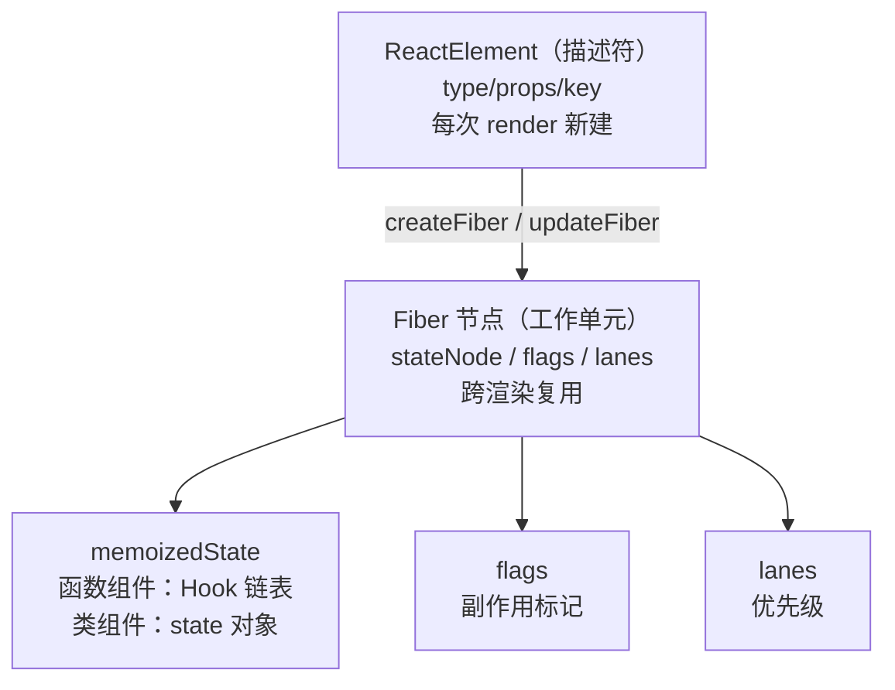

#### 追问链路

- `flags`（旧版叫 `effectTag`）上有哪些常见标记？（`Placement` / `Update` / `Deletion` / `Passive`）
- Fiber 节点的 `lanes` 和整棵树的 `pendingLanes` 是什么关系？
- `memoizedState` 在类组件和函数组件里分别存了什么？

---


#### 追问答案

#### Q3-A1 flags 上有哪些常见标记？

- `Placement`：节点需要插入 DOM（首次挂载或移动）
- `Update`：节点需要更新属性/文本（props 或 state 变化）
- `Deletion`：节点需要从 DOM 中删除
- `Passive`：节点有 `useEffect` 需要在 commit 后异步执行
- `LayoutEffect`（`Update | Callback`）：节点有 `useLayoutEffect` 需要在 layout 阶段同步执行
- 标记可以通过位运算组合：`flags & Placement` 检查是否需要插入

#### Q3-A2 lanes 和 pendingLanes 的关系

- `fiber.lanes`：这个 Fiber 节点自身有哪些待处理的更新优先级（位掩码）
- `root.pendingLanes`：整棵树所有 Fiber 的 `lanes` 的并集，表示根节点"知道有哪些优先级的工作待做"
- 调度时只看 `root.pendingLanes`，选出最高优先级 Lane 开始 render
- render 完成后，从 `pendingLanes` 中移除已完成的 Lane（位运算 `&~`）
- `fiber.childLanes`：当前 Fiber 子树中存在的所有 Lane，用于 `beginWork` 快速 bailout 判断

#### Q3-A3 memoizedState 在类/函数组件里分别存了什么？

- 函数组件：`memoizedState` 指向第一个 Hook 节点，Hook 节点用 `next` 串成链表
  - `useState` 的 Hook 节点里 `memoizedState` 存当前 state 值
  - `useEffect` 的 Hook 节点里 `memoizedState` 存 effect 对象（deps、create、destroy）
- 类组件：`memoizedState` 直接存 `this.state` 对象（上次 render 后的状态）
- 共同点：都是"上次渲染后的最终状态"，用于下次渲染时与新状态对比

---

### Q4 Fiber 树是怎么构建和链接的？child / sibling / return 三个指针怎么协作？

> 频率：`中频` 来源：字节

#### 口述版（30 秒）

Fiber 树用"长子 + 兄弟链"表示：`child` 指向第一个子节点，`sibling` 串联同级兄弟，`return` 指向父节点。遍历是深度优先：优先走 `child` 下沉，没有子节点就走 `sibling` 右移，兄弟走完就沿 `return` 上浮再右移，直到回到根节点。这种结构让遍历完全靠显式指针驱动，不依赖 JS 调用栈。

#### 学习版（3 分钟展开）

**结构示意：三节点组件树**

假设有这样的组件树：

```
App
├── Header
└── Main
    ├── List
    └── Footer
```

对应的 Fiber 链接关系：

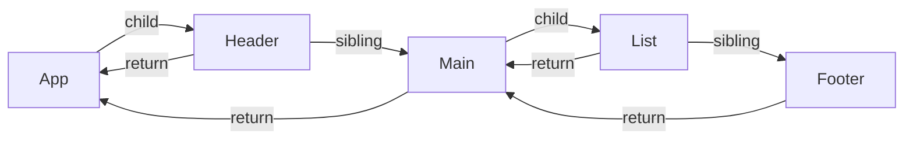

**深度优先遍历顺序**

处理顺序：`App → Header → Main → List → Footer`

每个节点经过两次：**beginWork**（向下进入）和 **completeWork**（向上离开）。

```
beginWork(App)
  beginWork(Header)
  completeWork(Header)   ← Header 没有 child，直接 complete
  beginWork(Main)
    beginWork(List)
    completeWork(List)
    beginWork(Footer)
    completeWork(Footer)
  completeWork(Main)
completeWork(App)
```

**为什么用"长子 + 兄弟链"而不是多叉树（child 数组）？**

| 维度 | 多叉树（children 数组） | 长子 + 兄弟链 |
|---|---|---|
| 访问第 N 个子节点 | O(1) 随机访问 | O(N) 顺序遍历 |
| 中断后恢复 | 需要保存数组下标 | 只需保存当前 Fiber 指针 |
| 插入 / 删除 | 操作数组，可能触发 GC | 修改指针，更轻量 |
| 内存结构 | 每个节点有变长数组 | 每个节点固定3个指针字段 |

Fiber 要求"可中断 + 断点保存极简"，长子 + 兄弟链只需要一个 `workInProgress` 指针就能完整记录中断位置。

#### 追问链路

- 在 `completeWork` 阶段，副作用（`flags`）是怎么向上汇聚的？
- 如果一个组件有 100 个子节点，它们在 Fiber 里是怎么存储的？
- `workInProgress` 指针遍历到叶节点后，下一步是什么？

---


#### 追问答案

#### Q4-A1 completeWork 阶段 flags 如何向上汇聚？

- 每个 Fiber 节点有两个 flags 字段：`flags`（自身）和 `subtreeFlags`（子树汇总）
- `completeWork` 末尾调用 `bubbleProperties`：将子节点的 `flags | subtreeFlags` 合并到父节点的 `subtreeFlags`
- 从叶节点开始，逐层向上合并，最终根节点的 `subtreeFlags` 包含整棵树所有副作用
- commit 阶段先检查 `subtreeFlags`：若子树无副作用可直接跳过，无需遍历每个子节点
- 这比 React 16 的 effectList 链表更高效——effectList 需要在 render 阶段手动维护链表指针

#### Q4-A2 100 个子节点如何存储？

- 第一个子节点挂在父节点的 `child` 字段
- 其余 99 个子节点通过 `sibling` 指针串成链表：child → s2 → s3 → ... → s100
- 这是"长子 + 兄弟链"结构，父节点只持有第一个子节点的引用
- 遍历所有子节点：从 `child` 出发，沿 `sibling` 链依次访问，时间复杂度 O(n)
- 优点：父节点结构固定（不需要动态数组），中断后恢复只需保存当前 `workInProgress` 指针

#### Q4-A3 workInProgress 到叶节点后，下一步是什么？

- 叶节点没有 `child`，`performUnitOfWork` 不会向下走
- 对叶节点执行 `completeWork`（创建/更新 DOM，冒泡 flags）
- 然后检查是否有 `sibling`：有则返回 `sibling`，`workLoop` 继续处理兄弟
- 没有 `sibling` 则沿 `return` 上浮到父节点，父节点执行 `completeWork`
- 如此循环，直到回到 `HostRoot`，整棵树遍历完成，render 阶段结束，进入 commit

---

## 层级三：工作流程 — render / commit 与双缓冲

### Q5 React 的渲染分哪两个阶段？各阶段分别做了什么事？

> 频率：`高频` 来源：阿里 / 字节

#### 口述版（30 秒）

渲染分两个阶段：render 阶段对 Fiber 树做 reconcile，找出有副作用的节点，全程纯计算可以被打断；commit 阶段把收集到的副作用同步应用到真实 DOM，必须一气呵成不能中断。`useLayoutEffect` 在 commit 阶段的 layout 子阶段同步执行，`useEffect` 在 commit 完成后异步调度执行。

#### 学习版（5 分钟展开）

**render 阶段（可中断）**

目标：构建 workInProgress Fiber 树，收集副作用

- 对每个 Fiber 节点执行 `beginWork`（向下）和 `completeWork`（向上）
- `beginWork`：根据 `pendingProps` 和旧 `memoizedProps` 决定是否需要更新，生成子 Fiber
- `completeWork`：创建 DOM 节点（首次挂载）或标记属性变更（更新），把 `flags` 冒泡到父节点的 `subtreeFlags`
- 最终产出：带有副作用标记的 workInProgress 树

**commit 阶段（不可中断）**

commit 分三个严格有序的子阶段：

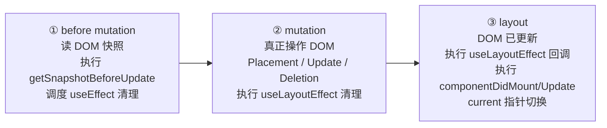

| 子阶段 | 主要工作 |
|---|---|
| before mutation | 调用 `getSnapshotBeforeUpdate`；调度 `useEffect` 的清理函数（异步） |
| mutation | 按 `flags` 增删改真实 DOM；执行 `useLayoutEffect` 的清理函数 |
| layout | DOM 已更新、类组件执行 `componentDidMount/Update`；执行 `useLayoutEffect` 回调；将 `current` 指针切换到 workInProgress |

**useLayoutEffect vs useEffect 时机**

```
mutation 阶段 → DOM 更新
layout 阶段   → useLayoutEffect 清理 → useLayoutEffect 回调（同步，可读最新 DOM）
commit 结束   → 浏览器绘制
异步调度      → useEffect 清理 → useEffect 回调
```

`useLayoutEffect` 在浏览器绘制之前同步执行，适合需要读取/写入 DOM 尺寸的场景（但会阻塞绘制）；`useEffect` 在绘制后异步执行，不阻塞渲染，是大多数副作用的推荐位置。

**为什么 commit 阶段不能中断？**

commit 阶段直接操作真实 DOM。如果中途暂停，用户看到的界面处于一种"半更新"状态（部分节点已变更，部分未变更），会造成视觉撕裂和数据不一致，因此必须原子性完成。

#### 追问链路

- `subtreeFlags` 是什么？它相比 React 16 的 effectList 有什么优化？
- 为什么 `useLayoutEffect` 里不该做耗时操作？
- 函数组件的 `useInsertionEffect` 是哪个时机？和 CSS-in-JS 有什么关系？

---


#### 追问答案

#### Q5-A1 subtreeFlags 相比 effectList 的优化

- React 16 的 effectList：render 阶段手动维护一个链表，把有副作用的 Fiber 节点串起来，commit 阶段遍历链表
- 问题：维护链表指针逻辑复杂，且链表节点顺序依赖遍历顺序，难以支持并发中断后的恢复
- React 18 的 subtreeFlags：每个节点只存自身 `flags` 和子树汇总 `subtreeFlags`，commit 阶段按树结构递归检查
- 优化点：`subtreeFlags === NoFlags` 时可直接跳过整棵子树，不需要遍历每个节点
- 与并发模式兼容：中断恢复后不需要重建 effectList，subtreeFlags 通过 `bubbleProperties` 重新冒泡即可

#### Q5-A2 useLayoutEffect 里为什么不该做耗时操作？

- `useLayoutEffect` 在 commit 阶段的 layout 子阶段**同步执行**，执行期间浏览器无法绘制
- 耗时操作会延迟浏览器绘制，用户看到页面白屏或内容延迟出现
- 本质和直接在 `componentDidMount` 里做耗时操作一样，阻塞渲染管线
- 正确用法：只在 `useLayoutEffect` 里做必须在绘制前同步读取/修改 DOM 的操作（如测量尺寸、同步滚动位置）
- 耗时的异步操作放 `useEffect`，它在浏览器绘制后异步执行，不阻塞渲染

#### Q5-A3 useInsertionEffect 的时机和 CSS-in-JS 的关系

- 执行时机：在 mutation 阶段 DOM 操作之前执行，比 `useLayoutEffect` 更早
- 目的：让 CSS-in-JS 库（如 styled-components、Emotion）在 DOM 插入前注入样式规则
- 为什么需要这个时机：如果样式在 DOM 插入后才注入，浏览器会触发额外的重排，`useInsertionEffect` 避免了这次重排
- 限制：不能在里面读取 DOM，也不能调用 `setState`（此时 DOM 还没有更新）
- 普通业务代码不应使用，专为 CSS-in-JS 库设计

---

### Q6 什么是双缓冲？current 树和 workInProgress 树是什么？

> 频率：`高频` 来源：字节 / 腾讯

#### 口述版（30 秒）

React 同时维护两棵 Fiber 树：`current` 是当前屏幕正在显示的，`workInProgress` 是本次更新正在构建的。两棵树上对应节点通过 `alternate` 字段互相指向对方，便于复用。更新完成后，`FiberRoot.current` 指针切换到 workInProgress 树，原来的 current 树变成下次更新的 workInProgress 基础，这就是双缓冲。

#### 学习版（3 分钟展开）

**双缓冲的比喻**

游戏渲染里，后台缓冲区正在绘制下一帧，前台缓冲区显示当前帧，绘制完成后一次性切换。React 的两棵 Fiber 树和这个机制完全一样：workInProgress 在后台构建，构建完成后"切换"到前台显示。

**alternate 字段**

```
current.alternate === workInProgress
workInProgress.alternate === current
```

这意味着每个 Fiber 节点最多同时存在两个版本，不需要每次更新都从零新建节点，大量复用对象减少 GC 压力。

**切换时机**

切换发生在 commit 阶段的 layout 子阶段末尾：

```js
// 简化示意
root.current = finishedWork; // finishedWork 就是 workInProgress 树的根
```

选择在 layout 子阶段末尾切换，是因为此时 `mutation` 阶段已完成 DOM 操作，`useLayoutEffect` 即将执行——让 `useLayoutEffect` 里的 `this.setState` 触发的更新，能基于最新的 current 树处理。

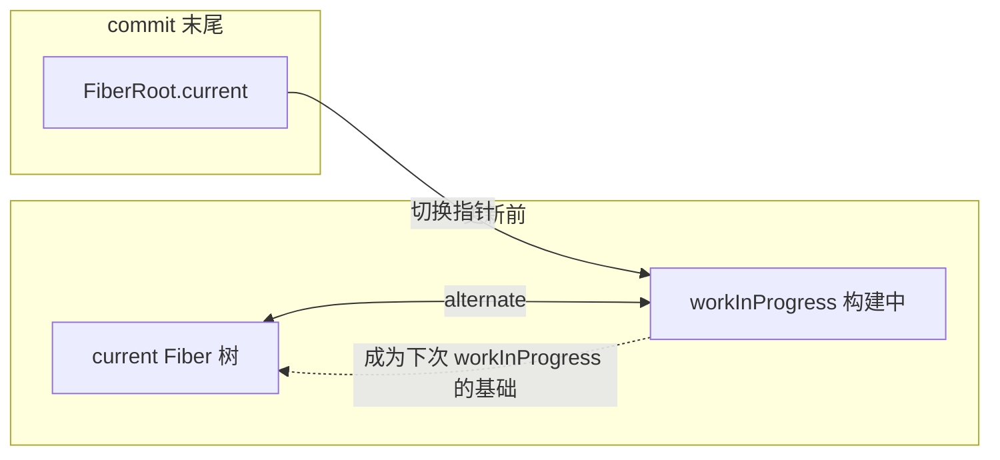

**首次挂载的特殊情况**

首次挂载时，`current` 树只有一个 `HostRoot` Fiber 节点（空壳）。整个 workInProgress 树从零构建完成后，`FiberRoot.current` 才第一次指向完整的 Fiber 树。

#### 追问链路

- 如果更新中途被更高优先级任务打断，workInProgress 树是直接丢弃还是保留？
- 为什么不直接在 current 树上修改，而要维护两棵树？
- `FiberRoot` 和 `HostRootFiber` 有什么区别？

---


#### 追问答案

#### Q6-A1 高优先级打断后 workInProgress 树是丢弃还是保留？

- **直接丢弃**，从根节点重新构建新的 workInProgress 树
- 原因：低优先级 render 阶段基于旧状态生成了部分 Fiber 节点，高优先级任务可能改变了状态，继续使用旧节点会导致数据不一致
- "保留"的只是 current 树（屏幕上正在显示的）和各 Fiber 节点上的 `updateQueue`（更新还在队列里，不会丢失）
- 重新构建时，低优先级和高优先级的更新都会一起处理（processUpdateQueue 会合并两者）
- 这也是为什么 render 阶段必须是纯函数——它可能被重复执行

#### Q6-A2 为什么要维护两棵树？

- 安全性：在 workInProgress 上修改，不影响当前屏幕显示的 current 树，用户看到的界面始终一致
- 可回滚：如果更新失败或被打断，丢弃 workInProgress 即可，current 树完好无损
- 复用优化：通过 `alternate` 指针，两棵树的 Fiber 节点互相复用，减少对象创建和 GC 压力
- 并发安全：React 可以在后台悄悄构建新树，构建完成后一次性切换，用户不会看到中间状态
- 若直接在 current 树上修改，一旦渲染中断，DOM 和 Fiber 树就会处于不一致状态

#### Q6-A3 FiberRoot 和 HostRootFiber 的区别

- `FiberRoot`：整个 React 应用的根容器对象，**不是** Fiber 节点
  - 存储：`current`（当前 Fiber 树根）、`pendingLanes`、`finishedWork`、容器 DOM 节点等全局状态
  - 由 `createRoot` 创建，一个应用只有一个
- `HostRootFiber`：类型为 `HostRoot` 的 Fiber 节点，是 Fiber 树的根节点
  - `FiberRoot.current` 指向它
  - `HostRootFiber.stateNode` 反指回 `FiberRoot`
- 简记：`FiberRoot` 是应用级容器，`HostRootFiber` 是 Fiber 树的第一个节点

---

### Q7 diff 算法在 Fiber 架构下是怎么工作的？

> 频率：`中频` 来源：阿里

#### 口述版（30 秒）

React diff 在 render 阶段的 `reconcileChildFibers` 中执行，对比新的 ReactElement 和旧的 Fiber 节点，决定复用、新建还是删除。单个子节点先比 type 再比 key；多个子节点先做一轮正序对比处理简单情况，遇到乱序时用 key 建 Map 做快速查找，尽量复用移动节点而不是重建。

#### 学习版（4 分钟展开）

**三条 diff 假设（启发式优化）**

React diff 基于三条假设，把 O(n³) 的树形 diff 降到 O(n)：

1. 不同 `type` 的节点产生完全不同的树（直接销毁重建，不尝试复用子节点）
2. 开发者可以用 `key` 提示哪些子元素在不同渲染间保持稳定
3. 只对同层节点进行比较，不跨层移动

**单节点 diff**

```
新节点只有一个子元素时：
  key 相同 && type 相同 → 复用旧 Fiber，打上 Update 标记
  key 相同 && type 不同 → 删除旧 Fiber，新建
  key 不同 → 继续遍历旧兄弟节点查找
  找不到匹配 → 新建 Fiber，旧节点打 Deletion 标记
```

**多节点 diff（两轮遍历）**

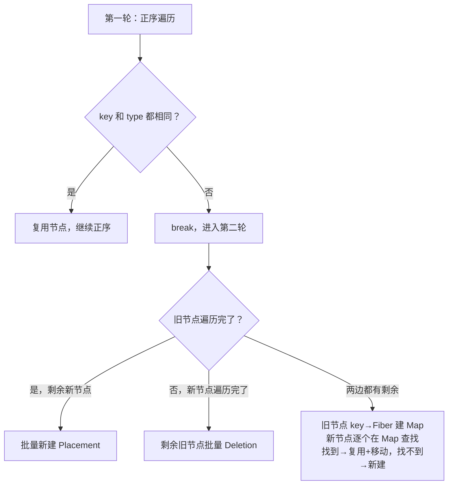

**key 的作用**

没有 `key` 时，React 按位置对比，列表顺序变化会导致大量重建；有 `key` 后，React 能识别"这个节点只是移动了位置"，打 `Placement` 标记（DOM 移动）而非 `Deletion + Placement`（重建）。

**mount 和 update 的区别**

- `mountChildFibers`（首次挂载）：不追踪副作用，不生成 `Deletion` 标记，性能更高
- `reconcileChildFibers`（更新）：追踪副作用，生成完整的 `flags` 标记

#### 追问链路

- 为什么 React 不做跨层级节点移动的优化？
- `key` 用数组 index 有什么问题？什么情况下可以用？
- `reconcileChildFibers` 返回的是什么？它和 `beginWork` 是什么关系？

---


#### 追问答案

#### Q7-A1 为什么不做跨层级节点移动的优化？

- 跨层级移动在真实业务中极少发生，优化的收益远小于实现成本
- 实现跨层级移动需要全树扫描比对，时间复杂度从 O(n) 升至 O(n²) 甚至更高
- React 的 diff 三条假设之一：开发者不会做跨层级移动，如果真的移动了，React 选择销毁重建
- 实际上跨层级"移动"通常通过 Portal 或条件渲染实现，不需要 diff 层面的优化
- 保持 O(n) 的复杂度是 React diff 性能的核心保证

#### Q7-A2 key 用数组 index 有什么问题？

- 列表重排时：index 和元素的对应关系变了，React 认为每个位置的节点"没变"，会错误复用
- 后果：组件内部状态（输入框值、滚动位置）残留在错误的节点上，出现数据错位
- 新增/删除头部元素时：所有后续元素的 index 都变了，触发全量 Update，而不是精准的 Placement/Deletion
- 可以用 index 的场景：列表项完全无状态、且列表不会重排/增删（只是展示）
- 正确做法：用数据本身的唯一 ID 作为 key（如 `item.id`）

#### Q7-A3 reconcileChildFibers 返回什么？它和 beginWork 是什么关系？

- `reconcileChildFibers` 返回**第一个子 Fiber 节点**（子节点链表的头）
- `beginWork` 调用 `reconcileChildFibers`（或 `mountChildFibers`），将返回值赋给 `workInProgress.child`
- `beginWork` 最终返回 `workInProgress.child`，即这个第一个子节点
- `workLoop` 收到返回值后，将 `workInProgress` 指向这个子节点，继续向下处理
- 关系：`beginWork` 是外层协调入口，`reconcileChildFibers` 是其内部专门处理子节点 diff 的函数

---

## 层级四：调度机制 — 时间切片与优先级

### Q8 时间切片（Time Slicing）的原理是什么？

> 频率：`高频` 来源：字节

#### 口述版（30 秒）

时间切片的核心是：每次只给 React 约 5ms 的 JS 执行时间，时间到了就把控制权交回浏览器，让它处理用户输入和绘制，下一个宏任务再继续 React 的工作。实现上用的是 `MessageChannel` 触发宏任务，而不是 `requestIdleCallback`，因为后者在不同浏览器里频率不稳定，且最低优先级会导致延迟过高。

#### 学习版（4 分钟展开）

**为什么不用 requestIdleCallback？**

| 对比项 | requestIdleCallback | MessageChannel |
|---|---|---|
| 触发频率 | 约 20fps（50ms/帧），太慢 | 接近 60fps（每帧后触发） |
| 兼容性 | Safari 长期不支持 | 所有现代浏览器支持 |
| 优先级 | 空闲才触发，紧急任务延迟过高 | 宏任务队列，优先级可控 |
| 最小延迟 | 约 4ms（最低 idle 延迟） | 约 0–1ms |

**为什么不用 requestAnimationFrame？**

`rAF` 在每帧绘制前执行，如果帧率是 60fps，那每 16.67ms 才能调度一次；而 React 希望在一帧里能多次切片（5ms × 3 ≈ 15ms），所以需要比 `rAF` 更高频的触发方式。

**MessageChannel 实现原理（简化）**

```js
// 简化示意，非 React 源码原文
const channel = new MessageChannel();
const port = channel.port2;

channel.port1.onmessage = performWorkUntilDeadline; // 宏任务回调

function scheduleCallback(callback) {
  port.postMessage(null); // 触发一个宏任务
}

function performWorkUntilDeadline() {
  const startTime = performance.now();
  const deadline = startTime + 5; // 5ms 时间片

  while (workInProgress !== null) {
    if (performance.now() >= deadline) {
      // 时间片用完，退出循环，让出主线程
      scheduleCallback(performWorkUntilDeadline); // 下一个宏任务继续
      return;
    }
    workInProgress = performUnitOfWork(workInProgress);
  }
}
```

**时间片长度为什么是 5ms？**

React Scheduler 内部默认帧间隔是 `5ms`（`yieldInterval = 5`）。这是一个经验值：
- 太长（如 16ms）：一个时间片就占满一帧，动画卡顿
- 太短（如 1ms）：切换开销大，真正做的工作少

```mermaid
gantt
  title 时间切片工作示意（一帧内）
  dateFormat X
  axisFormat %Lms

  section 主线程
  React 工作片 5ms     :active, 0, 5
  浏览器事件/绘制       :done, 5, 8
  React 工作片 5ms     :active, 8, 13
  浏览器绘制一帧        :done, 13, 17
```

**副作用：同一次更新的 render 阶段可能跨多帧**

这意味着 render 阶段的函数组件体、`useMemo`、`useReducer` 等可能被调用多次（被打断后重新执行）——这也是为什么 render 阶段必须保持纯净，不能有副作用。

#### 追问链路

- 为什么 render 阶段的函数组件体必须是纯函数（不能有副作用）？
- React 18 开启并发模式后，`StrictMode` 为什么会把组件渲染两次？
- `yieldInterval`（时间片长度）在 React 源码里是可以配置的吗？

---


#### 追问答案

#### Q8-A1 为什么函数组件体必须是纯函数？

- 时间切片下 render 阶段可能被中断，重新从根开始构建 workInProgress 树，函数组件体会被重复执行
- 非纯函数（有副作用）重复执行会导致副作用执行多次：请求重复发送、全局变量多次修改、DOM 多次操作
- React 的设计约定：render 阶段只负责"计算描述"，副作用统一放 commit 阶段，保证只执行一次
- 相同输入必须产生相同输出——这是 diff 算法能够正确工作的前提
- `StrictMode` 就是通过故意重复执行来暴露违反这条约定的代码

#### Q8-A2 StrictMode 为什么把组件渲染两次？

- 目的：主动检测 render 阶段的副作用，帮助开发者提前发现问题
- 原理：React 会故意调用函数组件体两次（第二次结果被丢弃），纯函数两次结果一致不受影响
- 只在开发模式生效，生产环境不会重复执行
- 覆盖范围：函数组件体、`useState` 的初始化函数、`useReducer` 的 reducer、`useMemo`/`useCallback` 的工厂函数
- 同时也会故意卸载再重新挂载组件，检测 `useEffect` 的清理函数是否正确实现

#### Q8-A3 yieldInterval 是否可以配置？

- 源码中 `yieldInterval` 硬编码为 `5`（毫秒），没有暴露公开配置 API
- React 内部有 `forceFrameRate` 函数可以动态设置，但标记为 `unstable_`，不稳定不建议使用
- React 团队认为 5ms 是经过实验的合理默认值，业务代码不应干预调度器内部
- 在测试环境中可以通过 `jest.useFakeTimers()` 控制时间流逝来影响调度行为
- 底层原因：时间片长度需要在"切换开销"和"有效工作量"间平衡，5ms 是这个平衡点的经验值

---

### Q9 Fiber 的优先级调度是怎么工作的？

> 频率：`高频` 来源：字节 / 腾讯

#### 口述版（30 秒）

React 用 Lane 模型（位掩码）给每次更新打优先级标签。`SyncLane` 最高（用户点击、输入），`TransitionLane` 居中，`IdleLane` 最低。调度时只处理优先级最高的 Lane，低优先级任务如果被高优先级打断，不是丢弃而是保留在队列里等高优先级完成后重新执行。为防止低优先级任务永远等不到执行（饥饿），React 会给每个任务设过期时间，过期的任务会被提升为同步优先级强制执行。

#### 学习版（5 分钟展开）

**为什么从 ExpirationTime 换成 Lane 模型？**

React 16/17 用 `ExpirationTime`（数字越大优先级越高）表示优先级。问题是：

- 批量更新时，多个不同优先级的更新很难"合并"计算
- 无法表示"这批更新属于同一类"（比如多个 Transition 更新）

Lane 用**位掩码**，每个 Lane 是二进制的一位，多个 Lane 可以用位运算自由组合：

```js
// 简化的 Lane 定义（非源码原文）
const SyncLane         = 0b0000000000000000000000000000001; // 最高优先级
const InputContinuous  = 0b0000000000000000000000000000100;
const DefaultLane      = 0b0000000000000000000000000010000;
const TransitionLane1  = 0b0000000000000000000000001000000;
const IdleLane         = 0b0100000000000000000000000000000; // 最低优先级

// 检查是否有待处理的 SyncLane
const hasSyncWork = (pendingLanes & SyncLane) !== 0;

// 合并两个 Lane
const mergedLanes = laneA | laneB;

// 从集合中移除一个 Lane
const remainingLanes = pendingLanes & ~finishedLane;
```

**优先级分级**

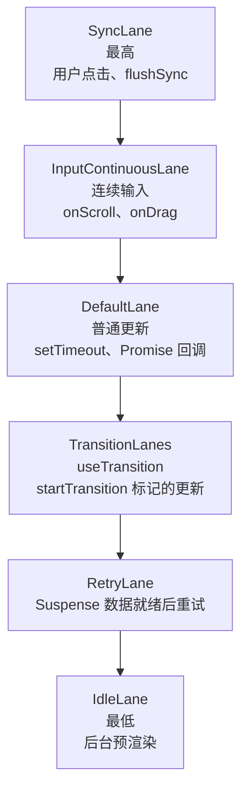

**打断与重做**

高优先级任务插队时，React 不会把 workInProgress 树的已完成部分保留，而是**从根节点重新开始构建**——因为低优先级的 render 阶段可能产生了基于旧状态的中间 DOM 描述，和高优先级更新叠加后数据不一致。

**饥饿问题（starvation）**

如果用户持续高频操作（如快速滚动），低优先级任务（如 Transition）可能永远得不到执行。React 给每个任务记录一个 `expirationTime`，超过这个时间后，即使还有高优先级任务进来，这个"过期"任务也会被强制提升到 `SyncLane` 执行一次。

#### 追问链路

- 同一个事件触发的多个 `setState`，它们的 Lane 是怎么合并的？
- `startTransition` 标记的更新为什么在用户快速输入时不会感知到"卡"？
- `pendingLanes`、`expiredLanes`、`renderLanes` 这三个字段分别代表什么？

---


#### 追问答案

#### Q9-A1 同一个事件触发的多个 setState，Lane 怎么合并？

- 在同一个合成事件回调里，React 的执行上下文被标记为 `BatchedContext`
- 每次 `setState` 调用 `dispatchSetState`，Lane 都基于相同的"当前执行上下文"计算，结果相同（如都是 `SyncLane`）
- 多个 Update 被放入各自 Fiber 的 `updateQueue`，Lane 相同
- `scheduleUpdateOnFiber` 调用 `ensureRootIsScheduled` 时，发现已有相同优先级的任务在队列里，不会重复注册
- 结果：事件回调执行完后，Scheduler 只触发一次渲染，一次 processUpdateQueue 消费所有 Update

#### Q9-A2 startTransition 为什么输入时不卡？

- `startTransition` 把包裹的更新标记为 `TransitionLane`（低优先级）
- 用户继续输入时触发新的 `SyncLane` 更新（高优先级）
- React 检测到有更高优先级的 `SyncLane`，中断正在进行的 `TransitionLane` render
- 优先完成输入响应的 `SyncLane` render + commit（输入框立即更新）
- `TransitionLane` 的 render 重新排队，等待下一个空闲时机继续——用户感觉输入始终流畅

#### Q9-A3 pendingLanes / expiredLanes / renderLanes 各是什么？

- `pendingLanes`：根节点上所有尚未完成的更新优先级集合（位掩码），有新 setState 就往这里加，render 完成就移除
- `expiredLanes`：已经过了过期时间、需要被强制同步执行的 Lane 集合，防止低优先级任务饥饿
- `renderLanes`：当前这次 render 阶段正在处理的 Lane 集合，`beginWork` 用它判断哪些更新要处理
- 关系：调度时从 `pendingLanes` 选出最高优先级 → 赋给 `renderLanes` → render 完成后从 `pendingLanes` 移除

---

### Q10 Scheduler 包的核心原理是什么？

> 频率：`拔高` 来源：字节（少数）

#### 口述版（30 秒）

Scheduler 是 React 独立的任务调度包，用两个**小顶堆**（最小优先级队列）管理任务：`taskQueue`（已到期，按过期时间排序）和 `timerQueue`（未到期，按开始时间排序）。通过 `MessageChannel` 驱动任务循环，每个时间片里尽可能多地执行 `taskQueue` 里的任务，时间片用完就退出，等下一个宏任务继续。

#### 学习版（4 分钟展开）

**两个任务队列**

```
timerQueue（小顶堆，按 startTime 排序）
  → 存放"还没到开始时间"的延迟任务
  → 用 setTimeout 检查是否到期，到期后移入 taskQueue

taskQueue（小顶堆，按 expirationTime 排序）
  → 存放"可以立即执行"的任务
  → 每次时间片从这里取任务执行
```

**小顶堆的作用**

小顶堆保证每次 `O(log n)` 地取出优先级最高（expirationTime 最小）的任务，比排序数组效率更高，适合频繁插入 / 取出的调度场景。

**任务循环（workLoop）**

```js
// 简化示意，非源码原文
function workLoop(hasTimeRemaining, initialTime) {
  let currentTime = initialTime;
  advanceTimers(currentTime); // 把到期的 timerQueue 任务移入 taskQueue

  currentTask = peek(taskQueue); // 取优先级最高的任务

  while (currentTask !== null) {
    if (currentTask.expirationTime > currentTime && !hasTimeRemaining) {
      break; // 时间片用完，且任务未过期，退出
    }

    const callback = currentTask.callback;
    if (typeof callback === 'function') {
      currentTask.callback = null;
      const continuationCallback = callback(didTimeout);

      if (typeof continuationCallback === 'function') {
        // 任务没做完，保存续集回调，下次继续
        currentTask.callback = continuationCallback;
      } else {
        pop(taskQueue); // 任务完成，出队
      }
    }

    currentTask = peek(taskQueue);
  }

  return currentTask !== null; // 返回是否还有剩余任务
}
```

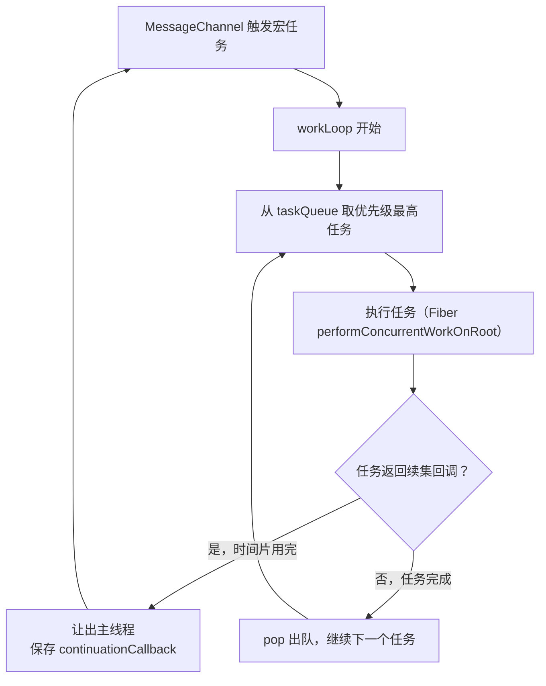

**React 如何使用 Scheduler**

React 的 `performConcurrentWorkOnRoot` 被包装成一个 Scheduler 任务。如果时间片用完但 render 没完成，它返回一个"续集函数"告诉 Scheduler"我还有工作，下次继续"——这就是 Fiber 可中断的底层机制。

#### 追问链路

- Scheduler 的任务优先级和 React 的 Lane 优先级是一一对应的吗？
- 为什么 Scheduler 要用小顶堆，而不是普通数组排序？
- `unstable_scheduleCallback` 的 `delay` 参数是怎么和 `timerQueue` 联动的？

---


#### 追问答案

#### Q10-A1 Scheduler 优先级和 Lane 优先级是否一一对应？

- **不是**一一对应，是两套独立的优先级系统，之间有映射关系
- React Lane（位掩码）：细粒度，约 31 种，描述"更新的类型和紧急程度"
- Scheduler 优先级（枚举）：粗粒度，只有 5 种（Immediate / UserBlocking / Normal / Low / Idle）
- 映射：`SyncLane` → `ImmediatePriority`，`InputContinuousLane` → `UserBlockingPriority`，`DefaultLane` → `NormalPriority`，`TransitionLane` → `NormalPriority`，`IdleLane` → `IdlePriority`
- 注意：`TransitionLane` 和 `DefaultLane` 映射到同一个 Scheduler 优先级，但 React 内部仍能通过 Lane 区分它们

#### Q10-A2 为什么用小顶堆而不是数组排序？

- 任务队列需要频繁的"插入新任务"和"取出最高优先级任务"操作
- 数组排序：插入 O(n log n)，取最小 O(1)——但每次插入都要重新排序，高频插入开销大
- 小顶堆：插入 O(log n)，取最小 O(1)，删除堆顶 O(log n)——所有操作都是对数级，高频场景更稳定
- 调度器的典型场景：用户快速操作产生大量任务，每次都要插入并取出最高优先级的，小顶堆完美契合
- JavaScript 没有内置堆，React Scheduler 手动实现了一个最小二叉堆（约 70 行代码）

#### Q10-A3 delay 参数怎么和 timerQueue 联动？

- `unstable_scheduleCallback(priority, callback, { delay: 1000 })` 表示 1000ms 后才允许执行
- 有 `delay` 的任务：`startTime = currentTime + delay`，放入 `timerQueue`（按 startTime 排序）
- Scheduler 同时用 `setTimeout(advanceTimers, delay)` 定时检查 `timerQueue`
- `advanceTimers` 会把 `startTime <= currentTime` 的任务从 `timerQueue` 移入 `taskQueue`
- 移入后才参与正常的优先级调度和时间片执行——`delay` 本质是"延迟进入调度队列的时间"

---

## 层级五：并发特性 — Concurrent Mode 全家桶

### Q11 Concurrent Mode 带来了哪些新能力？它和 Fiber 是什么关系？

> 频率：`中频` 来源：快手 / 字节

#### 口述版（30 秒）

Fiber 是底层基础设施，提供了可中断渲染和优先级调度的能力。Concurrent Mode 是建立在 Fiber 之上的上层特性，让开发者可以显式标记"哪些更新不紧急"。`useTransition` 把状态更新标记为低优先级，让紧急的用户输入先响应；`useDeferredValue` 推迟一个值的更新；两者结合可以实现"输入流畅、结果异步刷新"的体验。

#### 学习版（4 分钟展开）

**Fiber 和 Concurrent Mode 的关系**

```
Fiber（React 16）
  ↓ 提供：可中断渲染 + 优先级调度 + 双缓冲
Concurrent Mode（React 18 默认开启）
  ↓ 暴露：startTransition / useTransition / useDeferredValue / Suspense
开发者
  ↓ 使用：标记低优先级更新，让 React 自动优化调度
```

**useTransition：标记不紧急的更新**

```tsx
const [isPending, startTransition] = useTransition();

// 用户在搜索框输入——这个 setState 是紧急的（SyncLane）
setInputValue(e.target.value);

// 搜索结果更新——这个 setState 是低优先级的（TransitionLane）
startTransition(() => {
  setSearchQuery(e.target.value);
});
```

用户继续输入时，React 会中断低优先级的搜索结果渲染，优先处理输入，等用户停下来后再完成搜索渲染。`isPending` 在低优先级更新进行中时为 `true`，可用于显示 loading 态。

**useDeferredValue：推迟一个值**

```tsx
const deferredQuery = useDeferredValue(query);
// deferredQuery 落后于 query，用于渲染"不紧急"的部分
// 配合 memo，只有 deferredQuery 真正变化时才重渲染列表
```

`useDeferredValue` 和 `useTransition` 的区别：

| | useTransition | useDeferredValue |
|---|---|---|
| 控制对象 | 一段状态更新代码（回调） | 一个值 |
| 使用场景 | 你控制状态更新的地方 | 你只能拿到值（如来自 props） |
| isPending | 有 | 无（可通过 `value !== deferredValue` 判断） |

**startTransition vs flushSync**

```tsx
// startTransition：把里面的更新降为 TransitionLane（低优先级）
startTransition(() => setList(bigList));

// flushSync：把里面的更新强制提升为 SyncLane，且立即同步执行
flushSync(() => setState(val));
// flushSync 之后，DOM 已经更新了
```

#### 追问链路

- `useTransition` 标记的更新，在 Scheduler 里对应哪个优先级级别？
- 为什么 Concurrent Mode 要求组件 render 阶段是纯函数？（可能被重复执行）
- React 18 的 `createRoot` 和 React 17 的 `render` 有什么区别？并发特性依赖哪个？

---


#### 追问答案

#### Q11-A1 useTransition 在 Scheduler 里对应哪个优先级？

- `useTransition` 的 `startTransition` 将更新标记为 `TransitionLane`
- 映射到 Scheduler 的 `NormalPriority`（与 `DefaultLane` 相同的 Scheduler 优先级）
- 但在 React 内部，`TransitionLane` 的过期时间比 `DefaultLane` 更长（5000ms vs 5000ms，有时更宽松）
- 因此 `startTransition` 的更新在 React 调度层面是低优先级，但在 Scheduler 层面与普通更新相同
- 实际的优先级差异体现在：高优先级 Lane（SyncLane）可以打断 TransitionLane 的 render

#### Q11-A2 Concurrent Mode 为什么要求 render 是纯函数？

- Concurrent Mode 下 render 阶段可能被高优先级任务打断，workInProgress 树被丢弃后从根重新渲染
- 重新渲染意味着函数组件体会被重复调用
- 若 render 有副作用（发请求、改全局变量），重复调用会造成副作用多次执行
- 纯函数保证：相同输入产生相同输出，多次执行结果一致，可安全丢弃中间结果
- 这是 React 并发特性能够工作的基础约束，违反则行为不可预期

#### Q11-A3 createRoot 和旧 render 的区别？

- `ReactDOM.render`（React 17 及以前）：启用 Legacy 模式，所有更新同步执行，无并发特性
- `ReactDOM.createRoot`（React 18）：启用 Concurrent 模式，开启时间切片、优先级调度、自动批处理
- 并发特性（`useTransition`、`useDeferredValue`、Suspense 数据）**必须依赖 `createRoot`**，在 Legacy 模式下这些 API 存在但行为退化为同步
- 两种模式可以在同一页面共存（如微前端场景），但各自独立调度
- 升级建议：新项目直接用 `createRoot`；老项目可渐进迁移

---

### Q12 Suspense 的工作原理是什么？Fiber 如何配合实现"等待"？

> 频率：`中频` 来源：快手

#### 口述版（30 秒）

组件通过 `throw` 一个 Promise 告诉 React"我的数据还没准备好"。React 在 render 阶段捕获这个 throw，向上遍历 Fiber 树找到最近的 `Suspense` 边界，把边界内的内容替换为 `fallback`，并在 Promise resolve 后重新触发这颗子树的渲染。

#### 学习版（4 分钟展开）

**throw Promise 的处理流程**

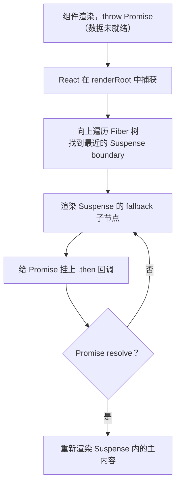

**Suspense 在 Fiber 树中的标记**

Suspense 组件在 render 阶段会标记 `DidCapture` flag，通知 commit 阶段显示 fallback；主内容的 Fiber 子树被标记为 `Offscreen` 并以"隐藏"模式保留（不是销毁），Promise resolve 后直接显示，避免重建。

**React 18 的 `use()` Hook**

```tsx
// use() 是 React 18 引入的新原语
const data = use(fetchData()); // fetchData() 返回一个 Promise

// 底层：use() 会在 Promise 未 resolve 时 throw 该 Promise
// 让 Suspense 机制自动处理等待状态
```

`use()` 让 Suspense 机制对开发者完全透明——不需要手动 `throw`，框架内部处理。

**Suspense + Concurrent Mode 的协作**

在并发模式下，React 可以在后台"悄悄"渲染新内容（Offscreen 模式），等数据全部就绪后一次性切换，用户不会看到 fallback 闪烁——这需要 Fiber 的双缓冲机制配合。

#### 追问链路

- Suspense 的 `fallback` 在 Fiber 树里是怎么存储的？为什么不是销毁主内容？
- React 18 的 Suspense 和 React 16 的 Suspense 有什么行为差异？
- `ErrorBoundary` 和 Suspense 的 `throw` 捕获机制有什么异同？

---


#### 追问答案

#### Q12-A1 fallback 在 Fiber 树里怎么存储？为什么不销毁主内容？

- `Suspense` 组件对应一个 `SuspenseComponent` 类型的 Fiber 节点
- 主内容（Primary children）和 `fallback` 都作为子节点存在于 Fiber 树中
- 数据未就绪时：主内容子树被标记为 `Offscreen` 并设为"隐藏"模式（`hidden`），`fallback` 子树正常渲染
- 不销毁主内容的原因：保留主内容的 Fiber 节点（及其状态、DOM 节点），数据就绪后可以直接"显示"，无需重建
- 重建代价高：销毁后重建意味着重新创建 Fiber 节点、重新执行组件函数、重新生成 DOM，比切换显隐更慢

#### Q12-A2 React 18 vs React 16 的 Suspense 行为差异

| 对比点 | React 16 | React 18 |
|--------|---------|---------|
| 支持的异步类型 | 只支持 `React.lazy`（代码分割） | 支持任意 Promise（数据获取） |
| 并发渲染 | 不支持，fallback 立即显示 | 支持，可在后台准备内容，避免 fallback 闪烁 |
| 嵌套 Suspense | 支持，但水合行为不同 | 支持选择性水合（Selective Hydration） |
| `use()` Hook | 不支持 | 支持（稳定于 React 19） |

#### Q12-A3 ErrorBoundary 和 Suspense 的 throw 捕获机制异同

- 相同：都利用 render 阶段可以 `throw`，React 在 `renderRoot` 里捕获 throw，向上找边界组件
- 不同之处：

| 对比点 | Suspense | ErrorBoundary |
|--------|---------|---------------|
| 捕获的 throw | `throw Promise` | `throw Error` |
| 边界组件 | `<Suspense>` | 实现了 `getDerivedStateFromError` 或 `componentDidCatch` 的类组件 |
| 处理方式 | 显示 fallback，Promise resolve 后重试 | 显示错误 UI，不自动重试 |
| 是否重渲染 | 是（数据就绪后） | 否（需手动重置） |

---

### Q13 批处理（Batching）的原理是什么？React 18 的自动批处理是什么？

> 频率：`中频` 来源：大厂补充题

#### 口述版（30 秒）

批处理是把多个 `setState` 合并成一次渲染。React 17 只在合成事件回调里自动批处理，`setTimeout` / `Promise` 里的多个 `setState` 各自触发一次渲染。React 18 用 `createRoot` 后，所有场景都自动批处理，因为底层统一走 Lane 合并机制。`flushSync` 可以强制跳出批处理，立即同步渲染。

#### 学习版（3 分钟展开）

**React 17 的批处理局限**

```tsx
// React 17：合成事件里自动批处理（只渲染 1 次）
function handleClick() {
  setCount(c => c + 1);
  setFlag(f => !f);
}

// React 17：setTimeout 里不批处理（渲染 2 次）
setTimeout(() => {
  setCount(c => c + 1); // 触发一次渲染
  setFlag(f => !f);     // 再触发一次渲染
}, 0);
```

**React 18 的自动批处理**

React 18 用 `createRoot` 后，所有更新统一走 Scheduler + Lane 机制：

```tsx
// React 18：所有场景都批处理（只渲染 1 次）
setTimeout(() => {
  setCount(c => c + 1);
  setFlag(f => !f);
  // React 会把这两个更新合并到同一个 DefaultLane，一次性渲染
}, 0);
```

原理：React 18 不再区分"React 受控事件"和"原生事件 / 异步回调"，所有 `setState` 都进入同一个 Lane 队列，在同一个宏任务里调度完成后统一 flush。

**与 Lane 优先级的联动**

```
同一个宏任务里的多个 setState
  → 都被分配到相同的 Lane（如 DefaultLane）
  → Lane 合并后只触发一次 scheduleUpdateOnFiber
  → 一次 render + 一次 commit
```

**flushSync：强制退出批处理**

```tsx
import { flushSync } from 'react-dom';

flushSync(() => {
  setCount(1); // 立即同步渲染，不等批处理
});
// 这一行执行时，DOM 已经是最新的了
flushSync(() => {
  setFlag(true);
});
// 两个 flushSync = 两次渲染
```

适用场景：需要在更新后立即读取 DOM 尺寸（如测量布局），或在第三方库回调里强制同步更新。

#### 追问链路

- `unstable_batchedUpdates`（React 17 的手动批处理 API）在 React 18 里还需要用吗？
- 在 React 18 里，`useTransition` 标记的更新和普通更新同时发生，它们的 Lane 是一样的吗？
- `flushSync` 和 `useLayoutEffect` 都能在 DOM 更新后同步读取，两者有什么区别？

---


#### 追问答案

#### Q13-A1 unstable_batchedUpdates 在 React 18 里还需要用吗？

- **基本不需要了**，React 18 的自动批处理覆盖了所有场景
- React 17 时代：`setTimeout`/`Promise` 回调里的多个 setState 不会自动批处理，需要手动包裹 `unstable_batchedUpdates`
- React 18 + `createRoot` 后：所有场景（包括异步回调）默认批处理，`unstable_batchedUpdates` 变成了 no-op（空操作）
- 保留兼容：API 仍然存在，不会报错，主要为了不破坏依赖它的旧代码和第三方库
- 例外：使用 `ReactDOM.render`（Legacy 模式）时，旧行为仍然存在，`unstable_batchedUpdates` 在异步场景仍有意义

#### Q13-A2 useTransition 的更新和普通更新的 Lane 是一样的吗？

- **不一样**：`startTransition` 标记的更新是 `TransitionLane`，普通更新是 `DefaultLane`
- 两者都对应 Scheduler 的 `NormalPriority`，但 Lane 值不同（二进制位不同）
- React 通过 Lane 区分它们：`TransitionLane` 可以被 `SyncLane`、`DefaultLane` 打断
- `DefaultLane` 的过期时间（约 5000ms）和 `TransitionLane` 类似，但优先级顺序：`DefaultLane > TransitionLane`
- 实际效果：普通更新（如点击按钮的副作用）会先于 Transition 更新执行

#### Q13-A3 flushSync 和 useLayoutEffect 的区别

| 对比点 | `flushSync` | `useLayoutEffect` |
|--------|-------------|------------------|
| 触发时机 | 主动调用时立即同步执行 | commit 阶段 layout 子阶段自动执行 |
| 用途 | 强制某次更新立即同步渲染 | 在 DOM 更新后同步执行副作用 |
| 使用位置 | 任意代码中调用 | 组件内声明 |
| 对 DOM 的影响 | 调用后 DOM 立即是最新状态 | 执行时 DOM 已是最新状态（可读取） |
| 嵌套限制 | 不能在 render 阶段或另一个 `flushSync` 里调用 | 不能调用 `flushSync` |

---

## 层级六：实战性能 — 排查与边界

### Q14 一个页面掉帧卡顿，你怀疑是 React 渲染问题，怎么排查？

> 频率：`高频` 来源：美团

#### 口述版（30 秒）

先用 React DevTools Profiler 录制一段操作，找到耗时最长的 commit，在 Flamegraph 里定位最慢的组件，查看"Why did this render"找触发原因。确认是自身计算重、父组件传播还是 Context 广播，再针对性优化（`memo` / `useMemo` / 拆分 Context / 虚拟列表）。优化完后重新录制验证，不能凭感觉加 `memo`。

#### 学习版（4 分钟展开）

**排查流程**

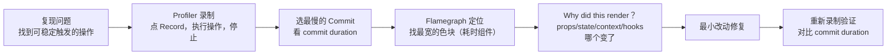

**常见原因与解法**

| 原因 | 现象 | 解法 |
|---|---|---|
| 父组件每次传新引用 | 子组件每次都重渲染 | `React.memo` + `useCallback`/`useMemo` 稳定引用 |
| Context value 每次新对象 | 所有 Consumer 重渲染 | 拆分 Context / `useMemo` 稳定 value |
| 大列表全量渲染 | 渲染 1000+ 节点 | `react-window` / `react-virtual` 虚拟化 |
| 组件自身计算重 | 单个组件耗时长 | `useMemo` 缓存计算、或移到 Web Worker |
| 频繁触发的事件（scroll/drag） | 每帧多次 setState | `useTransition` 降优先级 / `useDeferredValue` |

**memo / useMemo / useCallback 什么时候有害？**

- `memo` 本身有对比成本，props 变化频繁时对比反而更慢
- `useMemo` 的依赖数组是引用比较，复杂对象依赖可能永远命中缓存失效
- `useCallback` 包裹后如果函数仍作为 `useEffect` 依赖，可能引起死循环

**原则：先测量，再优化，不要预优化。**

#### 追问链路

- React DevTools Profiler 里 `baseDuration` 和 `actualDuration` 有什么区别？
- 如果 Profiler 显示某个组件渲染快，但页面还是卡，问题可能出在哪？（浏览器 layout/paint、DOM 规模）
- `useTransition` 能解决大列表首次渲染的卡顿吗？为什么？

---


#### 追问答案

#### Q14-A1 baseDuration 和 actualDuration 的区别

- `actualDuration`：本次 commit 中，这个组件及其子树实际花费的渲染时间（包含被 memo 跳过的节点）
- `baseDuration`：假设整棵子树都重新渲染（无任何缓存优化）所需的估算时间
- 关系：`actualDuration < baseDuration` 说明 memo 等优化生效了；两者接近说明优化没起作用
- 使用建议：优先关注 `actualDuration` 高的 commit；再看 `baseDuration` 判断优化空间
- `baseDuration` 是估算值，在首次渲染时和 `actualDuration` 相同（因为没有缓存可用）

#### Q14-A2 Profiler 显示渲染快但页面还卡，问题在哪？

- React Profiler 只测量 React 的 render + commit 时间，不包含浏览器后续的 layout 和 paint
- 可能的根因：
  - **DOM 节点数量多**：即使每个组件渲染很快，大量 DOM 的 layout/paint 仍然慢
  - **CSS 重排**：某个属性变更触发了昂贵的重排（如 `width`、`height`、`top`）
  - **图片/资源加载**：资源加载阻塞渲染
  - **非 React 的 JS 长任务**：第三方库、数据处理占用主线程
- 排查工具：浏览器 Performance 面板，找 Long Task 和 Layout/Paint 的耗时

#### Q14-A3 useTransition 能解决大列表首次渲染的卡顿吗？

- **不能**解决首次渲染的卡顿
- `startTransition` 只是把更新标记为低优先级，推迟执行——**推迟不等于减少工作量**
- 首次渲染时，1000 个列表项的 Fiber 节点创建、reconcile、DOM 生成这些工作量不变，只是被推迟了
- 用户感受：低优先级任务开始前，页面会保持上一个状态，`isPending` 为 true；任务开始后还是会有一段卡顿
- 真正解决大列表渲染的方案：**虚拟列表**（只渲染可见区域，DOM 节点数量从 1000 降到 20–30）

---

### Q15 Fiber 解决了什么，又解决不了什么？

> 频率：`中频` 来源：美团

#### 口述版（30 秒）

Fiber 解决的是 reconcile 阶段长时间占用主线程的问题——通过时间切片让渲染不阻塞用户输入。但 Fiber 解决不了单个组件渲染本身很慢、大列表 DOM 节点太多、主线程有大量 JS 计算等问题。这些场景分别要靠 `React.memo`/代码优化、虚拟列表、Web Worker 来处理。

#### 学习版（4 分钟展开）

**Fiber 能解决的问题**

| 场景 | Fiber 的作用 |
|---|---|
| 大型应用首次渲染阻塞 | 时间切片，分批处理，不独占主线程 |
| 动画帧率低（同步渲染抢占） | 动画任务优先级高于普通更新 |
| 搜索/过滤输入卡顿 | `useTransition` 降低结果渲染优先级 |
| 数据加载时 UI 无响应 | Suspense + 并发渲染，后台准备内容 |

**Fiber 解决不了的问题**

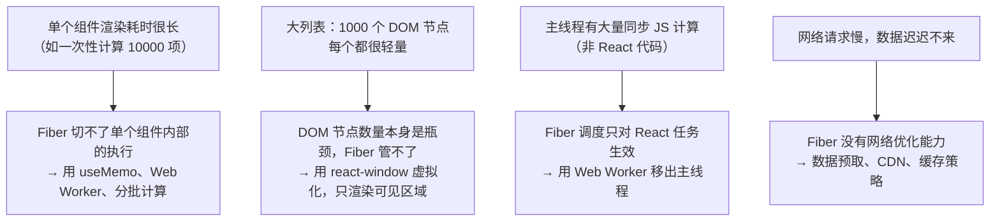

**一句话总结边界**

> Fiber 是 React 内部的调度优化，它让"React 的工作"对主线程更友好；但如果问题根源不是"React 工作量太多"，而是"DOM 太多"、"计算太重"、"网络太慢"，Fiber 帮不上忙，要从各自的层面解决。

#### 追问链路

- `useTransition` 能让大列表首次渲染不卡吗？（不能，`startTransition` 只是推迟，量还在那里）
- 一段耗时 200ms 的 `useMemo` 计算放在 render 里，会触发时间切片吗？（不会，时间切片在 Fiber 节点之间，不在节点内部）
- 什么情况下应该把计算移到 Web Worker？如何和 React 状态同步？

---


#### 追问答案

#### Q15-A1 useTransition 能让大列表首次渲染不卡吗？

- 不能。理由同 Q14-A3：`startTransition` 推迟渲染，但不减少工作量
- 被推迟的大列表渲染开始时，依然会产生长时间的 JS 任务
- 即使有时间切片，切片的是 Fiber 节点间的空隙，单个节点的渲染时间不变
- 若列表项本身渲染复杂（计算重），每个节点 1ms，1000 个节点仍需 1000ms

#### Q15-A2 耗时 200ms 的 useMemo 会触发时间切片吗？

- **不会**。时间切片发生在 Fiber 节点之间（`workLoop` 的循环间隙），不在节点内部
- `useMemo` 在一个 Fiber 节点的 `beginWork` 内部执行，是同步阻塞的
- 这 200ms 期间，`workLoop` 不会检测时间、不会中断，主线程被完全占用
- 解法：把昂贵计算移到 `useEffect` + Web Worker，不在 render 路径上执行
- 或者：用 `useDeferredValue` 推迟触发这个 `useMemo` 的输入，让计算发生在低优先级更新里

#### Q15-A3 什么时候应该用 Web Worker？如何和 React 同步？

- 适用场景：纯计算型任务，不需要访问 DOM，且耗时 > 16ms（如大数据排序、图像处理、加密运算）
- 与 React 同步的方式：
  ```js
  // 主线程
  const worker = new Worker('./worker.js');
  worker.postMessage({ data: bigData });
  worker.onmessage = (e) => {
    setResult(e.data.result); // Worker 完成后 setState
  };
  ```
- Worker 不能访问 DOM 和 React，只做纯计算，把结果 `postMessage` 回主线程
- 结合 `useTransition`：在 Worker 结果回来后用 `startTransition` 触发渲染，避免阻塞用户交互
- 注意：`postMessage` 传递数据有序列化开销，超大数据考虑用 `SharedArrayBuffer` 或 `Transferable`

---

## 层级七：横向对比与源码细节 — 拔高题

### Q16 为什么 Vue 不需要 Fiber 架构？Vue3 的更新机制和 React 有什么本质区别？

> 频率：`高频` 来源：字节 / 阿里

#### 口述版（30 秒）

React 用不可变数据 + 虚拟 DOM diff，每次 setState 从根开始重新渲染整棵树，所以需要 Fiber 把这个重计算切成片。Vue3 用 Proxy 响应式 + 编译时静态分析，精确知道哪个组件依赖哪些数据，数据变化时只触发依赖该数据的组件更新，更新粒度天然就细，不需要时间切片。本质区别：React 是"推整棵树重算"，Vue 是"拉受影响的组件"。

#### 学习版（4 分钟展开）

**两条技术路线的根本差异**

```
React：setState → 不可变数据生成新 vDOM → 从根 reconcile → diff 整棵树 → 提交
Vue：  ref.value = x → Proxy 拦截 → 通知依赖这个 ref 的组件 → 只 patch 这些组件
```

| 维度 | React（Fiber） | Vue3 |
|------|--------------|------|
| 更新触发方式 | 数据不可变，生成新 vDOM | 数据可变，Proxy 拦截赋值 |
| 知道哪些变了吗 | 不知道，要全树 diff 才知道 | 知道，依赖收集时记下了 |
| 更新范围 | 从根组件开始 | 只更新依赖变化的组件 |
| 编译时优化 | 弱（React Compiler 在补） | 强（PatchFlag、静态提升、Block Tree） |
| 需要时间切片吗 | 需要（整树重算太重） | 不需要（更新粒度小，单个组件 patch 很快） |

**Vue3 的三个编译时优化抵消了对调度的需求**

1. **PatchFlag**：编译时标记动态节点，diff 时只比对带 flag 的节点，跳过静态内容
2. **静态提升**：静态节点提到 render 函数外，每次 render 复用同一引用，不参与 diff
3. **Block Tree**：把动态节点拍平成一维数组，diff 复杂度从 O(n) 树遍历降到 O(动态节点数)

```js
// Vue3 编译产物示意
function render() {
  return (_openBlock(), _createBlock('div', null, [
    _createVNode('h1', null, '静态标题'),           // 静态，不参与 diff
    _createVNode('p', null, msg, 1 /* TEXT */),     // 只比对 text
  ]))
}
```

**SolidJS 走得更极端**

SolidJS 连组件函数都只执行一次（不像 React 每次渲染都重新执行函数体），更新直接绑定到细粒度的信号（Signal）上，根本不存在"重渲染整棵树"这个问题，所以也不需要 Fiber。

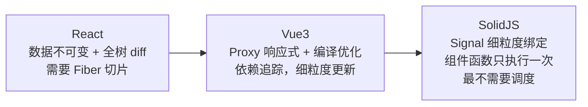

**一句话总结**

> Fiber 是为了解决"全树重算太重"的问题。Vue3 通过依赖收集让更新粒度天然很细，SolidJS 更是细到单个 DOM 绑定——它们的问题根源就不存在，自然不需要 Fiber 这个解法。

#### 追问链路

- Vue3 的响应式在大型应用里有没有性能问题？（依赖收集开销、深层响应式递归）
- React Compiler 能让 React 达到 Vue3 那样的编译优化吗？为什么不能完全替代？
- 如果 Vue 也引入时间切片，能解决什么问题？（大量数据首屏渲染时单帧仍可能卡）

---


#### 追问答案

#### Q16-A1 Vue3 响应式在大型应用里有没有性能问题？

- 有，主要体现在两个方面：
- **依赖收集开销**：每个响应式数据被读取时都要记录依赖关系，大量响应式对象（如复杂嵌套数据）的初始化和追踪有开销
- **深层响应式**：`reactive()` 默认递归代理嵌套对象，大型对象（如后端返回的复杂 JSON）会在首次访问时触发深层 Proxy 创建
- 解法：用 `shallowReactive`/`shallowRef` 只代理顶层，用 `markRaw` 标记不需要响应式的对象
- 对比 React：React 不追踪数据，更新粒度靠开发者用 `memo` 手动控制；Vue 自动追踪但有收集成本

#### Q16-A2 React Compiler 能完全替代 Vue3 的编译优化吗？

- 方向不同，不能完全替代：
- React Compiler 做的是**自动 memoization**：分析依赖关系，自动插入 `useMemo`/`useCallback`，消除不必要的重渲染
- Vue3 编译优化做的是**静态分析**：在编译时标记动态节点（PatchFlag），运行时 diff 只处理标记节点
- React Compiler 不能消除"全树 reconcile"的架构特征，只能减少不必要的组件重渲染
- Vue3 的 PatchFlag 是在 diff 粒度上的优化，React Compiler 是在组件粒度上的优化
- 两者是不同层次的优化，不能互相替代

#### Q16-A3 如果 Vue 也引入时间切片，能解决什么问题？

- 能解决：**大量组件首屏渲染时单帧阻塞**的问题（如一次性渲染 500 个复杂组件）
- 原因：Vue 虽然更新粒度细，但首屏渲染时仍然需要创建所有组件实例、执行所有 setup()，数量多时同样阻塞主线程
- 不能解决：**单个组件渲染慢**（时间切片只在组件间切，不在组件内部）
- 不能解决：**大量 DOM 节点的 layout/paint**（浏览器渲染管线问题）
- 实际上 Vue 核心团队曾探索过时间切片，结论是收益有限且引入复杂性，目前没有计划引入

---

### Q17 `beginWork` 和 `completeWork` 分别做了什么？

> 频率：`中频` 来源：阿里 / 字节

#### 口述版（30 秒）

`beginWork` 是"向下进入"一个 Fiber 节点：对比新旧 props 决定是否需要更新，生成子 Fiber，处理 bailout 优化（props 和 lanes 都没变直接复用整棵子树）。`completeWork` 是"向上离开"一个节点：首次挂载时创建真实 DOM（但不插入文档），更新时收集属性变更，把当前节点的 `flags` 冒泡合并到父节点的 `subtreeFlags` 上。

#### 学习版（4 分钟展开）

**beginWork 的工作**

```js
// 简化示意，非源码原文
function beginWork(current, workInProgress, renderLanes) {
  // 1. bailout 优化：props 没变 && 没有待处理更新 → 直接复用子树，跳过 reconcile
  if (current !== null) {
    const oldProps = current.memoizedProps;
    const newProps = workInProgress.pendingProps;
    if (oldProps === newProps && !hasScheduledUpdateOnFiber(current, renderLanes)) {
      return bailoutOnAlreadyFinishedWork(current, workInProgress, renderLanes);
    }
  }

  // 2. 重新执行组件函数（函数组件）或 render（类组件），得到 children
  const nextChildren = reconcileChildren(current, workInProgress, renderLanes);
  return workInProgress.child; // 返回子节点，workLoop 会继续向下
}
```

**completeWork 的工作**

```js
// 简化示意
function completeWork(current, workInProgress, renderLanes) {
  const newProps = workInProgress.pendingProps;

  switch (workInProgress.tag) {
    case HostComponent: // div / span 等
      if (current === null) {
        // mount：创建真实 DOM，挂载子节点，但不插入文档
        const instance = createInstance(workInProgress.type, newProps);
        appendAllChildren(instance, workInProgress);
        workInProgress.stateNode = instance;
      } else {
        // update：对比新旧 props，收集变化的属性
        if (current.memoizedProps !== newProps) {
          markUpdate(workInProgress); // 打上 Update flag
        }
      }
      break;
  }

  // 把子树的 flags 冒泡到当前节点
  bubbleProperties(workInProgress);
  return workInProgress.sibling; // 返回兄弟节点
}
```

**两个函数的协作时序**

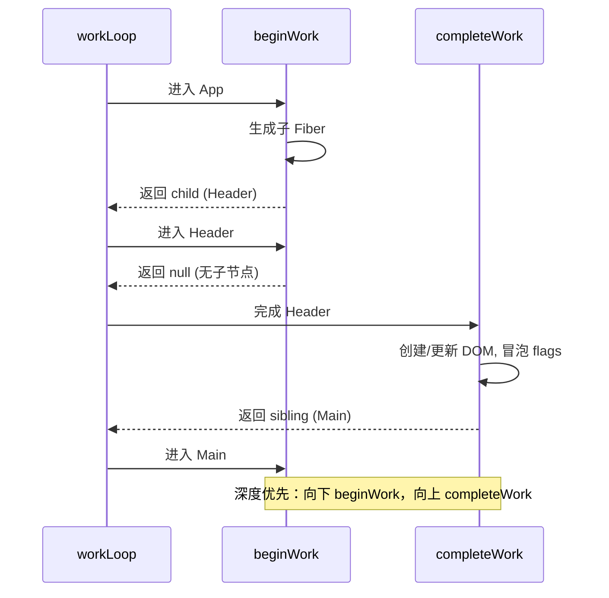

**bailout 优化是性能关键**

大部分节点在更新时 props 并没有变，`bailoutOnAlreadyFinishedWork` 直接复用整棵子树的 Fiber 节点，跳过整棵子树的 reconcile——这是 React 更新性能的主要来源。如果 props 引用每次都变（比如父组件每次传新对象），bailout 失效，整棵子树都要重新 reconcile，这就是为什么 `React.memo` 和稳定的 props 引用很重要。

#### 追问链路

- `bailout` 优化的触发条件有哪些？为什么 `props === newProps` 能判断？
- `completeWork` 在 mount 时创建 DOM 但不插入文档，什么时候才真正插入？
- `subtreeFlags` 冒泡到根节点后，commit 阶段怎么用？

---


#### 追问答案

#### Q17-A1 bailout 的触发条件？为什么 props === newProps 能判断？

- 触发条件（全部满足才能 bailout）：
  1. `current !== null`（不是首次挂载）
  2. `oldProps === newProps`（props 引用相同）
  3. `context` 没有变化
  4. `fiber.lanes === NoLanes`（这个 Fiber 上没有待处理的更新）
- 为什么引用相等就能判断：React 约定 props 是不可变的——每次渲染父组件都应创建新 props 对象（`<Child x={1} />` 每次都生成新对象），引用不变说明父组件没有重渲染，子组件可以安全跳过
- `React.memo` 的作用就是在 bailout 之前做一次浅比较，即使父组件重渲染了，只要值没变也能触发 bailout

#### Q17-A2 completeWork 创建的 DOM 什么时候插入文档？

- `completeWork` 的 mount 阶段：调用 `createInstance` 创建 DOM 节点，调用 `appendAllChildren` 把子节点挂到这个节点上——此时形成的是"离屏 DOM 树"
- 真正插入文档：在 commit 阶段的 **mutation 子阶段**，处理 `Placement` flag 时，调用 `insertOrAppendPlacementNode` 将离屏 DOM 树插入真实文档
- 好处：先在内存中拼好整棵 DOM 树，再一次性插入文档，只触发一次浏览器重排，而不是每插入一个节点触发一次
- 类比：DocumentFragment 的批量插入思路

#### Q17-A3 subtreeFlags 冒泡到根节点后 commit 阶段怎么用？

- commit 阶段从根节点开始，先检查 `root.subtreeFlags`
- 若 `subtreeFlags === NoFlags`：整棵树无副作用，整个 commit 阶段几乎是空操作（极罕见但可能）
- 遍历时：进入一个节点前先检查其 `subtreeFlags`，若为 `NoFlags` 则整棵子树跳过
- 这意味着 commit 阶段只需遍历有副作用的分支，而不是整棵树
- 每个节点的 `flags` 处理自身副作用，`subtreeFlags` 决定是否需要进入子树——两者配合实现精准 commit

---

### Q18 render 阶段为什么必须是纯函数？重复执行会带来什么问题？

> 频率：`中频` 来源：字节 / 美团

#### 口述版（30 秒）

Fiber 的时间切片让 render 阶段可能被中断、重新执行，所以函数组件体可能被调用多次。如果在 render 里做副作用（改全局变量、发请求、操作 DOM），重复执行会让副作用执行多次，造成数据不一致或重复请求。React 把副作用集中到 commit 阶段执行，保证只执行一次。

#### 学习版（3 分钟展开）

**时间切片导致重复执行**

```js
// 时间切片下，render 可能被打断
function workLoop() {
  while (workInProgress !== null && hasTime()) {
    workInProgress = performUnitOfWork(workInProgress);
  }
  if (workInProgress !== null) {
    // 时间片用完，下一帧继续——但前面处理过的节点会被重新 reconcile
    scheduleContinue();
  }
}
```

被打断后，React 会从根节点重新开始 reconcile（不是从断点继续，因为可能有高优先级任务插入改变了状态）。这意味着已经执行过的函数组件体**可能再执行一次**。

**副作用重复执行的危害**

```tsx
// ❌ 错误：render 阶段改全局变量
let count = 0;
function Counter() {
  count++; // 被打断重渲染时 count 会多加一次
  return <p>{count}</p>;
}

// ❌ 错误：render 阶段发请求
function Profile({ id }) {
  fetch(`/api/user/${id}`); // 重渲染时发多次请求
  return <div>loading</div>;
}

// ❌ 错误：render 阶段操作 DOM
function Tooltip({ text }) {
  document.title = text; // 重渲染时多次改 title
  return <span>{text}</span>;
}
```

**正确做法：副作用移到 Effect**

```tsx
function Profile({ id }) {
  const [user, setUser] = useState(null);
  useEffect(() => {
    fetch(`/api/user/${id}`).then(setUser); // commit 后只执行一次
  }, [id]);
  return <div>{user?.name}</div>;
}
```

**StrictMode 的作用**

React 18 在开发模式下会故意把组件 render 执行两次，帮你发现 render 里的副作用：

```tsx
<StrictMode>
  <App />  // App 和所有子组件 render 都会执行两次（开发环境）
</StrictMode>
```

如果 render 是纯函数，执行两次结果一样，没有副作用；如果 render 里有副作用，两次执行就会暴露问题。**生产环境不会重复执行**，这纯粹是开发期的检测工具。

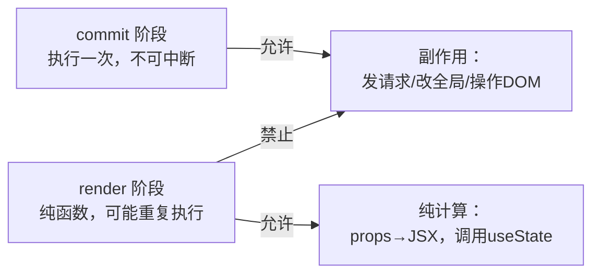

#### 追问链路

- `useState` 的 updater 函数（`setCount(c => c+1)`）为什么也要是纯函数？
- `useMemo` 和 `useCallback` 的工厂函数是 render 阶段执行的，需要纯吗？
- 生产环境 render 会被重复执行吗？什么场景下会？

---


#### 追问答案

#### Q18-A1 useState 的 updater 函数为什么也要是纯函数？

- updater 函数（`setCount(c => c + 1)` 中的 `c => c + 1`）在 `processUpdateQueue` 里被调用
- React 在处理更新时可能多次调用 updater（如优先级中断后重新处理，或 StrictMode 的额外调用）
- 非纯 updater 多次执行会导致：计数器多加、日志多打、副作用多触发
- 纯函数要求：相同输入产生相同输出，不依赖或修改外部状态
- 正确：`setCount(c => c + 1)`；错误：`setCount(c => { externalCount++; return c + 1; })`

#### Q18-A2 useMemo / useCallback 的工厂函数需要纯吗？

- **需要**，理由和组件 render 一样：
- `useMemo` 的工厂函数在 render 阶段执行，可能被重复调用（StrictMode、并发模式被中断）
- 若工厂函数有副作用（如发请求、修改外部变量），重复执行会导致副作用多次触发
- React Compiler 会假设 `useMemo`/`useCallback` 的工厂函数是纯函数来做优化分析
- 实际中最常见的错误：在 `useMemo` 工厂函数里写 `console.log`（StrictMode 会看到两次输出）

#### Q18-A3 生产环境 render 会被重复执行吗？

- 通常**不会**被主动重复执行（StrictMode 的双调用只在开发环境）
- 但在并发模式下，以下场景 render 可能实际执行多次：
  1. **高优先级打断低优先级**：低优先级的 render 被中断，之前执行过的函数组件体在新的 render 周期里再次执行
  2. **Suspense 重试**：Promise resolve 后，Suspense 内的组件重新 render
  3. **React 内部的 re-render 优化判断**：某些边界情况下 React 可能多执行一次来验证结果
- 生产环境不会**故意**重复执行，但并发特性使得重复执行成为可能，这是为什么纯函数约束在生产环境也很重要

---

### Q19 React 16 → 17 → 18 在 Fiber 架构上有哪些演进？

> 频率：`拔高` 来源：字节

#### 口述版（30 秒）

React 16 引入 Fiber 架构和时间切片，但 Concurrent Mode 是 opt-in；React 17 几乎没有新特性，重点是把事件委托从 document 移到 root，为多版本共存铺路，是个"过渡版本"；React 18 把 Concurrent Mode 变成默认行为（createRoot），引入 Lane 模型、自动批处理、Suspense 数据获取，并发特性正式可用。

#### 学习版（4 分钟展开）

**三个版本的核心变化**

| 版本 | Fiber 架构变化 | 关键特性 | Concurrent Mode |
|------|--------------|---------|----------------|
| 16 | 引入 Fiber + 时间切片 | hooks、Error Boundary、Portal | 实验性（unstable_） |
| 17 | 无大变化 | 事件委托改到 root、新版 JSX transform | 仍实验性 |
| 18 | Lane 模型、自动批处理、Suspense 数据 | useTransition、useDeferredValue、useSyncExternalStore | 默认开启（createRoot） |

**React 17 的"过渡"定位**

React 17 常被调侃"没有新特性"，但它的两个改动很重要：

1. **事件委托移到 root**：之前所有事件挂在 `document` 上，导致多版本 React 同存时事件系统冲突；17 改成挂在 `root` 容器上，为多版本共存和渐进升级铺路
2. **新版 JSX transform**：不再需要 `import React from 'react'`，编译器自动注入

**React 18 的三个关键变化**

1. **createRoot 开启并发**：`ReactDOM.createRoot` 替代 `ReactDOM.render`，开启 Concurrent Mode
   ```tsx
   // React 17
   ReactDOM.render(<App />, root);

   // React 18
   const root = ReactDOM.createRoot(root);
   root.render(<App />);
   ```

2. **Lane 模型替代 ExpirationTime**：用位掩码表示优先级，支持更灵活的批处理和中断恢复

3. **自动批处理**：所有场景的多个 setState 都自动合并，不再只限合成事件

**Suspense 的演进**

- React 16：Suspense 配合 React.lazy 做代码分割（只支持 lazy）
- React 18：Suspense 支持任意异步（fetch、relay 等），配合 `use()` 和 Concurrent Mode 实现数据获取

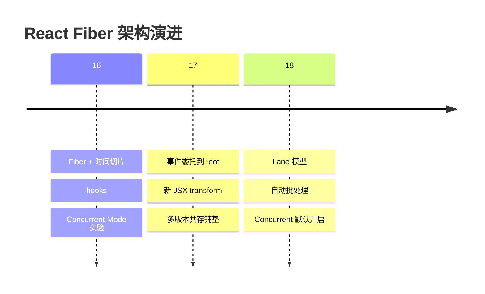

#### 追问链路

- React 17 的事件委托改动，为什么对渐进升级很重要？
- React 18 的 `createRoot` 和 `render` 混用会怎样？
- React 19 在 Fiber 架构上有什么新东西？（React Compiler、Actions、use Hook 稳定）

---


#### 追问答案

#### Q19-A1 React 17 事件委托改到 root 为什么对渐进升级重要？

- React 16 之前：所有事件委托挂在 `document` 上，多个 React 版本共存时，事件会互相干扰
  - 问题场景：React 16 子应用里触发的事件，冒泡到 `document` 后被 React 17 父应用的事件系统拦截处理
  - 结果：事件被处理两次，或阻止冒泡不生效
- React 17：事件委托挂在 `root` 容器上，不同版本 React 的事件互不干扰
- 允许的场景：页面同时存在 React 16 和 React 18 的子应用（如微前端），各自独立运行
- 这为"渐进式升级"提供了基础：可以先升级部分子应用，而不需要整个应用一次性升级

#### Q19-A2 createRoot 和 render 混用会怎样？

- 同一个 DOM 容器不能同时使用两种方式，会报警告或错误
- 如果同一个容器先用 `render` 再用 `createRoot`：React 会警告并清空原有内容重新挂载
- 不同容器可以分别使用：一个容器用 Legacy 模式，另一个用 Concurrent 模式，互不影响
- 混用的实际意义：微前端场景下不同子应用可以各自选择模式
- 建议：单个应用内统一使用 `createRoot`，不要混用

#### Q19-A3 React 19 在 Fiber 架构上有什么新东西？

- **React Compiler（正式发布）**：编译时自动分析依赖、插入 memoization，消除大量手动 `useMemo`/`useCallback`
- **Actions**：内置的异步状态管理原语，`useActionState` / `useFormStatus`，简化表单和异步操作
- **`use()` Hook 稳定**：在 render 阶段直接 `use(promise)`，配合 Suspense，替代大量 `useEffect` + loading state 模式
- **Server Components 稳定**：组件在服务端执行，不产生 Fiber 节点，直接输出 RSC Payload
- **ref 作为 prop**：函数组件可直接接收 `ref` prop，无需 `forwardRef`

---

### Q20 动画场景下，Fiber 如何保证 60fps？`useTransition` 能帮上忙吗？

> 频率：`中频` 来源：美团

#### 口述版（30 秒）

Fiber 保证 60fps 的核心是时间切片——每个时间片只占 5ms，剩下时间给浏览器处理动画帧和输入。但如果动画卡顿是 CSS 重排重绘、大量 DOM 节点、或主线程被非 React 代码占用导致的，Fiber 帮不上忙。`useTransition` 适合"输入 + 重计算结果"的场景，不适合动画本身——动画帧率应该用 CSS 动画或 `requestAnimationFrame`，不依赖 React 调度。

#### 学习版（4 分钟展开）

**Fiber 能保证的 60fps 场景**

当卡顿来自 React 大量重渲染时，Fiber 的时间切片让渲染不独占主线程，浏览器每帧还有时间绘制：

```
无 Fiber：[JS reconcile 50ms][绘制][JS reconcile 50ms][绘制]...  ← 掉帧
有 Fiber：[JS 5ms][绘制][JS 5ms][绘制][JS 5ms][绘制]...           ← 60fps
```

**Fiber 保证不了的 60fps 场景**

| 卡顿原因 | Fiber 能解决吗 | 解法 |
|---------|--------------|------|
| React 重渲染太重 | ✅ 时间切片 | useTransition 降低优先级 |
| CSS 复杂动画触发重排重绘 | ❌ | 用 `transform`/`opacity`（只合成不重排） |
| DOM 节点太多（10000+） | ❌ | 虚拟列表减少节点数 |
| 主线程长任务（非 React 代码） | ❌ | Web Worker 移出主线程 |
| 动画用 JS 驱动（每帧 setState） | ⚠️ 部分 | 改用 CSS/rAF，避免每帧触发 React 更新 |

**动画应该用 CSS 而不是 React 驱动**

```tsx
// ❌ 每帧 setState 驱动动画，依赖 React 调度，帧率不稳
function Animation() {
  const [x, setX] = useState(0);
  useEffect(() => {
    let frame;
    const loop = () => {
      setX(x => x + 1); // 每帧触发一次 React 更新
      frame = requestAnimationFrame(loop);
    };
    frame = requestAnimationFrame(loop);
    return () => cancelAnimationFrame(frame);
  }, []);
  return <div style={{ transform: `translateX(${x}px)` }} />;
}

// ✅ CSS 动画，完全脱离 React 调度，走浏览器合成线程
function Animation() {
  return <div className="slide" />; // .slide { animation: slide 2s linear }
}
```

**useTransition 的适用边界**

`useTransition` 适合"用户输入触发重型结果计算"的场景：

```tsx
// 搜索框：输入流畅（SyncLane），结果渲染低优先级（TransitionLane）
function Search() {
  const [input, setInput] = useState('');
  const [query, setQuery] = useState('');
  const [isPending, startTransition] = useTransition();

  const onChange = (e) => {
    setInput(e.target.value); // 紧急，立即响应
    startTransition(() => setQuery(e.target.value)); // 不紧急，可被打断
  };
  return <input value={input} onChange={onChange} />;<ResultList query={query} loading={isPending} />
}
```

但 `useTransition` **不适合**：
- 动画本身（动画不该走 React 更新）
- 必须立即反馈的场景（如拖拽位置）
- 结果计算很轻的场景（没有打断价值）

#### 追问链路

- `requestAnimationFrame` 驱动的动画，为什么比 React `setState` 驱动更流畅？
- `useDeferredValue` 在动画场景下有用吗？（适用于"值滞后"导致的重渲染）
- 如果动画和 React 重渲染同时卡，怎么区分瓶颈在哪？（Performance 面板看 Long Task 来源）

---


#### 追问答案

#### Q20-A1 rAF 驱动的动画为什么比 setState 驱动更流畅？

- `requestAnimationFrame` 在浏览器绘制管线里直接注册，在每帧绘制前执行，时机精准
- 浏览器可以针对 `rAF` 做优化：页面不可见时暂停、节能模式时降频
- 动画计算（如位置更新）在 `rAF` 里直接写 DOM 样式，没有 React 的 reconcile 和 commit 开销
- `setState` 驱动：`setState` → 批处理 → Scheduler 调度 → render → commit → 写 DOM，链路长，时机不可控
- 更好的选择：CSS 动画（GPU 合成层，完全脱离主线程）或 `rAF`（主线程但时机精准）

#### Q20-A2 useDeferredValue 在动画场景下有用吗？

- 有用，但不是直接优化动画，而是**减少动画过程中的 React 重渲染开销**
- 场景：动画进行时，某个响应动画的组件触发了重型渲染（如实时数据图表）
- `useDeferredValue` 让图表的输入值落后于动画，动画帧率不受图表重渲染影响
- 不适合：直接控制动画本身的位置/透明度，这些应该用 CSS 或 `rAF`
- 实际用法：`const deferredValue = useDeferredValue(animatingValue)` 配合 `memo` 让复杂组件延迟响应

#### Q20-A3 动画和 React 重渲染同时卡，怎么区分瓶颈？

- 打开浏览器 **Performance 面板**，录制卡顿时段
- 看 **Main 线程火焰图**：
  - 若出现"React reconcile / commit"长任务 → React 渲染是瓶颈，用 `useTransition` 或 `memo` 优化
  - 若出现"Layout" / "Paint" 长任务 → 浏览器渲染管线是瓶颈，检查 CSS 重排（避免改 `width`/`height`，改用 `transform`）
  - 若出现非 React 的 JS 长任务 → 第三方代码或业务逻辑占用主线程
- 看 **Frames 行**：掉帧时对应的主线程任务是什么
- 快速判断法：注释掉 `startTransition` 或所有 React 更新，若动画恢复流畅 → React 是瓶颈；若仍卡 → 浏览器渲染管线是瓶颈

---

### Q21 调用 setState / useState setter 之后，React 内部经历了什么？

> 频率：`高频` 来源：字节 / 阿里 / 腾讯

#### 口述版（30 秒）

调用 setter 后，React 先创建一个 Update 对象放进当前 Fiber 的 `updateQueue`，同时计算本次更新的优先级（Lane），然后从当前 Fiber 一路向上找到 `FiberRoot`，调度一次从根节点开始的渲染任务。Scheduler 在合适时机（同步或下一个宏任务）开始 render 阶段：重新执行组件函数，从 `updateQueue` 消费 Update 得到新 state，reconcile 生成新 Fiber 树，最后 commit 阶段把变更写入真实 DOM。

#### 学习版（5 分钟展开）

**完整调用链路**

```
useState setter / class setState
  ↓
① dispatchSetState / enqueueSetState
    - 计算 Lane（根据当前上下文决定优先级）
    - 创建 Update 对象 { lane, action, next }
    - 把 Update 入队到 fiber.updateQueue（环形链表）
    - eager state 优化：如果当前 Fiber 没有其他待处理更新，
      提前计算新值，若和旧值相同则 bailout，不触发后续调度
  ↓
② scheduleUpdateOnFiber
    - 从触发更新的 Fiber 向上遍历，给沿途所有祖先节点打上 childLanes 标记
    - 一路找到 FiberRoot
    - 标记 root.pendingLanes |= lane（告诉根节点有活要干了）
  ↓
③ ensureRootIsScheduled
    - 检查 root.pendingLanes，找出最高优先级的 Lane
    - 如果是 SyncLane → 同步调度（microtask 或直接执行）
    - 否则 → 调用 Scheduler.scheduleCallback，按优先级排入任务队列
  ↓
④ Scheduler 在合适时机执行 performConcurrentWorkOnRoot / performSyncWorkOnRoot
  ↓
⑤ render 阶段
    - beginWork：重新执行函数组件体，processUpdateQueue 消费 updateQueue，
      得到新 state，生成新子 Fiber
    - completeWork：创建/更新 DOM 描述，冒泡 flags
  ↓
⑥ commit 阶段
    - before mutation → mutation（写 DOM）→ layout
    - useEffect 异步调度执行
  ↓
⑦ 屏幕显示新内容
```

**Update 对象长什么样**

```js
// 简化示意，非源码原文
const update = {
  lane: SyncLane,          // 本次更新的优先级
  action: newState,        // 新值（或 updater 函数）
  hasEagerState: false,    // 是否已提前计算出新 state
  eagerState: null,        // 提前计算的结果（eager 优化用）
  next: null,              // 指向下一个 Update（环形链表）
};

// 挂在 Fiber 上的更新队列
fiber.updateQueue = {
  baseState: currentState,   // 上次 render 后的基础 state
  firstBaseUpdate: null,     // 低优先级跳过的 Update 起点
  lastBaseUpdate: null,
  shared: {
    pending: update,         // 本次新产生的 Update（环形链表）
  },
};
```

**为什么 setState 看起来是"异步的"？**

不是真正的异步，是**批处理**让你看不到立即更新的 state：

```tsx
function handleClick() {
  setCount(1);
  console.log(count); // 仍然是旧值 0 ！// 原因：setter 只是把 Update 入队，render 阶段还没执行
  // count 变量是本次 render 闭包里的快照，不会因 setter 改变
}
```

真正发生的时序：

```
handleClick 执行
  → setCount(1) 入队 Update
  → console.log(count) 读的是闭包快照（0）
  → handleClick 执行完毕
  → 批处理 flush：render 阶段执行
  → 函数组件体重新执行，count 变成 1
  → commit，DOM 更新
```

**eager state 优化**

```js
// 如果 setter 传入的值和当前 state 相同，React 会跳过渲染
const [count, setCount] = useState(0);
setCount(0); // 触发 eager 优化：新值 === 旧值，不调度渲染
```

React 在 `dispatchSetState` 里，当 Fiber 没有其他待处理更新时，会提前用 `reducer` 计算新值。如果结果 `Object.is(eagerState, currentState)` 为 true，直接 return，不进入调度流程。

**childLanes 的作用**

`scheduleUpdateOnFiber` 从触发更新的 Fiber 一路向上给祖先打 `childLanes`，这样 render 阶段的 `beginWork` 可以快速判断：

```js
// beginWork 中的 bailout 判断
if (
  current.lanes === NoLanes &&       // 这个 Fiber 本身没有待处理更新
  current.childLanes === NoLanes     // 子树也没有更新
) {
  return bailout(); // 整棵子树跳过，不 reconcile
}
```

没有打 `childLanes` 的子树可以完全跳过，这是 Fiber 更新性能的核心路径。

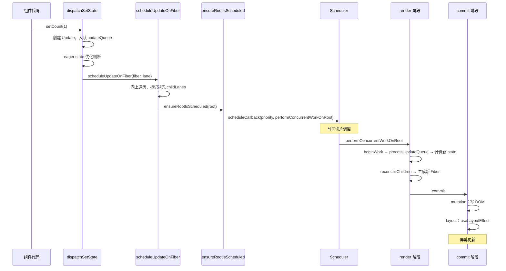

**函数组件 setter vs 类组件 setState 的区别**

| 维度 | 函数组件 useState setter | 类组件 setState |
|------|------------------------|----------------|
| 内部函数 | `dispatchSetState` | `enqueueSetState` |
| 状态存储 | Fiber 的 `memoizedState`（Hook 链表） | Fiber 的 `memoizedState`（state 对象） |
| 合并行为 | 不合并（每次 setter 是独立更新） | 浅合并（`setState({a: 1})` 只更新 a） |
| 是否有回调 | 无（用 useEffect 替代） | 有（`setState(s, callback)`） |
| eager 优化 | 有（值相同直接跳过） | 无 |

#### 追问链路

- `processUpdateQueue` 是怎么消费 `updateQueue` 里的 Update 的？低优先级 Update 被跳过后怎么处理？
- 为什么函数组件的 `useState` 不合并 state，而类组件的 `setState` 会浅合并？
- render 阶段之前，从触发更新的 Fiber 到 FiberRoot 的遍历，是怎么找到根节点的？（`return` 指针链）
- 多个组件同时 setState，React 怎么保证只渲染一次？（ensureRootIsScheduled 的 Lane 合并）

---


#### 追问答案

#### Q21-A1 processUpdateQueue 如何消费 Update？低优先级被跳过后怎么处理？

- `processUpdateQueue` 遍历 `updateQueue.shared.pending`（环形链表），逐个处理 Update
- 判断 `update.lane` 是否在当前 `renderLanes` 内：在则处理（执行 action 得到新 state），不在则跳过
- 被跳过的 Update：保留在 `baseQueue` 里，同时把跳过点之前的 state 记录为 `baseState`
- 下次渲染时，从 `baseState` 开始，重新处理整个 `baseQueue`（包括之前跳过的 Update），保证状态正确性
- 关键保证：跳过的 Update 不会丢失，最终一定会被处理——这就是"优先级中断不丢更新"的底层机制

#### Q21-A2 useState 不合并 state，setState 会浅合并，为什么？

- 类组件 `setState` 浅合并是历史设计：`setState({ a: 1 })` 只更新 `a`，其他字段保留，符合"局部更新"习惯
- 函数组件 `useState` 每个状态是独立的（一个 `useState` 管一个值），不存在"合并"的概念
- 设计哲学不同：`useState` 鼓励把状态拆细，每个 `useState` 独立管理；类组件 `state` 是一个大对象，合并更新更方便
- 若需要对象形式的 state，函数组件应用 `useReducer`（显式 action）或手动展开：`setState(s => ({...s, a: 1}))`

#### Q21-A3 从 Fiber 到 FiberRoot 怎么找到根节点？

- 每个 Fiber 节点有 `return` 指针指向父节点
- `scheduleUpdateOnFiber` 从触发更新的 Fiber 开始，沿 `return` 指针链一路向上遍历
- 当 `node.tag === HostRoot` 时，找到了 `HostRootFiber`（Fiber 树的根节点）
- `HostRootFiber.stateNode` 就是 `FiberRoot`（应用根容器），从这里可以访问 `pendingLanes` 等全局状态
- 同时，遍历过程中给每个祖先节点标记 `childLanes |= lane`，告诉它们"子树有更新"

#### Q21-A4 多个组件同时 setState，如何保证只渲染一次？

- 每个 setState 调用 `scheduleUpdateOnFiber`，最终都会调用 `ensureRootIsScheduled`
- `ensureRootIsScheduled` 检查：当前是否已经有相同或更高优先级的 Scheduler 任务在队列里
- 如果已有同等优先级任务：不重复注册，复用已有任务
- 所有 setState 执行完后（同一宏任务内），Scheduler 任务队列里只有一个渲染任务
- 该任务执行 `performConcurrentWorkOnRoot`，一次性处理所有 Fiber 上的 `updateQueue`，一次 render + 一次 commit

## 面试速查表

| 题号 | 核心一句话 | 频率 | 大厂来源 |
|---|---|---|---|
| Q1 | Stack Reconciler 同步递归阻塞主线程；Fiber 改成可中断链表循环 | 高频 | 字节/腾讯/美团 |
| Q2 | Stack = JS 调用栈（不可中断）；Fiber = 显式链表循环（可中断） | 中频 | 腾讯 |
| Q3 | Fiber 节点 = ReactElement + 状态 + 副作用 + 指针 + 优先级 | 高频 | 字节 |
| Q4 | child/sibling/return 三指针实现深度优先遍历，workInProgress 记录断点 | 中频 | 字节 |
| Q5 | render 阶段（可中断）找副作用；commit 阶段（不可中断）写 DOM | 高频 | 阿里/字节 |
| Q6 | 双缓冲：current 显示中，workInProgress 构建中，commit 末尾切换指针 | 高频 | 字节/腾讯 |
| Q7 | key + type 决定复用；两轮遍历；正序简单情况 + Map 处理乱序 | 中频 | 阿里 |
| Q8 | MessageChannel 触发宏任务，每片 5ms，时间到让出主线程 | 高频 | 字节 |
| Q9 | Lane 位掩码打优先级；高优打断低优；过期时间防饥饿 | 高频 | 字节/腾讯 |
| Q10 | Scheduler 小顶堆管理任务队列；workLoop 驱动 Fiber 循环 | 拔高 | 字节少数 |
| Q11 | startTransition 降低更新优先级；useDeferredValue 推迟值 | 中频 | 快手/字节 |
| Q12 | throw Promise → React 捕获 → 找 Suspense 边界 → 显示 fallback → resolve 后重渲染 | 中频 | 快手 |
| Q13 | React 18 createRoot 后所有场景自动批处理；flushSync 强制同步 | 中频 | 补充 |
| Q14 | Profiler 录制 → 找慢 commit → Flamegraph → Why did this render → 最小改动验证 | 高频 | 美团 |
| Q15 | Fiber 解决 reconcile 阻塞；解决不了 DOM 量大/计算重/网络慢 | 中频 | 美团 |
| Q16 | Vue3 依赖收集让更新粒度细，不需要 Fiber 切片；SolidJS 更极端 | 高频 | 字节/阿里 |
| Q17 | beginWork 向下生成子 Fiber + bailout；completeWork 向上创建 DOM + 冒泡 flags | 中频 | 阿里/字节 |
| Q18 | 时间切片导致 render 可能重复执行，副作用必须移到 commit 阶段 | 中频 | 字节/美团 |
| Q19 | 16 引入 Fiber；17 过渡（事件委托到 root）；18 默认并发 + Lane + 自动批处理 | 拔高 | 字节 |
| Q20 | Fiber 靠时间切片让出主线程保 60fps；但管不了 CSS 重排/大 DOM；动画用 CSS 不用 React | 中频 | 美团 |
| Q21 | setter → 创建 Update 入队 → scheduleUpdateOnFiber → ensureRootIsScheduled → render → commit | 高频 | 字节/阿里/腾讯 |

---
