# React Fiber、并发与现代 React：从工作单元到 React 19.x

> 适用版本：以 React 19.x 稳定能力为主，React 18 作为并发基础设施演进背景。源码字段只用于建立心智模型，不要求死记具体实现。
> 难度标签：`进阶重点` `高级深挖` `历史兼容`

## 目录

- [1. Fiber 为什么出现](#1-fiber-为什么出现)
- [2. Fiber 节点与树结构](#2-fiber-节点与树结构)
- [3. 双缓冲与工作循环](#3-双缓冲与工作循环)
- [4. lanes、Root 与 Scheduler](#4-lanesroot-与-scheduler)
- [5. 可中断 Render 与不可中断 Commit](#5-可中断-render-与不可中断-commit)
- [6. 并发渲染是什么](#6-并发渲染是什么)
- [7. Transition 与 Deferred Value](#7-transition-与-deferred-value)
- [8. Suspense 的工作边界](#8-suspense-的工作边界)
- [9. React 18 的关键变化](#9-react-18-的关键变化)
- [10. React 19.x 的关键变化](#10-react-19x-的关键变化)
- [11. Server Components 与框架边界](#11-server-components-与框架边界)
- [12. 生命周期、Strict Mode 与并发安全](#12-生命周期strict-mode-与并发安全)
- [13. 面试速查](#13-面试速查)

---

## 1. Fiber 为什么出现

### 面试问题

React Fiber 是什么？它为什么要重写旧协调器？

### 30 秒回答

Fiber 既指 React 16 引入的协调架构，也指树中的工作节点。旧协调过程主要依赖 JavaScript 递归调用栈，一旦开始遍历较大的组件树，就很难在中间保存进度、让高优先级交互插队或放弃过期结果。Fiber 把 Render 拆成一个个显式工作单元，并在节点上保存树关系、状态、更新队列、优先级和变更标记，使 React 可以调度、暂停、继续或重做 Render，最后再通过不可中断的 Commit 一次性修改 DOM。

### 3 分钟展开

Fiber 出现的根因不是“虚拟 DOM 太慢”，而是**旧协调器的工作控制权在 JavaScript 调用栈里**。

旧式递归协调可以概念化为：父组件调用子组件，子组件继续调用更深层组件，直到整棵相关子树返回。若一次更新需要计算大量节点，主线程会长时间执行 JavaScript；浏览器在这段时间内难以及时处理输入、动画和绘制。更关键的是，递归栈只知道“当前函数调用到哪”，React 很难在任意组件边界保存完整进度，并让另一个更紧急更新先完成。

Fiber 做了 4 件关键事情：

1. **显式化工作进度**：把每个组件对应的工作保存为 Fiber 节点，不再只依赖调用栈；
2. **拆分 Render**：一次处理一个 unit of work，处理后可以检查是否应让出主线程；
3. **携带优先级**：更新通过 lane 表达优先级和批次，Root 可以选择下一批工作；
4. **隔离计算与提交**：先在 work-in-progress 树上计算，完成后才 Commit，避免把半完成 UI 暴露给用户。

因此 Fiber 是“可调度协调”的基础设施。它本身不等于时间切片、并发、Suspense 或 Transition，但这些能力都依赖 Fiber 提供的工作单元、优先级和双缓冲模型。

### 旧协调方式与 Fiber 的差异

| 维度 | 旧式递归协调的限制 | Fiber 的处理方式 |
|---|---|---|
| 遍历进度 | 主要隐含在 JavaScript 调用栈 | 保存在 `child`、`sibling`、`return` 等指针中 |
| 中途让出 | 长递归开始后不容易切开 | 每个 unit 完成后可检查是否让出 |
| 更新优先级 | 难以让紧急更新插队 | lane 让 Root 选择更合适的工作 |
| 过期结果 | 难以表达“这份计算已经过期” | work-in-progress 可被放弃或基于最新状态重做 |
| DOM 一致性 | 若计算与修改交织，难保证原子性 | Render 只计算，Commit 才修改宿主环境 |

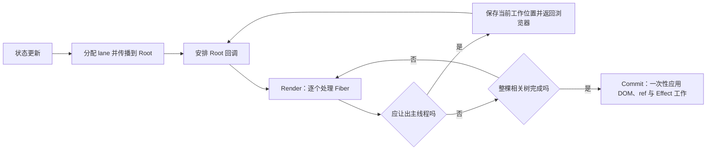

这张图要看两条边界：Render 可以多次进入并让出，Commit 则只接收已经完成的树。高优先级更新到来时，低优先级工作可能继续，也可能因输入和 lanes 变化而重做，不能把“可恢复”理解成永远从原指令位置无条件续跑。

### 一个能说明动机的工程场景

```tsx
function ProductSearch({ products }: { products: Product[] }) {
  const [text, setText] = useState('');
  const [query, setQuery] = useState('');
  const [, startTransition] = useTransition();

  function handleChange(nextText: string) {
    setText(nextText); // 输入回显是紧急更新，应立即响应

    startTransition(() => {
      // 大列表筛选可以让位；Fiber 提供可中断 Render 的基础
      setQuery(nextText);
    });
  }

  const visibleProducts = filterProducts(products, query);

  return (
    <>
      <input value={text} onChange={(event) => handleChange(event.target.value)} />
      <ProductList products={visibleProducts} />
    </>
  );
}
```

这个例子中，Fiber 不会自动让 `filterProducts` 变快，也不会减少列表总计算量。它提供的是：当列表 Render 被标记为 Transition 后，新的输入更新可以优先完成，过期的列表计算可以被中断并重做。若 `filterProducts` 本身耗时极长且无法拆分，仍需 memoization、虚拟列表、Web Worker 或数据结构优化。

### Fiber 不是什么

- 不是浏览器线程，也不会让 JavaScript 自动并行执行；常见客户端 Render 仍运行在主线程。
- 不是“把 DOM 数组改成链表”这么简单；Fiber 是携带状态、队列、优先级和提交标记的工作节点。
- 不是虚拟 DOM 的同义词；Element 是本次 UI 描述，Fiber 是跨 Render 保留的工作与状态载体。
- 不等于 `requestIdleCallback`。React 使用自己的 Scheduler 抽象协调工作时机，不应把 Fiber 原理回答成“浏览器空闲时调用 `requestIdleCallback`”。
- 不保证每次更新都切片；同步更新、小更新或某些环境中的工作可能一次完成。

### 如何验证，而不是只背概念

1. 在包含昂贵列表的页面录制 React Profiler 和浏览器 Performance；
2. 对比普通更新与 Transition 更新时输入响应是否更及时；
3. 检查耗时是在 Render、Commit、layout 还是 paint；
4. 若 Commit 或单个同步函数本身很长，说明仅依赖并发调度不够；
5. 在开发环境避免用重复日志推断提交次数，结合 Profiler 的 Commit 记录判断。

### 面试官追问树

1. Fiber 为什么不能简单等同于虚拟 DOM？
2. 为什么递归调用栈不利于暂停和优先级插队？
3. Fiber 如何在不依赖递归栈时找到子节点、兄弟节点和父节点？
4. Render 被中断后一定从原位置继续吗？
5. 为什么 Commit 不跟着一起切片？
6. Fiber 会让昂贵计算本身变快吗？
7. React 是否使用 `requestIdleCallback` 实现全部调度？

### 版本边界

- React 16 完成 Fiber 协调器架构切换，但不等于 React 16 应用默认拥有今天完整的并发用户体验 API。
- React 18 通过现代 Root、Transition、Suspense SSR 等把并发基础设施带入稳定公开能力。
- React 19.x 延续这套基础，并扩展 Actions、`use`、服务端能力等；Fiber 源码字段和函数名仍属于内部实现，不是公共 API 契约。

### 一句话收束

> Fiber 的本质是把“必须一口气递归完成的协调过程”，改造成“React 能保存、排序、暂停和重做的工作单元系统”。

---

## 2. Fiber 节点与树结构

### 面试问题

Fiber 节点大致保存哪些信息？为什么用 `child`、`sibling`、`return`？

### 30 秒回答

Fiber 保存组件类型、key、输入 props、记忆化 props / state、更新队列、宿主节点引用、树指针、优先级 lanes、变更 flags 和对应的 `alternate`。`child` 指向第一个子节点，`sibling` 串起同级节点，`return` 指向父节点，使 React 不依赖递归调用栈也能进行深度优先遍历和回溯。

```js
// 简化示意，并非 React 源码原文
const fiber = {
  tag: 'FunctionComponent',
  type: ProductList,
  key: null,

  pendingProps: {},        // 本轮准备处理的输入
  memoizedProps: {},       // 上轮已提交的输入
  memoizedState: null,     // Hook 链表或类组件状态入口
  updateQueue: null,       // 待处理更新 / Effect 信息

  child: null,             // 第一个子 Fiber
  sibling: null,           // 下一个兄弟 Fiber
  return: null,            // 父 Fiber

  stateNode: null,         // DOM 节点、类实例或 Root 等宿主数据
  flags: 0,                // 本节点需要在 Commit 执行的工作
  subtreeFlags: 0,         // 子树是否包含 Commit 工作
  lanes: 0,                // 本节点待处理更新优先级集合
  childLanes: 0,           // 子树待处理优先级集合
  alternate: null,         // current 与 workInProgress 对应节点
};
```

### 遍历直觉

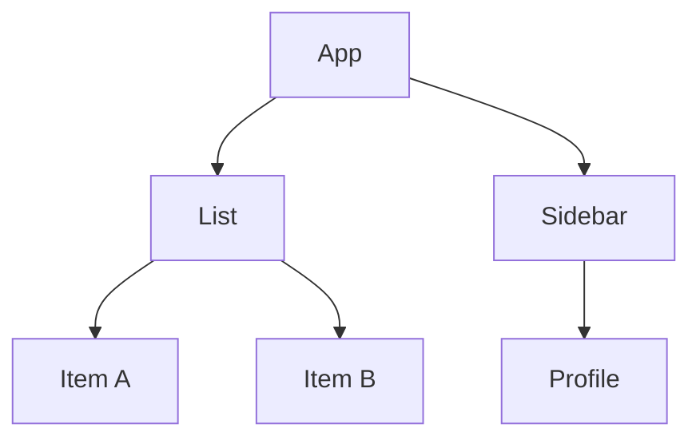

深度优先过程可口述为：

1. `beginWork(App)`，进入第一个 `child`。
2. 处理 `List`，继续进入 `Item A`。
3. `Item A` 无子节点，执行 `completeWork`，转向 `sibling Item B`。
4. `List` 子树完成后回到 `App`，处理 `Sidebar`。
5. 回溯时聚合 flags 和 lanes。

### Element、Fiber 与 DOM

参见 [React Element、Fiber 与 DOM 图](https://cdn.jsdelivr.net/gh/2530622506/interView-writing-@main/docs/react-interview/assets/react-element-fiber-dom.png)。Element 可能每次渲染新建；Fiber 在身份匹配时复用；DOM 只在 Commit 有必要时变化。

---

## 3. 双缓冲与工作循环

### 面试问题

什么是 Fiber 双缓冲？`current`、`workInProgress`、`alternate`、`beginWork` 和 `completeWork` 如何串起来？

### 30 秒回答

`current` 树表示最近一次已经提交、与页面一致的 Fiber 版本；下一次 Render 在 `workInProgress` 树上计算。两棵树中的对应节点通过 `alternate` 关联。工作循环先通过 `beginWork` 从父到子处理更新和协调 children，再通过 `completeWork` 从子到父准备宿主结果并聚合 flags。整棵相关树完成后，Commit 应用变更并把 Root 的 current 指针切到完成树；未完成或过期的树不会直接显示给用户。

### 3 分钟展开

双缓冲要解决两个问题：

1. **一致性**：正在计算的新 UI 不能污染用户正在看的已提交 UI；
2. **复用**：下一次更新不应从零创建所有工作节点，而应复用 current / alternate 对应关系。

在一次更新开始时，React 从 current Root 创建或复用 work-in-progress Root。处理某个 Fiber 时：

- `beginWork` 读取新 props、状态队列、Context 和 lanes，决定是调用组件、协调子节点，还是 bailout；
- 若有 child，工作指针向下进入第一个 child；
- 若没有 child，或子树已经完成，则进入 `completeWork`；
- `completeWork` 准备 DOM 等宿主结果，并把子树 flags、lanes 等信息向父节点聚合；
- 若存在 sibling，转向 sibling；否则继续沿 `return` 回溯；
- Root 完成后得到一棵 finished work，随后进入 Commit。

### current 与 work-in-progress 保存什么

```js
// 面试级简化示意，并非 React 源码原文
const root = {
  current: currentRootFiber, // 已提交树的入口
  finishedWork: null,        // 已完成、等待 Commit 的树
  finishedLanes: 0,
};

const currentFiber = {
  memoizedProps: oldProps,
  memoizedState: oldState,
  alternate: workInProgressFiber,
};

const workInProgressFiber = {
  pendingProps: nextProps,
  memoizedState: nextState,
  flags: 0,
  subtreeFlags: 0,
  alternate: currentFiber,
};
```

“有两棵 Fiber 树”不表示页面存在两套 DOM。DOM 节点通常通过 `stateNode` 与相关 Fiber 关联，只有 Commit 才把完成树记录的变更应用到真实宿主环境。


图中阅读重点是：Root 的 `current` 指向已提交树，虚线 `alternate` 连接身份对应节点，work-in-progress 完成并提交后会成为新的 current。下一轮更新可反向复用另一侧节点对象，而不是每次深拷贝两棵完整新树。

### 用一棵具体树演算工作循环

假设组件树是：

```text
App
├─ Header
└─ Main
   ├─ ProductList
   └─ Sidebar
```

没有 bailout 时，概念上的顺序如下：

| 步骤 | 当前工作 | 动作 | 下一个工作 |
|---|---|---|---|
| 1 | `App` | `beginWork`，得到 `Header` | `Header` |
| 2 | `Header` | `beginWork`，无 child | `completeWork(Header)` |
| 3 | `Header` 完成 | 找到 sibling | `Main` |
| 4 | `Main` | `beginWork`，得到 `ProductList` | `ProductList` |
| 5 | `ProductList` | 完成自身和子树 | `Sidebar` |
| 6 | `Sidebar` | 完成自身和子树 | 回到 `Main` |
| 7 | `Main` | `completeWork`，聚合子树 flags | 回到 `App` |
| 8 | `App` | `completeWork`，Root Render 完成 | 准备 Commit |

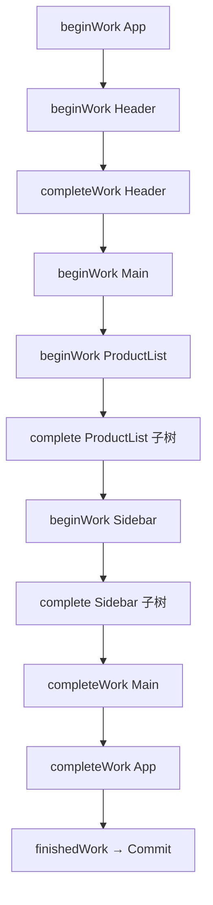

### 工作循环伪代码

> 下列代码是简化 JavaScript 伪代码，并非 React 源码原文。真实实现还包含错误处理、Suspense、hydration、profiling、不同 Root 模式等分支。

```js
function workLoopConcurrent() {
  while (workInProgress !== null && !shouldYield()) {
    performUnitOfWork(workInProgress);
  }
}

function performUnitOfWork(unit) {
  const next = beginWork(unit); // 处理更新并协调第一个子 Fiber

  if (next !== null) {
    workInProgress = next;
    return;
  }

  completeUnitOfWork(unit);
}

function completeUnitOfWork(unit) {
  let completed = unit;

  while (completed !== null) {
    completeWork(completed); // 准备宿主结果并聚合子树信息

    if (completed.sibling !== null) {
      workInProgress = completed.sibling;
      return;
    }

    completed = completed.return; // 没有兄弟节点就继续回到父节点
    workInProgress = completed;
  }
}
```

### `beginWork`、`completeWork` 与 Commit 的职责边界

| 阶段 | 典型职责 | 不应做什么 |
|---|---|---|
| `beginWork` | 处理状态队列、调用组件、读取 Context、协调 children、判断 bailout | 直接修改用户可见 DOM |
| `completeWork` | 创建 / 准备宿主实例、向上聚合 flags 和子树信息 | 执行业务网络请求和订阅 |
| Commit | 根据 flags 修改 DOM、处理 ref、执行 layout / passive Effect 流程 | 被任意暂停后留下半完成页面 |

### Bailout 到底跳过什么

Bailout 不是“组件用了 `memo` 就绝对不 Render”。React 会结合本轮 render lanes、props、Context、组件类型和子树 `childLanes` 判断：

- 当前 Fiber 自身没有需要处理的工作时，可以复用已有结果；
- 当前节点可跳过，但子树仍有匹配 lanes 时，仍要继续进入子树；
- Context 变化、引用变化或本地状态更新都可能让 bailout 失败；
- `memo` 只参与 props 比较，不会屏蔽组件自己的 state 或读取到的 Context 更新。

### 中断后是继续还是重做

- **时间片结束但输入未过期**：React 可以保留工作指针，后续继续该次 Render；
- **更高优先级更新到达**：低优先级工作可以让位，紧急更新先基于 current 树完成；
- **已计算结果不再适用**：React 可以放弃部分 work-in-progress，并基于最新 state、props 和 lanes 重做；
- **发生错误或 Suspense**：工作循环进入对应捕获、回退或重试路径。

所以面试中应说“Render 可暂停、继续或重做”，不要承诺“中断后一定原地续算且完全复用此前结果”。

### 工程定位方法

当 Profiler 显示某次更新很慢时，可以沿工作循环问：

1. 是大量组件进入了 `beginWork`，还是少数组件单次计算很重？
2. props、Context 或 state 为什么让 bailout 失败？
3. Render 很慢但 Commit 很快，是否适合 memoization、Transition 或列表虚拟化？
4. Render 很快但 Commit / layout 很慢，是否存在大量 DOM mutation 或同步测量？
5. 低优先级工作是否因持续紧急输入被多次重做？

### 面试官追问树

1. `current` 和 `workInProgress` 是否各有一套 DOM？
2. `alternate` 的主要作用是什么？
3. `beginWork` 与 `completeWork` 的遍历方向有何不同？
4. flags 为什么在回溯阶段向上聚合？
5. 父 Fiber bailout 后，子树更新会不会丢失？
6. Render 被让出后一定原地恢复吗？
7. finished work 在什么时候成为 current？

### 一句话收束

> 双缓冲隔离“正在看的树”和“正在算的树”，工作循环用 `beginWork` 向下展开、用 `completeWork` 向上收口，只有完成树才有资格进入 Commit。

---

## 4. lanes、Root 与 Scheduler

### 面试问题

React 的 lanes 是什么？它与事件优先级、Root 调度和 Scheduler 有什么关系？

### 30 秒回答

lane 是 React reconciler 内部用位集合表达更新优先级和批次的模型。事件或更新来源先影响更新被分配到哪个 lane，lane 再从 Fiber 向 Root 传播；Root 记录 pending、suspended、pinged 等 lane 集合，并选择下一批 render lanes。Scheduler 负责安排承载 Render 的 JavaScript 回调何时执行以及何时让出主线程。简言之：lane 决定“React 先算哪批更新”，Root 汇总“当前还有哪些工作”，Scheduler 决定“何时获得一段执行时间”。

### 3 分钟展开

优先级链路可以分成 3 层，而不是把所有概念都叫 Scheduler：

1. **更新层**：`setState`、Reducer dispatch、外部 Store 通知等创建 Update，并为它选择 lane；
2. **Root 层**：lane 从触发更新的 Fiber 向上标记到 Root，Root 合并 pending lanes，并结合 suspended / pinged / expired 等状态选择下一批 lanes；
3. **宿主调度层**：React 根据选出的工作，安排同步任务或 Scheduler callback；回调运行时进入同步或并发工作循环。

lane 既表达优先级，也帮助把一组更新作为同一次 Render 的工作集合。它不是业务权限等级，也不是一个简单递增数字；位集合使 React 能快速合并、包含、移除和挑选多组工作。


图中应从左到右理解：更新先获得 lane，Root 汇总 lanes，再把当前最高优先级的可执行工作映射为调度回调。图片中的 lane 名称用于建立层级感，不应背具体 bit 值；内部 lane 数量和映射可能随版本变化。

### Root 上为什么需要多组 lanes

> 下列结构是面试级简化示意，并非 React 源码原文。

```js
const fiberRoot = {
  pendingLanes: 0,    // 尚未完成的全部工作
  suspendedLanes: 0,  // 因等待资源等原因暂时不能继续的工作
  pingedLanes: 0,     // 资源就绪后被唤醒、可以重试的工作
  expiredLanes: 0,    // 等待过久，需要提高处理紧迫性的工作

  callbackNode: null, // 当前已安排的 Scheduler 任务
  callbackPriority: 0,
  finishedWork: null,
  finishedLanes: 0,
};
```

若 Root 只保存一个“最高优先级数字”，就很难同时表示：某些 Transition 正在等待数据、某个默认更新可继续、又有一个输入更新刚到达。lane 集合允许这些状态并存，并在每次调度时重新选择。

### 为什么使用位集合

```js
// 简化示意，并非 React 的真实常量值
const SyncLane = 0b0001;
const DefaultLane = 0b0010;
const TransitionLaneA = 0b0100;
const TransitionLaneB = 0b1000;

let pendingLanes = DefaultLane | TransitionLaneA;
pendingLanes |= SyncLane; // 合并一个紧急更新

const includesSync = (pendingLanes & SyncLane) !== 0;
pendingLanes &= ~SyncLane; // 完成后移除这一 lane
```

常见集合操作包括：

- `a | b`：合并两组工作；
- `a & b`：判断是否交集；
- `a & ~b`：从集合中移除已完成工作；
- 取最高优先级位：选择下一批候选工作。

### 从点击到工作循环的职责链

> 函数名只用于源码导航，不要求背诵；不同 React 版本可能调整调用关系。

```text
事件 / 更新来源
  → requestUpdateLane：选择 lane
  → enqueueUpdate / enqueueConcurrentHookUpdate：写入更新队列
  → scheduleUpdateOnFiber：把 lane 传播到 Root
  → ensureRootIsScheduled：比较并安排 Root 任务
  → getNextLanes：选择下一批 render lanes
  → Scheduler callback 或同步任务
  → performWorkOnRoot
  → renderRootSync / renderRootConcurrent
  → commitRoot
```

这条链与[状态更新完整链路](./react-state-and-rendering.md#4-一次更新的完整链路)是同一过程的不同观察角度：状态专题关注 Update Queue，这里关注 lane 如何影响 Root 和工作循环。

### 调度伪代码

> 下列代码是简化 JavaScript 伪代码，并非 React 源码原文。

```js
function scheduleUpdate(root, update) {
  root.pendingLanes |= update.lane; // Root 记录尚未完成的工作
  ensureRootIsScheduled(root);
}

function ensureRootIsScheduled(root) {
  const nextLanes = getNextLanes(
    root.pendingLanes,
    root.suspendedLanes,
    root.pingedLanes,
  );

  if (nextLanes === NoLanes) {
    cancelExistingCallback(root);
    return;
  }

  const priority = lanesToSchedulerPriority(nextLanes);

  if (canReuseExistingCallback(root, priority)) {
    return; // 已有足够合适的任务，不重复安排
  }

  root.callbackNode = scheduleCallback(priority, () => {
    return performWorkOnRoot(root, nextLanes);
  });
}
```

### 高优先级更新如何插队

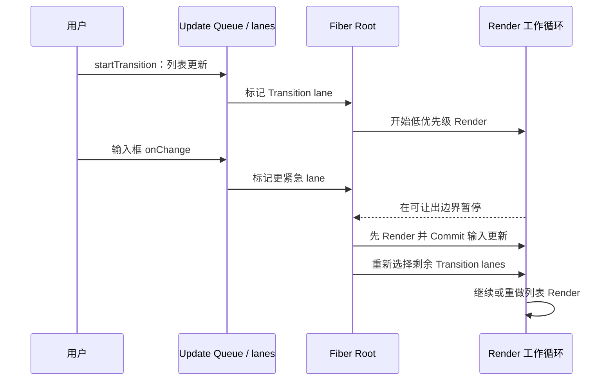

这里“插队”发生在 Render 调度层，不表示两个组件同时在两个 JavaScript 线程中渲染。低优先级 Update 仍保留在队列和 Root lanes 中，除非被更晚语义覆盖或相关组件卸载，不会因为让位就自动丢失。

### Update Queue 为什么还需要 `baseQueue`

lane 只决定本轮处理哪些更新，Update Queue 还必须保持更新语义顺序。若本轮跳过低优先级 Update，后面的高优先级 Update 虽可先计算，但后续仍可能需要从 `baseState` 开始重放，以得到与原始更新顺序一致的结果。详细演算见[更新队列与函数式更新](./react-state-and-rendering.md#2-更新队列与函数式更新)。

### lanes 与 Scheduler 不是一一对应

- lane 是 reconciler 的更新集合模型，Scheduler priority 是宿主回调调度模型；
- 多个 lanes 可以映射到同一类 Scheduler 优先级；
- 同一 Root 的 callback 可能因新工作到达而取消、复用或重新安排；
- 同步工作可以通过内部同步队列 / microtask 等路径刷新，不应回答成“一切都由 Scheduler 宏任务执行”；
- Scheduler 让出主线程只影响 Render 计算，Commit 仍要保持一致完成。

### 优先级不是业务重要性

Transition 的“低优先级”只表示 UI 计算可以让位于输入等紧急交互，不代表业务不重要。支付提交、权限变更、库存扣减等正确性仍应由服务端事务、幂等、鉴权和错误处理保证；不能因为包进 Transition 就改变业务一致性。

### 如何验证优先级问题

1. 使用 React Profiler 观察交互对应的 Render 和 Commit；
2. 使用浏览器 Performance 检查长任务是否来自单次组件计算、重复 Render 还是 Commit；
3. 给紧急值和延迟值分别记录时间戳，确认输入先更新、结果后更新；
4. 若 `isPending` 很久，检查 Suspense、网络瀑布和昂贵计算，而不是只怀疑 lane；
5. 若 Transition 完全不改善卡顿，检查是否存在不可切开的同步函数或长 Commit。

### 面试官追问树

1. lane 为什么使用位集合而不是单个数字？
2. `pendingLanes`、`suspendedLanes` 和 `pingedLanes` 分别表示什么？
3. 更新 lane 与 Scheduler priority 是否一一对应？
4. lane 如何从子 Fiber 传播到 Root？
5. 高优先级更新到来后，低优先级 Update 会丢失吗？
6. 为什么 Update Queue 还需要 `baseState` / `baseQueue`？
7. Scheduler 可以中断 Commit 吗？

### 版本边界

lanes、Root 字段和源码函数名都是 React 内部实现。稳定的面试结论是“更新有优先级、Root 汇总工作、Render 可调度”；不要把某个版本的 bit 常量、lane 数量或精确函数调用栈当成公共 API。

### 一句话收束

> lane 负责给 React 的更新分组和排序，Root 负责汇总与选择，Scheduler 负责争取执行时间，三者共同完成“该先算谁、何时开始算”。

---

## 5. 可中断 Render 与不可中断 Commit

### 面试问题

为什么 Render 可以被中断，而 Commit 不可以？

### 30 秒回答

Render 只在内存中计算 work-in-progress 树，没有改变用户可见宿主环境，因此可在更高优先级更新到来时暂停或丢弃。Commit 会修改 DOM、ref 和布局 Effect；若被中断，页面可能出现结构与事件不一致的半成品，所以 Commit 必须一次完成。并发不是“DOM 分段提交”，而是“下一版本的计算可以调度”。

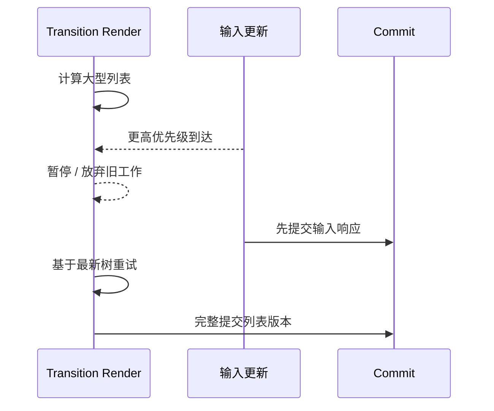

### Render 纯净性的工程含义

```tsx
function BrokenProfile({ userId }: { userId: string }) {
  analytics.track('render', userId); // ❌ Render 重试会重复上报
  document.title = userId;           // ❌ Render 期间直接修改外部系统
  return <p>{userId}</p>;
}
```

应把上报放在事件或 Effect，把文档标题作为与外部系统同步的 Effect，并设计幂等或清理逻辑。

### Commit 阶段仍要快

Commit 不可中断，因此大量同步布局读取、长时间 `useLayoutEffect` 或第三方 DOM 操作会直接阻塞交互和绘制。并发能力不能挽救一个耗时过长的 Commit。

---

## 6. 并发渲染是什么

### 面试问题

React 的 Concurrent Rendering（并发渲染）是什么？是不是多线程？

### 30 秒回答

并发渲染是 React 能管理多个优先级的 UI 版本，并让低优先级 Render 暂停、继续、放弃或重做的能力。它通常仍在浏览器主线程执行，不等于多线程并行，也不意味着 DOM 会分段提交。React 先在内存中准备 work-in-progress，紧急更新可以先完成，只有某个版本完整 Render 后才进入 Commit。Transition、Deferred Value、Suspense 和选择性 hydration 是利用这套能力的公开入口。

### 3 分钟展开

“并发”描述的是**工作管理模型**，不是 CPU 同时跑两个 React Render：

1. React 可能已经开始计算一个低优先级列表版本；
2. 用户继续输入，产生更紧急的更新；
3. 工作循环在可让出边界停止旧 Render；
4. React 基于 current 树优先计算并提交输入更新；
5. 之后再基于最新状态继续或重做列表版本；
6. 如果列表依赖的数据又变了，旧的 work-in-progress 可以被丢弃，用户不会看到半完成 DOM。

这让“输入保持响应”和“昂贵结果最终一致”可以同时成立。但并发不会减少总 CPU、网络和 DOM 成本，某些被打断的工作甚至会重做，所以它是响应性工具，不是免费性能加速器。

### 同步渲染与并发渲染的时间线

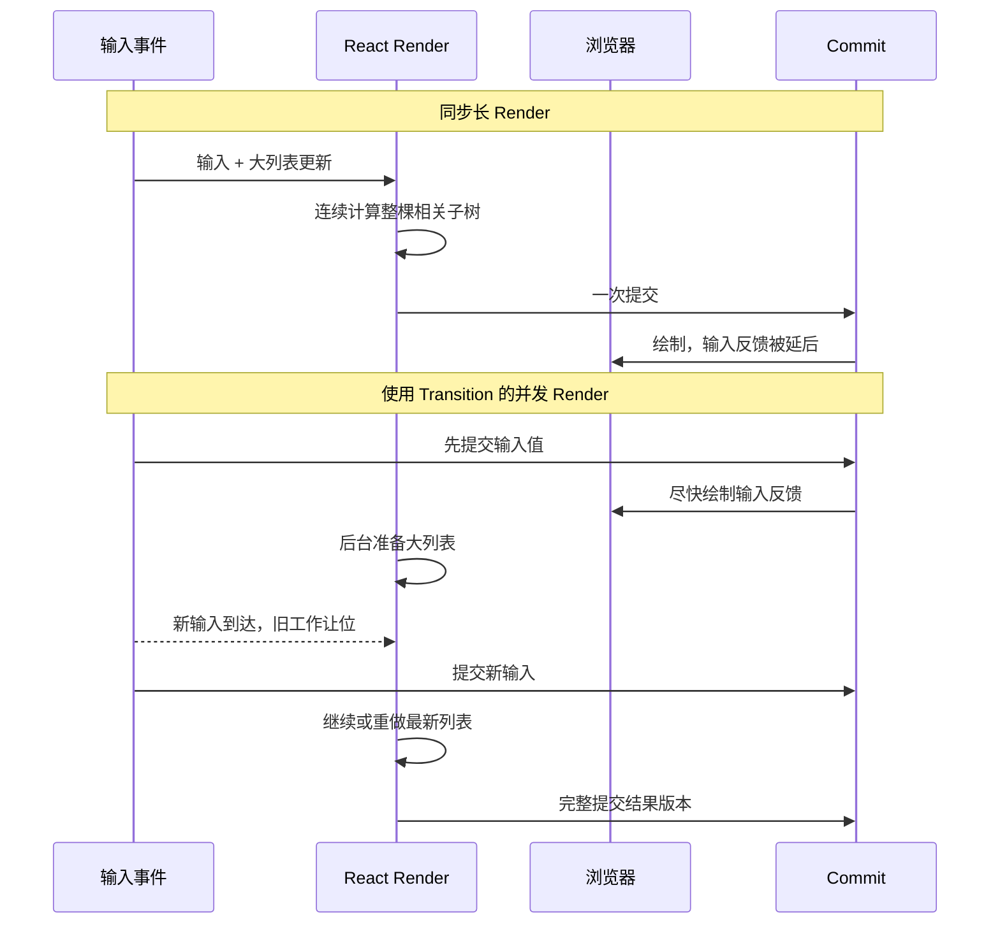

“后台”这里只表示较低优先级的 Render，不表示自动移动到 Web Worker 或另一个线程。

### 并发带来的用户体验能力

- 输入、点击、焦点等紧急反馈可以先提交；
- 已展示内容可在新内容准备期间保持可见，减少大范围 loading 闪烁；
- Suspense 边界可以协调等待、fallback 和 reveal；
- 服务端流式渲染可以按边界逐步发送 HTML；
- 选择性 hydration 可以优先接管用户正在交互的边界。

### 并发不会自动解决

| 问题 | 为什么并发不够 | 常见补充方案 |
|---|---|---|
| 单个同步算法执行 200 ms | React 无法在普通函数内部任意切开 | 算法优化、分块、Web Worker |
| 大列表 DOM 过多 | 最终仍需创建和维护节点 | 虚拟列表、分页 |
| 网络请求瀑布 | 调度不能缩短网络依赖链 | 缓存、预加载、并行请求 |
| Commit / layout 很长 | Commit 不可随意中断 | 减少 DOM mutation、避免布局抖动 |
| 外部 Store tearing | 外部数据可能在 Render 中变化 | `useSyncExternalStore` 等一致快照协议 |
| Effect 重复或泄漏 | 可重试 Render 会放大不纯逻辑 | 对称 cleanup、幂等设计 |

### 并发安全的代码特征

1. Render 纯净，不发送请求、不写 DOM、不修改外部可变对象；
2. 状态按 snapshot 理解，更新使用不可变数据；
3. 外部订阅提供稳定且可比较的 snapshot；
4. Effect setup / cleanup 对称并可重复执行；
5. 不依赖组件函数或 `useMemo` 计算“只执行一次”；
6. 不在模块全局保存请求级可变状态；
7. 对异步结果使用缓存、取消、版本号或请求身份避免竞态。

### 一个常见误判

```tsx
function Results({ query }: { query: string }) {
  // ❌ 即使父更新处于 Transition，这个函数一旦开始仍是同步 JavaScript
  const rows = runVeryExpensiveSynchronousAlgorithm(query);
  return <ResultTable rows={rows} />;
}
```

如果 `runVeryExpensiveSynchronousAlgorithm` 单次调用就长时间占用主线程，React 只能在它返回后才到达下一个可让出边界。Transition 更适合“许多可分散 Fiber 的 Render 工作”，不是任意同步函数的抢占式线程调度。

### 面试官追问树

1. 并发渲染为什么不是多线程？
2. React 在什么时候可以让出主线程？
3. 为什么用户看不到半完成的 work-in-progress？
4. 一个超长同步函数能被 React 从中间打断吗？
5. 并发是否会减少总 Render 次数和 CPU？
6. tearing 是什么，外部 Store 如何避免？
7. 为什么并发要求 Render 纯净？

### 版本边界

React 18 的现代 Root 提供并发基础设施，但不代表所有更新都自动成为可中断 Transition，也不应再使用“开启一个全局 Concurrent Mode 后全部异步”这种说法。应用通过 Transition、Suspense、Deferred Value、框架 SSR / hydration 等能力按场景使用并发特性。

### 一句话收束

> React 并发不是让两份 UI 同时在线程里运行，而是让 React 有权决定“先完成哪一版 UI、哪一版可以等待或重做”。

---

## 7. Transition 与 Deferred Value

### 面试问题

`useTransition`、`startTransition` 和 `useDeferredValue` 有什么区别？它们如何与 Suspense 协作？

### 30 秒回答

Transition 把一组状态更新标记为非紧急，允许它被输入等更紧急更新打断；`useTransition` 额外返回 `isPending`，独立 `startTransition` 适合不需要在当前组件读取 pending 状态的场景。`useDeferredValue` 不控制更新发生的位置，而是让某个已得到的值暂时落后，用旧值先渲染当前 UI，再在后台尝试新值。它们都不是 debounce：不固定等待毫秒，也不会自动减少请求次数。

### 3 分钟展开

选择它们可以先问“我能不能控制产生状态更新的位置”：

- 能控制 `setState`：用 Transition 包裹**非紧急更新**；
- 只能拿到一个新 prop / value：用 `useDeferredValue` 延迟由该值驱动的子树；
- 新 Render 可能等待代码或数据：在合适层级配合 Suspense；
- 需要减少网络请求频率：另用 debounce、缓存、取消或请求合并，Transition 不负责这个问题。

Transition 更新可被更紧急更新打断。React 处理完紧急更新后，会重新处理仍待完成的 Transition。`isPending` 表示当前存在尚未完成的 Transition 工作，适合显示细粒度 pending 提示，但不应被当成具体请求 ID 或事务锁。

### 双状态层：输入立即更新，结果延后

```tsx
function SearchPage({ products }: { products: Product[] }) {
  const [text, setText] = useState('');
  const [query, setQuery] = useState('');
  const [isPending, startTransition] = useTransition();

  function handleChange(nextText: string) {
    setText(nextText); // 受控输入必须立即更新

    startTransition(() => {
      setQuery(nextText); // 结果列表允许让位于后续输入
    });
  }

  return (
    <section aria-busy={isPending}>
      <input value={text} onChange={(event) => handleChange(event.target.value)} />
      {isPending && <small>正在更新结果…</small>}
      <SlowProductList products={filterProducts(products, query)} />
    </section>
  );
}
```

这里的两个 state 不是重复设计：`text` 表示用户已经输入的事实，`query` 表示结果子树当前正在追赶的版本。

### 为什么不能用 Transition 控制输入值

```tsx
function BrokenSearch() {
  const [text, setText] = useState('');
  const [, startTransition] = useTransition();

  return (
    <input
      value={text}
      onChange={(event) => {
        startTransition(() => {
          setText(event.target.value); // ❌ 受控输入不能等待非紧急更新
        });
      }}
    />
  );
}
```

受控 input 需要在输入事件后同步反映最新 `value`。Transition 可用于依赖输入的慢结果，不能用于输入本身。

### React 19.x 中 async Action 的边界

`startTransition` 可以接收 async Action，并让 `isPending` 覆盖异步工作；但当前 JavaScript async context 存在限制：`await` 之后的状态更新若要明确保持 Transition 语义，需要再次包一层 `startTransition`。

```tsx
function SaveButton() {
  const [message, setMessage] = useState('');
  const [isPending, startTransition] = useTransition();

  function handleSave() {
    startTransition(async () => {
      const result = await saveProfile();

      startTransition(() => {
        // await 之后重新标记这次状态更新为 Transition
        setMessage(result.message);
      });
    });
  }

  return (
    <button disabled={isPending} onClick={handleSave}>
      {isPending ? '保存中…' : message || '保存'}
    </button>
  );
}
```

如果业务要求严格的并发提交顺序，仍应使用请求 ID、服务端幂等、禁用重复提交或框架 Action 方案；Transition 不自动替代事务和竞态控制。

### `useDeferredValue`：延迟值，不是延迟赋值

```tsx
function SearchResults({ query }: { query: string }) {
  const deferredQuery = useDeferredValue(query);
  const isStale = query !== deferredQuery;

  return (
    <div
      aria-busy={isStale}
      style={{
        opacity: isStale ? 0.6 : 1,
        transition: 'opacity 160ms ease',
      }}
    >
      <SlowList query={deferredQuery} />
    </div>
  );
}
```

更新时可以概念化为两次尝试：

1. 新 `query` 到达，组件先用旧 `deferredQuery` 快速提交，保留旧结果；
2. React 在后台尝试让 `deferredQuery` 追上新值；
3. 若这次后台 Render 被新输入打断，React 放弃过期尝试并改为追赶更新值；
4. 若子树 Suspense，旧结果可以继续可见，并通过 `isStale` 给用户反馈。

若 `SlowList` 的昂贵部分没有因 props 相同而跳过，父组件的紧急 Render 仍可能重新计算它。实际优化通常需要合理组件边界、`memo`、缓存或虚拟列表配合，并通过 Profiler 验证。

### Transition、Deferred Value 与 debounce 对比

| 工具 | 控制什么 | 是否固定等待 | 是否减少请求 | 是否可被更紧急 Render 打断 |
|---|---|---:|---:|---:|
| `startTransition` / `useTransition` | 一组 state 更新的紧迫性 | 否 | 否 | 是 |
| `useDeferredValue` | 某个值驱动子树追赶的时机 | 否 | 否 | 是 |
| debounce | 函数在一段静默时间后执行 | 是 | 可以 | 与 React Render 调度无直接关系 |
| throttle | 函数在固定窗口内限制频率 | 是 | 可以 | 与 React Render 调度无直接关系 |

### 与 Suspense 协作的时间线

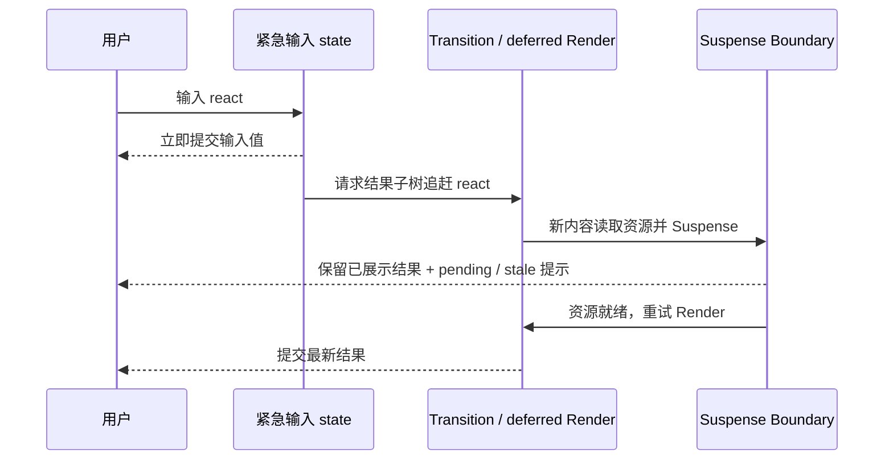

Transition 通常会避免已展示的 Suspense 内容重新退回大 fallback，但新出现的嵌套边界仍可以显示自己的 fallback。若切换的是语义上全新的实体，可通过稳定 `key` 重置边界，让用户看到新的加载状态。

### 常见失败方式

- 把所有更新都包进 Transition，导致真正需要立即反馈的状态也延迟；
- 只加 `useDeferredValue`，但慢组件没有形成可跳过的边界；
- 认为 Transition 能 debounce 请求，结果每个输入值仍发起网络请求；
- 用 `isPending` 代替请求错误、取消和提交顺序管理；
- 在 `await` 后直接更新 state，却误以为一定保留 Transition 标记；
- 用 Transition 掩盖 300 ms 的同步算法或超长 Commit。

### 如何验证是否真的有效

1. 先用 Profiler 找到昂贵更新，不能凭感觉添加 Transition；
2. 在 Performance 面板观察输入事件后是否更快出现 paint；
3. 检查旧工作是否因连续输入被重做，以及总 CPU 是否可接受；
4. 对网络请求记录请求数，确认是否还需要 debounce / cache / abort；
5. 为 pending、error、empty 和 stale 状态分别设计 UI，避免只展示一个 spinner。

### 面试官追问树

1. Transition 为什么不能控制受控 input？
2. `useTransition` 与独立 `startTransition` 的差别是什么？
3. `useDeferredValue` 为什么不是 debounce？
4. Deferred 子树什么时候需要配合 `memo`？
5. Transition 更新被输入打断后会怎样？
6. `await` 之后的更新如何保持 Transition 语义？
7. `isPending` 能否代替请求竞态控制？
8. Transition 如何避免已展示 Suspense 边界闪回 fallback？

### 版本边界

React 18 已提供 Transition 与 Deferred Value 的稳定基础。React 19.x 的 Actions 进一步把异步操作、pending、错误和乐观更新串联起来，但 `startTransition` 的调度语义不等于服务端事务语义；涉及框架表单 Action 时应明确哪些是 React DOM / 框架能力。

### 一句话收束

> Transition 延后“我能控制的一组更新”，Deferred Value 延后“我已经拿到的值所驱动的子树”，二者都优化响应顺序，不负责让计算和网络凭空消失。

---

## 8. Suspense 的工作边界

### 面试问题

Suspense 是什么？它如何等待、重试和 reveal？为什么普通 Effect 请求不会自动触发 Suspense？

### 30 秒回答

Suspense 是协调“子树当前无法完成 Render”时 fallback、重试和内容 reveal 的边界。支持 Suspense 的资源在读取尚未就绪时会让 Render 挂起，React 找到最近的 Suspense 边界，决定显示 fallback 或保留已展示内容，并在资源就绪后重新调度对应 lanes。Suspense 本身不负责发请求，也不会捕获 `useEffect` 中的普通 fetch；数据必须来自框架、兼容缓存、lazy 代码加载或 React 支持的资源读取路径。

### 3 分钟展开

一次客户端 Suspense 可以按以下链路理解：

1. React 开始 Render 边界内的子树；
2. 组件读取代码或数据资源，资源尚未完成；
3. 资源读取通过 React 支持的协议表示“当前不能完成”；
4. React 标记相关工作为 suspended，并找到最近的 Suspense boundary；
5. 初次展示时，边界可以提交 fallback；若内容已经展示且更新位于 Transition 中，React 通常优先保留旧内容；
6. thenable 完成后触发 ping，Root 将相应 lanes 标记为可重试；
7. React 重新 Render 边界；这次资源可读后，完成 work-in-progress 并 Commit 内容。

Suspense 协调的是**等待状态下的 UI 提交策略**。请求发起、缓存去重、错误重试、失效策略和服务端数据一致性通常由框架或数据层负责。

### 执行链路图

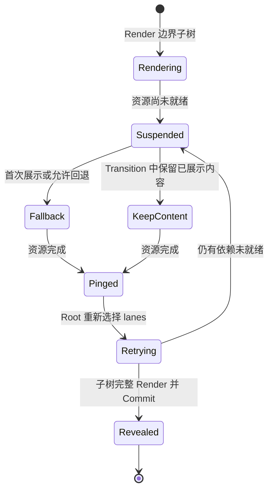

图中最重要的是：Suspended 不一定等于立刻显示 fallback。是否回退取决于边界此前是否已 reveal、更新是否处于 Transition / deferred 路径、边界层级和资源状态。

### 简化资源协议

> 下列代码只用于解释 Suspense 心智模型，并非推荐手写生产数据层，也不是 React 源码原文。真实项目优先使用支持 Suspense 的框架或缓存方案。

```js
function readRecord(record) {
  if (record.status === 'fulfilled') {
    return record.value;
  }

  if (record.status === 'rejected') {
    throw record.error; // 交给 Error Boundary 处理失败
  }

  throw record.promise; // 告诉最近的 Suspense 边界：本轮不能完成
}
```

React 19.x 也提供 `use(promiseOrContext)` 等读取能力，但 Promise 的创建位置、缓存和服务端 / 客户端边界必须由框架或稳定数据层管理。不要在每次 Render 中无缓存地创建新 Promise，否则重试时可能不断得到全新等待对象。

### 为什么 Effect fetch 不会触发 Suspense

```tsx
function EffectProfile({ userId }: { userId: string }) {
  const [profile, setProfile] = useState<Profile | null>(null);

  useEffect(() => {
    fetchProfile(userId).then(setProfile); // Render 已经结束后才发起请求
  }, [userId]);

  if (profile === null) {
    return <Spinner />; // 这是组件自己的条件分支，不是 Suspense 捕获
  }

  return <ProfileCard profile={profile} />;
}
```

Effect 在 Commit 后才运行。组件第一次 Render 时没有通过 Suspense 协议报告等待，因此外层 Suspense 不知道这次请求。要让 Suspense 协调数据等待，需要在 Render 读取一个可缓存、可重试且被 React / 框架支持的资源。

### 边界应该如何分层

```tsx
function Dashboard() {
  return (
    <Suspense fallback={<DashboardSkeleton />}>
      <Summary />

      <Suspense fallback={<ChartSkeleton />}>
        <RevenueChart />
      </Suspense>

      <Suspense fallback={<TableSkeleton />}>
        <RecentOrders />
      </Suspense>
    </Suspense>
  );
}
```

边界粒度应匹配用户感知的加载单元：

- 太粗：一个慢模块让整页退回大 loading；
- 太细：大量 spinner 依次闪烁，页面视觉不稳定；
- 合理嵌套：先 reveal 页面骨架和关键摘要，再独立 reveal 图表与表格；
- Error Boundary 与 Suspense 配合：前者处理失败，后者处理等待。

### 已展示内容为什么有时不回退 fallback

若一次普通紧急更新让已展示子树再次 Suspense，最近边界可能需要显示 fallback。若更新位于 Transition 中，React 通常优先保持已 reveal 的内容，等待新内容准备好后再替换；新出现且尚未 reveal 的嵌套 Suspense 仍可显示自己的 fallback。

当用户从 `/user/1` 导航到语义上不同的 `/user/2`，如果希望明确重置旧边界，可以使用业务身份作为 `key`：

```tsx
<Suspense fallback={<ProfileSkeleton />}>
  <ProfilePage key={userId} userId={userId} />
</Suspense>
```

`key` 告诉 React 这是新的状态身份。是否在导航时重置通常由路由框架根据页面语义决定，不能机械给所有 Suspense 子树添加随机 key。

### 初次挂起、状态与 Effect 的边界

- 子树在首次挂载完成前 Suspense 时，React 不会保留那次未提交 Render 的本地状态；资源就绪后会从头重试；
- 已展示内容被隐藏后重新 reveal 时，布局 Effect 需要重新建立，不能假设其 setup 永远只执行一次；
- Render 期间创建的不可回滚副作用会因重试而重复，因此 Suspense 再次证明 Render 必须纯净；
- Error Boundary 不捕获“等待成功”，Suspense 也不替代错误、超时和重试 UI。

### 服务端流式渲染与选择性 hydration

在支持的服务端渲染框架中，Suspense 边界还可以成为传输与 hydration 单元：

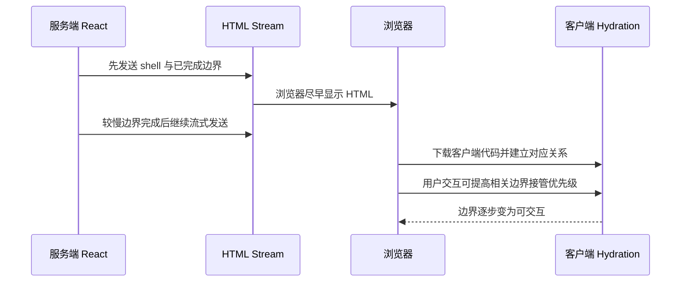

需要明确 3 个边界：

1. Streaming SSR 负责更早发送可显示 HTML，不等于客户端已经可交互；
2. hydration 负责让服务端 HTML 与客户端 Fiber 对齐并绑定交互；
3. 路由、数据缓存、Server Components 与部署协议通常由框架提供，不应全部归因于 Suspense 组件本身。

### 常见失败方式

- 认为 `<Suspense>` 会自动拦截任意 `fetch`；
- 每个小组件都包一个 spinner，导致 reveal 顺序混乱；
- 在 Render 中创建无缓存 Promise，使边界不断重新挂起；
- 没有 Error Boundary，资源失败后只有全局错误；
- 导航时 key 设计错误，旧用户状态被错误保留或每次都无谓重置；
- 把框架的数据缓存、RSC 或 Server Actions 说成 Suspense 自己完成。

### 如何验证 Suspense 设计

1. 模拟首次慢加载，确认 fallback 粒度是否符合页面骨架；
2. 模拟已展示内容的刷新，确认 Transition 是否避免大范围闪回；
3. 模拟嵌套边界不同完成顺序，检查 reveal 是否稳定；
4. 模拟拒绝 Promise，确认错误进入 Error Boundary；
5. 检查同一资源是否被缓存和去重，避免请求瀑布；
6. SSR 场景分别测量 HTML 到达、首次绘制、hydration 和可交互时间。

### 面试官追问树

1. Suspense 会自动发送网络请求吗？
2. 为什么 Effect 中的 fetch 不会触发外层 Suspense？
3. thenable 完成后 React 如何知道要重试？
4. Transition 为什么能避免已展示内容闪回 fallback？
5. 初次 Render 挂起时，本地 state 会保留吗？
6. Suspense 与 Error Boundary 如何分工？
7. 边界的 `key` 什么时候需要变化？
8. Streaming SSR 与 hydration 分别解决什么问题？

### 版本与框架边界

- `React.lazy` 与代码分割是 React 稳定支持的 Suspense 来源；
- 数据 Suspense 应优先使用 React 官方文档认可的框架、缓存或资源 API，不要把临时手写 `throw promise` 当成通用生产方案；
- Streaming SSR、Selective Hydration、RSC 数据协议等通常需要 React DOM Server 与框架集成；
- React 19.x 的 `use` 扩展了资源读取表达方式，但没有取消缓存、错误处理和请求一致性设计。

### 一句话收束

> Suspense 不负责“怎么请求”，而负责“这棵子树暂时算不完时，页面先提交什么、资源就绪后如何重试并 reveal”。

---

## 9. React 18 的关键变化

### 面试问题

React 18 有哪些重要变化？它们之间的主线是什么？

### 30 秒回答

React 18 的主线不是“新增几个 Hook”，而是把并发渲染基础设施带入稳定版本：现代 Root API（`createRoot` / `hydrateRoot`）、更广泛的自动批处理、Transition、`useDeferredValue`、`useId`、`useSyncExternalStore`、流式 SSR 与选择性 hydration，以及更严格的开发期 Strict Mode 检查。这些能力共同服务于 **更新优先级、交互响应性、外部数据一致性和服务端渐进可交互**。

### 3 分钟展开

可以按 4 层回答，而不是平铺 API：

1. **入口层**：`ReactDOM.render` 迁移到 `createRoot`，SSR 使用 `hydrateRoot`。现代 Root 让 React 18 的调度与批处理能力生效。
2. **客户端调度层**：自动批处理减少中间提交；Transition 和 `useDeferredValue` 允许把非紧急结果更新标成可中断工作。
3. **一致性协议层**：`useSyncExternalStore` 让外部 Store 在并发渲染和 hydration 下提供稳定 snapshot；`useId` 解决服务端与客户端无障碍 ID 对齐。
4. **服务端层**：Suspense 边界配合流式 SSR 先发送可用 HTML，再逐段 reveal；选择性 hydration 允许页面按优先级接管交互，而不是整页一次性完成。

最后主动补两个边界：**并发不是多线程**；**使用 `createRoot` 也不代表每次 Render 都会被切片或所有更新自动变成 Transition**。同步紧急更新仍可以同步完成，Commit 仍保持原子性。

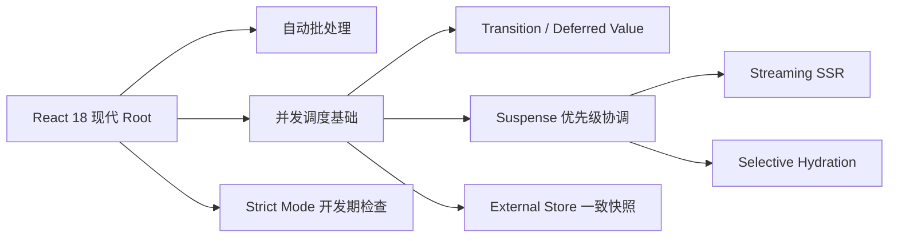

### `ReactDOM.render` 到 `createRoot`

React 18 客户端入口从旧 Root API 迁移到现代 Root：

```tsx
// React 17 / legacy root 语境
import ReactDOM from 'react-dom';

ReactDOM.render(<App />, document.getElementById('root'));
```

```tsx
// React 18+ 客户端入口
import { createRoot } from 'react-dom/client';

const container = document.getElementById('root');
if (!container) throw new Error('缺少 #root 容器');

const root = createRoot(container);
// 中文注释：现代 Root 启用 React 18 的新调度与批处理语境
root.render(<App />);
```

卸载也从 `unmountComponentAtNode(container)` 改为持有 Root 后调用 `root.unmount()`。不要在同一个 DOM 容器上重复 `createRoot`；Root 是应用入口对象，不是每次更新时临时创建的工具。

### SSR 入口：`hydrateRoot` 不是 `createRoot` 后再 render

服务端已经输出 React HTML 时，客户端应复用并接管现有标记：

```tsx
import { hydrateRoot } from 'react-dom/client';

const container = document.getElementById('root');
if (!container) throw new Error('缺少 #root 容器');

hydrateRoot(container, <App />, {
  onRecoverableError(error) {
    // 中文注释：把可恢复 hydration 问题接入监控，而不是静默忽略
    console.error(error);
  },
});
```

若对服务端 HTML 直接调用 `createRoot(...).render(...)`，React 会按客户端新树处理，而不是执行正常 hydration。服务端与客户端首屏输出仍应一致；`suppressHydrationWarning` 只适合已确认的局部不可避免差异，不是隐藏所有 mismatch 的开关。

### 自动批处理：减少提交次数，不改变 snapshot

React 18 的现代 Root 会把更多异步来源中的多次更新批到一次提交，例如 Promise、定时器和原生事件回调。关键收益是减少无意义的中间 UI 与重复 Commit：

```tsx
function Profile() {
  const [name, setName] = useState('');
  const [loaded, setLoaded] = useState(false);

  async function loadProfile() {
    const profile = await fetchProfile();

    // 中文注释：现代 Root 中，这两个更新通常会被批处理为一次提交
    setName(profile.name);
    setLoaded(true);

    // 中文注释：当前函数闭包中的 name / loaded 仍是本次 Render 的旧快照
  }

  return <button onClick={loadProfile}>{loaded ? name : '加载'}</button>;
}
```

自动批处理不等于：

- state 变量被原地同步修改；
- 所有更新合并成一个 state；
- 跨任意时间和任意事件无限批处理；
- Render 一定只执行一次；
- Commit 中的 DOM 读取永远不需要考虑时序。

如果确实必须先提交 DOM，再立刻测量，可以使用 `flushSync` 逃生，但它会强制 React 尽快同步刷新，可能破坏调度收益：

```tsx
import { flushSync } from 'react-dom';

function MessageList() {
  const listRef = useRef<HTMLUListElement>(null);
  const [messages, setMessages] = useState<string[]>([]);

  function appendMessage(message: string) {
    flushSync(() => {
      // 中文注释：只有必须让 DOM 先更新时才使用，不要作为默认写法
      setMessages((current) => [...current, message]);
    });

    listRef.current?.lastElementChild?.scrollIntoView();
  }

  return <ul ref={listRef}>{messages.map((message) => <li key={message}>{message}</li>)}</ul>;
}
```

更常规的布局测量应优先由组件生命周期和 `useLayoutEffect` 建模，而不是到处 `flushSync`。

### Transition 与 `useDeferredValue`：给结果更新分优先级

React 18 允许区分两类更新：

- 输入、点击反馈、焦点等紧急更新必须立即响应；
- 搜索结果、复杂图表、路由内容等可以稍后完成，并允许中断或重试。

`startTransition` 标记的是一组 state 更新；`useDeferredValue` 延迟的是某个已经得到的值驱动的子树。它们不减少总计算量，也不等价于 debounce。完整示例见 [Transition、Deferred Value 与 Suspense](#7-transition-与-deferred-value)。

### Streaming SSR 与 Selective Hydration

传统 SSR 常形成瀑布：服务端等完全部数据 → 输出整页 HTML → 客户端下载全部 JS → 整页 hydration → 才能交互。React 18 借助 Suspense 边界拆开这条链路：

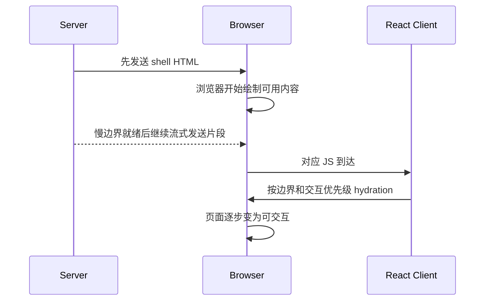

这里有两个不同维度：

- **Streaming SSR** 解决“HTML 必须一次性等齐”的问题；
- **Selective Hydration** 解决“整页 JS 和 hydration 必须一次性完成”的问题。

它们通常需要框架、服务器渲染器、数据层和 Suspense 边界共同配合。只在客户端组件里写一个 `<Suspense>`，不会自动获得完整的流式服务端架构。

### `useSyncExternalStore`：外部状态的一致快照协议

并发 Render 可能暂停、重试，而外部 Store 又能在 React 之外变化。`useSyncExternalStore(subscribe, getSnapshot, getServerSnapshot?)` 规定：

- 如何订阅变更；
- 当前客户端 snapshot 是什么；
- SSR / hydration 的服务端 snapshot 是什么；
- snapshot 未变化时必须尽量返回稳定引用。

这不是“更高级的 `useEffect` 订阅写法”，而是为外部 Store 读取一致性提供协议。业务组件本地 state 不需要为了追新而全部改成它；状态库作者、浏览器 API 适配器和跨 Root Store 更需要掌握。

→ [深入：外部 Store 与 tearing](./react-component-communication-and-state-management.md#6-外部-store-与-usesyncexternalstore)

### `useInsertionEffect`：CSS-in-JS 库的专用时机

`useInsertionEffect` 主要服务 CSS-in-JS 库在布局 Effect 读取布局前注入样式。它不是业务组件通用的“更早 Effect”：

- 不应用来读取常规 refs 或测量布局；
- 不应用来替代 `useEffect` 请求数据；
- 样式库之外很少需要直接调用；
- 面试时应说“为样式注入提供专用时机”，不要背成对所有实现版本都绝对成立的 DOM mutation 口号。

### Strict Mode：开发期验证可重入性和清理对称性

React 18 的 Strict Mode 会在开发环境执行额外检查，例如额外 Render、Effect setup / cleanup 和 ref callback 调用，用来暴露：

- Render 中修改外部变量；
- Effect 订阅没有 cleanup；
- cleanup 不能完整撤销 setup；
- 把“只会挂载一次”当成业务前提；
- 第三方实例重复创建却不销毁。

这不是生产环境“无缘无故执行两次”，也不应通过删除 `<StrictMode>` 来掩盖副作用错误。正确做法是让 Render 纯净，让同步逻辑能够 setup → cleanup → setup 后仍保持正确。

### 关键能力表

| 能力 | 解决的问题 | 面试边界 |
|---|---|---|
| `createRoot` | 启用现代 Root 与新调度语境 | 不等于所有更新都并发 |
| `hydrateRoot` | 复用并接管服务端 HTML | 首屏输出仍需一致，不能当作普通 render |
| 自动批处理 | 减少多更新的中间提交 | 不改变 state snapshot，不保证 Render 次数 |
| Transition | 区分紧急与非紧急 state 更新 | 不减少总计算量，不能控制受控输入值 |
| `useDeferredValue` | 延迟值驱动的昂贵子树 | 不是 debounce，不负责发请求 |
| `useId` | SSR / hydration 稳定无障碍 ID | 不应用作列表 key |
| `useSyncExternalStore` | 外部 Store 一致快照 | 给 Store / 外部订阅协议使用 |
| `useInsertionEffect` | 样式库在布局读取前协调注入 | 不是业务副作用的默认 Hook |
| Streaming SSR | 更早发送可展示 HTML | 需要服务端和框架集成 |
| Selective Hydration | 按边界和优先级接管交互 | 不代表 JS 成本消失 |
| Strict Mode 检查 | 暴露非纯 Render 与错误 cleanup | 额外调用主要发生在开发环境 |

### `useId` 不是列表 key

```tsx
function PasswordField() {
  const hintId = useId();

  return (
    <>
      <input type="password" aria-describedby={hintId} />
      <p id={hintId}>至少 12 个字符</p>
    </>
  );
}
```

`useId` 适合关联 label、hint 和无障碍属性。列表 key 必须来自数据身份；`useId` 与组件树调用位置相关，不能替代业务 ID，也不能为了“生成稳定 key”在 `map` 中调用 Hook。

### React 18 与 React 19 的版本边界

| 主题 | React 18 主线 | React 19.x 增量 |
|---|---|---|
| 并发能力 | 现代 Root、Transition、Suspense 基础 | Actions 与异步 Transition 工作流增强 |
| 表单 | 传统受控 / 非受控和框架方案 | form Actions、`useActionState`、`useFormStatus` 等 |
| 乐观更新 | 手工维护临时状态 | `useOptimistic` |
| 资源读取 | 框架 / Suspense 集成 | `use` 等新消费方式 |
| ref | 函数组件常用 `forwardRef` | 支持 ref 作为 prop，迁移需看生态兼容 |
| Context Provider | `<Context.Provider>` | 支持更简化的 `<Context>` Provider 写法 |

回答 React 18 时，应先讲清它建立的并发与 SSR 基础；React 19 的 Actions、`use`、ref prop 等放到后续版本，不要倒灌进 React 18。

### 面试官追问树

```text
React 18 有哪些变化？
  → 为什么要从 ReactDOM.render 迁移到 createRoot？
  → 自动批处理扩大到了哪些异步来源？
    → state snapshot 为什么仍然不变？
    → flushSync 什么时候才能用？
  → createRoot 是否让所有更新自动并发？
    → Transition 与普通更新如何区分？
  → 并发是不是 Web Worker 或多线程？
  → Streaming SSR 和 Selective Hydration 分别解决什么？
  → useSyncExternalStore 为什么不只是 useEffect + subscribe？
  → Strict Mode 为什么开发期会额外执行？
  → 哪些其实是 React 19，而不是 React 18？
```

### 一句话收束

> React 18 的价值不是“默认变快”，而是提供现代 Root、优先级调度、一致快照和渐进式 SSR 基础；应用仍要正确划分状态、边界和数据协议，才能把基础设施转化为体验收益。

---

## 10. React 19.x 的关键变化

### 面试问题

React 19.x 相比 React 18，面试中应该重点关注什么？

### 30 秒回答

React 19 延续并发和 Suspense 基础，重点改善异步 Action、表单状态和乐观 UI，引入 `useActionState`、`useOptimistic`、`use` 等能力，并简化 ref 传递、Provider 写法及文档元数据 / 资源处理。React 19.2 又加入 `useEffectEvent` 等稳定能力。回答时必须区分 React 核心稳定 API、框架集成能力和实验性特性。

### Actions 心智模型

Action 表示可能异步完成的状态变更过程，React 可以围绕它协调 pending、错误、乐观状态和表单重置。Action 不是新的网络协议，也不替代后端事务。

```tsx
function RenameForm({ rename }: { rename: (name: string) => Promise<string> }) {
  const [error, submitAction, isPending] = useActionState(
    async (_previousError: string | null, formData: FormData) => {
      const name = String(formData.get('name') ?? '').trim();
      if (!name) return '名称不能为空';

      try {
        await rename(name); // 服务端仍需校验权限与业务规则
        return null;
      } catch {
        return '保存失败，请重试';
      }
    },
    null,
  );

  return (
    <form action={submitAction}>
      <input name="name" disabled={isPending} />
      <button disabled={isPending}>{isPending ? '保存中…' : '保存'}</button>
      {error && <p role="alert">{error}</p>}
    </form>
  );
}
```

### `use`

`use` 可在渲染中读取 Promise 或 Context；Promise pending 时与 Suspense 协作，reject 时交给 Error Boundary。它与普通 Hook 规则不完全相同，可在条件中调用，但资源创建和缓存应由框架或稳定数据层管理，避免每次 Render 新建 Promise 导致重复挂起。

### ref 作为 prop

React 19 中函数组件可接收 `ref` prop，减少部分 `forwardRef` 包装。组件库升级时需要考虑 React 版本范围和类型声明，不能只改源码不改 peer dependency。

### Provider 简化

现代写法可以直接使用 `<ThemeContext value={theme}>`；旧代码中的 `<ThemeContext.Provider>` 仍是常见历史形式。

### 文档元数据和资源

React 19 支持组件中声明 `title`、`meta`、`link` 等文档元数据，并改善样式表、脚本等资源的优先级与去重协调。框架通常会提供更完整的路由级 metadata 方案，项目中应统一一条管理路径。

### React 19.2 重点

- `useEffectEvent`：分离 Effect 的响应式同步与非响应式最新值读取。
- Activity 等能力需要根据官方稳定性与目标版本核对后使用。
- 性能诊断和服务端能力持续增强，但面试回答不应把 canary / experimental API 当成所有项目可直接使用的稳定能力。

---

## 11. Server Components 与框架边界

### 面试问题

React Server Components（RSC）和 SSR 有什么区别？是否属于 React 19 就能直接使用的浏览器 API？

### 30 秒回答

SSR 把组件初始输出渲染为 HTML，客户端通常还需 hydration 建立交互；Server Components 在服务端执行并把序列化组件结果传给客户端，不把对应组件 JavaScript 发送到浏览器，可与 Client Components 组合。RSC 需要 bundler、路由、数据缓存和协议集成，实际项目通常通过 Next.js 等框架使用，不是仅升级 React 就自动获得完整方案。

### 对比表

| 维度 | CSR | SSR | Server Components |
|---|---|---|---|
| 组件执行位置 | 浏览器 | 服务端初始 + 浏览器 hydration | Server Component 仅服务端，Client Component 在客户端 |
| 首屏 HTML | 通常较少 | 有 | 可组合进流式结果 |
| 客户端 JS | 全部客户端组件 | 仍需 hydration 代码 | Server Component 代码不下发 |
| 可直接使用浏览器 API | 是 | 服务端阶段否 | Server Component 否 |
| 状态与事件 | 支持 | hydration 后支持 | 需 Client Component |

### 边界规则

- Server Component 可读取服务端资源，但不能使用客户端状态和 Effect。
- Client Component 用 `'use client'` 声明客户端边界，可使用交互 Hook。
- 从服务端传到客户端的 props 必须可序列化，函数等能力通过框架支持的 Action 协议处理。
- 不要在通用 React 面试中把 Next.js 的缓存策略说成 React 核心固定行为。

---

## 12. 生命周期、Strict Mode 与并发安全

### 面试问题

Fiber 和并发对类组件生命周期有什么影响？为什么 Strict Mode 会“执行两次”？

### 30 秒回答

可中断 Render 意味着 Render 阶段生命周期不能依赖只调用一次，因此旧的 `componentWill*` 生命周期被标记为不安全。Strict Mode 在开发环境额外调用组件、Effect 和 ref 回调流程，帮助暴露不纯渲染和缺少清理的问题；这不是生产环境无条件重复提交，而是并发安全检查。

### 历史生命周期分类

| 阶段 | 生命周期 | 建议 |
|---|---|---|
| Render | `render`、`getDerivedStateFromProps` | 必须纯净 |
| Pre-commit | `getSnapshotBeforeUpdate` | 读取变更前 DOM 快照 |
| Commit | `componentDidMount/Update` | 可执行副作用，但要清理 |
| Unmount | `componentWillUnmount` | 释放外部资源 |
| Legacy unsafe | `componentWillMount/ReceiveProps/Update` | 遗留项目迁移 |

### Strict Mode 发现的典型 bug

```tsx
let nextId = 0;

function BrokenList({ items }: { items: Item[] }) {
  // ❌ Render 期间修改模块全局变量，多次调用会产生不可预测结果
  return items.map((item) => <Row key={nextId++} item={item} />);
}
```

key 应来自稳定数据身份。任何依赖“组件只执行一次”的逻辑，都需要重新设计。

### 外部订阅必须可重入

```tsx
useEffect(() => {
  socket.subscribe(handler);
  return () => socket.unsubscribe(handler); // setup / cleanup 对称，重复验证也安全
}, [socket, handler]);
```

如果 cleanup 不能完整撤销 setup，开发 Strict Mode 常会暴露重复连接、重复监听和计时器泄漏。

---

## 13. 面试速查

### 高频问答

**Q：Fiber 的核心价值？**
A：把协调工作拆成显式单元，保存遍历和优先级信息，让 Render 可调度，为并发、Suspense 和 Transition 提供基础。

**Q：Fiber 是链表吗？**
A：节点通过 child / sibling / return 指针组织为可遍历工作树；单说链表不完整。

**Q：双缓冲是什么？**
A：current 表示已提交版本，workInProgress 表示下一版本，alternate 连接对应节点；完成后切换根指针。

**Q：lanes 和 Scheduler？**
A：lanes 表达 React 更新优先级 / 批次；Scheduler 安排回调执行时机，二者协作但不同层。

**Q：并发是不是多线程？**
A：通常不是。它是主线程上的可中断、可重试和有优先级的渲染管理。

**Q：为什么 Commit 不能中断？**
A：它修改用户可见宿主环境，中断会产生半完成界面；Render 只计算内存树，可安全重做。

**Q：Suspense 会自动请求数据吗？**
A：不会；它协调支持 Suspense 的资源等待与 fallback，数据能力由框架或兼容数据层提供。

### 稳定性边界表

| 层级 | 示例 | 回答方式 |
|---|---|---|
| React 稳定核心 | state、Effect、Transition、Suspense、Actions | 可作为主线 |
| React DOM 能力 | `createRoot`、表单 action、资源协调 | 说明渲染器边界 |
| 框架能力 | 路由缓存、RSC bundling、Server Actions 部署 | 不归因成 React 单独完成 |
| Canary / Experimental | 未进入稳定文档的 API | 明确实验状态，不作为通用方案 |

## 参考资料

- [Render and Commit](https://react.dev/learn/render-and-commit)、[Preserving and Resetting State](https://react.dev/learn/preserving-and-resetting-state)
- [`useTransition`](https://react.dev/reference/react/useTransition)、[`useDeferredValue`](https://react.dev/reference/react/useDeferredValue)、[`Suspense`](https://react.dev/reference/react/Suspense)
- [React v18.0](https://react.dev/blog/2022/03/29/react-v18)、[React 19](https://react.dev/blog/2024/12/05/react-19)、[React 19.2](https://react.dev/blog/2025/10/01/react-19-2)
- [React Server Components](https://react.dev/reference/rsc/server-components)、[Server Functions](https://react.dev/reference/rsc/server-functions)
- [ReactFiberWorkLoop.js](https://github.com/facebook/react/blob/main/packages/react-reconciler/src/ReactFiberWorkLoop.js)、[ReactFiberRootScheduler.js](https://github.com/facebook/react/blob/main/packages/react-reconciler/src/ReactFiberRootScheduler.js)：Root 调度、同步 / 并发工作循环源码导航
- [ReactFiberLane.js](https://github.com/facebook/react/blob/main/packages/react-reconciler/src/ReactFiberLane.js)、[Scheduler](https://github.com/facebook/react/tree/main/packages/scheduler)：lane 集合与宿主调度源码导航
- [ReactFiberBeginWork.js](https://github.com/facebook/react/blob/main/packages/react-reconciler/src/ReactFiberBeginWork.js)、[ReactFiberCompleteWork.js](https://github.com/facebook/react/blob/main/packages/react-reconciler/src/ReactFiberCompleteWork.js)：`beginWork` / `completeWork` 职责导航

## 关联专题

- [React 面试知识总纲](./react-interview-guide.md)
- [状态更新与渲染](./react-state-and-rendering.md)
- [Hooks 深入](./react-hooks-deep-dive.md)
- [React Diff 与 Vue 3 对比](./react-diff-vue3-compare.md)
- [性能与工程化](./react-performance-and-engineering.md)
