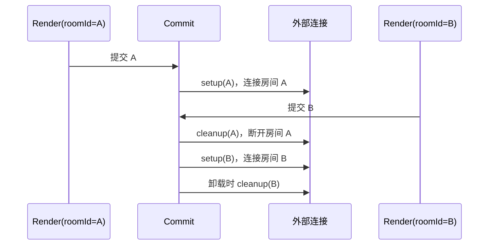
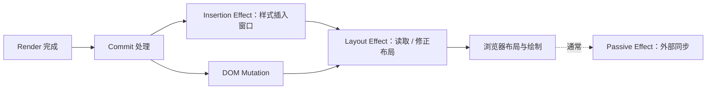
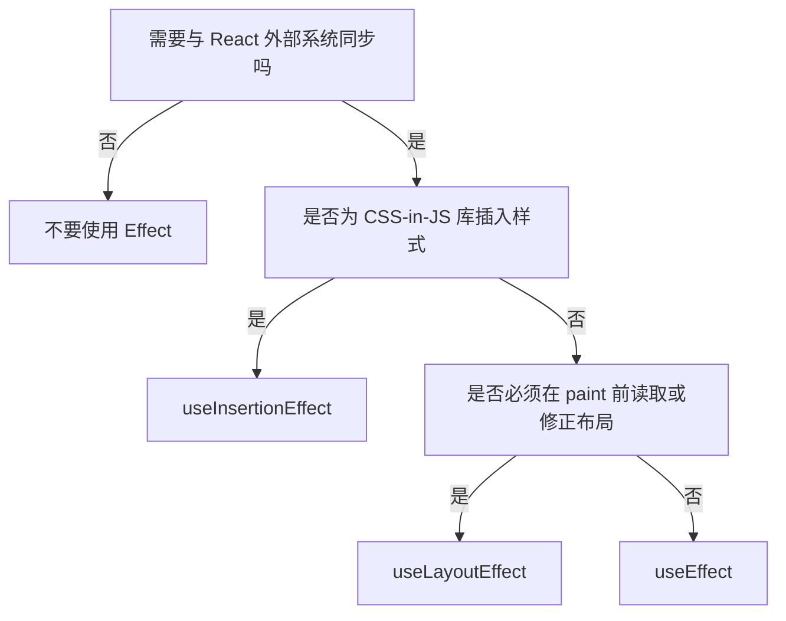

# React Hooks 深入：调用顺序、闭包、Effect 与逻辑复用

> 适用版本：React 19.x；重点不是背 API，而是理解 Hook 如何把状态挂到 Fiber、为什么存在调用规则，以及 Effect 如何描述外部同步。
> 难度标签：`基础必会` `进阶重点` `高级深挖` `历史兼容`

## 目录

- [1. Hooks 解决了什么问题](#1-hooks-解决了什么问题)
- [2. Hook 状态为什么依赖调用顺序](#2-hook-状态为什么依赖调用顺序)
- [3. useState 与 useReducer](#3-usestate-与-usereducer)
- [4. 闭包与过期值](#4-闭包与过期值)
- [5. Effect 的正确心智模型](#5-effect-的正确心智模型)
- [6. 三种 Effect 的时机](#6-三种-effect-的时机)
- [7. useRef 与命令式边界](#7-useref-与命令式边界)
- [8. memo、useMemo 与 useCallback](#8-memousememo-与-usecallback)
- [9. 自定义 Hooks](#9-自定义-hooks)
- [10. React 19.x 常见现代 Hooks](#10-react-19x-常见现代-hooks)
- [11. 高频错误与排查](#11-高频错误与排查)
- [12. 面试速查](#12-面试速查)

---

## 1. Hooks 解决了什么问题

### 面试问题

Hooks 为什么出现？它们比类组件生命周期好在哪里？

### 30 秒回答

Hooks 让函数组件拥有状态、Context、ref 和 Effect 等 React 能力，并允许按业务关注点复用有状态逻辑。类组件常把同一业务同步拆到多个生命周期，又把无关逻辑堆进同一方法；自定义 Hook 可以把“订阅 + 清理”“请求 + 竞态处理”等完整逻辑单元组合起来，同时避免 HOC 和 Render Props 的额外组件层级。

### Hooks 没有解决什么

- 不会自动解决复杂状态建模；复杂迁移仍需要 reducer 或状态机思维。
- 不会自动保证 Effect 正确；依赖和清理仍要精确。
- 不会自动提升性能；滥用 memoization 反而增加复杂度。
- 不会把组件变成“只执行一次”的函数；组件会随渲染多次执行。

### Hook 的分类

| 类别 | 常用 Hook | 核心用途 |
|---|---|---|
| 状态 | `useState`、`useReducer` | 保存组件记忆 |
| 上下文 | `useContext` | 读取祖先提供的值 |
| 引用 | `useRef`、`useImperativeHandle` | 保存非渲染数据或暴露命令式能力 |
| 外部同步 | `useEffect`、`useLayoutEffect`、`useInsertionEffect` | 与 React 外部系统同步 |
| 性能 | `useMemo`、`useCallback`、`useTransition`、`useDeferredValue` | 跳过计算或调节更新优先级 |
| 外部 Store | `useSyncExternalStore` | 并发安全地订阅外部状态 |
| 现代交互 | `useActionState`、`useOptimistic`、`useFormStatus` | Action / 表单 / 乐观更新 |

---

## 2. Hook 状态为什么依赖调用顺序

### 面试问题

为什么 Hook 只能在组件或自定义 Hook 顶层调用？React 如何知道某个 `useState` 对应哪份状态？

### 30 秒回答

函数组件没有类实例字段，React 需要在多次 Render 之间把“第 N 次 Hook 调用”对应到同一个 Hook 状态槽。组件 Fiber 保存一条按调用顺序组织的 Hook 链表；挂载时依次创建节点，更新时依次复用节点。若 Hook 放在条件、循环或提前返回之后，不同 Render 的调用序列发生变化，后续 Hook 就会读取错误槽位。

### 3 分钟展开

Hook 规则不是语法偏好，而是 React 的寻址协议：

1. 开始执行函数组件前，React 根据当前 Fiber 是首次挂载还是更新，选择不同的 Hook dispatcher；
2. 每调用一次 Hook，内部指针移动到链表中的下一个 Hook 节点；
3. `useState`、`useReducer`、`useEffect` 等都依赖当前节点保存自己的状态或 Effect 元数据；
4. 组件执行结束后，这条 Hook 链表挂在 Fiber 的 `memoizedState` 上；
5. 下一次 Render 必须用相同顺序遍历，才能把第 N 次调用与上一次第 N 个节点对应起来。

所以 React 并不是通过变量名 `count`、`name` 识别 Hook，也不是给每个 Hook 自动生成业务 ID，而是依赖稳定调用顺序。


图示重点是“顺序寻址”：Fiber 通过 `memoizedState` 找到第一个 Hook，每个 Hook 再通过 `next` 指向下一个节点。

### Hook 数据存在哪里

> 下列结构是面试级简化示意，并非 React 源码原文；不同 Hook 会复用字段保存不同含义。

```js
const functionComponentFiber = {
  memoizedState: firstHook, // 函数组件的第一个 Hook 节点
  updateQueue: effectQueue, // Effect 等提交阶段信息
};

const hook = {
  memoizedState: null, // useState 的状态，或 useEffect 的 Effect 记录
  baseState: null,     // Update Queue 重放的基础状态
  baseQueue: null,     // 被低优先级跳过的 Update
  queue: null,         // useState / useReducer 的更新队列
  next: null,          // 下一个 Hook
};
```

| 位置 | 主要保存内容 |
|---|---|
| Fiber `memoizedState` | 第一个 Hook 节点 |
| Hook `memoizedState` | 当前 Hook 的状态、memo 值或 Effect 记录 |
| Hook `queue` | `useState` / `useReducer` 的 Update Queue |
| Hook `next` | 组件内下一个 Hook，形成单向链表 |
| Fiber `updateQueue` | 提交阶段需要遍历的 Effect 等信息 |

### mount dispatcher 与 update dispatcher

首次挂载和后续更新的核心差异是：

| 阶段 | 行为 |
|---|---|
| Mount | 创建新的 Hook 节点，计算初始值，建立 queue |
| Update | 按顺序读取旧 Hook，克隆或复用到 work-in-progress，并处理 pending updates |
| Re-render | 处理 Render Phase Update 等特殊情况，仍必须保持调用顺序 |

> 下列代码是简化 JavaScript 伪代码，并非 React 源码原文。

```js
let currentlyRenderingFiber = null;
let workInProgressHook = null;

function mountWorkInProgressHook() {
  const hook = {
    memoizedState: null,
    baseState: null,
    baseQueue: null,
    queue: null,
    next: null,
  };

  if (workInProgressHook === null) {
    // 第一个 Hook 挂到当前 Fiber
    currentlyRenderingFiber.memoizedState = hook;
  } else {
    // 后续 Hook 按调用顺序追加
    workInProgressHook.next = hook;
  }

  workInProgressHook = hook;
  return hook;
}
```

更新阶段需要同时沿着 current Hook 链和 work-in-progress Hook 链移动：

```js
let currentHook = null;
let workInProgressHook = null;

function updateWorkInProgressHook() {
  const nextCurrentHook =
    currentHook === null
      ? currentlyRenderingFiber.alternate?.memoizedState
      : currentHook.next;

  if (nextCurrentHook === null) {
    throw new Error('本次 Render 调用了比上次更多的 Hook');
  }

  currentHook = nextCurrentHook;

  const newHook = {
    memoizedState: currentHook.memoizedState,
    baseState: currentHook.baseState,
    baseQueue: currentHook.baseQueue,
    queue: currentHook.queue,
    next: null,
  };

  appendToWorkInProgressHookList(newHook);
  return newHook;
}
```

真实实现还会处理已有 work-in-progress Hook、热更新、开发环境校验等分支。面试重点是：**更新阶段没有业务名称可查，只能沿旧链表按位置读取**。

### 条件调用为什么会发生位置错配

```tsx
function BrokenProfile({ showAge }: { showAge: boolean }) {
  const [name] = useState('Ada');

  if (showAge) {
    const [age] = useState(36); // ❌ 条件 Hook
    console.log(age);
  }

  const [city] = useState('London');
  return <p>{name} - {city}</p>;
}
```

两次 Render 的调用序列：

| Hook 位置 | `showAge = true` | `showAge = false` |
|---:|---|---|
| 1 | `useState(name)` | `useState(name)` |
| 2 | `useState(age)` | `useState(city)` |
| 3 | `useState(city)` | 不存在 |

第二次 Render 中，`city` 会尝试读取上一次第 2 个槽位，也就是 `age` 的状态。React 开发环境通常会报告 Hook 数量或顺序变化；即使某段代码暂时没有报错，协议也已经被破坏。

正确方式是让 Hook 顺序稳定，把条件放到 Hook 内部逻辑或渲染结果中：

```tsx
function CorrectProfile({ showAge }: { showAge: boolean }) {
  const [name] = useState('Ada');
  const [age] = useState(36); // ✅ 每次 Render 都调用
  const [city] = useState('London');

  return (
    <p>
      {name}
      {showAge ? ` - ${age}` : ''}
      {' - '}{city}
    </p>
  );
}
```

### 提前返回为什么也要小心

```tsx
function UserPanel({ user }: { user: User | null }) {
  const [expanded, setExpanded] = useState(false);

  if (user === null) {
    return <p>未登录</p>;
  }

  // ❌ 如果某次 Render 提前返回，下面的 Hook 就不会执行
  const permissions = useMemo(() => buildPermissions(user), [user]);

  return <button onClick={() => setExpanded((value) => !value)}>{String(expanded)}{permissions.length}</button>;
}
```

应把所有 Hook 放在可能的提前返回之前，或拆分成子组件，使每个组件内部的调用序列稳定。

### 为什么 `useState` 返回数组

Hook 顺序依赖的是“调用位置”，不是返回值形态；`useState` 返回数组主要是 API 设计选择：调用者可以自由命名并通过数组解构区分当前值与 dispatch。

```tsx
const [count, setCount] = useState(0);
const [name, setName] = useState('Ada');
```

若返回固定键名对象，多次调用时需要频繁重命名。数组并不是 Hook 能工作的底层原因。

### Render Phase Update 与 Strict Mode 边界

- Render 期间更新当前正在渲染的组件，React 有专门的重新渲染与次数限制机制，但这不是常规状态建模方式；无条件更新会形成死循环。
- Strict Mode 在开发环境可能额外调用组件、初始化函数或 updater，目的是发现不纯逻辑，不会改变 Hook 必须稳定排序的规则。
- 自定义 Hook 可以包含其他 Hook，但每次调用自定义 Hook 时，其内部 Hook 序列同样必须稳定。
- `use` 与传统 Hook 的调用限制并不完全相同；面试回答“Hook 规则”时要区分普通 Hooks 与 React 对 `use` 的特殊规则，不能据此放宽 `useState` / `useEffect` 的限制。

### 如何验证 Hook 顺序问题

1. 启用 `eslint-plugin-react-hooks`，不要关闭 `rules-of-hooks`；
2. 搜索条件、循环、回调和提前返回之后的 Hook；
3. 将条件逻辑移入 Effect / callback 内部，或拆成子组件；
4. 若错误只在特定 props 下出现，列出不同 Render 的 Hook 调用序列进行对照。

### 面试官追问树

1. React 为什么不能按变量名保存 Hook 状态？
2. Hook 节点存在哪个对象上？
3. Mount 与 Update dispatcher 有什么区别？
4. 条件调用为什么会让后续 Hook 错位？
5. 自定义 Hook 会共享状态吗？
6. Render Phase Update 为什么危险？
7. `use` 为什么不能简单套用所有传统 Hook 规则？

### 一句话收束

> Hook 链表解决“状态存在哪里”，稳定调用顺序解决“下一次 Render 怎么找到同一个状态”；条件调用破坏的正是这套位置寻址协议。

---

## 3. useState 与 useReducer

### 面试问题

什么时候用 `useState`，什么时候用 `useReducer`？

### 30 秒回答

独立、简单的状态优先 `useState`；当多个字段围绕事件一起迁移、下一状态规则复杂、希望集中校验状态转换时使用 `useReducer`。Reducer 应保持纯净，只根据 state 和 action 计算下一 state；异步请求和订阅放事件处理器或 Effect。

### 用 reducer 表达状态迁移

```tsx
type State =
  | { status: 'idle'; data: null; error: null }
  | { status: 'loading'; data: null; error: null }
  | { status: 'success'; data: string[]; error: null }
  | { status: 'error'; data: null; error: string };

type Action =
  | { type: 'request' }
  | { type: 'success'; data: string[] }
  | { type: 'failure'; error: string }
  | { type: 'reset' };

function reducer(state: State, action: Action): State {
  switch (action.type) {
    case 'request':
      return { status: 'loading', data: null, error: null };
    case 'success':
      return { status: 'success', data: action.data, error: null };
    case 'failure':
      return { status: 'error', data: null, error: action.error };
    case 'reset':
      return { status: 'idle', data: null, error: null };
    default: {
      // TypeScript 穷尽检查，新增 action 时提醒补全分支
      const exhaustive: never = action;
      return exhaustive;
    }
  }
}
```

### 初始化函数

```tsx
function createInitialState(raw: string[]) {
  // 仅首次挂载时执行昂贵初始化
  return { items: raw.map((value) => value.trim()) };
}

const [state, setState] = useState(() => createInitialState(source));
```

传函数本身与传函数返回值不同：`useState(createInitialState(source))` 会在每次组件执行时先计算参数，即使 React 只采用初始那次结果。

### Reducer 与 Immer

复杂不可变更新可以使用 Immer 降低嵌套复制成本，但要知道它通过代理记录“看似修改”的操作并生成不可变结果。面试中仍应能手写基础结构共享，避免把工具用法当成状态模型。

---

## 4. 闭包与过期值

### 面试问题

什么是 stale closure（过期闭包）？如何解决？

### 30 秒回答

每次渲染都会创建新的函数闭包，闭包读取的是那次渲染的 props 和 state。如果异步回调或 Effect 长期保留旧函数，就会看到旧值。解决方式取决于意图：更新依赖前值时用函数式更新；Effect 需要响应值变化时声明依赖；需要非响应地读取最新值时使用 `useEffectEvent` 或谨慎使用 ref。

### 典型错误：Interval 捕获初始值

```tsx
function BrokenTimer() {
  const [count, setCount] = useState(0);

  useEffect(() => {
    const id = window.setInterval(() => {
      setCount(count + 1); // ❌ 永远基于首次 Effect 捕获的 count
    }, 1000);

    return () => window.clearInterval(id);
  }, []); // 缺失 count 是在掩盖语义问题

  return <p>{count}</p>;
}
```

推荐写法：

```tsx
function Timer() {
  const [count, setCount] = useState(0);

  useEffect(() => {
    const id = window.setInterval(() => {
      // 函数式更新不需要读取闭包中的 count
      setCount((value) => value + 1);
    }, 1000);

    return () => window.clearInterval(id);
  }, []);

  return <p>{count}</p>;
}
```

### stale closure 中为什么不能欺骗依赖数组

依赖数组是在声明 Effect 使用了哪些响应式值。不要先决定“只执行一次”，再通过空数组欺骗 linter。正确顺序是：

1. 明确要同步的外部系统。
2. 写出 setup 和 cleanup。
3. 声明 setup 使用的所有响应式依赖。
4. 如果依赖过多，重构代码或分离响应式 / 非响应式逻辑。

---

## 5. Effect 的正确心智模型

### 面试问题

`useEffect` 到底解决什么问题？依赖变化时 setup 和 cleanup 按什么顺序执行？

### 30 秒回答

Effect 用于让已经提交的 React UI 与 React 外部系统保持同步，例如网络连接、浏览器 API、第三方组件和订阅。依赖项使用 `Object.is` 逐项比较；依赖变化时，React 会先用旧 Render 捕获的值执行上一次 cleanup，再用新 Render 的值执行 setup；卸载时执行最后一次 cleanup。Effect 不是生命周期方法的机械拼接，也不应该用来同步本可在 Render 中直接推导的数据。

### 3 分钟展开

判断是否需要 Effect，可以依次问 4 个问题：

1. 是否存在 React 外部系统？如果没有，通常不需要 Effect；
2. 同步是否由“组件已经显示”触发？如果是具体用户动作，优先放事件处理器；
3. setup 建立了什么资源？cleanup 必须撤销同一次 setup 建立的资源；
4. 哪些 reactive values 决定这次同步？它们都应进入依赖数组。

Effect 的生命周期属于“某一次同步过程”，而不是组件整体：

```text
setup(A) → cleanup(A) → setup(B) → cleanup(B)
```

每次 setup 都使用创建它的 Render snapshot；cleanup 也闭包捕获同一份旧值，因此能精确撤销旧连接，而不是读取一个已经变化的全局变量。



### Effect 记录存在哪里

> 下列结构是面试级简化示意，并非 React 源码原文。

`useEffect` 本身仍占用一个 Hook 节点；Hook 的 `memoizedState` 保存 Effect 记录，函数组件 Fiber 的 update queue 还会维护本次提交需要处理的 Effect 列表。

```js
const effect = {
  tag: 'Passive | HasEffect',
  create: setup,
  destroy: previousCleanup,
  deps: [roomId],
  next: null, // 多个 Effect 可形成环形链表
};

const effectHook = {
  memoizedState: effect,
  next: nextHook,
};
```

这解释了两个现象：

- Effect 依然必须遵守 Hook 调用顺序；
- 依赖未变化时，React 可以保留 Effect 记录但不标记本次需要重新执行 setup。

### 依赖数组如何比较

React 会检查依赖数组长度，并使用 `Object.is` 比较对应位置：

> 下列代码是简化 JavaScript 伪代码，并非 React 源码原文。

```js
function areHookInputsEqual(nextDeps, previousDeps) {
  if (previousDeps === null || nextDeps.length !== previousDeps.length) {
    return false;
  }

  for (let index = 0; index < nextDeps.length; index += 1) {
    if (!Object.is(nextDeps[index], previousDeps[index])) {
      return false;
    }
  }

  return true;
}
```

因此新建对象、数组和函数会因为引用变化让 Effect 重新同步。解决方式不是盲目删除依赖，而是先判断该对象是否真的需要存在、能否移入 Effect、能否拆成 primitive，最后才考虑 memoization。

### 完整订阅示例

```tsx
function ChatRoom({ roomId }: { roomId: string }) {
  useEffect(() => {
    const connection = createConnection(roomId);
    connection.connect(); // setup：建立当前 roomId 的连接

    return () => {
      // cleanup 捕获的是同一次 Render 的 connection 和 roomId
      connection.disconnect();
    };
  }, [roomId]);

  return <p>房间：{roomId}</p>;
}
```

依赖从 A 变成 B 时，不是“直接执行新 Effect”，而是：

```text
旧 cleanup(A) → 新 setup(B)
```

卸载时只有 cleanup，没有新的 setup。

### 不需要 Effect 的场景

#### 1. 计算派生值

```tsx
// ❌ 多一次 state、Render 和 Commit，还可能短暂显示旧值
useEffect(() => {
  setFullName(`${firstName} ${lastName}`);
}, [firstName, lastName]);

// ✅ 纯派生值在 Render 中直接计算
const fullName = `${firstName} ${lastName}`;
```

#### 2. 响应具体用户动作

```tsx
function BuyButton({ product }: { product: Product }) {
  function handleBuy() {
    // ✅ “购买”由点击触发，应在事件处理器中表达
    purchase(product.id);
  }

  return <button onClick={handleBuy}>购买</button>;
}
```

#### 3. 重置整棵子树

当实体 ID 变化需要重置内部状态时，优先用 `key` 定义新身份，而不是在 Effect 中逐项调用 setter。

### 请求竞态：为什么 cleanup 很重要

用户快速输入 `react` 和 `vue` 时，旧请求可能晚于新请求返回。如果旧请求最后写入 state，页面就会显示过期结果。

#### 方案一：`AbortController`

```tsx
function SearchResult({ query }: { query: string }) {
  const [result, setResult] = useState<string[]>([]);

  useEffect(() => {
    const controller = new AbortController();

    async function load() {
      const response = await fetch(`/api/search?q=${encodeURIComponent(query)}`, {
        signal: controller.signal,
      });
      const data = (await response.json()) as string[];
      setResult(data); // 只有未取消请求可以正常到达这里
    }

    void load().catch((error: unknown) => {
      if (!(error instanceof DOMException && error.name === 'AbortError')) {
        console.error(error);
      }
    });

    return () => {
      controller.abort(); // query 变化或卸载时取消旧请求
    };
  }, [query]);

  return <ResultList items={result} />;
}
```

#### 方案二：忽略过期结果

某些 API 无法取消时，可以让 cleanup 标记旧同步过程已经失效：

```tsx
useEffect(() => {
  let ignore = false;

  async function load() {
    const data = await fetchResult(query);

    if (!ignore) {
      setResult(data); // 只允许当前 Effect 实例提交结果
    }
  }

  void load();

  return () => {
    ignore = true;
  };
}, [query]);
```

| 方案 | 能否停止网络工作 | 能否阻止旧结果覆盖 | 适用场景 |
|---|---:|---:|---|
| `AbortController` | 通常可以 | 可以 | 支持 signal 的 fetch / API |
| ignore flag | 不可以 | 可以 | 请求无法取消，但要保证结果时序 |
| 数据框架 / 缓存层 | 由实现决定 | 可以，并可去重缓存 | 生产级查询、SSR、预取、重试 |

工程中还要处理缓存、去重、SSR、预取、错误重试和瀑布请求，通常应交给框架数据层或 TanStack Query 等服务端状态工具，而不是每个组件重复手写 Effect。

### Strict Mode 为什么会多一次 setup / cleanup

开发环境 Strict Mode 会额外执行一次 setup → cleanup → setup 检查，用来验证 cleanup 是否能完整撤销 setup。正确写法不应通过“只运行一次 ref”掩盖重复连接，而应让同步过程具备可重入性：

```tsx
useEffect(() => {
  const subscription = source.subscribe(handleChange);

  return () => {
    subscription.unsubscribe(); // cleanup 与 setup 完全对称
  };
}, [source]);
```

如果额外执行后产生两个连接，说明真正问题是缺少或写错 cleanup。

### 依赖数组不是执行频率开关

- 不传依赖数组：每次相关提交后都重新同步；
- `[]`：表示 Effect 不读取会随 Render 变化的 reactive value，而不是“我要它只执行一次”；
- `[a, b]`：`a` 或 `b` 通过 `Object.is` 比较发生变化时重新同步。

不要为了控制次数而欺骗 linter。若依赖过多，应重构同步边界，而不是删除真实依赖。

### Effect 与生命周期的关系

类组件把逻辑分散到 mount、update、unmount 方法；Effect 把同一外部同步过程的 setup 与 cleanup 放在一起。因此可以用生命周期帮助迁移，但不能建立机械等号：

```text
componentDidMount + componentDidUpdate + componentWillUnmount
                     ≠
                 useEffect
```

### 边界与反例

- Effect 只在客户端运行，Server Rendering 不执行 Effect。
- `useEffect` 的 passive flush 通常不会阻塞浏览器绘制，但交互来源等情况会影响具体时机，不能承诺“永远在 paint 后”。
- cleanup 不只在卸载时执行，依赖变化且 Effect 需要重新同步时也会先执行旧 cleanup。
- 空依赖数组不能豁免闭包规则；读取了 reactive value 却不声明依赖，会产生 stale closure。
- Effect cleanup 不应更新已经卸载组件的 UI 状态；它的职责是撤销外部同步。

### 面试官追问树

1. 什么情况下根本不需要 Effect？
2. cleanup 在什么时候执行？
3. 依赖数组如何比较？
4. 为什么对象依赖经常导致重复执行？
5. 请求竞态如何取消或忽略？
6. Strict Mode 为什么额外执行 setup / cleanup？
7. Effect 与生命周期为什么不能画等号？
8. Passive Effect 是否保证永远在 paint 后？

### 一句话收束

> Effect 不是“组件渲染后的万能回调”，而是一段可反复启动和停止的外部同步过程；依赖决定何时重启，cleanup 保证旧过程先被完整撤销。

---

## 6. 三种 Effect 的时机

### 面试问题

`useEffect`、`useLayoutEffect`、`useInsertionEffect` 有什么区别？

### 30 秒回答

`useEffect` 用于不影响首帧布局的大多数外部同步，通常在提交和浏览器绘制机会之后 flush；`useLayoutEffect` 在 DOM 已更新、浏览器重新绘制前同步执行，适合测量并立即修正布局，但会阻塞绘制；`useInsertionEffect` 提供更早的样式插入窗口，主要服务 CSS-in-JS 库，不适合普通业务副作用。

### 3 分钟展开

三者都用于外部同步，但占用的浏览器关键路径不同：

- **Insertion Effect**：让样式库在 Layout Effect 读取布局前插入规则，避免动态样式导致错误测量；React 不保证此时 DOM 已经更新，ref 也尚未绑定；
- **Layout Effect**：DOM 已经提交，可以读取布局并同步修正；React 会在浏览器 paint 前完成它；
- **Passive Effect**：优先让浏览器获得绘制机会，再处理网络连接、订阅、日志等不影响布局的同步。



> 这是面试级职责关系图，不是绝对逐行时序。`useInsertionEffect` 保证的是“在 Layout Effect 前提供样式插入窗口”，而不是“此时 DOM 一定未更新或已经更新”；其 cleanup / setup 还可能按组件交错执行。交互更新也可能影响 Passive Effect 的实际 flush 时机。

### 对比表

| API | 主要时机 | 是否阻塞绘制 | 典型用途 | 不适合做什么 |
|---|---|---:|---|---|
| `useInsertionEffect` | Layout Effect 之前的样式插入窗口；不保证 DOM 是否已更新 | 是 | CSS-in-JS 注入规则 | 读取 ref、更新 state、普通订阅 |
| `useLayoutEffect` | DOM 更新后、浏览器 paint 前 | 是 | 测量尺寸、同步定位、命令式布局修正 | 网络请求、可延后的日志和订阅 |
| `useEffect` | 提交后的 Passive Effect flush，通常让出绘制机会 | 通常否 | 网络连接、浏览器 API、订阅、埋点 | 首帧前必须完成的布局测量 |

### Layout Effect：避免可见闪烁

```tsx
function Tooltip({ anchor }: { anchor: DOMRect }) {
  const ref = useRef<HTMLDivElement>(null);
  const [height, setHeight] = useState(0);

  useLayoutEffect(() => {
    // DOM 已提交，但浏览器通常还没有绘制这一帧
    const nextHeight = ref.current?.getBoundingClientRect().height ?? 0;
    setHeight(nextHeight); // 同步修正位置，避免用户先看到错误位置
  }, [anchor]);

  const top = anchor.top - height;

  return (
    <div ref={ref} style={{ position: 'fixed', top, left: anchor.left }}>
      提示内容
    </div>
  );
}
```

这里需要两次 Render，但 React 会尽量在 paint 前完成测量与修正。代价是主线程被占用更久，因此能用 CSS 布局解决时，不要使用 `useLayoutEffect`。

### Passive Effect：不参与布局修正

```tsx
function OnlineReporter({ userId }: { userId: string }) {
  useEffect(() => {
    const stop = analytics.trackPresence(userId);

    return () => {
      stop(); // 用户变化或卸载时停止旧上报
    };
  }, [userId]);

  return null;
}
```

上报不影响当前 DOM 的尺寸和位置，放在 Passive Effect 可以减少对关键绘制路径的阻塞。

### Insertion Effect：库作者的样式插入窗口

普通业务很少需要直接调用 `useInsertionEffect`。CSS-in-JS 库可能使用它保证样式规则在布局测量前就存在：

```tsx
function useCssRule(rule: string) {
  useInsertionEffect(() => {
    const styleElement = document.createElement('style');
    styleElement.textContent = rule;
    document.head.appendChild(styleElement);

    return () => {
      styleElement.remove(); // 移除本次插入的样式
    };
  }, [rule]);
}
```

这是用于解释职责的简化示例。真实样式库还要做规则去重、缓存、SSR 提取、优先级和 CSP 处理。`useInsertionEffect` 执行时 ref 尚未绑定，也禁止在其中更新 state；业务组件不应把它当成“比 `useLayoutEffect` 更快”的通用 API。

### cleanup 与 setup 的相对顺序

对同一种 Effect，当依赖变化时都遵循“先撤销旧同步，再建立新同步”：

```text
旧 cleanup → 新 setup
```

差别在于它们被安排在哪个提交窗口执行：

- Insertion cleanup / setup：服务样式插入时机，并可能按组件交错执行；
- Layout cleanup / setup：位于布局读取和 paint 之前；
- Passive cleanup / setup：位于 Passive Effect flush。

不要把 cleanup 简化成“组件卸载才执行”。

### 与浏览器 paint 的细化边界

- `useLayoutEffect` 会阻塞浏览器重新绘制；其中同步更新 state 还可能让 React 立即处理剩余 Effect，因此应保持短小。
- `useEffect` 通常让浏览器先 paint，但由交互引起的 Effect 可能在 paint 前执行，以便事件系统观察结果。
- 如果 Effect 中的工作必须明确延后到浏览器完成绘制后的另一个任务，可结合具体需求使用 `setTimeout`、`requestAnimationFrame` 或调度 API，而不是依赖一句“useEffect 永远在 paint 后”。
- 如果页面出现位置闪烁，说明该逻辑可能属于 Layout Effect；如果只是请求或订阅，不应升级到 Layout Effect。

### SSR 边界

Effects 不在 Server Rendering 中执行。`useLayoutEffect` 依赖浏览器布局信息，如果组件必须服务端渲染，应保证服务端输出与客户端首次 Render 一致，并在 hydration 后再执行测量。不能通过在服务端读取 `window` 或 DOM 来“提前算布局”。

### 选择决策树



### 边界与反例

- 不要为了“更早执行”把所有 `useEffect` 改成 `useLayoutEffect`；这会直接增加阻塞时间。
- `useInsertionEffect` 执行时 ref 尚未绑定，而且不能在其中更新 state；不要依赖 DOM 是否已经完成 mutation。
- `useLayoutEffect` 不能修复错误的数据流；如果值能在 Render 中计算，仍然不需要 Effect。
- 三种 Effect 都必须有稳定依赖和对称 cleanup。

### 面试官追问树

1. Tooltip 测量为什么用 `useLayoutEffect`？
2. 网络请求为什么不应该用 `useLayoutEffect`？
3. `useInsertionEffect` 解决了样式库的什么问题？
4. `useEffect` 是否绝对在 paint 后？
5. Layout Effect 中更新 state 有什么代价？
6. 三种 Effect 的 cleanup 分别何时发生？
7. SSR 为什么不会执行这些 Effect？

### 一句话收束

> 三种 Effect 的区别不在“谁更高级”，而在是否占用绘制关键路径：样式插入用 Insertion，布局测量用 Layout，其余外部同步默认用 Passive Effect。

---

## 7. useRef 与命令式边界

### 面试问题

`useRef` 和 `useState` 有什么区别？

### 30 秒回答

`useRef` 返回跨渲染稳定的对象，修改 `ref.current` 不会触发渲染；适合保存计时器、外部实例、最新值或 DOM 引用。`useState` 表示影响 UI 的数据，更新会请求重新渲染。不要在 Render 期间随意读写 ref，因为这会破坏纯净性和并发可预测性。

```tsx
function Stopwatch() {
  const [elapsed, setElapsed] = useState(0);
  const timerRef = useRef<number | null>(null);

  function start() {
    if (timerRef.current !== null) return;

    timerRef.current = window.setInterval(() => {
      setElapsed((value) => value + 100);
    }, 100);
  }

  function stop() {
    if (timerRef.current !== null) {
      window.clearInterval(timerRef.current);
      timerRef.current = null; // 修改 ref 不需要重新渲染
    }
  }

  return <button onClick={timerRef.current === null ? start : stop}>{elapsed}ms</button>;
}
```

### `forwardRef` 与现代 ref 传递

React 19 支持把 `ref` 作为组件 prop 使用；遗留 React 版本常通过 `forwardRef`。维护跨版本组件库时要明确 peer dependency，不要混写版本假设。

### `useImperativeHandle`

只暴露最小命令式能力：

```tsx
type SearchInputHandle = { focus: () => void };

type SearchInputProps = {
  ref?: React.Ref<SearchInputHandle>;
};

function SearchInput({ ref }: SearchInputProps) {
  const inputRef = useRef<HTMLInputElement>(null);

  useImperativeHandle(ref, () => ({
    focus() {
      inputRef.current?.focus(); // 只暴露 focus，而不是整个 DOM 节点
    },
  }), []);

  return <input ref={inputRef} type="search" />;
}
```

---

## 8. memo、useMemo 与 useCallback

### 面试问题

`memo`、`useMemo`、`useCallback` 的区别是什么？什么时候使用？

### 30 秒回答

`memo` 尝试在 props 通过浅比较未变化时跳过组件重新渲染；`useMemo` 缓存一次计算结果；`useCallback` 缓存函数引用。它们都是性能优化，不是正确性工具。只有在 Profiler 证明子树或计算昂贵，并且引用稳定确实能切断更新传播时才使用。

```tsx
const ProductTable = memo(function ProductTable({ items }: { items: Product[] }) {
  // 这个组件只有在 items 引用变化时才需要重新渲染
  return <table>{/* 省略行渲染 */}</table>;
});

function Page({ products, query }: Props) {
  const visibleProducts = useMemo(
    () => expensiveFilter(products, query),
    [products, query], // 缓存昂贵计算结果，也稳定传给 memo 子组件的引用
  );

  const handleSelect = useCallback((id: string) => {
    // 函数只依赖稳定的 dispatch，因此引用可以保持稳定
    dispatch({ type: 'select', id });
  }, [dispatch]);

  return <ProductTable items={visibleProducts} onSelect={handleSelect} />;
}
```

### 为什么 memo 经常失效

```tsx
// 中文注释：该示例聚焦当前机制，省略无关工程细节。
<Panel options={{ theme: 'dark' }} />
```

父组件每次 Render 都创建新对象，浅比较看到引用变化。解决方法不一定是 `useMemo`：

1. 把常量移到组件外。
2. 传更小的原始值，而不是整个对象。
3. 让 `children` 或局部状态下沉，减少父组件更新。
4. 确有性能价值时再缓存。

### React Compiler 的影响

React Compiler 可以自动应用类似 memoization 的优化，降低手写 `memo`、`useMemo`、`useCallback` 的需要，但它不会修复错误的状态边界、副作用和数据流。面试时应把编译器视为“自动优化层”，而不是取消 React 渲染模型。

完整的 bailout 决策、成本模型、Profiler 验证和 Context 失效条件见[性能专题：memoization 的收益、成本与失效条件](./react-performance-and-engineering.md#4-memoization-的收益成本与失效条件)。

---

## 9. 自定义 Hooks

### 面试问题

如何设计一个好的自定义 Hook？

### 30 秒回答

自定义 Hook 用于复用有状态逻辑，不复用状态实例；每次调用都有独立状态。命名必须以 `use` 开头，使 linter 和读者识别 Hook 规则。好的 Hook 提供稳定、最小的领域 API，内部正确处理订阅、清理、竞态和依赖，而不是简单把几行代码搬走。

### 在线状态 Hook

```tsx
function subscribeOnlineStatus(callback: () => void) {
  window.addEventListener('online', callback);
  window.addEventListener('offline', callback);

  return () => {
    window.removeEventListener('online', callback);
    window.removeEventListener('offline', callback);
  };
}

function useOnlineStatus() {
  return useSyncExternalStore(
    subscribeOnlineStatus,
    () => navigator.onLine, // 客户端快照
    () => true,             // 服务端快照，保证 hydration 初始一致
  );
}
```

这里优先 `useSyncExternalStore`，因为浏览器在线状态是 React 外部 Store；它比“Effect + useState”更准确地描述订阅与快照。

### Hook API 设计检查表

- 输入是否都是必要依赖？
- 返回值是否暴露过多内部状态？
- 是否能避免调用者自己拼装 setup / cleanup？
- 错误、加载、取消和重试语义是否明确？
- 返回对象或函数是否需要稳定引用？稳定是否真的带来收益？
- Hook 是否偷偷承担了本应属于服务层或框架的数据缓存？

---

## 10. React 19.x 常见现代 Hooks

### `useTransition`

把某些更新标记为非紧急，使输入等高优先级交互保持响应。Transition 不会让计算变少，而是允许 React 调节执行顺序和显示策略。

```tsx
function SearchPage({ products }: { products: Product[] }) {
  const [query, setQuery] = useState('');
  const [filter, setFilter] = useState('');
  const [isPending, startTransition] = useTransition();

  function handleChange(next: string) {
    setQuery(next); // 输入框必须立即响应
    startTransition(() => {
      setFilter(next); // 昂贵列表可以作为非紧急更新
    });
  }

  return <>{/* 根据 filter 渲染列表，并用 isPending 提示过渡状态 */}</>;
}
```

### `useDeferredValue`

延迟某个值驱动的非紧急子树，常用于调用者无法直接控制更新位置时。它不是固定毫秒数的 debounce，也不会减少网络请求，必要时仍需专门的请求防抖与取消策略。

### `useEffectEvent`

在 React 19.2 中，Effect Event 用于把 Effect 内“需要读取最新 props / state、但不希望让 Effect 因它重连”的逻辑拆成非响应事件。Effect Event 只能在 Effect 相关逻辑中调用，不是规避依赖数组的通用后门。

```tsx
function ChatRoom({ roomId, theme }: { roomId: string; theme: Theme }) {
  const onConnected = useEffectEvent(() => {
    // 始终读取最新 theme，但 theme 变化不需要重连房间
    showNotification('已连接', theme);
  });

  useEffect(() => {
    const connection = createConnection(roomId);
    connection.on('connected', onConnected);
    connection.connect();
    return () => connection.disconnect();
  }, [roomId]); // 连接生命周期只由 roomId 决定
}
```

### `useActionState` 与 `useOptimistic`

- `useActionState`：围绕 Action 管理结果和 pending 状态，常用于表单和服务端 Action 集成。
- `useOptimistic`：在异步操作完成前显示乐观结果，失败时回到权威状态。
- 二者不替代服务端校验、幂等、冲突处理和错误恢复。

```tsx
function LikeButton({ liked, submitLike }: Props) {
  const [optimisticLiked, setOptimisticLiked] = useOptimistic(liked);

  async function handleClick() {
    setOptimisticLiked(!optimisticLiked); // 先给用户即时反馈
    await submitLike(!optimisticLiked);   // 服务端结果仍是最终权威来源
  }

  return <button onClick={handleClick}>{optimisticLiked ? '已赞' : '点赞'}</button>;
}
```

---

## 11. 高频错误与排查

### 错误一：用 Effect 同步派生状态

症状：多一次 Render，页面短暂出现旧值，依赖链越来越复杂。
处理：能在 Render 计算就直接计算；昂贵才 `useMemo`。

### 错误二：忽略 exhaustive-deps

症状：闭包读到旧 props / state。
处理：先补齐依赖，再重构不稳定对象、函数或拆分 Effect，不要随意关闭规则。

### 错误三：Effect 没有对称清理

症状：重复订阅、重复连接、卸载后更新、Strict Mode 暴露问题。
处理：把 Effect 看作独立的 setup / cleanup 进程。

### 错误四：到处 `useCallback`

症状：依赖数组和缓存成本增加，却没有任何子组件使用稳定引用。
处理：先用 Profiler 找到实际瓶颈，再选择最小优化点。

### 错误五：ref 变成隐藏 state

症状：`ref.current` 已变化但 UI 不更新。
处理：影响渲染的数据用 state；ref 只保存渲染不关心的信息。

### 错误六：自定义 Hook 返回不稳定大对象

```tsx
function useSearch() {
  // ❌ 每次渲染返回全新对象，调用者若整体作为依赖会不断变化
  return { query, setQuery, result, retry };
}
```

不必盲目缓存返回对象；更好的第一步是让调用者解构所需值、缩小 Effect 依赖，并确认身份稳定是否属于公开契约。

---

## 12. 面试速查

### 高频问答

**Q：Hook 为什么不能写在 if 中？**
A：React 按调用顺序匹配 Hook 槽位，条件调用会导致跨渲染错位。

**Q：Effect cleanup 什么时候执行？**
A：依赖变化后的新 setup 之前先清理旧同步，卸载时清理最后一次同步；开发 Strict Mode 还会额外验证。

**Q：`useEffect` 与 `useLayoutEffect`？**
A：前者通常不阻塞绘制；后者在 DOM 提交后、绘制前同步执行，用于布局测量和修正。

**Q：`useMemo` 保证值永远不变吗？**
A：不，它是缓存优化，React 可在特定情况下丢弃缓存；正确性不能依赖它。

**Q：`useRef` 为什么更新不渲染？**
A：ref 是稳定可变容器，不参与 React 的渲染数据流，修改 `current` 不会创建更新。

**Q：自定义 Hook 会共享状态吗？**
A：不会；它共享逻辑，每次调用的 Hook 状态仍归属于各自组件 Fiber。

### API 选择口诀

| 需求 | 首选 |
|---|---|
| 简单本地状态 | `useState` |
| 复杂事件驱动迁移 | `useReducer` |
| 读取 Context | `useContext` |
| 保存非渲染数据 / DOM | `useRef` |
| 同步外部系统 | `useEffect` |
| 绘制前测量 | `useLayoutEffect` |
| 订阅外部 Store | `useSyncExternalStore` |
| 降低非紧急更新优先级 | `useTransition` |
| 缓存昂贵纯计算 | `useMemo` |

## 参考资料

- [Rules of Hooks](https://react.dev/reference/rules/rules-of-hooks)、[Built-in React Hooks](https://react.dev/reference/react/hooks)
- [Synchronizing with Effects](https://react.dev/learn/synchronizing-with-effects)、[You Might Not Need an Effect](https://react.dev/learn/you-might-not-need-an-effect)
- [Lifecycle of Reactive Effects](https://react.dev/learn/lifecycle-of-reactive-effects)：从单次 setup / cleanup 同步过程理解 Effect
- [`useEffect`](https://react.dev/reference/react/useEffect)、[`useLayoutEffect`](https://react.dev/reference/react/useLayoutEffect)、[`useInsertionEffect`](https://react.dev/reference/react/useInsertionEffect)
- [`useEffectEvent`](https://react.dev/reference/react/useEffectEvent)、[`useTransition`](https://react.dev/reference/react/useTransition)、[`useDeferredValue`](https://react.dev/reference/react/useDeferredValue)
- [`useSyncExternalStore`](https://react.dev/reference/react/useSyncExternalStore)、[`useActionState`](https://react.dev/reference/react/useActionState)、[`useOptimistic`](https://react.dev/reference/react/useOptimistic)
- [ReactFiberHooks.js](https://github.com/facebook/react/blob/main/packages/react-reconciler/src/ReactFiberHooks.js)：Hook 链表、dispatcher、Update Queue 与 Effect 记录源码导航

## 关联专题

- [React 面试知识总纲](./react-interview-guide.md)
- [状态更新与渲染](./react-state-and-rendering.md)
- [组件通信与状态管理](./react-component-communication-and-state-management.md)
- [性能与工程化](./react-performance-and-engineering.md)
