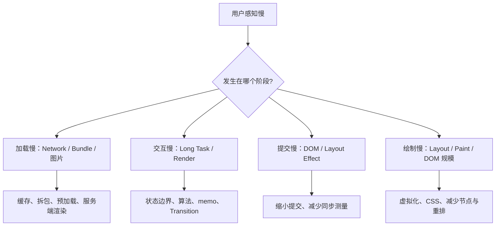
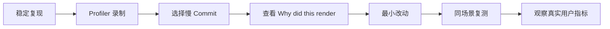
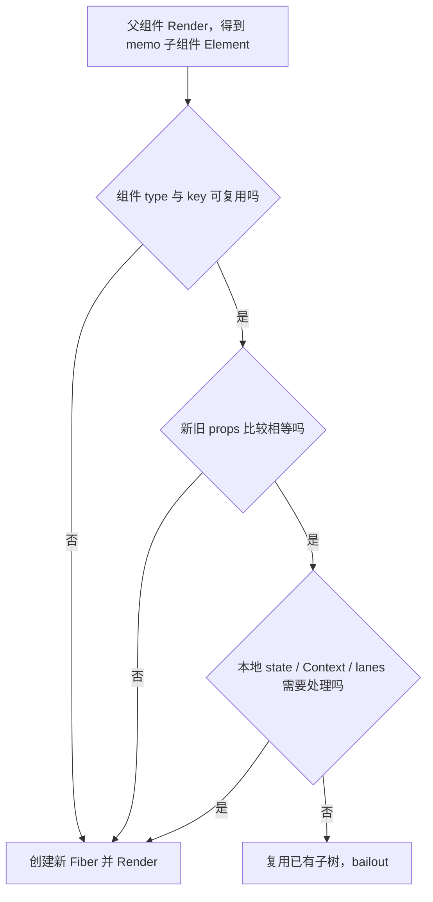
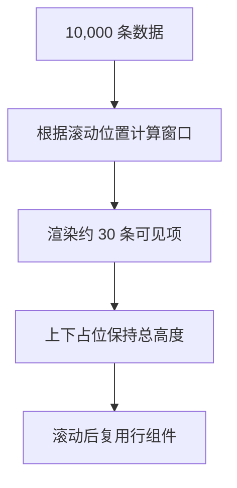
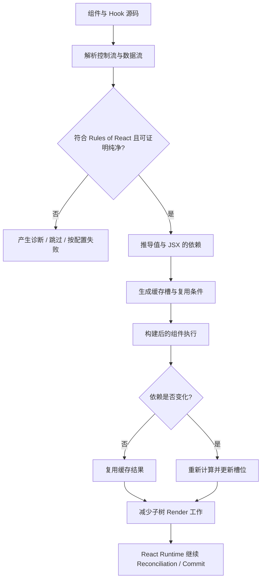
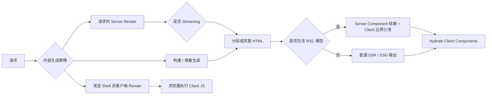
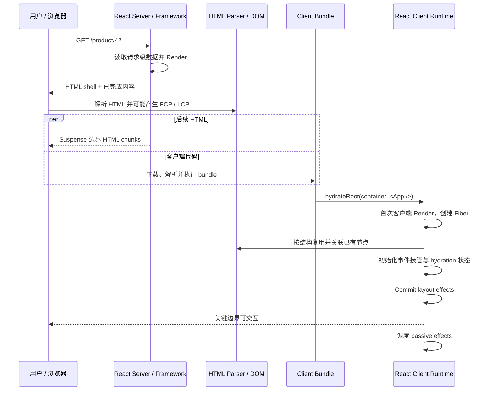
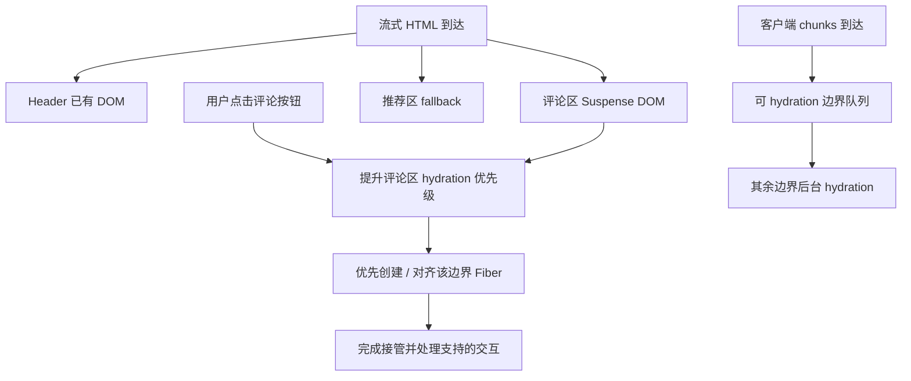

# React 性能与工程化：测量、渲染成本、Compiler、SSR 与 SEO

> 核心原则：性能优化不是背 `useMemo` 清单，而是定位瓶颈属于网络、JavaScript、Render、Commit、布局绘制还是资源加载，再用最小改动消除不必要工作。
> 难度标签：`基础必会` `进阶重点` `高级深挖`

## 目录

- [1. React 性能问题如何分类](#1-react-性能问题如何分类)
- [2. 先测量：Profiler 工作流](#2-先测量profiler-工作流)
- [3. 减少不必要的渲染传播](#3-减少不必要的渲染传播)
- [4. memoization 的收益、成本与失效条件](#4-memoization-的收益成本与失效条件)
- [5. 列表、虚拟化与大计算](#5-列表虚拟化与大计算)
- [6. 并发能力与交互响应](#6-并发能力与交互响应)
- [7. React Compiler](#7-react-compiler)
- [8. 包体积与加载性能](#8-包体积与加载性能)
- [9. SSR、SSG、CSR 与 SEO](#9-ssrssgcsr-与-seo)
- [10. Hydration 与服务端工程边界](#10-hydration-与服务端工程边界)
- [11. 错误边界、测试与可观测性](#11-错误边界测试与可观测性)
- [12. 工程场景闭环](#12-工程场景闭环症状定位根因修复与验证)
- [13. 面试速查](#13-面试速查)

---

## 1. React 性能问题如何分类

### 面试问题

React 项目卡顿时，你会怎么分析？

### 30 秒回答

先复现并量化，再区分瓶颈层：网络慢、bundle 大、JavaScript 长任务、React Render 重复、Commit / layout effect 过重、DOM 规模大、样式布局抖动或图片资源问题。用浏览器 Performance、React DevTools Profiler、Network 和真实用户指标定位，不能看到组件重渲染就直接加 `memo`。



### 常见指标与含义

| 指标 / 工具 | 主要回答 |
|---|---|
| LCP | 最大内容何时可见，受服务端、网络、图片和渲染影响 |
| INP | 用户交互到下一次绘制的响应性 |
| CLS | 页面是否发生意外布局偏移 |
| React Profiler | 哪个组件何时 Render / Commit，耗时多少 |
| Browser Performance | 主线程长任务、脚本、布局、绘制 |
| Network | 请求瀑布、缓存、资源优先级、压缩 |
| Bundle Analyzer | 哪些依赖进入客户端包 |

### “渲染次数”不是唯一指标

一个只渲染 1 次但执行 300ms 的组件，比渲染 5 次、每次 1ms 更严重。还要区分：

- 组件函数调用；
- React Render 阶段工作；
- DOM Commit；
- 浏览器 layout / paint；
- 开发 Strict Mode 的额外调用。

---

## 2. 先测量：Profiler 工作流

### 面试问题

如何用 React Profiler 定位性能问题？

### 30 秒回答

录制可重复的用户操作，先查看慢 Commit，再沿 Ranked / Flamegraph 找耗时组件和触发原因。确认是组件自身计算昂贵、父级传播、Context 广播还是 props 引用变化。做一次最小优化后重新录制，比较 commit duration 和用户指标，避免凭感觉优化。



### `<Profiler>` API

```tsx
import { Profiler, type ProfilerOnRenderCallback } from 'react';

const onRender: ProfilerOnRenderCallback = (
  id,
  phase,
  actualDuration,
  baseDuration,
  startTime,
  commitTime,
) => {
  // 生产采样时应控制频率，避免观测本身产生过大成本
  performanceLogger.record({
    id,
    phase,
    actualDuration,
    baseDuration,
    startTime,
    commitTime,
  });
};

function App() {
  return (
    <Profiler id="ProductPage" onRender={onRender}>
      <ProductPage />
    </Profiler>
  );
}
```

- `actualDuration`：本次更新实际渲染耗时。
- `baseDuration`：不使用 memoization 时完整子树的估计成本。
- `phase`：mount、update 或 nested-update 等阶段。

### 测量误区

- 开发构建包含额外检查，不代表生产绝对耗时。
- 单次本机测试不能代表低端设备与真实网络。
- 只盯平均值会掩盖 P75 / P95 长尾。
- 微基准可能优化了无关热点，应优先测真实用户路径。

---

## 3. 减少不必要的渲染传播

### 面试问题

父组件更新为什么会让子组件执行？如何减少无关渲染？

### 30 秒回答

父组件重新渲染时会重新计算其 children，默认继续检查子组件。优化优先顺序是：保持 Render 纯净且足够快、把瞬时状态下沉、使用组合隔离稳定子树、拆分高频 Context、缩小外部 Store selector，最后才用 `memo` 和稳定引用切断确实昂贵的传播。

### 状态下沉

```tsx
// ❌ 搜索输入放在 Page 顶层，每次键入都让整个页面子树重新计算
function Page() {
  const [query, setQuery] = useState('');
  return <><Header /><Search query={query} onChange={setQuery} /><ExpensiveDashboard /></>;
}

// ✅ 输入状态由真正使用它的局部组件持有
function Page() {
  return <><Header /><SearchSection /><ExpensiveDashboard /></>;
}
```

### 使用 children 隔离更新

```tsx
// 中文注释：该示例聚焦当前机制，省略无关工程细节。
function ColorPicker({ children }: { children: ReactNode }) {
  const [color, setColor] = useState('#ffffff');

  return (
    <section style={{ background: color }}>
      <input value={color} onChange={(event) => setColor(event.target.value)} />
      {children}
    </section>
  );
}

function App() {
  return (
    <ColorPicker>
      <ExpensiveTree />
    </ColorPicker>
  );
}
```

`children` Element 由 `App` 创建，ColorPicker 局部更新时可帮助 React 复用稳定子树。具体是否跳过仍由 React 决定，但这种架构通常比到处缓存更清晰。

### Context 拆分

把主题、登录用户、每秒变化的进度和大量 actions 放在同一个 value 中，会让所有消费者订阅同一广播。按语义和变化频率拆分，或使用 selector Store。

### 避免“镜像 props”

Effect 中把 props 复制到 state 会额外产生一次更新，且容易失同步。能直接渲染或计算的值不要镜像。

---

## 4. memoization 的收益、成本与失效条件

### 面试问题

`React.memo`、`useMemo`、`useCallback` 的底层区别是什么？为什么加了仍然 Render？如何证明优化值得？

### 30 秒回答

`memo` 给组件增加基于 props 的 bailout 机会，`useMemo` 在 Hook 槽位中缓存计算结果，`useCallback` 缓存函数引用。它们比较依赖时都基于 `Object.is` 语义，但只在“比较和缓存成本小于被跳过工作、依赖大部分时间稳定、组件边界正确”时有收益。组件自己的 state、读取的 Context、始终变化的对象 / 函数、昂贵自定义比较都可能让 memoization 失效。它们是性能提示，不应承担业务正确性。

### 3 分钟展开

三者作用在不同层：

1. **`memo(Component)`**：父组件更新后，React 比较包装组件的新旧 props；相等且没有本地 state、Context、目标 lanes 等必须处理的工作时，才有机会复用上次子树；
2. **`useMemo(factory, deps)`**：更新阶段按 Hook 顺序找到旧缓存，逐项用 `Object.is` 比较 deps；相等返回旧 value，否则重新执行 factory；
3. **`useCallback(fn, deps)`**：语义上等价于缓存函数本身，主要价值是给 `memo` 子组件或其他 Hook 提供稳定引用。

缓存不是免费：每次 Render 仍要创建依赖数组、比较依赖、保留对象和增加心智负担。若组件本来只需几十微秒，或者 props 每次都变，缓存可能没有收益甚至更慢。

### 数据大致存在哪里

> 下列代码是面试级简化示意，并非 React 源码原文。

```js
const memoHook = {
  memoizedState: [cachedValue, previousDeps],
  next: nextHook,
};

function updateMemo(factory, nextDeps) {
  const [previousValue, previousDeps] = currentHook.memoizedState;

  if (areHookInputsEqual(nextDeps, previousDeps)) {
    return previousValue; // 依赖逐项 Object.is 相等，复用缓存
  }

  const nextValue = factory();
  workInProgressHook.memoizedState = [nextValue, nextDeps];
  return nextValue;
}
```

`memo` 的组件级比较则发生在协调该 Fiber 时。即使 props 相等，只要组件自己的 state 有更新、读取的 Context 变化或子树存在目标 lane，React 仍需处理对应工作。

### bailout 决策链路



`memo` 不是“禁止 Render”的开关，而是给 React 增加一条可跳过路径。

### 一个完整的优化案例

假设订单页每次切换主题都会重复聚合 50,000 条记录并绘制图表。

```tsx
const RevenueChart = memo(function RevenueChart({ points }: { points: Point[] }) {
  return <ChartCanvas points={points} />;
});

function Dashboard({ records, range }: DashboardProps) {
  const [theme, setTheme] = useState<'light' | 'dark'>('light');

  const points = useMemo(() => {
    // 仅在数据或区间变化时重新执行昂贵聚合
    return aggregateRecords(records, range);
  }, [records, range]);

  return (
    <main data-theme={theme}>
      <button onClick={() => setTheme((value) => value === 'light' ? 'dark' : 'light')}>
        切换主题
      </button>
      <RevenueChart points={points} />
    </main>
  );
}
```

**优化前**：若每次 Render 都执行 `aggregateRecords`，且生成新 `points` 数组，主题变化会同时触发聚合和图表 Render。

**优化后**：`records` / `range` 不变时，`useMemo` 复用 `points` 引用；`RevenueChart` 的 props 浅比较通过，图表子树获得 bailout 机会。

**验证方法**：

1. 使用 React Profiler 录制“切换主题”交互；
2. 对比 `actualDuration`、Commit 数量和 `RevenueChart` 是否 Render；
3. 使用浏览器 Performance 检查主线程 scripting 时间；
4. 再录制“切换 range”，确认真正需要更新时图表仍正确重新计算；
5. 在生产构建和代表性设备上复测，避免开发 Strict Mode 干扰结论。

### `useCallback` 什么时候真正有意义

```tsx
const TodoList = memo(function TodoList({ onAdd }: { onAdd: (text: string) => void }) {
  return <TodoComposer onSubmit={onAdd} />;
});

function Todos() {
  const [todos, setTodos] = useState<Todo[]>([]);

  const handleAdd = useCallback((text: string) => {
    setTodos((current) => [
      ...current,
      { id: crypto.randomUUID(), text },
    ]);
    // 使用函数式更新，不需要读取 todos，因此依赖可以保持为空
  }, []);

  return <TodoList onAdd={handleAdd} />;
}
```

如果 `TodoList` 没有 `memo`、函数也不进入其他 Hook 依赖，那么单独添加 `useCallback` 通常只是缓存一个函数，没有切断任何昂贵路径。

### 一个新引用如何击穿整条缓存链

```tsx
function Page({ products }: { products: Product[] }) {
  const options = { pageSize: 50 }; // ❌ 每次 Render 都是新对象

  return <MemoizedTable products={products} options={options} />;
}
```

可选修复顺序：

1. 若对象是常量，移到组件外；
2. 若只被子组件使用，把 primitive props 直接传入；
3. 若能在子组件内部构造，缩小引用传播范围；
4. 只有确有性能价值时才 `useMemo(() => ({ pageSize }), [pageSize])`。

不要为了“让依赖数组好看”把所有对象都缓存。架构上的状态下沉和组件拆分通常比缓存网更稳定。

### Context、children 与本地 state 为什么会让 `memo` 仍然 Render

- **Context**：组件内部 `useContext` 订阅变化时必须更新，`memo` 只比较 props；
- **本地 state**：组件自己的 dispatch 直接给该 Fiber 安排工作；
- **children**：父组件每次创建新的 JSX Element，`children` prop 可能是新引用；
- **ref / key / type**：身份或 ref 语义变化时，不能只按普通 props 忽略；
- **开发 Strict Mode**：额外调用用于发现不纯逻辑，不代表生产 Commit 次数。

若昂贵视图只需要 Context 中一个 primitive，可用“Context 容器 + memo 纯视图”隔离；详细见[Context 的机制与性能边界](./react-component-communication-and-state-management.md#4-context-的机制与性能边界)。

### 自定义比较函数的风险

```tsx
const Chart = memo(ChartView, (previous, next) => {
  // ❌ 漏比较 onHover，组件可能长期持有旧闭包
  return previous.points === next.points;
});
```

自定义 comparator 必须覆盖所有影响输出和行为的 props，包括函数。深比较还可能比重新 Render 更慢，并在数据结构变化后产生不可预测的长任务。除非 Profiler 证明默认浅比较不足且数据结构受控，否则优先修复引用和组件边界。

### 成本模型

可以用一个粗略不等式判断：

```text
缓存收益 ≈ 被跳过的 Render / 计算成本
         - props 或 deps 比较成本
         - 缓存对象内存与 GC 成本
         - 代码复杂度与闭包错误风险
```

适合 memoization 的信号：

- 子树或纯计算在 Profiler 中确实昂贵；
- 依赖在大多数交互中保持稳定；
- 输出引用会继续传给 `memo` 子组件或昂贵 Hook；
- 能用小而清晰的依赖数组表达正确性；
- 优化前后可通过同一用户路径重复测量。

不适合的信号：

- 组件很小，计算接近常数时间；
- props 每次都会变化；
- 性能瓶颈在网络、DOM 数量、CSS layout 或图片；
- 缓存只是为了让“Render 次数变少”；
- 依赖数组需要绕过 linter 才能稳定；
- 自定义深比较比组件计算更复杂。

### memoization 不是语义保证

- `useMemo` 的 factory 必须纯净，开发 Strict Mode 可能额外调用以暴露副作用；
- React 可以在特定场景丢弃缓存，因此业务正确性不能依赖“这个对象永远同一引用”；
- 需要长期保存可变值应使用 state 或 ref，而不是 `useMemo`；
- 需要保证副作用只执行一次，应重新设计 Effect / 事件边界，不能借助 memoization；
- stale closure 是依赖错误，不应通过自定义 comparator 或删除 deps 掩盖。

### 与 React Compiler 的关系

React Compiler 可以基于组件和 Hook 的纯净性自动插入类似 memoization 的优化，减少大量手写 `memo`、`useMemo`、`useCallback`。但它不会：

- 修复错误状态所有权；
- 减少网络请求或 DOM 数量；
- 把不纯 Render 变正确；
- 替代 Profiler 和真实指标；
- 保证所有第三方库边界都自动最优。

因此迁移时先保持 Rules of React、不可变数据和正确依赖，再评估哪些手写缓存仍有必要。完整 Compiler 边界将在本专题第 7 节展开。

### 常见失败方式

- 到处 `useCallback`，但没有任何消费者依赖引用稳定；
- `useMemo` 中执行副作用或请求；
- 用空依赖冻结读取了 props / state 的函数，制造 stale closure；
- 父组件每次创建新对象，让 `memo` 永远比较失败；
- 自定义 comparator 漏掉函数 prop；
- 用控制台 Render 日志代替 Profiler 成本数据；
- 优化了组件执行，却忽略真正昂贵的 Commit、layout 或大 DOM。

### 面试官追问树

1. `memo` 比较 props 时使用什么语义？
2. `useMemo` 的值存在哪里？依赖如何比较？
3. 为什么有 `memo` 组件仍会因 Context 更新而 Render？
4. 单独使用 `useCallback` 为什么可能没有收益？
5. 自定义 comparator 为什么可能产生 stale closure？
6. `useMemo` 能否作为业务语义保证对象永远不变？
7. 如何用 Profiler 证明缓存值得？
8. React Compiler 出现后还要不要手写 memoization？

### 版本边界

`memo`、`useMemo`、`useCallback` 是稳定 API，但 bailout 细节属于 React 实现。React Compiler 在现代 React 工具链中提供自动优化能力；是否启用、覆盖范围和诊断方式取决于构建配置，不能把“支持 Compiler”说成所有项目默认已经优化。

### 一句话收束

> memoization 的价值不是“少 Render”本身，而是用低成本比较切断一条被证明昂贵且大多数时候输入稳定的计算路径。

---

## 5. 列表、虚拟化与大计算

### 面试问题

上万条列表如何优化？只加 `key` 和 `memo` 够吗？

### 30 秒回答

不够。`key` 解决身份，`memo` 只能尝试跳过组件计算，但浏览器仍要维护大量 DOM。大列表首选窗口化 / 虚拟化，只渲染视口附近项目；同时使用稳定 key、行高策略、分页或增量加载、事件委托和服务端聚合。复杂排序过滤可移到 Web Worker 或服务端。



### 稳定 key

```tsx
{rows.map((row) => (
  <Row key={row.id} row={row} /> // 使用持久业务 ID，而不是可变化的 index
))}
```

`key` 不会阻止重新渲染，它帮助 React 正确匹配身份、移动和状态。

### 计算移出主线程

Web Worker 适合纯 CPU 计算，但需要考虑结构化克隆成本和取消旧任务：

```ts
worker.postMessage({ type: 'aggregate', records });
worker.onmessage = (event: MessageEvent<AggregateResult>) => {
  // 回到主线程后只提交最终 UI 所需的紧凑结果
  setResult(event.data);
};
```

### 避免布局抖动

在循环中交替读取布局和写样式会强制多次同步布局。批量读取，再批量写入；动画优先 `transform` / `opacity`，并用浏览器 Performance 验证。

---

## 6. 并发能力与交互响应

### 面试问题

`useTransition` 能提升性能吗？

### 30 秒回答

它主要提升感知响应性，不一定减少总计算时间。Transition 让输入等紧急更新先提交，昂贵视图作为低优先级工作可被打断和重试。若计算本身耗时巨大，仍要优化算法、虚拟化或移出主线程；若 Commit 很慢，Transition 也无法中断它。

### 选择策略

| 问题 | 方案 |
|---|---|
| 输入被大列表阻塞 | 拆分紧急输入与 Transition 列表更新 |
| 子组件接收外部 query | `useDeferredValue` 延迟子树 |
| 固定时间内减少请求 | debounce / throttle + 取消请求 |
| CPU 计算太大 | 算法、缓存、Worker、服务端计算 |
| DOM 太多 | 虚拟化 / 分页 |
| Commit / layout effect 太慢 | 减少 DOM 写入和同步布局工作 |

### 乐观 UI

`useOptimistic` 能缩短用户感知等待，但要设计失败回滚、重复提交和并发冲突。乐观展示是交互策略，不是服务端成功保证。

---

## 7. React Compiler

### 面试问题

React Compiler 是什么？它为什么能自动 memoization？有了它还需要 `memo`、`useMemo`、`useCallback` 吗？

### 考察点

面试官通常不是要听“自动加缓存”这一句，而是想确认候选人是否理解：

- 编译器优化建立在组件纯净性和 Rules of React 上；
- 它缓存的可能是计算结果、对象、函数或 JSX 子树，而不是机械地给每个组件包一层 `memo`；
- 自动 memoization 只减少 Render 阶段的重复工作，不会解决网络、算法、DOM 数量和状态架构问题；
- 引入 Compiler 仍然需要诊断、灰度、Profiler 和回滚策略。

### 30 秒回答

React Compiler 是构建期优化器。它静态分析组件与 Hook 中的值依赖，在确认语义安全时自动复用计算结果或 JSX，从而减少无意义重新计算和子组件 Render。React Compiler 1.0 已作为稳定版本发布，但是否启用仍取决于项目构建链、React 目标版本、框架支持和代码是否遵守 Rules of React。

有了 Compiler，日常代码对 `memo`、`useMemo`、`useCallback` 的依赖会明显下降，但不能立即全量删除旧缓存：先让诊断通过，分范围启用，再用 React DevTools Profiler 和业务指标验证。Compiler 优化的是可证明安全的 Render 工作，不替代状态下沉、虚拟化、网络优化、算法优化和正确的 Effect 设计。

### 3 分钟展开

手写 memoization 的困难不是 API 不够，而是人很难持续维护正确依赖：

```tsx
function ProductPage({ products, theme }: Props) {
  const visible = products.filter(isVisible);
  const options = { color: theme.primary };

  return <ProductChart products={visible} options={options} />;
}
```

这里每次 Render 都会创建新的数组和对象。即使 `ProductChart` 使用 `memo`，浅比较也会因为引用变化失效。过去通常要手写多个 `useMemo`；Compiler 则尝试在构建阶段回答：

1. `visible` 依赖哪些输入？
2. `options` 依赖哪些输入？
3. 这些计算是否纯净？
4. 输入未变化时，旧值或旧 JSX 是否可以安全复用？
5. 哪些值逃逸到外部、发生 mutation 或违反 Hook 规则，因而不能优化？

如果分析成立，编译器在产物中插入缓存槽和依赖检查。运行时再次执行组件时，未变化的槽位可以直接复用；变化的槽位才重新计算。这样不仅可能减少当前组件计算，也能让传给子组件的引用稳定，从而形成 bailout 链。

但 Compiler 不能改变业务语义。组件如果在 Render 中写全局变量、原地修改 props、条件调用 Hook，编译器不能靠“聪明优化”把错误模型变正确。通常应先用 lint / diagnostics 修正规则问题；无法证明安全的函数可能被跳过优化，具体构建失败还是跳过由项目配置决定。

### 自动优化执行链



最后一条箭头很重要：Compiler **没有取代 Fiber、Reconciliation 和 Commit**，只是让进入这些阶段的重复计算更少。

### 编译前与概念上的编译后

#### 编译前：业务源码保持直接表达

```tsx
interface Product {
  id: string;
  category: string;
  revenue: number;
}

interface RevenueChartProps {
  products: Product[];
  category: string;
  color: string;
}

function RevenueChart({ products, category, color }: RevenueChartProps) {
  const points = products
    .filter((product) => product.category === category)
    .map((product) => ({ x: product.id, y: product.revenue }));

  const chartOptions = { color, animated: true };

  return <Chart points={points} options={chartOptions} />;
}
```

#### 概念上的编译后：缓存依赖未变化的值

```tsx
// 简化示意，并非 React Compiler 的真实输出
function RevenueChartCompiled(props: RevenueChartProps) {
  const cache = useCompilerCache(4);

  let points: Array<{ x: string; y: number }>;
  if (cache[0] === props.products && cache[1] === props.category) {
    // 中文注释：依赖相同，复用上次计算结果
    points = cache[2];
  } else {
    points = props.products
      .filter((product) => product.category === props.category)
      .map((product) => ({ x: product.id, y: product.revenue }));

    cache[0] = props.products;
    cache[1] = props.category;
    cache[2] = points;
  }

  let content: ReactNode;
  if (cache[3]?.points === points && cache[3]?.color === props.color) {
    // 中文注释：子树输入未变化时复用 JSX 描述
    content = cache[3].content;
  } else {
    const chartOptions = { color: props.color, animated: true };
    content = <Chart points={points} options={chartOptions} />;
    cache[3] = { points, color: props.color, content };
  }

  return content;
}
```

真实 Compiler 产物、缓存槽数量和哨兵实现都可能随版本变化。面试中应该解释“**依赖分析 → 缓存槽 → 条件复用**”，不要背生成代码。

### 为什么纯净性是前提

下面的组件不能只依据 props 决定输出：

```tsx
let renderCount = 0;

function ImpureBadge({ label }: { label: string }) {
  // ❌ Render 修改外部可变状态，同样输入不再保证同样结果
  renderCount += 1;
  return <span>{label}: {renderCount}</span>;
}
```

如果编译器复用旧 JSX，`renderCount` 是否增加就会改变，说明缓存会影响可观察语义。React 要求 Render 纯净，本来就是为了支持重复执行、中断、重试和优化；Compiler 只是进一步利用这条约束。

常见阻碍包括：

- Render 中修改 props、全局变量、单例或 DOM；
- 条件 / 循环调用 Hook；
- mutation 导致引用不变但内容已改变；
- 难以分析的动态调用、别名和不兼容第三方 API；
- 把“当前时间、随机数、浏览器状态”直接当纯计算读取；
- 自定义 Hook 隐藏不受控副作用。

### 与手写 memoization 如何共存

| 手段 | Compiler 启用后的建议 | 原因 |
|---|---|---|
| `memo(Component)` | 不必默认给所有叶子组件添加；旧代码先保留并测量 | Compiler 通常能减少相同 props 下的子组件工作，但迁移不应靠猜测 |
| `useMemo` | 仅为性能的缓存可评估移除；具有明确引用契约的代码谨慎处理 | 缓存不是业务语义保证，部分第三方 API 又可能要求稳定对象 |
| `useCallback` | 不为“看起来专业”而添加；订阅解绑、命令式 API等身份契约仍需明确 | 函数稳定性有时是外部系统契约，不只是 React Render 优化 |
| 自定义 comparator | 优先减少；保留时必须比较函数与闭包语义 | comparator 可能比 Render 更贵，也可能产生 stale closure |
| 状态下沉 / 拆分组件 | 继续需要 | Compiler 不会替你决定状态所有权和更新传播范围 |

不要在一次提交中删除全仓库 `useMemo` / `useCallback`。正确迁移是比较启用前后：Render 次数、`actualDuration`、长任务、内存、bundle 和交互指标。

### `"use memo"` 与 `"use no memo"`

React Compiler 支持函数级 directive，用于渐进采用和排障：

```tsx
function RevenueChart(props: RevenueChartProps) {
  'use memo';

  // 中文注释：在 annotation 等渐进模式下，显式要求编译器尝试优化该函数
  return <Chart data={buildData(props)} />;
}

function LegacyEditor(props: LegacyEditorProps) {
  'use no memo';

  // 中文注释：临时跳过该函数，便于隔离迁移问题；不应长期掩盖规则违规
  return <ThirdPartyEditor value={props.value} />;
}
```

边界：

- directive 必须放在函数体指令序言位置；
- `"use memo"` 不是无条件成功承诺，函数仍需满足编译要求；
- `"use no memo"` 是迁移 / 调试逃生口，不是永久忽略诊断的最佳实践；
- 默认是否需要 `"use memo"` 取决于 `compilationMode`，不要把某个项目配置说成所有项目规则。

### 诊断、配置与渐进启用

稳定的思路是“先诊断，再扩大范围”，而不是一上来全仓库强制编译：

1. **建立基线**：保存关键页面的 Profiler、交互录屏、Web Vitals、单元测试和视觉测试结果。
2. **接入 lint / diagnostics**：修复组件纯净性、Hook 规则、mutation 和不支持语法问题。
3. **确认 target**：React 17 / 18 / 19 的运行时兼容方式不同，应按官方文档和框架插件配置。
4. **选择 compilationMode**：全量推断、指定目录或 annotation 模式按项目风险决定。
5. **设置失败策略**：`panicThreshold` 等选项决定遇到诊断时跳过还是让构建失败；CI 与本地策略应一致。
6. **必要时 gating**：使用运行时 Feature Flag 对优化产物做灰度或 A/B 验证。
7. **逐层扩大**：优先从纯净、测试充分的叶子模块开始，再向共享组件和核心页面推进。
8. **保留回滚**：锁定编译器版本，能快速关闭插件、缩小目录或使用临时 `"use no memo"`。

具体插件字段和默认值可能随版本及框架集成变化；文档中应记录项目实际版本，不要复制一份长期不更新的“万能配置”。

### 完整工程案例：表格 Render 仍然很慢

#### 症状

- 筛选框输入时，`SalesTable` 每次按键都 Render；
- 2,000 行单元格格式化产生 80～120 ms 长任务；
- 团队已经给 `SalesTable` 加了 `memo`，但 Profiler 显示仍未 bailout。

#### 根因

父组件每次 Render 都创建新的 `columns`、`filters` 和回调；`memo` 浅比较每次都失败。问题不是“React 太慢”，而是引用链和 DOM 规模共同放大成本。

#### 渐进修复

```tsx
function SalesPage({ rows }: { rows: SaleRow[] }) {
  const [keyword, setKeyword] = useState('');

  // 中文注释：先保持代码纯净，让 Compiler 能分析依赖关系
  const visibleRows = rows.filter((row) => row.customer.includes(keyword));
  const columns = createColumns();

  return (
    <>
      <input value={keyword} onChange={(event) => setKeyword(event.target.value)} />
      <SalesTable rows={visibleRows} columns={columns} />
    </>
  );
}
```

启用 Compiler 后，稳定输入下 `columns` 和部分 JSX 可以被复用，但 `keyword` 每次变化时筛选仍需执行，2,000 行 DOM 也仍然存在。因此后续还要：

- 使用虚拟化降低挂载节点数；
- 必要时用索引或服务端查询代替全表扫描；
- 用 Transition / Deferred Value 改善输入响应，但不把它当总计算优化；
- 使用 Profiler 比较 Compiler 前后的 `actualDuration` 和 Render 原因；
- 使用浏览器 Performance 验证长任务与 INP，而不是只数 Render 次数。

#### 验证清单

| 指标 | 启用前 | 目标 |
|---|---:|---:|
| 输入交互长任务 | 80～120 ms | 明显低于 50 ms，且无连续阻塞 |
| `SalesTable` 无关更新 Render | 高频 | 稳定输入时可 bailout |
| DOM 节点 | 约 20,000 | 虚拟化后只保留可视窗口 |
| INP / 业务输入延迟 | 记录真实基线 | 灰度后无回归并有统计改善 |

### Compiler 不会做什么

- 不消除网络瀑布、慢接口、数据库查询和缓存穿透；
- 不把 `O(n²)` 算法自动改成 `O(n log n)`；
- 不自动虚拟化 10 万个 DOM 节点；
- 不修复错误的状态所有权、Context 广播或 Effect 请求竞态；
- 不减少必须发生的 DOM mutation、layout 和 paint；
- 不保证任意动态 JavaScript 都能安全优化；
- 不替代 Profiler、浏览器 Performance 和真实用户监控。

### 边界与反例

- **“Compiler 会阻止所有重新渲染”**：错误。state、props、context 变化仍需要计算新 UI；Compiler 只复用依赖未变且安全的部分。
- **“编译成功就一定更快”**：错误。缓存也有比较和内存成本，页面瓶颈可能在 Commit、DOM、网络或第三方脚本。
- **“有 Compiler 就可以原地修改对象”**：错误。mutation 会破坏快照和依赖推导，也可能让 UI 根本不知道内容变了。
- **“`use no memo` 能修复组件”**：错误。它只是跳过优化，不能修复 Render 副作用或错误状态逻辑。
- **“手写 memoization 都应该删除”**：错误。先区分性能提示与外部身份契约，再测量和渐进迁移。

### 面试官追问树

1. **Compiler 与 Babel / SWC 是什么关系？**
   - 它是构建期变换，可通过框架或构建插件接入；具体承载工具取决于工程链路。
2. **它为什么依赖组件纯净性？**
   - 只有相同输入可产生等价输出，复用缓存才不改变可观察行为。
3. **它是不是自动给所有组件加 `memo`？**
   - 不应机械理解；它可以缓存中间值、对象、函数或 JSX，目标是减少重复工作。
4. **为什么仍要遵守 Hook 规则？**
   - Hook 顺序决定状态槽位身份，也让编译器能稳定分析数据流。
5. **如何判断迁移成功？**
   - 诊断通过只是正确性门槛，还要比较 Profiler、长任务、INP、内存、bundle 和业务错误率。
6. **什么时候使用 `"use no memo"`？**
   - 用于临时隔离编译问题和回滚，随后应定位不兼容代码，而不是永久掩盖。

### 版本边界

- React Compiler 1.0 已发布为稳定版本；项目能否使用仍取决于 React target、构建插件、框架集成和第三方依赖。
- React 17 / 18 项目需要按官方兼容说明配置 target / runtime；不要直接复制 React 19 项目的默认配置。
- `compilationMode`、`panicThreshold`、`gating`、logger 和 directive 属于 Compiler 工具链能力，具体配置以项目锁定版本的官方文档为准。
- 本节描述稳定心智模型，不承诺生成代码、缓存槽格式或内部函数名长期不变。
- 手写缓存的底层成本与失效条件见[第 4 节](#4-memoization-的收益成本与失效条件)。

### 一句话收束

**React Compiler 利用纯净组件和规则化 Hook 的可分析性，在构建期自动生成依赖缓存；它减少重复 Render 计算，但不替代正确架构、真实测量和端到端性能优化。**

---

## 8. 包体积与加载性能

### 面试问题

React 工程如何优化首屏加载？

### 30 秒回答

从请求链路看：减少必须下载的客户端 JavaScript、按路由和功能拆包、避免重复依赖、压缩和长期缓存静态资源、预加载关键资源、优化图片字体，并用 SSR / SSG / 流式渲染尽早输出内容。`React.lazy` 只解决组件代码拆分，不自动解决数据瀑布。

### 组件懒加载

```tsx
// 中文注释：该示例聚焦当前机制，省略无关工程细节。
const AdminPanel = lazy(() => import('./AdminPanel'));

function Route() {
  return (
    <Suspense fallback={<PanelSkeleton />}>
      <AdminPanel />
    </Suspense>
  );
}
```

### 常见工程问题

- barrel file 导致 tree shaking 失效或意外引入大模块。
- 同一库多个版本进入 bundle。
- 整包导入图标、日期或工具库。
- 把仅服务端使用的依赖带入 Client Component。
- 首屏先下载 JS，再由 Effect 发请求，形成请求瀑布。
- 第三方脚本无优先级和延迟策略。

### 预加载必须有证据

过度 `preload` 会争抢关键带宽。应根据真实导航概率、资源大小、缓存命中和浏览器优先级确定，不是把所有下一页资源都提前加载。

---

## 9. SSR、SSG、CSR 与 SEO

### 面试问题

React SPA 能被搜索引擎收录吗？什么时候选 CSR、SSR、SSG、Streaming 或 RSC？

### 30 秒回答

部分搜索引擎能够执行 JavaScript，但存在渲染延迟、资源预算和兼容差异，公开内容不能把 SEO 全押在爬虫执行 CSR。CSR、SSR、SSG 主要回答“HTML 在哪里、何时生成”；Streaming 回答“HTML 能否分段到达”；RSC 回答“哪些组件只在服务端执行、向客户端传什么结果”。生产项目通常由框架组合这些能力。

SSR 能让内容更早进入 HTML，但不等于 JavaScript 已下载、hydration 已完成或页面已经可交互。SEO 还依赖 metadata、状态码、canonical、结构化数据、可抓取链接、站点地图、性能和内容质量。

### 3 分钟展开

选择渲染模式要同时看 4 条链路：

1. **内容生成**：构建时、请求时、缓存命中时，还是浏览器执行 JS 后？
2. **数据新鲜度**：内容多久变化，能否共享缓存，是否按用户个性化？
3. **交互成本**：首屏需要下载多少 Client JavaScript，hydration 会占用多少主线程？
4. **抓取与分发**：爬虫是否能直接获得正文、metadata、正确状态码和链接关系？

SSR 的优势是请求响应直接包含 HTML；代价是服务器计算、TTFB、缓存键和请求隔离更复杂。SSG 把计算前移到构建 / 增量生成，适合可缓存内容。CSR 适合登录后工具和强交互应用。Streaming 可以先发送 shell 和已完成边界，慢数据随后补齐。RSC 能让只负责数据读取和内容组合的组件不进入客户端 bundle，但交互仍需要 Client Component。

### 渲染模式对比

| 模式 | 主要回答的问题 | HTML 生成时机 | 优点 | 代价 / 边界 |
|---|---|---|---|---|
| CSR | 页面主要在浏览器生成吗 | 浏览器下载并执行 JS 后 | 静态部署简单、交互模型直接 | 首屏依赖 JS，公开内容抓取和弱设备体验有风险 |
| SSR | 每个请求是否返回完整初始 HTML | 请求时或服务端缓存命中时 | 个性化、首屏 HTML、状态码可控 | TTFB、服务器成本、缓存和请求隔离复杂 |
| SSG / ISR | 内容能否提前生成并缓存 | 构建时或增量再生成 | CDN 命中快、稳定、服务器压力低 | 内容更新、失效和大规模构建策略 |
| Streaming SSR | HTML 是否可按边界逐步发送 | 请求过程中分块生成 | shell 更早到达，慢边界不阻塞全部内容 | 需要 Suspense 与框架 / 运行时支持，监控更复杂 |
| RSC | 哪些组件不需要发送到浏览器执行 | 构建时或服务端环境执行 | 减少客户端 JS，靠近数据源 | 不能直接交互，边界、序列化和框架约束更强 |

### 这些概念不是互斥开关



例如一个全栈 React 框架可以同时使用：

- RSC 在服务器读取数据库并组织页面；
- Streaming SSR 尽早返回 shell 和已完成的 Suspense 边界；
- Client Component 为筛选器和按钮提供交互；
- Hydration 复用服务端 HTML 并激活 Client Component；
- CDN / Data Cache 缓存公共结果。

### SEO 不只等于 SSR

即使 HTML 已在服务端生成，下面任何一项出错仍会影响搜索表现：

- `<title>`、description、Open Graph、canonical 缺失或重复；
- 404 页面返回 `200`，形成 soft 404；
- 导航使用不可抓取的点击事件而不是真实 `<a href>`；
- robots、sitemap、hreflang、结构化数据错误；
- 主要内容依赖 hydration 后二次请求才出现；
- LCP 很慢、布局跳动、移动端体验差；
- 相同内容产生多个 URL，或服务端 / 客户端 metadata 不一致；
- 需要登录或 Cookie 的个性化页面误进入公共缓存。

SEO 是 **可发现、可抓取、可理解、可索引、体验可接受** 的组合问题，不是是否调用某个 SSR API。

### CSR 什么时候完全合理

- 登录后的管理后台、运营工具、BI 工作台；
- 主要价值来自交互而非公开内容；
- 页面不需要搜索引擎索引；
- 团队希望使用静态 CDN 部署并降低服务端复杂度；
- 首屏 bundle、弱网和低端设备成本已经可接受。

即使选择 CSR，也应提供正确的基础 metadata、错误页、加载反馈、代码拆分和可访问性。

### 工程决策示例

| 页面 | 推荐起点 | 原因 |
|---|---|---|
| 新闻详情 / 商品详情 | SSG / SSR + 缓存，必要时 Streaming | 公开内容、分享卡片、状态码和首屏重要 |
| 实时个性化订单页 | SSR 或 RSC 框架 + 用户级缓存边界 | 数据按用户变化，不能公共缓存 |
| 登录后数据看板 | CSR 或混合渲染 | SEO 不重要，交互密集 |
| 文档站 | SSG + CDN | 内容稳定、链接多、缓存收益高 |
| 大型电商搜索页 | SSR shell + Streaming / 客户端交互 | 首屏可索引，筛选交互仍在客户端 |

### 边界与反例

- **SSR 一定比 CSR 快**：错误。未缓存 SSR 可能增加 TTFB，且大量 hydration JavaScript 仍会阻塞交互。
- **HTML 有正文就完成 SEO**：错误。metadata、状态码、链接、重复内容和性能同样重要。
- **RSC 就是 SSR**：错误。RSC 是组件执行与传输模型；SSR 是生成 HTML。框架可以组合两者。
- **Streaming 会减少总计算量**：不一定。它主要改变到达顺序和用户感知，慢查询仍需优化。
- **所有 React 站点都应 SSR**：错误。内部工具可能更适合 CSR。

### 版本与框架边界

React 提供 `react-dom/server`、`hydrateRoot`、Suspense 和 RSC 基础能力，但路由、数据加载、缓存、资源提示、错误恢复、Streaming 协议和部署通常由框架完成。面试时要区分 React API 与 Next.js、React Router 等框架的具体约定，不能把某个框架的缓存默认值说成 React 通用行为。

完整 hydration 执行链、mismatch、Selective Hydration 与性能测量见下一节。

---

## 10. Hydration 与服务端工程边界

### 面试问题

从请求到页面可交互发生了什么？什么是 hydration mismatch？Streaming SSR、Selective Hydration 和 RSC 分别解决什么问题？

### 30 秒回答

服务端先把 React 树渲染成 HTML，浏览器收到后可以解析和绘制；客户端 bundle 到达后，`hydrateRoot` 会让 React 创建客户端 Fiber 树，并把它与已有 DOM 对齐，初始化根事件系统，随后提交客户端 Effect，页面才逐步具备完整交互能力。Hydration 不是无条件重建 DOM，而是尝试复用服务端节点。

客户端首次 Render 必须与服务端输出一致。时间、随机数、locale、浏览器 API、无效 HTML、数据快照、CSS-in-JS 配置或 ID 不一致都可能产生 mismatch。Streaming SSR 让 HTML 按 Suspense 边界分段到达；Selective Hydration 让更紧急或被用户交互的边界优先激活；RSC 则减少必须发送并 hydration 的客户端组件代码。它们相关，但不是同一个概念。

### 3 分钟展开

完整链路可以拆成 3 条并行时间线：

1. **内容时间线**：请求到达 → 服务端读取数据 → Render → HTML shell / chunks 返回 → 浏览器解析 → FCP / LCP。
2. **代码时间线**：发现 `<script>` → 下载、解析、编译客户端 bundle → 执行入口 → `hydrateRoot`。
3. **交互时间线**：React 根据同样初始数据进行首次客户端 Render → Fiber 与已有 DOM 对齐 → 事件系统接管 → layout / passive Effect 执行 → 用户交互能够被正确处理。

因此“SSR 首屏很快”可能只说明 HTML 和像素早到；如果客户端 JavaScript 有 2 MB、hydration 形成 500 ms 长任务，用户会看到按钮却点不动。性能治理必须同时测 TTFB、FCP / LCP、bundle、hydration CPU、长任务和 INP。

Hydration 的核心假设是服务端和客户端以相同输入生成相同初始结构。React 为性能不会把整个服务端 DOM 做昂贵的全面验证；出现 mismatch 时可能记录 recoverable error、修复局部内容，严重时放弃部分服务端结果并切换客户端渲染。即使“页面看起来没坏”，错误的节点对应也可能造成事件处理和状态身份风险，因此 mismatch 应按 bug 修复。

### 从请求到可交互的完整时序



图中“初始化事件接管”不是给每个按钮逐个绑定一个原生监听器。React DOM 通常在 Root 级使用事件委托；Selective Hydration 还可以利用离散交互提高相关 Suspense 边界的 hydration 优先级，并在支持的事件路径上完成接管 / 重放。

### Hydration 大致匹配什么

```ts
// 简化示意，并非 React 源码原文
function hydrateFiber(fiber: Fiber, domNode: Node | null): Node | null {
  if (!domNode || !canHydrate(fiber, domNode)) {
    // 中文注释：结构无法对应，记录恢复错误并进入插入 / 客户端重建路径
    markHydrationMismatch(fiber);
    return domNode;
  }

  // 中文注释：把 Fiber 的宿主节点引用指向服务端已经存在的 DOM
  fiber.stateNode = domNode;

  let childDom = domNode.firstChild;
  for (let child = fiber.child; child; child = child.sibling) {
    childDom = hydrateFiber(child, childDom);
  }

  return domNode.nextSibling;
}
```

真实实现要处理 Host Text、Suspense 标记、流式片段、可恢复错误、删除 / 插入和 hydration lane。面试中只需说明：**客户端 Fiber 不是从服务端传来的；客户端根据同一 UI 再建 Fiber，并尝试把 Host Fiber 对应到现有 DOM。**

### mismatch 分类、症状与修复

| 类型 | 典型错误 | 为什么不一致 | 推荐修复 |
|---|---|---|---|
| 时间 / 随机数 | Render 中调用 `Date.now()`、`Math.random()` | 两端执行时刻和结果不同 | 服务端生成确定值并序列化；随机 ID 用稳定业务 ID / `useId` |
| locale / timezone | `toLocaleString()` 使用机器默认配置 | 服务器与用户环境不同 | 明确传入 locale、timezone；必要时 hydration 后再本地化 |
| 浏览器 API | Render 中读 `window`、`matchMedia`、`localStorage` | 服务端不存在或值不同 | 稳定服务端快照、CSS、`useSyncExternalStore` 或 Effect 后更新 |
| 无效 HTML | `<p>` 内嵌 `<div>`、错误表格结构 | 浏览器解析器会自动纠正 DOM | 修复语义嵌套，用 HTML validator / DOM snapshot 检查 |
| 数据快照 | 服务端库存为 5，客户端首请求变成 4 | 两次读取不是同一快照 | 把服务端初始数据传给客户端缓存，hydration 后再 revalidate |
| CSS-in-JS | class hash、样式插入顺序不同 | 服务端提取配置与客户端不一致 | 使用库官方 SSR 集成，统一 cache key、顺序和 nonce |
| ID / 多 Root | 手写自增 ID 或多个 Root 前缀冲突 | 生成顺序或根配置不同 | 使用 `useId`；多 Root 配置一致 `identifierPrefix` |
| 条件分支 | `typeof window !== 'undefined'` 直接返回不同树 | 两端首次 Render 结构不同 | 首次输出保持一致，客户端差异放到 Effect 后第二次 Render |

### 完整工程案例：商品价格 hydration mismatch

#### 错误实现

```tsx
function ProductPrice({ cents }: { cents: number }) {
  // ❌ 服务端默认 locale 可能是 en-US，浏览器可能是 zh-CN
  const price = new Intl.NumberFormat().format(cents / 100);

  // ❌ 两端执行时间不同，促销状态可能直接变化
  const campaignEnded = Date.now() > Date.parse('2026-08-09T12:00:00+08:00');

  return <strong>{campaignEnded ? '活动结束' : `¥${price}`}</strong>;
}
```

#### 修复：复用同一服务端快照

```tsx
interface ProductPriceProps {
  cents: number;
  locale: string;
  currency: string;
  campaignEnded: boolean;
}

function ProductPrice({
  cents,
  locale,
  currency,
  campaignEnded,
}: ProductPriceProps) {
  const price = new Intl.NumberFormat(locale, {
    style: 'currency',
    currency,
  }).format(cents / 100);

  // 中文注释：服务端和 hydration 首次 Render 都使用同一份确定输入
  return <strong>{campaignEnded ? '活动结束' : price}</strong>;
}
```

框架 loader / Server Component 应在请求内计算 `locale`、货币和活动状态，并把同一序列化结果交给初始客户端树。hydration 完成后若要校准客户端时钟或重新验证库存，再触发普通更新，而不是让首次 Render 自己重新猜一遍。

#### 诊断入口

```tsx
hydrateRoot(document.getElementById('root')!, <App />, {
  onRecoverableError(error, errorInfo) {
    // 中文注释：开发环境记录组件栈，生产环境采样上报版本、URL 和错误摘要
    reportHydrationError({
      message: error.message,
      componentStack: errorInfo.componentStack,
      release: APP_RELEASE,
    });
  },
});
```

不要只在本地 Console 看一次。mismatch 可能只发生在特定 locale、AB 实验、缓存节点或慢请求，必须带上发布版本和请求上下文聚合。

### 客户端专属内容如何安全出现

```tsx
function ClientTimezone({ serverText }: { serverText: string }) {
  const [text, setText] = useState(serverText);

  useEffect(() => {
    // 中文注释：Effect 不在服务端执行；hydration 后再替换为用户本地时区
    setText(new Intl.DateTimeFormat(undefined, {
      dateStyle: 'medium',
      timeStyle: 'short',
    }).format(new Date()));
  }, []);

  return <time>{text}</time>;
}
```

这种 two-pass rendering 能保证首次匹配，但会增加一次客户端 Render，并可能产生内容变化。优先传入确定数据；只有真正依赖浏览器环境时才使用。

### `suppressHydrationWarning` 的边界

```tsx
function UnavoidableClock() {
  return (
    <time suppressHydrationWarning>
      {new Date().toLocaleTimeString()}
    </time>
  );
}
```

它只适合确实无法避免、范围很小的文本或属性差异：

- 是逃生口，不是修复机制；
- 只作用于当前元素的一层，不应包住整棵页面隐藏错误；
- React 不会因此理解两端为什么不同；
- 结构不一致、事件目标错位和数据快照问题仍必须修复；
- 使用前应记录为什么无法提供稳定初始值。

### Streaming SSR 与 Suspense

传统 SSR 如果等待所有数据后再返回，最慢查询会阻塞整个页面。Streaming SSR 可以先发 shell，慢区域由 Suspense fallback 占位，数据就绪后再发送对应片段。

```tsx
import { renderToPipeableStream } from 'react-dom/server';

function handleRequest(request: IncomingMessage, response: ServerResponse) {
  const { pipe, abort } = renderToPipeableStream(<App url={request.url ?? '/'} />, {
    bootstrapScripts: ['/client.js'],
    onShellReady() {
      response.statusCode = 200;
      response.setHeader('content-type', 'text/html');

      // 中文注释：shell 就绪后立即开始输出，不等待所有慢边界
      pipe(response);
    },
    onShellError(error) {
      // 中文注释：shell 都无法生成时，返回框架级错误页
      sendErrorPage(response, error);
    },
    onError(error) {
      // 中文注释：记录流式阶段错误，状态码策略由 shell 是否已发送决定
      logServerRenderError(error);
    },
  });

  // 中文注释：避免僵尸请求无限占用服务端资源
  request.on('close', abort);
}
```

这段代码说明机制，不是完整生产服务器。生产中还要处理 CSP nonce、bot 策略、超时、背压、错误状态码、资源提示和框架协议。

### Selective Hydration 为什么成立



它解决“一个大 Root 必须从头到尾一次性激活”的问题，但有前提：

- 服务端输出和客户端代码按 Suspense / 框架边界可识别；
- 对应 Client JavaScript 已到达或可以被请求；
- Commit 中的大量同步 DOM / layout work 仍不能被随意中断；
- 一个巨大 Client Component 即使放进边界，内部 hydration 仍可能形成长任务。

### RSC、SSR 与 Hydration 的边界

| 能力 | 解决的问题 | 是否产生 HTML | 是否发送组件 JS | 是否 hydration |
|---|---|---|---|---|
| SSR | 首次请求如何得到 HTML | 是 | 取决于客户端树 | 客户端组件需要 |
| Streaming SSR | HTML 是否分块到达 | 是，分段 | 取决于客户端树 | 到达且代码可用的边界需要 |
| RSC | 哪些组件在服务端执行并传输结果 | 自身输出是 RSC payload；框架可再用于生成 HTML | Server Component 代码不进入客户端 bundle | Server Component 自身不 hydration |
| Client Component | 哪里需要 state、Effect、事件和浏览器 API | 框架可在服务端预渲染初始 HTML | 是 | 是 |

RSC 不是“所有东西都在服务器”。Server Component 不能直接注册 `onClick`，也不能使用大多数需要持久客户端状态的 Hooks；交互边界需要 `"use client"`。反过来，把页面根部过早标为 Client Component，会扩大客户端模块图和 hydration 成本。

### 请求级缓存隔离

SSR 服务不能把当前用户数据放进模块全局可变单例：

```ts
// ❌ 错误：并发请求可能覆盖其他用户的数据
let currentUser: User | null = null;

async function renderRequest(request: Request) {
  currentUser = await getUser(request);
  return renderToString(<App user={currentUser} />);
}
```

应建立请求作用域，并明确缓存键：

```ts
async function renderRequest(request: Request) {
  // 中文注释：每个请求拥有独立上下文，避免用户数据串线
  const requestContext = createRequestContext({ request });
  const user = await requestContext.getUser();

  return renderToString(
    <RequestContext.Provider value={requestContext}>
      <App user={user} />
    </RequestContext.Provider>,
  );
}
```

缓存至少区分：

- **公共缓存**：所有用户相同的产品目录、静态文章；
- **用户级缓存**：权限、购物车、订单，缓存键必须包含身份并防止越权；
- **请求级 memoization**：同一请求内去重，响应结束后释放；
- **进程级资源**：数据库连接池可以共享，但当前请求数据不能放入全局可变槽。

框架的 `cache`、fetch dedupe 和 revalidate 语义各不相同，必须按实际版本确认。

### 如何测量“SSR 快但 hydration 慢”

| 指标 / 工具 | 说明 | 常见问题 |
|---|---|---|
| TTFB | 请求到首字节 | 服务端计算慢、缓存 miss、跨区网络 |
| FCP / LCP | 首个内容 / 最大内容绘制 | shell 太空、图片和字体阻塞、慢边界 |
| JS 下载 / 解析 | Client bundle 体积和执行成本 | Client Component 边界过大、重复依赖 |
| Hydration CPU | `hydrateRoot` 后主线程工作 | 大树一次性激活、复杂 Render、layout effect |
| Long Task | 超过 50 ms 的主线程任务 | 大量节点、第三方脚本、同步 JSON 处理 |
| INP | 用户交互到下一次绘制 | hydration 争抢、事件处理、Render / Commit 过重 |
| 可交互时间 | 业务关键按钮何时真正可用 | 不能只用“看到内容”的时间代替 |

定位步骤：

1. Performance 录制冷启动，标出 HTML 到达、脚本执行和 `hydrateRoot`；
2. 用 Coverage / bundle analyzer 找未使用 Client JavaScript；
3. 用 React Profiler 查看 hydration 后首批 Commit 和 Effect；
4. 暂停第三方脚本，判断是否争抢主线程；
5. 按路由 / Suspense / Client Component 边界拆分，对比长任务；
6. 在真实设备和弱网环境测 INP，不只看开发机 Lighthouse。

### 常见失败方式

- 服务器返回 skeleton，正文仍由客户端 Effect 请求，名义 SSR 实际仍有瀑布；
- 为避免 `window` 报错，直接在 Render 返回完全不同的客户端树；
- 把整个应用标成一个 Client Component，RSC 只剩文件名没有 bundle 收益；
- 把用户数据写进公共 CDN 缓存或模块单例；
- 过度使用 `suppressHydrationWarning` 隐藏真实 mismatch；
- Streaming 之后没有超时和错误边界，慢请求长期占用连接；
- 服务端 HTML 很快，但同步 `useLayoutEffect` 和第三方脚本让页面长时间不可点。

### 面试官追问树

1. **Hydration 是重新 Render 吗？**
   - 客户端会执行组件建立 Fiber 和期望输出，但目标是复用现有 DOM，不是无条件清空重建。
2. **为什么要求两端输出一致？**
   - React 需要可靠地把 Fiber、DOM、事件和状态身份对齐；全面验证所有节点会昂贵且不能解决语义差异。
3. **Effect 在服务端执行吗？**
   - 不执行；Effect 属于客户端 Commit 后的同步过程。服务端数据应在框架数据层或 Server Component 中读取。
4. **SSR 完成后页面为什么还点不动？**
   - HTML 已绘制不代表客户端 bundle 已执行、目标边界已 hydration 或主线程空闲。
5. **Streaming 与 Selective Hydration 的区别？**
   - Streaming 控制 HTML 到达顺序；Selective Hydration 控制客户端边界激活顺序。
6. **RSC 为什么能减少 JavaScript？**
   - Server Component 的实现不进入客户端 bundle，只把可序列化结果和 Client Component 引用传给客户端。
7. **什么时候可以用 `suppressHydrationWarning`？**
   - 仅限小范围、确实不可避免的差异；结构、数据和事件问题不能靠它掩盖。
8. **怎么证明 hydration 优化有效？**
   - 比较 Client JS、hydration 长任务、关键边界可交互时间和 INP，同时确保错误率、视觉与功能无回归。

### 版本边界

- React 18 已提供并发 Root、Streaming SSR 与基于 Suspense 的 Selective Hydration 基础；React 19.x 和现代框架继续扩展服务端能力与资源协调。
- RSC 的打包、路由、数据缓存和传输协议主要由框架集成，不建议在业务项目里手写一套不兼容的实现。
- `renderToPipeableStream` 面向 Node.js Stream；Web Stream 环境使用 `renderToReadableStream`。生产中优先使用框架封装。
- `hydrateRoot` 的 recoverable error 回调和具体错误恢复行为应按项目 React 版本验证，不把开发环境警告文本当稳定 API。
- Effect、Suspense 与 Transition 的客户端边界见 [`react-hooks-deep-dive.md`](./react-hooks-deep-dive.md) 与 [`react-fiber-concurrency-and-modern-react.md`](./react-fiber-concurrency-and-modern-react.md#8-suspense-的工作边界)。

### 一句话收束

**SSR 让 HTML 更早到达，Hydration 让客户端 Fiber 复用并接管这些 DOM，Streaming 与 Selective Hydration分别优化到达和激活顺序，RSC 则减少必须发送到浏览器执行的组件代码；真正的完成标准是内容正确且关键交互可用。**

---

## 11. 错误边界、测试与可观测性

### 面试问题

React 工程如何保证错误隔离和性能回归可发现？

### 30 秒回答

用 Error Boundary 隔离渲染错误，用路由 / 功能边界提供可恢复 UI；事件和异步错误仍需在相应调用链处理。测试以用户行为为中心，用 React Testing Library 验证可见结果，不把内部 state 当契约。上线后结合错误监控、Web Vitals、Profiler 采样和发布版本定位回归。

### Error Boundary 边界

Error Boundary 通常能捕获子树 Render、生命周期和构造过程中的错误，但不会自动捕获：

- 事件处理器中的异常；
- 任意异步回调；
- 服务端渲染错误的全部场景；
- Error Boundary 自身错误。

函数组件常由框架、路由或小型类包装提供边界能力。

### 测试示例

```tsx
it('提交成功后显示确认信息', async () => {
  render(<Checkout />);

  await user.type(screen.getByLabelText('邮箱'), 'ada@example.com');
  await user.click(screen.getByRole('button', { name: '提交订单' }));

  // 验证用户可见行为，而不是读取组件内部 state
  expect(await screen.findByText('订单已提交')).toBeVisible();
});
```

### 性能预算

可在 CI 和监控中定义：

- 关键路由 JS 预算；
- LCP / INP / CLS 阈值；
- 大列表交互基准；
- 核心 Commit duration 采样；
- 第三方脚本数量与加载策略。

性能预算应以用户和业务场景为单位，而不是只规定一个整个仓库的 bundle 数字。

---

## 12. 工程场景闭环：症状、定位、根因、修复与验证

面试中的性能场景不要只答“加 `memo`”。统一按下面的证据链回答：

```text
用户症状
  → 建立可复现基线
  → 用工具定位瓶颈层
  → 提出根因假设并验证
  → 选择最小修复
  → 对比指标并防止回归
```

| 场景 | 首要工具 | 常见瓶颈层 |
|---|---|---|
| 搜索输入卡顿 | Performance + Profiler | 长任务、结果树 Render、DOM 规模 |
| Context 导致全页更新 | Profiler | 状态边界、广播范围 |
| `memo` 加了仍无效 | Profiler “Why did this render” | props 引用、Context、本地 state |
| 万级列表滚动卡顿 | Performance + Elements | DOM 规模、布局、图片 |
| 拖拽动画抖动 | Performance | layout thrashing、同步布局 |
| 请求重复与结果闪回 | Network + 日志 | Effect 依赖、竞态、缓存协议 |
| 首次进入路由很慢 | Coverage + Bundle Analyzer | bundle、第三方脚本、瀑布请求 |
| SSR 首屏快但不可交互 | Performance + hydration 标记 | hydration CPU、客户端边界、脚本 |
| 首屏图片跳动且 LCP 高 | Performance + Network | 图片尺寸、优先级、解码、CLS |
| 页面切换后内存持续增长 | Memory + 订阅日志 | cleanup、闭包、第三方实例 |

### 跨专题场景索引

性能专题集中讲 10 个闭环；以下正确性 / 并发场景在对应机制专题中展开，避免复制同一份长答案：

| 必考场景 | 深入章节 | 闭环重点 |
|---|---|---|
| stale closure | [闭包与过期值](./react-hooks-deep-dive.md#4-闭包与过期值) | 定时器捕获旧快照、函数式更新、Effect Event 边界 |
| Effect 请求竞态 | [Effect 的正确心智模型](./react-hooks-deep-dive.md#5-effect-的正确心智模型) | request ID / Abort、cleanup、Strict Mode 验证 |
| Context 广播 | [Context 工程案例](./react-component-communication-and-state-management.md#4-context-的机制与性能边界) | Provider value、消费者范围、selector 选型 |
| external store tearing | [外部 Store](./react-component-communication-and-state-management.md#6-外部-store-与-usesyncexternalstore) | subscribe、稳定 snapshot、SSR snapshot |
| Transition 误用 | [Transition 与 Deferred Value](./react-fiber-concurrency-and-modern-react.md#7-transition-与-deferred-value) | 受控输入、等待边界、与 debounce 区别 |
| key 导致状态错位 | [Diff、key 与状态身份](./react-diff-vue3-compare.md#13-react-diffkey-与组件状态身份) | index key、输入 state、复用与主动重置 |
| hydration mismatch | [mismatch 分类与工程案例](#10-hydration-与服务端工程边界) | 服务端快照、随机值、客户端专属内容、监控 |

### 场景 1：搜索输入卡顿

#### 症状

用户每输入 1 个字符，输入框回显明显延迟；Performance 中出现长任务，Profiler 中结果区域 Commit 很重。

#### 定位

1. 用 CPU slowdown 和固定数据集稳定复现；
2. Performance 判断时间消耗在 JavaScript、样式布局还是绘制；
3. Profiler 比较输入组件与结果列表的 Render / Commit；
4. Network 检查是否每次按键都产生无法取消的请求。

#### 根因

常见根因不是单一的“React 重渲染”，而是：同步筛选 / 排序大量数据、一次挂载成千上万 DOM 节点、输入 state 与昂贵结果 state 绑定在同一紧急更新中，以及旧请求返回后覆盖新查询。

#### 错误做法

看到输入卡顿就给所有组件加 `memo` / `useCallback`，却不检查同步排序、请求竞态和 20,000 个 DOM 节点。

#### 修复

```tsx
function SearchPage() {
  const [input, setInput] = useState('');
  const [query, setQuery] = useState('');
  const [isPending, startTransition] = useTransition();

  function handleChange(nextValue: string) {
    // 中文注释：受控输入必须同步更新，不能放入 Transition
    setInput(nextValue);

    startTransition(() => {
      // 中文注释：昂贵结果树允许被更高优先级输入打断
      setQuery(nextValue);
    });
  }

  return (
    <>
      <input value={input} onChange={(event) => handleChange(event.target.value)} />
      <VirtualizedResults query={query} dimmed={isPending} />
    </>
  );
}
```

同时按证据选择：请求 debounce + `AbortController`、服务端筛选 / 排序、列表虚拟化，以及只对已确认热点的行组件做 memoization。Transition 不减少总计算量，DOM 数量过大时仍必须虚拟化。

#### 验证

对比输入事件的 INP / 长任务、结果区域 actual duration、DOM 节点数和请求取消率。验证输入值始终立即回显，旧请求不会覆盖新结果，低端设备上也没有明显回归。

#### 追问

Transition、debounce 和 virtualization 分别解决什么问题？为什么受控输入值不能放进 Transition？

---

### 场景 2：Context 导致全页更新

#### 症状

上传进度每 100ms 变化一次，页面中不读取进度的导航、图表和表单也频繁 Render，交互出现周期性卡顿。

#### 定位

Profiler 从慢组件反向查看更新来源；检查 Provider 的 `value` 是否每次都创建包含用户、主题、进度和 actions 的新对象；确认消费者读取的是整个 Context，还是只读取一个字段。

#### 根因

Context 按 Provider value 身份传播。把高频进度和低频认证信息塞进一个大 value，会让所有读取该 Context 的消费者都收到更新；给消费者加 `memo` 也不能阻止它自己读取的 Context 变化。

#### 错误做法

只对消费者包 `memo`，但 Provider 仍把高频进度和低频认证信息放在同一个新对象中广播。

#### 修复

- 按变化频率和领域拆分 `AuthContext`、`ThemeContext` 与 `UploadProgressContext`；
- 高频、消费者多且需要 selector 时迁移到外部 Store；
- 只派发动作的组件订阅稳定 dispatch Context；
- 不消费 Context 的昂贵子树移到 Provider 外，或通过 `children` 组合隔离。

#### 验证

Profiler 对比拆分前后的 Rendered at、Commit duration 和受影响组件数量；用上传中持续输入、拖拽等真实交互验证 INP，而不是只看 Render 次数下降。

#### 追问

Context 穿透 `memo` 的原因是什么？什么时候拆 Context，什么时候使用 selector Store？

---

### 场景 3：加了 `memo`，子组件仍然每次 Render

#### 症状

团队给昂贵图表组件包了 `memo`，但父组件每次输入仍触发图表 Render，优化没有效果。

#### 定位

检查 Profiler 的 props 变化，逐项比较对象、数组和函数引用；再检查图表是否读取了变化的 Context，或内部 state / Store subscription 本身正在更新。

#### 根因

常见失效链是父组件每次 Render 都创建 `{ range, theme }`、`data.map(...)` 和内联 callback，浅比较看到新引用后无法 bailout。另一种情况是 props 稳定，但组件自己的 Context 或 state 变化，`memo` 本来就不能拦截。

#### 错误做法

继续叠加自定义深比较，甚至忽略函数 props，可能得到更贵的比较和读取旧闭包的错误行为。

#### 修复

优先稳定数据流而不是堆 Hook：把常量移出组件、避免无意义复制、把昂贵推导放在真正依赖它的边界、缩小 Context / Store 订阅。只有引用稳定确实能让昂贵子树跳过时，再使用 `useMemo` / `useCallback`。

```tsx
const Chart = memo(function Chart({ points }: { points: Point[] }) {
  return <ExpensiveCanvas points={points} />;
});

function Dashboard({ rows }: { rows: Row[] }) {
  const points = useMemo(
    () => buildPoints(rows),
    // 中文注释：只有 rows 身份变化时才重新执行昂贵转换
    [rows],
  );

  return <Chart points={points} />;
}
```

#### 验证

确认未相关输入时图表不再 Render，相关数据变化时仍正确更新；记录 memo 比较成本和内存，避免为了跳过极便宜组件反而增加总成本。

#### 追问

`memo` 的浅比较、Context 更新和组件本地 state 三条更新路径如何区分？自定义 comparator 有什么风险？

---

### 场景 4：万级列表首屏与滚动卡顿

#### 症状

打开日志页时白屏时间长，滚动掉帧，选中一行后整表更新；Elements 面板显示上万个节点。

#### 定位

Performance 分离脚本计算、DOM 创建、Style / Layout 与 Paint；Profiler 查看行组件更新范围；检查 key 是否稳定、行高是否可预测、图片和富文本是否扩大布局成本。

#### 根因

一次把全部数据映射成真实 DOM，浏览器布局与绘制成本会成为主瓶颈。即使每行都 `memo`，首次创建和持续维护的大 DOM 仍然昂贵；使用 index key 还会在插入 / 排序时造成状态错位和额外复用问题。

#### 错误做法

给每一行加 `memo` 后仍一次挂载全部节点；memoization 无法消除首次 DOM 创建、布局和绘制成本。

#### 修复

- 使用 windowing / virtualization，只渲染可视区与少量 overscan；
- key 使用业务 ID；
- 将选中 ID 放在合适所有者，行组件只接收 `selected: boolean`；
- 固定或测量行高，减少滚动时反复布局；
- 大数据排序移到服务端、增量任务或 Worker，但避免为很小数据引入通信成本。

#### 验证

比较 DOM 节点数、首次 Commit、滚动 FPS / 长任务和内存；覆盖键盘导航、屏幕阅读器、动态行高、滚动定位和行状态保留，防止虚拟化只优化性能却破坏可用性。

#### 追问

虚拟化如何处理动态行高、可访问性和状态保留？稳定 key 为什么仍然必要？

---

### 场景 5：拖拽或动画过程中布局抖动

#### 症状

拖拽卡片时帧率不稳定，Performance 中连续出现紫色 Layout，调用栈指向循环里的 `getBoundingClientRect()` 和 style 写入。

#### 定位

录制一段固定拖拽动作，查看一帧内是否交替发生“写样式 → 读布局 → 再写样式”；开启 Layout Shift / Rendering 辅助观察；确认问题是否来自 React Render，还是浏览器布局流水线。

#### 根因

布局读取依赖最新样式，交替读写会迫使浏览器同步刷新布局，形成 layout thrashing。此时给组件加 `memo` 可能毫无帮助，因为瓶颈在 Commit 后的 DOM 操作和布局。

#### 错误做法

把所有拖拽位置都放进 React state，并在每次 pointermove 中交替读写布局，导致 React 更新与同步 Layout 双重压力。

#### 修复

- 一帧中先批量读取，再批量写入；
- 拖拽视觉移动优先使用 `transform`，避免频繁改变 `top / left / width`；
- 用 `requestAnimationFrame` 合并同一帧写入；
- 把一次性测量放在合适的 `useLayoutEffect`，并缓存稳定几何数据；
- 避免在 Render 中读写 DOM。

#### 验证

Performance 中每帧 Layout 次数下降，长帧减少；同时检查最终落点、缩放、滚动容器和窗口 resize 后几何数据仍正确。

#### 追问

Render 优化与浏览器 Layout / Paint 优化有什么区别？`useLayoutEffect` 为什么也可能阻塞绘制？

---

### 场景 6：请求重复、结果闪回或卸载后仍更新

#### 症状

开发环境进入页面会看到重复请求；快速切换筛选条件时，旧请求后返回并覆盖新结果；离开页面后日志仍显示回调执行。

#### 定位

Network 给请求加 query、request ID 和 initiator；检查 Effect 依赖、Strict Mode 下 setup / cleanup、缓存层是否去重，以及响应提交前是否校验当前请求身份。

#### 根因

Effect 被当作“生命周期只执行一次”，但同步逻辑没有可重入和取消设计；依赖对象每次新建导致重复 setup；多个请求并行时没有取消或忽略旧响应。Strict Mode 往往只是把真实 cleanup 缺陷提前暴露出来。

#### 错误做法

为了阻止开发环境重复请求而删除 Strict Mode，或把依赖数组改成 `[]`；这会隐藏 cleanup 与过期参数问题。

#### 修复

```tsx
function useProduct(productId: string) {
  const [product, setProduct] = useState<Product | null>(null);

  useEffect(() => {
    const controller = new AbortController();

    async function load() {
      const response = await fetch(`/api/products/${productId}`, {
        signal: controller.signal,
      });
      const nextProduct = await response.json() as Product;
      // 中文注释：被取消的旧请求不会再提交过期结果
      setProduct(nextProduct);
    }

    load().catch((error: unknown) => {
      if (!(error instanceof DOMException && error.name === 'AbortError')) {
        reportError(error);
      }
    });

    return () => controller.abort();
  }, [productId]);

  return product;
}
```

跨页面共享数据优先使用框架 loader 或 Query Cache 负责去重、缓存、失效和重试，不要让每个叶子组件复制一套请求状态机。

#### 验证

快速切换 20 次筛选，确认只有最后一次结果生效；离开路由后请求被取消或结果被忽略；Strict Mode 下没有资源泄漏；缓存命中、错误重试和离线恢复符合业务协议。

#### 追问

Abort、忽略旧响应和 Query Cache 去重的职责有何不同？Strict Mode 为什么能暴露真实问题？

---

### 场景 7：首次进入路由很慢

#### 症状

首页 HTML 很快出现，但点击进入报表路由后长时间无响应；Network 显示大 chunk 与多个串行请求，主线程还有第三方 SDK 初始化长任务。

#### 定位

- Bundle Analyzer 找最大模块和重复依赖；
- Coverage 检查首屏下载但未执行的代码；
- Network 确认请求瀑布、缓存头和压缩；
- Performance 查看 parse / compile / evaluate 与第三方脚本；
- React Profiler 只用于判断加载后是否还有 Render 热点。

#### 根因

路由没有拆包、重型编辑器或图表库被首页静态导入、多个组件在 Effect 中串行取数、第三方脚本过早执行。这个问题主要属于加载架构，不应只靠 `memo` 处理。

#### 错误做法

只压缩业务代码，却让图表库、编辑器和第三方 SDK 继续进入首页 chunk；或者无差别 preload 所有路由，重新制造带宽竞争。

#### 修复

- 按路由 / 功能动态 import，给 Suspense 提供稳定 fallback；
- 仅在高概率导航或空闲时预加载，避免把所有 chunk 又提前下载；
- 服务端或路由数据层并行请求，消除组件级瀑布；
- 替换或按需加载重型依赖；
- 延后非关键监控、客服和可视化 SDK，并保留错误上报底线。

#### 验证

对比关键路由 transferred size、请求并行度、脚本 evaluate 时间、LCP / INP 和缓存命中；在慢网、冷缓存和二次访问三种条件下测试，避免只优化本机热缓存。

#### 追问

动态 import、预加载和预取如何选？如何证明拆包没有把等待从启动阶段转移成点击后的瀑布？

---

### 场景 8：SSR 首屏快，但 hydration 卡顿

#### 症状

服务端 TTFB 和 HTML 首屏很好，用户却在数秒内点按钮无响应；Performance 显示主线程集中执行 hydration 和 layout effect。

#### 定位

给 shell HTML、bundle 到达、hydration 开始 / 完成和首次可交互打标；检查客户端组件边界、bundle 体积、第三方脚本、同步 layout effect，以及是否把整页都作为一个巨大的客户端 Root 接管。

#### 根因

SSR 只缩短“看到内容”的时间，没有消除客户端 JavaScript、组件执行、事件绑定和 Effect 成本。本可留在服务端的静态内容被标为客户端组件，或所有边界必须等同一个大 bundle 后一起 hydration。

#### 错误做法

因为 LCP 已改善就宣布 SSR 优化完成，忽略 HTML 显示后主线程仍被大 bundle、hydration 和 layout effect 占满。

#### 修复

- 减小客户端组件边界，把纯展示和数据拼装留在服务端 / 构建期；
- 利用 Suspense、Streaming SSR 和框架能力分段发送与选择性 hydration；
- 拆分 bundle，延后非关键交互和第三方脚本；
- 移除 hydration 时的大量同步计算与 layout effect；
- 保证服务端 / 客户端首屏快照一致，避免 mismatch 触发恢复工作。

#### 验证

同时比较 TTFB、LCP、hydration CPU、long tasks 和 INP；在 HTML 已显示但 JS 尚未完成时主动点击关键按钮，验证交互是否能被优先接管，而不是只看 Lighthouse 总分。

#### 追问

Streaming SSR、Selective Hydration 和 RSC 分别减少哪一段等待或 JavaScript 成本？

---

### 场景 9：首屏图片跳动，LCP 很高

#### 症状

商品主图加载后页面整体下移，CLS 上升；图片下载完成较晚，LCP 元素一直等待；React Profiler 没有明显慢组件。

#### 定位

Network 检查图片格式、尺寸、缓存和优先级；Performance / Lighthouse 确认 LCP 元素和 Layout Shift 来源；比较实际展示尺寸与下载像素，检查是否由客户端 JS 到达后才发现图片 URL。

#### 根因

未预留宽高导致布局变化，向移动端发送超大原图，首屏主图被 lazy-load 或藏在客户端请求之后。问题主要在资源和 HTML 优先级，不在 React reconciliation。

#### 错误做法

给主图加 `loading="lazy"` 并依赖客户端 Effect 才设置 URL；这会延迟 LCP 资源发现，还可能造成布局跳动。

#### 修复

- 为图片提供 `width` / `height` 或 `aspect-ratio`；
- 使用响应式图片、现代格式和 CDN 尺寸变换；
- 首屏 LCP 图片不要无条件懒加载，并按框架能力设置优先级；
- 让关键图片 URL 尽量出现在初始 HTML；
- 非首屏图片继续 lazy-load，防止抢占关键带宽。

#### 验证

对比 LCP、CLS、图片 transferred bytes 和发现时间；覆盖不同 DPR、视口和弱网，确认优先加载没有挤压关键 CSS / 字体等其他资源。

#### 追问

为什么 React Profiler 很快也可能 Core Web Vitals 很差？LCP 图片与非首屏图片的优先级如何取舍？

---

### 场景 10：页面切换后内存持续增长

#### 症状

反复进入 / 离开实时监控页后，内存和 WebSocket 订阅数持续增加；页面关闭后仍收到消息，最终出现重复通知。

#### 定位

用 Memory heap snapshot 和 allocation timeline 比较多轮导航；给订阅 setup / cleanup 打唯一 ID；检查定时器、原生事件、Observer、WebSocket、第三方图表实例和闭包引用链。

#### 根因

Effect 只 setup 没 cleanup，cleanup 使用了不同函数引用，或第三方实例的 `destroy()` 没执行。全局 Event Bus / Store 订阅也可能因为匿名 callback 无法取消而持有整棵业务对象图。

#### 错误做法

cleanup 中重新创建一个匿名函数传给 `removeEventListener` / unsubscribe；函数引用不同，旧监听器不会被移除。

#### 修复

```tsx
function LivePanel({ stream }: { stream: MetricsStream }) {
  useEffect(() => {
    function handleMetric(metric: Metric) {
      // 中文注释：使用同一个函数引用，确保 unsubscribe 能准确移除
      renderMetric(metric);
    }

    const unsubscribe = stream.subscribe(handleMetric);

    return () => {
      // 中文注释：cleanup 必须完整撤销本次 setup 创建的外部连接
      unsubscribe();
    };
  }, [stream]);

  return <canvas />;
}
```

对第三方实例建立统一适配器，在 Effect 中创建，在 cleanup 中 `destroy / disconnect / close`；服务端请求级对象不要放在跨请求全局单例中。

#### 验证

执行固定次数的进入 / 离开脚本，确认订阅计数回到基线、Detached DOM 不持续增长、消息只处理一次；在 Strict Mode setup → cleanup → setup 检查下仍保持正确。

#### 追问

Effect cleanup 的对称性如何验证？外部 Store、Event Bus 和第三方实例各自需要什么释放协议？

---

### 如何把工程案例讲成面试答案

1. 先说用户能感知的症状和量化指标；
2. 明确工具能证明什么，不能证明什么；
3. 给出 2～3 个候选根因，再用证据排除；
4. 修复顺序从架构和数量级问题到 memoization 微优化；
5. 验证必须包含性能、正确性、弱设备和回归预算。

> 一句话收束：性能优化的核心是减少用户路径上的不必要工作，并用可重复指标证明工作真的减少，而不是让代码看起来“用了更多优化 API”。

---

## 13. 面试速查

### 高频问答

**Q：React 性能优化手段？**
A：先测量；优化状态边界和数据结构；减少不必要 Render；对昂贵子树使用 memoization；大列表虚拟化；优化算法和网络；使用 Transition 改善响应；拆包、SSR / Streaming 和资源优化；持续监控。

**Q：父组件更新，子组件一定更新 DOM 吗？**
A：子组件可能重新执行，但协调后若宿主输出不变，不一定修改 DOM。

**Q：`useMemo` 越多越好吗？**
A：不是，缓存有比较、内存和维护成本，应基于测量。

**Q：React Compiler 会淘汰手写 memo 吗？**
A：会降低需求，但仍需兼容性评估、Profiler 验证和正确架构；缓存 API 仍可用于明确场景。

**Q：虚拟 DOM 一定更快？**
A：不一定。它提供声明式协调和批量决策；特定手写 DOM 操作可能更快，但复杂应用可维护性和一致性更难。

**Q：SPA 能做 SEO 吗？**
A：能被部分爬虫渲染，但公开内容通常更适合 SSR / SSG，并配合 metadata、语义 HTML、状态码和性能治理。

### 优化优先级

```text
正确性与可测量性
  → 状态所有权与组件边界
  → 算法、网络、DOM 规模
  → 加载与渲染策略
  → memoization 微优化
```

## 参考资料

- [`<Profiler>`](https://react.dev/reference/react/Profiler)、[`memo`](https://react.dev/reference/react/memo)、[`useMemo`](https://react.dev/reference/react/useMemo)、[`useCallback`](https://react.dev/reference/react/useCallback)
- [`useTransition`](https://react.dev/reference/react/useTransition)、[`useDeferredValue`](https://react.dev/reference/react/useDeferredValue)、[`Suspense`](https://react.dev/reference/react/Suspense)
- [React Compiler v1.0](https://react.dev/blog/2025/10/07/react-compiler-1)
- [web.dev：Web Vitals](https://web.dev/articles/vitals) 与浏览器性能分析
- [React Server Components](https://react.dev/reference/rsc/server-components)、[hydrateRoot](https://react.dev/reference/react-dom/client/hydrateRoot)

## 关联专题

- [React 面试知识总纲](./react-interview-guide.md)
- [状态更新与渲染](./react-state-and-rendering.md)
- [Hooks 深入](./react-hooks-deep-dive.md)
- [Fiber、并发与现代 React](./react-fiber-concurrency-and-modern-react.md)
- [React Diff 与 Vue 3 对比](./react-diff-vue3-compare.md)
