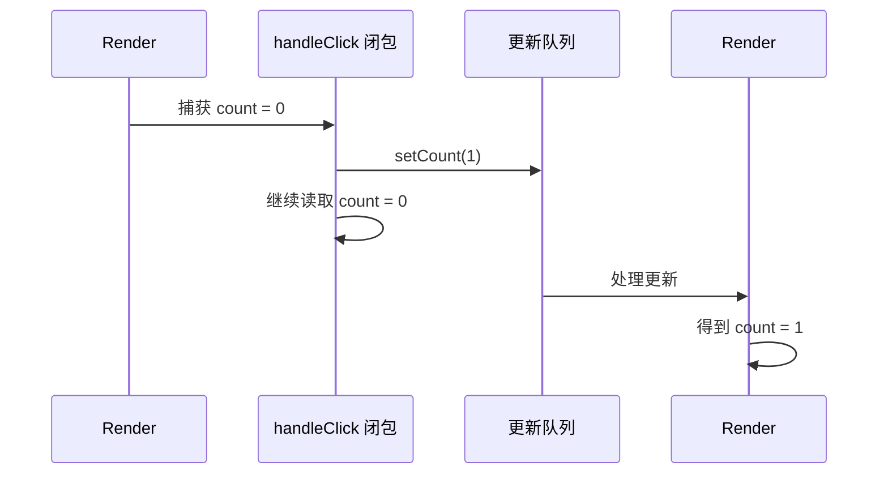
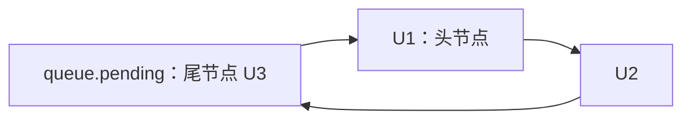
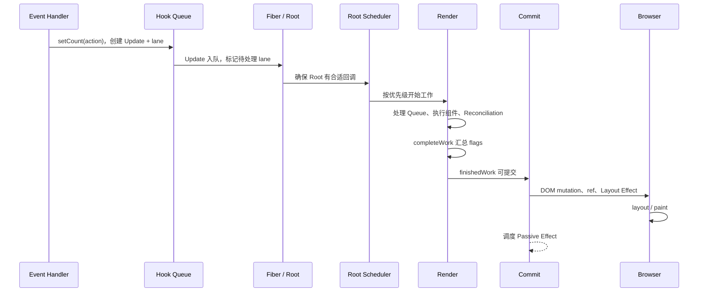
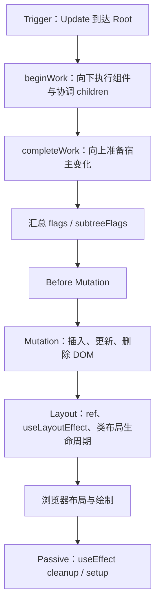

# React 状态更新与渲染：Snapshot、Queue、Batching 与 Commit

> 核心结论：不要再用“`setState` 到底同步还是异步”概括 React 更新。更准确的链路是：**发出更新请求 → 进入队列 → 按优先级参与调度 → Render 计算 → Commit 生效**。
> 难度标签：`基础必会` `进阶重点` `高级深挖` `历史兼容`

## 目录

- [1. State 是一次渲染的快照](#1-state-是一次渲染的快照)
- [2. 更新队列与函数式更新](#2-更新队列与函数式更新)
- [3. Batching 到底做了什么](#3-batching-到底做了什么)
- [4. 一次更新的完整链路](#4-一次更新的完整链路)
- [5. Render 与 Commit](#5-render-与-commit)
- [6. 状态如何保留与重置](#6-状态如何保留与重置)
- [7. Props、State 与派生状态](#7-propsstate-与派生状态)
- [8. 类组件 setState 的历史兼容](#8-类组件-setstate-的历史兼容)
- [9. 高频场景与调试方法](#9-高频场景与调试方法)
- [10. 面试速查](#10-面试速查)

---

## 1. State 是一次渲染的快照

### 面试问题

为什么调用 `setState` 后，当前函数里的变量没有立刻变化？

### 30 秒回答

函数组件每次渲染都会得到一份固定的状态快照。调用状态更新函数不是修改当前闭包里的变量，而是请求 React 使用新状态进行下一次渲染。因此，同一个事件处理器继续读取的仍是创建它的那次渲染快照。

```tsx
function SnapshotDemo() {
  const [count, setCount] = useState(0);

  function handleClick() {
    setCount(count + 1); // 请求下一次渲染使用 1
    console.log(count); // 仍然输出 0：当前闭包中的快照没有改变
  }

  return <button onClick={handleClick}>{count}</button>;
}
```



图中的关键不是“JavaScript 变量更新慢”，而是事件处理器属于旧渲染。每次 Render 都像拍摄一张新的照片，其中包含当时的状态和由它创建的回调。

### 快照模型解决什么问题

- 一次渲染内部读取一致，不会在函数执行到一半时突然变化。
- React 可以保留、暂停或重试某个渲染工作。
- 异步回调的闭包语义可解释，而不是依赖一个随时变化的隐式实例字段。

### 延时回调示例

```tsx
function DelayedAlert() {
  const [count, setCount] = useState(0);

  function handleAlert() {
    const snapshot = count; // 明确记录本次点击看到的状态
    window.setTimeout(() => {
      alert(`点击时的计数：${snapshot}`);
    }, 3000);
  }

  return (
    <>
      <button onClick={() => setCount((value) => value + 1)}>+1</button>
      <button onClick={handleAlert}>3 秒后显示</button>
    </>
  );
}
```

如果需求是读取“回调执行时的最新值”，应重新审视业务语义；确实需要时可用 `ref` 保存 latest value，但不要用 ref 逃避正常状态建模。

---

## 2. 更新队列与函数式更新

### 面试问题

连续调用三次 `setCount(count + 1)` 为什么通常只增加 1？React 如何保存和计算这些更新？

### 30 秒回答

同一个事件处理器中的 `count` 都来自同一份 Render snapshot，因此三次传入的都是相同替换值。函数式更新不是立即执行，而是把“如何基于前一个待处理状态计算下一个状态”加入 Update Queue。React 在之后的 Render 中按顺序处理队列，所以三次 `setCount(value => value + 1)` 能累加 3。

当更新具有不同优先级时，React 还可能暂时跳过低优先级 Update，并把它保存在 `baseQueue` 中等待后续 Render 重放。因此 Update Queue 不只是一个“待执行函数数组”，还承担优先级恢复和更新顺序保持。

### 3 分钟展开

一次 `useState` 更新可以从 4 层理解：

1. **Snapshot**：当前事件处理器读取的是创建它的那次 Render 中的 `count`；
2. **Update**：每次 `setCount` 都创建一条更新，记录 action 和 lane；
3. **Queue**：更新先进入该 Hook 对应的队列，多条 pending 更新通常组织成环形链表；
4. **Process**：下一次 Render 处理队列。优先级足够的更新参与计算，优先级不足的更新保留到 `baseQueue`，以后继续处理。

所以“连续更新为什么覆盖”和“并发更新为什么不会永久丢失”是同一个队列模型的两个层次：前者由 snapshot 与 action 顺序解释，后者由 lane、`baseState` 和 `baseQueue` 解释。

```tsx
function Counter() {
  const [count, setCount] = useState(0);

  function addWrong() {
    setCount(count + 1);
    setCount(count + 1);
    setCount(count + 1); // 三次都基于同一个 count 快照
  }

  function addCorrectly() {
    setCount((value) => value + 1);
    setCount((value) => value + 1);
    setCount((value) => value + 1); // Render 时按队列顺序得到 n + 3
  }

  return (
    <>
      <output>{count}</output>
      <button onClick={addWrong}>错误累加</button>
      <button onClick={addCorrectly}>正确累加</button>
    </>
  );
}
```

### Update Queue 的关键数据存在哪里

> 下列结构是面试级简化示意，并非 React 源码原文；内部字段与模块位置可能随版本调整。

```js
const hook = {
  memoizedState: 0, // 本次 Render 最终读取到的状态
  baseState: 0,     // 尚未处理完的基础状态
  baseQueue: null,  // 被跳过、等待后续重放的更新
  queue: {
    pending: null,  // 本轮新进入的更新；可理解为环形链表尾指针
    dispatch: null,
  },
  next: null,       // 指向该组件的下一个 Hook
};

const update = {
  lane: 0b0010,               // 该更新所属优先级
  action: (value) => value + 1,
  next: null,                 // 多个 Update 形成链表
};
```

| 字段 | 面试中应理解的职责 |
|---|---|
| `memoizedState` | 当前 Render 计算完成后，组件实际读取的状态 |
| `baseState` | 处理 `baseQueue` 时使用的起点 |
| `queue.pending` | 自上次处理后新进入的更新 |
| `baseQueue` | 因 lane 不匹配而暂时跳过、以后需要重放的更新 |
| `update.action` | 直接替换值或函数式更新函数 |
| `update.lane` | 决定本次 Render 是否处理这条更新 |

### 为什么 pending queue 常用环形链表

环形链表可以只保存尾指针，就以接近 O(1) 的成本把新 Update 插入尾部，同时能通过 `tail.next` 找到头节点。面试不需要背插入源码，但要知道它解决的是“快速追加多条更新”，不是为了炫技。

> 下列代码是简化 JavaScript 伪代码，并非 React 源码原文。

```js
function enqueueUpdate(queue, update) {
  const pending = queue.pending;

  if (pending === null) {
    // 第一条更新自己首尾相连
    update.next = update;
  } else {
    // pending 指向尾节点，pending.next 指向头节点
    update.next = pending.next;
    pending.next = update;
  }

  // 新 Update 成为新的尾节点
  queue.pending = update;
}
```



图中只要记住：`pending` 指向尾节点，尾节点的 `next` 指向头节点，因此既方便追加，也方便从头遍历。

### Render 如何处理直接值与函数式更新

> 下列代码是简化 JavaScript 伪代码，并非 React 源码原文。

```js
function applyAction(previousState, action) {
  if (typeof action === 'function') {
    // 函数式更新基于队列中上一步的计算结果
    return action(previousState);
  }

  // 直接值可以理解为“替换当前待计算状态”
  return action;
}

function processVisibleUpdates(baseState, updates) {
  let nextState = baseState;

  for (const update of updates) {
    nextState = applyAction(nextState, update.action);
  }

  return nextState;
}
```

假设初始状态是 `0`：

```tsx
setCount(count + 5);             // 替换为 5
setCount((value) => value + 1);  // 基于 5 得到 6
setCount(42);                    // 最终替换为 42
```

最终结果是 `42`。这里不是“后一次 setState 把前面调用取消了”，而是 3 条 Update 都进入队列，并按照 action 语义依次计算。

### 不同优先级更新如何避免永久丢失

假设队列中先有一个 Transition 低优先级更新，后面又进入一个点击产生的高优先级更新。本轮只处理高优先级 lane 时，React 不能直接删除低优先级更新，否则它会永久丢失；也不能完全忘记后续已处理更新，否则以后重放会破坏顺序。

面试级模型可以理解为：

```js
function processUpdateQueue(baseState, updates, renderLanes) {
  let newState = baseState;
  let newBaseState = null;
  const deferred = [];

  for (const update of updates) {
    const shouldSkip = !includesLane(renderLanes, update.lane);

    if (shouldSkip) {
      if (newBaseState === null) {
        // 记录“第一次跳过之前”已经算出的状态，作为未来重放起点
        newBaseState = newState;
      }

      deferred.push(update);
      continue;
    }

    newState = applyAction(newState, update.action);

    if (newBaseState !== null) {
      // 简化表达：第一次跳过之后，后续已处理更新也保留重放信息，
      // 从而让未来 Render 维持原始更新顺序。
      deferred.push(cloneForRebase(update));
    }
  }

  return {
    memoizedState: newState,
    baseState: newBaseState ?? newState,
    baseQueue: deferred,
  };
}
```

真实实现会合并 pending queue 与 base queue，并通过 lane 位集合判断是否跳过。面试重点是：**被跳过的更新不会消失，而是携带顺序信息留待后续重放**。

### 对象更新为什么要复制

```tsx
type User = { name: string; tags: string[] };

function addTag(user: User, tag: string): User {
  return {
    ...user,
    tags: [...user.tags, tag], // 只复制发生变化的路径
  };
}
```

React 不要求深拷贝整个对象，只要求不要修改仍被旧 Render snapshot 引用的数据。结构共享既保留历史快照，又避免无意义的全量复制。

### 边界与反例

- 函数式 updater 必须保持纯净；开发环境 Strict Mode 可能额外调用 updater 来发现副作用。
- 直接值不是错误；当新状态与旧状态无关时，`setOpen(false)` 比函数形式更直接。
- `setState` 调用顺序很重要；函数式更新也不会自动解决错误的业务顺序。
- `Object.is(nextState, currentState)` 相同可能触发 eager bailout，但业务逻辑不能依赖“updater 一定只执行一次”。
- Update Queue 负责 React 状态更新，不等同于 JavaScript microtask queue 或浏览器事件队列。

### 面试官追问树

1. 三次 `setCount(count + 1)` 为什么只增加 1？
2. 函数式更新什么时候必须使用？
3. 直接值与 updater 混用时如何计算？
4. `queue.pending` 为什么适合用环形链表？
5. 低优先级 Update 被跳过后放在哪里？
6. 为什么 updater 不能产生副作用？

### 一句话收束

> Snapshot 决定当前回调“看见什么”，Update Queue 决定下一次 Render“按什么顺序算”，lane 与 `baseQueue` 决定被跳过的更新“以后如何继续算”。

---

## 3. Batching 到底做了什么

### 面试问题

什么是批处理？React 18 以后有什么变化？

### 30 秒回答

Batching（批处理）是 React 把一段执行上下文中的多个状态更新合并到较少的渲染提交中。React 18 使用 `createRoot` 后扩展了自动批处理范围，不只覆盖 React 事件，也覆盖常见的 Promise、定时器和原生事件回调。批处理减少重复 Render / Commit，但不会把不同 state 更新“合并成一个值”，每条更新仍按队列规则计算。

```tsx
function BatchDemo() {
  const [count, setCount] = useState(0);
  const [pending, setPending] = useState(false);

  async function handleClick() {
    setPending(true);
    const result = await Promise.resolve(3);
    setCount((value) => value + result);
    setPending(false);
    // 在现代根中，这些更新通常可以自动批处理，减少中间提交
  }

  return <button onClick={handleClick}>{pending ? '处理中…' : count}</button>;
}
```

### 批处理不保证什么

- 不保证 `setState` 调用后当前变量立刻改变。
- 不保证所有时刻、所有根、所有外部集成都只有一次渲染。
- 不会跨越必须立即响应的离散用户事件，把两个独立点击错误地混为一个事件。
- 开发环境 Strict Mode 可能额外调用渲染逻辑，不能只用 `console.log` 次数判断生产提交次数。

### `flushSync` 的边界

```tsx
import { flushSync } from 'react-dom';

function MessageList() {
  const [messages, setMessages] = useState<string[]>([]);
  const listRef = useRef<HTMLUListElement>(null);

  function addMessage(message: string) {
    flushSync(() => {
      // 强制这次更新同步提交，以便下一行读取最新 DOM
      setMessages((items) => [...items, message]);
    });

    listRef.current?.lastElementChild?.scrollIntoView();
  }

  return <ul ref={listRef}>{messages.map((item) => <li key={item}>{item}</li>)}</ul>;
}
```

`flushSync` 是与浏览器或第三方命令式 API 集成时的逃生舱，会压缩调度空间并可能伤害性能，不应作为“让 state 立即变化”的常规工具。

---

## 4. 一次更新的完整链路

### 面试问题

调用 `setCount` 后，React 内部大致发生什么？

### 30 秒回答

React 会为这次状态变化创建 Update，分配 lane 并加入当前 Hook 的队列；随后把待处理优先级从当前 Fiber 标记到 Root，并确保 Root 获得合适的调度回调。Render 阶段处理 Update Queue、执行组件和 Reconciliation，构建 work-in-progress Fiber tree；完成后进入 Commit，把 DOM、ref、Layout Effect 等变化一次性提交，再调度 Passive Effect。

### 3 分钟展开

完整链路可以拆成 7 步：

1. **创建 Update**：记录 action、lane 等信息；
2. **入队**：Update 进入当前 Hook 或类组件的更新队列；
3. **标记 Root**：把这条 lane 从当前 Fiber 向上关联到 FiberRoot；
4. **安排工作**：根据 Root 的 pending lanes 决定复用、取消还是创建调度回调；
5. **Render**：处理队列，调用组件，执行 Reconciliation，生成或复用 Fiber，并标记 flags；
6. **Complete**：完成宿主节点准备，并把子树 flags 向上汇总；
7. **Commit**：执行 DOM mutation、ref、Layout Effect，之后调度 Passive Effect。

关键点是：`setCount` 并不直接调用 DOM API，也不保证立刻执行组件。它只是把一次更新放入 React 的调度和协调体系。



图中最重要的分界是：进入 Commit 前，新的 UI 仍只是 work-in-progress 计算结果；只有 Commit 完成，用户才看到本次提交。

### 源码职责导航

> 下表用于建立源码阅读地图，不要求在面试中背函数名。React 内部文件和函数可能随版本变化，应优先记住职责链。

| 典型内部步骤 | 主要职责 |
|---|---|
| `dispatchSetState` | 接收 Hook 更新，选择 lane，创建 Update，并尝试 eager state 优化 |
| `requestUpdateLane` | 根据当前事件、Transition 和执行上下文选择更新 lane |
| `enqueueConcurrentHookUpdate` | 把 Hook Update 暂存到并发更新队列并关联 Fiber |
| `scheduleUpdateOnFiber` | 标记 Root 存在待处理工作，处理 Render 中更新等特殊情况 |
| `ensureRootIsScheduled` | 根据 Root 的 pending lanes 确保存在合适优先级的回调 |
| `renderRootSync` / `renderRootConcurrent` | 以同步或可中断方式构建 work-in-progress tree |
| `commitRoot` | 提交 finishedWork，并协调各 Commit 子阶段与 Passive Effect |

不要把这些函数理解成每次都严格一对一同步调用。并发更新可能先暂存、批量整理，Root 回调也可能被复用、取消或换成更高优先级。

### 关键数据分别存在哪里

| 数据 | 典型归属 | 作用 |
|---|---|---|
| 当前状态 | Hook 的 `memoizedState` | 本次 Render 返回给组件的状态 |
| 待处理更新 | Hook queue / `baseQueue` | 保存 action、lane 和重放顺序 |
| 当前已提交树 | FiberRoot 的 current tree | 页面当前可见版本 |
| 正在计算的树 | work-in-progress tree | 下一次可能提交的版本 |
| 待处理优先级 | Fiber / FiberRoot 的 lanes | 选择本轮需要处理的更新 |
| DOM 变更信息 | Fiber flags / subtreeFlags | Commit 阶段快速定位副作用 |

### 面试级调度伪代码

> 下列代码是简化 JavaScript 伪代码，并非 React 源码原文。

```js
function dispatchStateUpdate(fiber, queue, action) {
  const lane = requestUpdateLane(fiber);
  const update = { action, lane, next: null };

  if (canEagerlyCompute(queue)) {
    const eagerState = applyAction(queue.lastRenderedState, action);

    if (Object.is(eagerState, queue.lastRenderedState)) {
      // 新旧状态相同：可能直接跳过安排新的 Render
      enqueueWithoutScheduling(queue, update);
      return;
    }
  }

  enqueueConcurrentHookUpdate(fiber, queue, update, lane);
  const root = markUpdateLaneFromFiberToRoot(fiber, lane);

  if (root !== null) {
    ensureRootIsScheduled(root);
  }
}
```

这段伪代码只表达稳定主线：创建 Update、分配 lane、入队、关联 Root、安排工作。真实实现还要处理 Render Phase Update、Transition entanglement、隐藏树、错误恢复等分支。

### 一个更新不一定导致 DOM 变化

```tsx
function Profile({ userId }: { userId: string }) {
  const [selectedTab, setSelectedTab] = useState<'overview' | 'activity'>('overview');

  return (
    <button onClick={() => setSelectedTab('overview')}>
      当前页签：{selectedTab}，用户：{userId}
    </button>
  );
}
```

如果状态本来就是 `'overview'`，React 可能通过 `Object.is` 和 eager state 跳过调度；即使组件被重新执行，只要宿主输出没有变化，Commit 也可能不产生 DOM mutation。因此要区分：

```text
调用 setter ≠ 一定执行组件 ≠ 一定产生 DOM 修改
```

### 如何验证更新链路

1. 在 React DevTools Profiler 中查看是哪次交互触发 Commit；
2. 用 `<Profiler>` 的 `actualDuration` 判断 Render 成本；
3. 用浏览器 Performance 面板观察 scripting、layout、paint；
4. 在组件函数、`useLayoutEffect`、`useEffect` 分别记录日志，区分 Render、Layout 和 Passive 阶段；
5. 不要只看 `console.log` 次数，Strict Mode 会改变开发环境的调用次数。

### 边界与反例

- 状态更新发生在不同 Root 时，不能假设它们总被同一次 Commit 处理。
- `flushSync` 可以要求 React 立即刷新部分工作，但会压缩调度空间，不是默认更新模型。
- Render 过程中触发更新有专门处理路径；业务组件不应把它当常规状态修正方案。
- 类组件和函数组件的队列结构不同，但都遵循“创建更新 → 入队 → 调度 → Render → Commit”的主线。
- 内部函数名会变化；面试时应先讲职责，再用函数名证明读过源码。

### 面试官追问树

1. setter 会不会直接修改 state？
2. Update 存在哪里？
3. lane 在链路中解决什么问题？
4. Scheduler 与 Reconciliation 分别负责什么？
5. 为什么同值更新可能被跳过？
6. 为什么 Render 可以中断而 Commit 不可以？
7. 如何证明一次 Render 没有修改 DOM？

### 一句话收束

> setter 负责“登记更新”，lane 和 Root Scheduler 负责“决定何时算”，Render 负责“算出下一棵树”，Commit 才负责“让结果生效”。

---

## 5. Render 与 Commit

### 面试问题

React 渲染流程主要有哪些阶段？哪些阶段能操作 DOM？

### 30 秒回答

Trigger、Render、Commit 是最适合面试表达的三步。Render 调用组件、处理更新队列并协调 Fiber tree，只计算下一份 UI；它可能暂停、放弃或重做，因此必须保持纯净。Commit 把 Fiber flags 对应的变化应用到宿主环境，并处理 ref 与 Layout Effect。Passive Effect 不属于 DOM mutation 本身，通常在提交后单独 flush。

### 3 分钟展开

Render 与 Commit 的根本区别不是“一个生成虚拟 DOM、一个修改真实 DOM”这么简单，而是：

- **Render 是可重试计算**：React 从 current tree 创建或复用 work-in-progress Fiber，执行 `beginWork` 向下协调 children，再执行 `completeWork` 向上完成宿主工作并汇总 flags；
- **Commit 是不可中断提交**：React 已经决定采用 finishedWork，需要在一次一致性边界内完成必要 mutation、ref 和布局副作用，不能让用户看到“只提交半棵树”的状态；
- **Passive Effect 是提交后的外部同步**：其 cleanup / setup 由 React 单独安排，不应与 DOM mutation 混为一谈。



### Render 阶段内部做什么

1. 读取符合本轮 lanes 的 Update；
2. 计算 Hook state 或类组件 state；
3. 调用函数组件或类组件 `render`；
4. 比较新 React Element 与旧 Fiber children；
5. 复用、创建或删除 Fiber；
6. 在 `completeWork` 中准备宿主节点并汇总 flags；
7. 产出 finishedWork，等待 Commit。

Render 可能出现 3 种结果：

- **完成**：得到可以 Commit 的 finishedWork；
- **让出主线程**：保存工作进度，之后继续；
- **放弃并重做**：更高优先级更新到来或结果失效，从 Root 重新计算。

这就是为什么 Render 期间不能发送请求、修改全局变量或直接操作 DOM：这些外部影响无法随着一次被放弃的 Render 自动回滚。

### flags 为什么重要

Reconciliation 不会在 Render 阶段直接修改 DOM，而是在 Fiber 上记录工作标记，例如 Placement、Update、ChildDeletion、Ref、Passive 等。`completeWork` 会把子树中的标记汇总到 `subtreeFlags`，Commit 因此可以跳过没有副作用的分支，而不是再次扫描所有业务逻辑。

> 下列代码是简化 JavaScript 伪代码，并非 React 源码原文。

```js
function completeUnitOfWork(fiber) {
  let subtreeFlags = 0;
  let child = fiber.child;

  while (child !== null) {
    // 把子节点自身和后代的副作用向父节点汇总
    subtreeFlags |= child.flags;
    subtreeFlags |= child.subtreeFlags;
    child = child.sibling;
  }

  fiber.subtreeFlags = subtreeFlags;
}
```

### Commit 阶段的子阶段

| 子阶段 | 典型工作 | 是否应读写 DOM |
|---|---|---|
| Before Mutation | 读取 DOM 变更前快照、处理部分提交前逻辑 | 可以读取，不应随意修改 |
| Mutation | Placement、Update、Deletion 等宿主变更，处理部分 ref / insertion effect 工作 | React 在此修改宿主环境 |
| Layout | 绑定 ref、执行 `useLayoutEffect`、类组件布局生命周期 | 可以读取并同步修正布局 |
| Passive flush | 执行 `useEffect` 的旧 cleanup 和新 setup | 用于外部同步，不应阻塞关键绘制 |

Commit 是同步一致性边界，但 Passive Effect 通常被安排到提交后的单独阶段。因此面试时最好说“Commit 负责提交 DOM、ref 和 Layout Effect，并安排 Passive Effect”，而不是笼统说“所有 Effect 都在 Commit 中同步执行”。

### 用日志区分 Render、Layout 与 Passive

```tsx
function CommitOrderDemo() {
  const [count, setCount] = useState(0);

  console.log('1. Render：计算 UI', count);

  useLayoutEffect(() => {
    console.log('2. Layout Effect：DOM 已更新，通常尚未绘制', count);

    return () => {
      console.log('Layout cleanup：下一次 layout setup 前', count);
    };
  }, [count]);

  useEffect(() => {
    console.log('3. Passive Effect：提交后进行外部同步', count);

    return () => {
      console.log('Passive cleanup：下一次 passive setup 前', count);
    };
  }, [count]);

  return <button onClick={() => setCount((value) => value + 1)}>{count}</button>;
}
```

开发环境 Strict Mode 可能额外执行 Render 和 Effect 的 setup / cleanup 检查，因此日志用于理解阶段，不能直接当作生产调用次数保证。

### 组件 Render 不等于 DOM mutation

下面组件在父组件更新时可能再次执行，但文本结果没有变化时，React 不需要修改对应 DOM：

```tsx
function StableChild({ label }: { label: string }) {
  console.log('组件函数可能再次执行');
  return <span>{label}</span>;
}
```

因此性能排查要分别确认：

1. 组件是否执行；
2. Reconciliation 是否产生 flags；
3. Commit 是否真的修改 DOM；
4. 浏览器是否发生昂贵 layout / paint。

只统计“组件 Render 次数”可能会把便宜的 JavaScript 计算误判成真正瓶颈。

### 为什么 Render 必须纯净

如果在 Render 中发送请求、订阅事件或修改 DOM，一旦渲染被暂停或放弃，就会留下无法回滚的外部影响。正确边界是：

- 因用户动作发生的事情，优先放事件处理器；
- 因组件可见并需要与外部系统同步的事情，放 Effect；
- 可由现有数据直接推导的值，放 Render；
- 必须在绘制前读取并修正布局的事情，放 `useLayoutEffect`；
- DOM mutation 交给 React，除非通过 ref 与第三方命令式系统集成。

### 如何验证阶段问题

- **页面数据不对**：先检查 snapshot、Update Queue 和 Render 计算；
- **DOM 闪烁**：检查是否把布局修正放到了 Passive Effect；
- **交互卡顿**：在 Performance 面板区分 Render scripting、Commit mutation、layout 和 paint；
- **Effect 重复连接**：检查 cleanup 是否与 setup 对称，以及 Strict Mode 是否暴露了非幂等逻辑；
- **日志很多但页面没变**：使用 Profiler 确认 Commit，而不是只统计组件函数调用。

### 边界与反例

- 并发只让 Render 具备可中断能力，不意味着 Commit 可以拆成多帧执行。
- `useLayoutEffect` 可以在 DOM 提交后同步更新状态，这可能触发额外 Render，并阻塞绘制。
- Passive Effect 的实际 flush 时机受更新来源和调度影响，不能机械保证“永远在 paint 后”；其设计用途仍是非布局型外部同步。
- Server Rendering 只生成服务端输出，不执行浏览器中的 layout / passive Effects；Effects 在客户端接管后运行。

### 面试官追问树

1. Render 阶段会不会修改 DOM？
2. `beginWork` 与 `completeWork` 分别做什么？
3. flags 和 `subtreeFlags` 有什么作用？
4. Commit 为什么不能中断？
5. `useLayoutEffect` 与 `useEffect` 分别处于什么阶段？
6. 组件执行了为什么 DOM 可能不变？
7. Strict Mode 为什么会让日志看起来重复？

### 一句话收束

> Render 是可以暂停和重做的“计算草稿”，flags 是草稿中的“变更清单”，Commit 才是一次性让草稿成为用户可见结果的“原子提交”。

---

## 6. 状态如何保留与重置

### 面试问题

React 根据什么决定组件状态保留还是重置？`key` 为什么也能用于非列表组件？

### 30 秒回答

状态绑定在 Fiber 树中的“组件类型 + 位置 + key”身份上。相同父节点下，相同位置、类型和 key 通常会复用 Fiber 并保留状态；类型或 key 变化会创建新 Fiber，旧状态随卸载丢弃。`key` 是身份提示，不只用于列表，也可用于显式重置表单或会话。

```tsx
type ChatProps = { userId: string };

function Chat({ userId }: ChatProps) {
  const [draft, setDraft] = useState('');
  return <textarea value={draft} onChange={(event) => setDraft(event.target.value)} />;
}

function ChatPage({ selectedUserId }: { selectedUserId: string }) {
  return (
    // 用户变化时 key 变化，React 会创建新的 Chat 身份并清空草稿
    <Chat key={selectedUserId} userId={selectedUserId} />
  );
}
```

### 不要在组件内部定义组件

```tsx
function Parent() {
  // ❌ 每次 Parent 渲染都会创建新的函数类型，Child 状态会反复重置
  function Child() {
    const [value, setValue] = useState('');
    return <input value={value} onChange={(event) => setValue(event.target.value)} />;
  }

  return <Child />;
}
```

应把 `Child` 移到模块顶层，确保组件类型引用稳定。

### CSS 隐藏与条件卸载

- `display: none`：DOM 和组件仍存在，状态保留。
- 条件渲染为 `null`：对应子树卸载，状态通常丢失。
- Suspense / Offscreen 相关能力可能保留隐藏树，需按具体 API 和框架行为判断。

---

## 7. Props、State 与派生状态

### 面试问题

什么时候需要把 props 复制到 state？如何避免派生状态失同步？

### 30 秒回答

默认不要复制。若值能由当前 props / state 计算，应在 Render 中推导；如果计算昂贵再考虑 `useMemo`。只有“把 props 作为初始值后由组件独立编辑”等明确语义才存 state，并通过 key 或显式重置定义切换行为。

```tsx
function ProductList({ products, query }: {
  products: Array<{ id: string; name: string }>;
  query: string;
}) {
  // 这是派生数据，不需要 useEffect + setState 再同步一遍
  const visibleProducts = products.filter((product) =>
    product.name.toLowerCase().includes(query.toLowerCase()),
  );

  return <ul>{visibleProducts.map((item) => <li key={item.id}>{item.name}</li>)}</ul>;
}
```

### 何时可以使用 `useMemo`

```tsx
const visibleProducts = useMemo(
  () => expensiveFilter(products, query),
  // 只有 products 或 query 变化时才重新执行昂贵计算
  [products, query],
);
```

`useMemo` 是性能优化，不是语义保证。若移除它会导致逻辑错误，说明状态或依赖建模存在问题。

---

## 8. 类组件 setState 的历史兼容

### 面试问题

类组件 `this.setState` 与 Hook state 有何不同？

### 30 秒回答

类组件对象形式的 `setState` 会对顶层 state 做浅合并，而 `useState` 更新值是替换语义。类组件连续依赖前值时也应使用函数形式，并在回调或生命周期中读取提交后的结果。二者都应理解为更新请求，不要依赖调用后立即读取的新值。

```tsx
class Counter extends React.Component<object, { count: number; label: string }> {
  state = { count: 0, label: '计数' };

  add = () => {
    this.setState(
      (previous) => ({ count: previous.count + 1 }), // 顶层浅合并，label 被保留
      () => {
        // 回调在提交后执行，可以读取已提交状态
        console.log(this.state.count);
      },
    );
  };

  render() {
    return <button onClick={this.add}>{this.state.count}</button>;
  }
}
```

Hook 对象状态需要显式合并：

```tsx
setForm((previous) => ({
  ...previous,
  name: nextName, // useState 不会自动合并对象字段
}));
```

### “同步 / 异步”问法的标准纠正

可以这样回答：

> `setState` 的调用本身是同步执行的，但它提交的是更新请求；状态变量属于当前渲染快照，不会原地修改。React 是否立刻 Render / Commit 取决于更新来源、批处理、优先级、根模式以及是否使用 `flushSync`。所以更准确地讨论“更新何时被处理和提交”，而不是给 `setState` 贴同步或异步标签。

---

## 9. 高频场景与调试方法

### 场景一：更新丢失

```tsx
// ❌ 多个异步结果都捕获了旧列表，后完成者可能覆盖先完成者
setItems([...items, result]);

// ✅ 基于队列中的最新待处理状态追加
setItems((current) => [...current, result]);
```

### 场景二：对象引用没变

```tsx
// ❌ 原地修改后仍传回同一对象，React 可能通过 Object.is 认为没有变化
user.name = 'Grace';
setUser(user);

// ✅ 创建新对象，保留旧快照
setUser((current) => ({ ...current, name: 'Grace' }));
```

### 场景三：无限更新

```tsx
function Broken() {
  const [count, setCount] = useState(0);
  setCount(count + 1); // ❌ Render 期间无条件更新，引发重复渲染
  return <p>{count}</p>;
}
```

更新应由事件、Effect 的外部同步或明确的条件机制触发，不应把修正逻辑随意放在渲染主体。

### 场景四：开发环境渲染两次

Strict Mode 会在开发环境执行额外检查，帮助发现不纯渲染、Effect 缺少清理和 ref 回调问题。调试时区分：

- 组件函数被调用次数；
- DOM 实际 Commit 次数；
- Effect setup / cleanup 次数；
- 生产构建行为。

### 建议的定位顺序

1. React DevTools Profiler 确认是谁触发更新。
2. 检查 state 所有者是否过高。
3. 检查对象、数组、函数引用是否每次重建。
4. 检查 Context value 是否包含频繁变化的大对象。
5. 检查 Effect 是否在同步可推导状态。
6. 最后再决定是否使用 memoization。

---

## 10. 面试速查

### 一组可以直接口述的答案

**Q：调用 `setState` 后发生什么？**
A：创建更新并入队，标记优先级到根，调度 Render；Render 处理队列并协调 Fiber；完成后 Commit DOM、ref 和 Effect。

**Q：为什么连续三次 `setCount(count + 1)` 只加一次？**
A：三次读取同一渲染快照并提交同一个替换结果，应使用函数式更新表达累加。

**Q：React 18 自动批处理是什么？**
A：现代根把更多异步上下文中的更新合并处理，以减少中间提交；它不改变快照和队列语义。

**Q：什么时候状态会重置？**
A：当组件在树中的类型、位置或 key 身份变化，React 创建新 Fiber，旧状态被丢弃。

**Q：Render 和 Commit 的区别？**
A：Render 计算且可能被重做；Commit 修改宿主环境且必须保持一致性。

### 易错结论对照

| 不准确说法 | 更准确表达 |
|---|---|
| setState 是异步的 | setState 发出更新请求，提交时机由队列、批处理和调度决定 |
| setState 会马上改变量 | 当前渲染快照不变，下一次渲染获得新状态 |
| 批处理会丢更新 | 直接值可能覆盖，函数式更新会按队列顺序计算 |
| 组件更新就一定改 DOM | Render 后可能发现宿主输出没有变化 |
| key 只是消除警告 | key 定义兄弟节点身份，影响复用、移动和状态保留 |

## 参考资料

- [State as a Snapshot](https://react.dev/learn/state-as-a-snapshot)
- [Queueing a Series of State Updates](https://react.dev/learn/queueing-a-series-of-state-updates)
- [Render and Commit](https://react.dev/learn/render-and-commit)
- [Preserving and Resetting State](https://react.dev/learn/preserving-and-resetting-state)
- [React v18.0](https://react.dev/blog/2022/03/29/react-v18)：Automatic Batching 与并发基础设施
- [ReactFiberHooks.js](https://github.com/facebook/react/blob/main/packages/react-reconciler/src/ReactFiberHooks.js)：Hook Update Queue 与 `dispatchSetState` 源码导航
- [ReactFiberWorkLoop.js](https://github.com/facebook/react/blob/main/packages/react-reconciler/src/ReactFiberWorkLoop.js)、[ReactFiberRootScheduler.js](https://github.com/facebook/react/blob/main/packages/react-reconciler/src/ReactFiberRootScheduler.js)：Render、Root 调度与 lane 处理源码导航
- [ReactFiberCommitWork.js](https://github.com/facebook/react/blob/main/packages/react-reconciler/src/ReactFiberCommitWork.js)：Commit 子阶段与 Effect 提交源码导航

## 关联专题

- [React 面试知识总纲](./react-interview-guide.md)
- [React 核心与组件模型](./react-core-and-component-model.md)
- [Hooks 深入](./react-hooks-deep-dive.md)
- [Fiber、并发与现代 React](./react-fiber-concurrency-and-modern-react.md)
- [React Diff 与 Vue 3 对比](./react-diff-vue3-compare.md)
