# React / Vue diff 算法面试题

> 题目来源：字节跳动、阿里巴巴、百度、腾讯、滴滴、小红书等大厂前端面试复盘（2023–2025）
> 共 13 道题，按「基础认知 → React 细节 → Vue 细节 → 横向对比 → 进阶实战」五层递进
> 每题含：口述版（分点简答）+ 学习版（详细展开）+ 追问链路 + 追问答案 + 图示

---

## 层级一：基础认知 — 为什么需要 diff

### Q1 什么是虚拟 DOM？diff 算法解决什么问题？

> 频率：`高频` 来源：百度 / 阿里 / 字节

#### 口述版

- 虚拟 DOM 是用 JS 对象描述真实 DOM 结构的轻量拷贝，包含 `type / props / children`
- 数据变化时先生成新的虚拟 DOM，通过 diff 对比新旧两棵树，算出**最小变更集**（patch）
- 再把 patch 批量应用到真实 DOM，避免全量替换
- 核心价值：**跨平台**（同一套虚拟 DOM 可以渲染到 DOM、Native、Canvas）+ **批量更新减少重排重绘**

#### 学习版

**虚拟 DOM 的数据结构**

```js
// React 的 ReactElement（简化）
{
  type: 'div',                 // 标签名或组件
  props: {
    className: 'box',
    children: [
      { type: 'span', props: { children: 'hello' } }
    ]
  }
}

// Vue 的 VNode（简化）
{
  tag: 'div',
  data: { class: 'box' },
  children: [
    { tag: 'span', children: 'hello' }
  ]
}
```

**没有 diff 会怎样？**

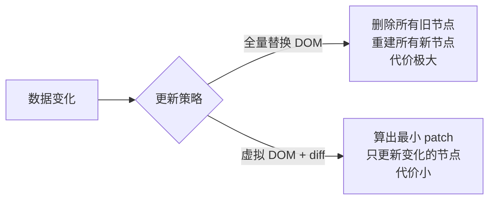

**虚拟 DOM 不一定快**

| 场景 | 虚拟 DOM 效率 |
|------|-------------|
| 数据频繁变动、局部更新 | ✅ 快（批量 diff + 最小 patch） |
| 首次渲染 | ❌ 慢（多一层 JS 对象创建） |
| 极简静态页面 | ❌ 没必要，直接操作 DOM 反而更快 |
| 跨平台渲染 | ✅ 必要（抽象层的价值） |

#### 追问链路

- 虚拟 DOM 一定比直接操作真实 DOM 快吗？什么情况更慢？
- 没有 diff，直接全量替换 DOM 有什么问题？
- diff 算法本身的代价在哪？

#### 追问答案

**虚拟 DOM 一定快吗？**
- 不一定。虚拟 DOM 的价值在于**批量更新**和**跨平台**，不在于"快"本身
- 首次渲染比直接操作 DOM 慢（多了 JS 对象创建 + diff 计算开销）
- 数据频繁小范围变化时比全量重建快，但比精准手动操作 DOM 慢
- Svelte 编译时直接生成 DOM 操作代码，首屏和更新都比虚拟 DOM 快

**全量替换 DOM 的问题**
- 所有 DOM 节点销毁重建 → 浏览器强制重排重绘 → 性能差
- 表单输入内容、滚动位置、焦点、动画状态全部丢失
- 无法做过渡动画（节点直接消失再出现）

**diff 本身的代价**
- 每次更新都要遍历整棵虚拟 DOM 树进行对比，O(n) 但系数不小
- 节点数量很大时（如 10000 个），diff 本身就是瓶颈
- 这也是为什么 Vue3 要做编译时优化（PatchFlag），减少需要 diff 的节点数

---

### Q2 标准树 diff 是 O(n³)，React/Vue 怎么降到 O(n)？

> 频率：`中频` 来源：字节 / 阿里

#### 口述版

- 标准 tree diff：遍历旧树 O(n) × 遍历新树 O(n) × 比较编辑距离 O(n) = **O(n³)**
- React/Vue 通过三条**启发式假设**降到 O(n)：
  1. 不同类型节点直接销毁重建，不尝试复用
  2. 只比较同层节点，不跨层移动
  3. 开发者通过 `key` 标记稳定节点，帮助框架识别移动

#### 学习版

**O(n³) 从哪来**

```
完整 tree diff 的三重循环：
1. 遍历旧树所有节点（O(n)）
2. 对每个旧节点，遍历新树所有节点寻找匹配（O(n)）
3. 计算两个节点之间的编辑距离（O(n)）

总计：O(n) × O(n) × O(n) = O(n³)
```

**三条假设如何降复杂度**

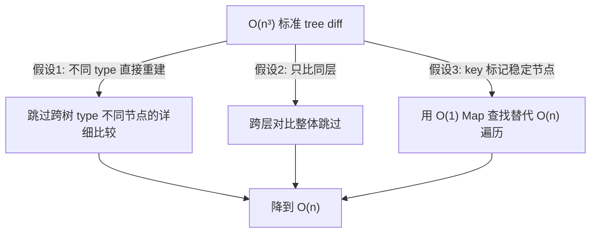

| 假设 | 砍掉的情况 | 代价 |
|------|-----------|------|
| 不同 type 直接重建 | 不比较不同类型节点的子树 | 条件渲染换组件类型时整棵子树重建 |
| 只比同层 | 跨层移动无法复用 | 节点跨层移动时销毁重建 |
| key 标记节点 | 用 Map 查找替代遍历 | 开发者要手动维护 key |

#### 追问链路

- O(n³) 具体怎么算出来的？三重在哪？
- Vue 是靠假设降复杂度，还是靠别的手段？
- 三条假设如果都违反，会发生什么？

#### 追问答案

**O(n³) 三重循环分别是什么**
- 第一重：对旧树每个节点（n 个），在新树里找对应节点（n 次对比）→ O(n²)
- 第二重：找到候选节点后，计算两个子树之间的最优编辑操作（插入/删除/替换）→ 编辑距离算法 O(n)
- 三者相乘 → O(n³)

**Vue 还做了哪些额外优化**
- Vue3 在假设基础上加了**编译时优化**：PatchFlag 标记动态节点，运行时只 diff 带标记的节点
- 依赖收集让 Vue 天然知道"哪个组件需要更新"，组件级别就能跳过
- React 没有依赖收集，只能靠 Fiber + bailout 跳过无变化的子树

**三条假设都违反会怎样**
- 频繁跨层移动节点 → 每次都销毁重建，DOM 操作极多
- 不加 key，列表频繁排序/插入 → 大量无效 DOM 操作
- 实际 UI 很少需要跨层移动，这三条假设在绝大多数场景都成立

---

## 层级二：React diff 细节

### Q3 React diff 的三个核心假设是什么？为什么这么设计？

> 频率：`高频` 来源：字节 / 阿里 / 百度

#### 口述版

- **假设 1**：不同 `type` 的节点产生完全不同的树 → 直接销毁重建，不尝试复用
- **假设 2**：开发者通过 `key` 暗示哪些节点在不同渲染间保持稳定 → key 相同才尝试复用
- **假设 3**：只做同层比较，不跨层移动 → 跨层就是销毁 + 新建

#### 学习版

**假设 1：不同 type 直接重建**

```jsx
// old
<div className="box">
  <Counter />
</div>

// new（div → section）
<section className="box">
  <Counter />
</section>
```

`div` 变 `section`，即使子树完全一样，React 也会**销毁整棵旧树，从零创建新树**。这意味着 `Counter` 组件的 state 会被重置。

这条假设的代价：**条件渲染时换组件类型会丢失子树状态**，这是很多 React bug 的来源。

**假设 2：key 标记稳定节点**

```jsx
// 没有 key：React 按位置对比，位置 0 ↔ 位置 0，无法识别"移动"
<ul>
  <li>Apple</li>
  <li>Banana</li>
</ul>

// 有 key：React 用 key 建 Map，能识别"Banana 只是换了位置"
<ul>
  <li key="apple">Apple</li>
  <li key="banana">Banana</li>
</ul>
```

**假设 3：只做同层比较**

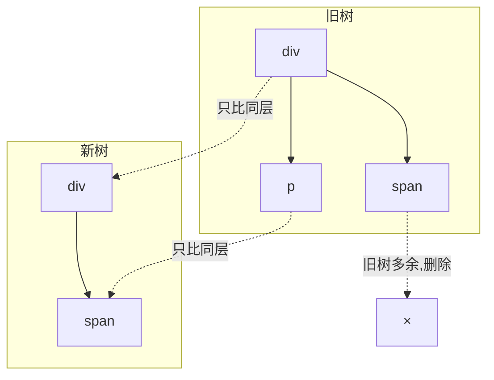

跨层级对比不做：如果旧树里某个节点"移动"到了新树的另一层，React 会在旧位置删除，在新位置创建，不会"移动"。

**为什么这三条是有意为之**

| 假设 | 为什么合理 |
|------|----------|
| 不同 type 重建 | UI 组件树中，不同 type 的子树结构通常完全不同，复用没意义 |
| key 标记 | 把识别稳定节点的责任交给开发者，框架保持简单 |
| 只比同层 | 跨层移动在实际 UI 中极少发生，O(n) 的收益远大于少数跨层场景的代价 |

#### 追问链路

- "不同 type 产生不同树"在业务里怎么体现？有什么常见踩坑？
- "不做跨层移动优化"是局限还是有意为之？
- 这三条假设在源码哪里体现？

#### 追问答案

**"不同 type 产生不同树"业务踩坑**
- 最常见：`{isLogin ? <UserPanel /> : <GuestPanel />}` 切换时，两个组件都被重置 state
- 另一个踩坑：同一位置的组件从类组件改成函数组件，state 也会被重置（type 变了）
- 解法：保持相同位置使用相同 type，或者把 state 提升到父组件 / 用 Context 维护

**"不做跨层移动"是有意为之**
- 跨层移动检测需要全树扫描，复杂度从 O(n) 升回 O(n²) 甚至 O(n³)
- 实际 UI 开发中，跨层移动节点的场景极少（Portal 除外，它用不同机制处理）
- 对于极少发生的场景，不值得为它付出算法复杂度的代价

**在源码哪里体现**
- 假设 1 体现在 `beginWork` 中：`current.type !== workInProgress.type` 时直接走 `mountXxx` 而非 `updateXxx`
- 假设 2 体现在 `reconcileChildFibers`：先比 key，再比 type
- 假设 3 体现在整体架构：`performUnitOfWork` 只沿 `child/sibling` 链表同层遍历

---

### Q4 React 单节点 diff 的流程是什么？

> 频率：`中频` 来源：字节 / 校招

#### 口述版

- 新节点只有一个子元素时走单节点 diff
- 流程：遍历旧的兄弟节点，用 key + type 双重匹配
  - **key 相同 + type 相同** → 复用旧 Fiber，其余旧兄弟全删
  - **key 相同 + type 不同** → 删除旧节点（含所有兄弟），新建 Fiber
  - **key 不同** → 跳过当前旧节点，继续找下一个兄弟
  - **找完所有旧兄弟都没命中** → 新建 Fiber

#### 学习版

**完整流程图**

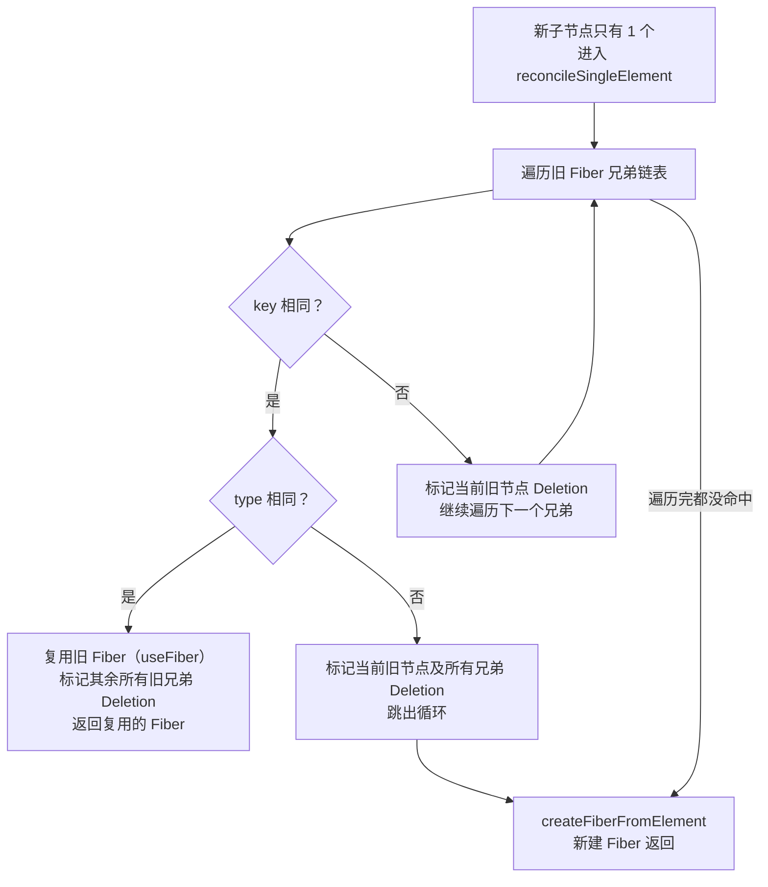

**"复用"复用了什么**

```js
// useFiber 的核心逻辑（简化）
function useFiber(fiber, pendingProps) {
  const clone = createWorkInProgress(fiber, pendingProps);
  // 复用了：
  // - fiber.type（组件类型）
  // - fiber.stateNode（类组件实例 / 真实 DOM 节点）
  // - fiber.memoizedState（useState 的 state）
  // - fiber.updateQueue（待处理的更新队列）
  clone.index = 0;
  clone.sibling = null;
  return clone;
}
```

复用意味着：组件的 `state`、类组件的实例、已有的真实 DOM 节点都不会被销毁，只是更新 props。

**key 相同 + type 不同为什么不能复用**

```jsx
// old: key="a" type=Input → stateNode 是 <input> DOM 节点
<Input key="a" value="hello" />

// new: key="a" type=Select → stateNode 应该是 <select> DOM 节点
<Select key="a" options={[...]} />
```

两者虽然 key 一样，但对应的 DOM 结构完全不同，强行复用会让 DOM 节点类型错误，所以必须销毁重建。

#### 追问链路

- key 相同 + type 相同，"复用"到底复用了什么？
- 新节点没有 key 时怎么处理？
- 为什么 key 相同 + type 不同，还要把所有旧兄弟一起删掉？

#### 追问答案

**"复用"复用了什么**
- 复用 `Fiber` 对象（`alternate` 机制，直接用旧 Fiber 作为 workInProgress）
- 复用真实 DOM 节点（`fiber.stateNode`）→ 不销毁 DOM，只更新属性
- 复用组件 state（`fiber.memoizedState`）→ Hook 链表不重建
- 复用类组件实例（`fiber.stateNode` for ClassComponent）→ `this` 指向不变

**新节点没有 key 时**
- key 为 `null`，React 视为"任意 key 都可能匹配"
- 只要 type 相同，就直接复用第一个旧节点，删除其余
- 本质是"按位置"匹配（index 0 对 index 0），没有 key 的节点识别能力

**为什么 key 相同 type 不同时删掉所有旧兄弟**
- key 是唯一标识，如果 key 匹配上了但 type 不对，说明这个位置的节点需要完全重建
- 既然这个 key 已经"命中"，旧链表里不可能还有其他同 key 节点，所以继续保留旧兄弟没有意义
- 清空旧兄弟是为了避免 commit 阶段出现孤儿节点（不被新树引用的旧 DOM 节点）

---

### Q5 React 多节点 diff 为什么做两轮遍历？每轮解决什么问题？

> 频率：`高频` 来源：字节 / 阿里

#### 口述版

- 多节点 diff 处理 `children` 是数组的情况（列表渲染）
- **第一轮（正序遍历）**：处理节点类型不变、只有属性更新的"简单情况"，遇到 key 或 type 不匹配立即停
- **第二轮（用 Map 处理乱序）**：处理第一轮没处理完的情况（新增、删除、移动）
- 两轮遍历是因为实际业务里"顺序不变只改属性"最常见，第一轮用 O(n) 快速解决，第二轮兜底处理复杂情况

#### 学习版

**第一轮：正序遍历**

```
同时遍历新数组 newChildren 和旧 Fiber 链表：
  - key 相同 + type 相同 → 复用，双指针前进
  - key 相同 + type 不同 → 不能复用，break 退出第一轮
  - key 不同 → break 退出第一轮（顺序变化了）
```

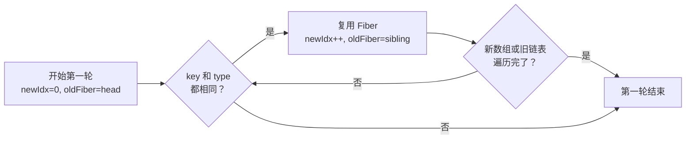

**第一轮结束后的三种情况**

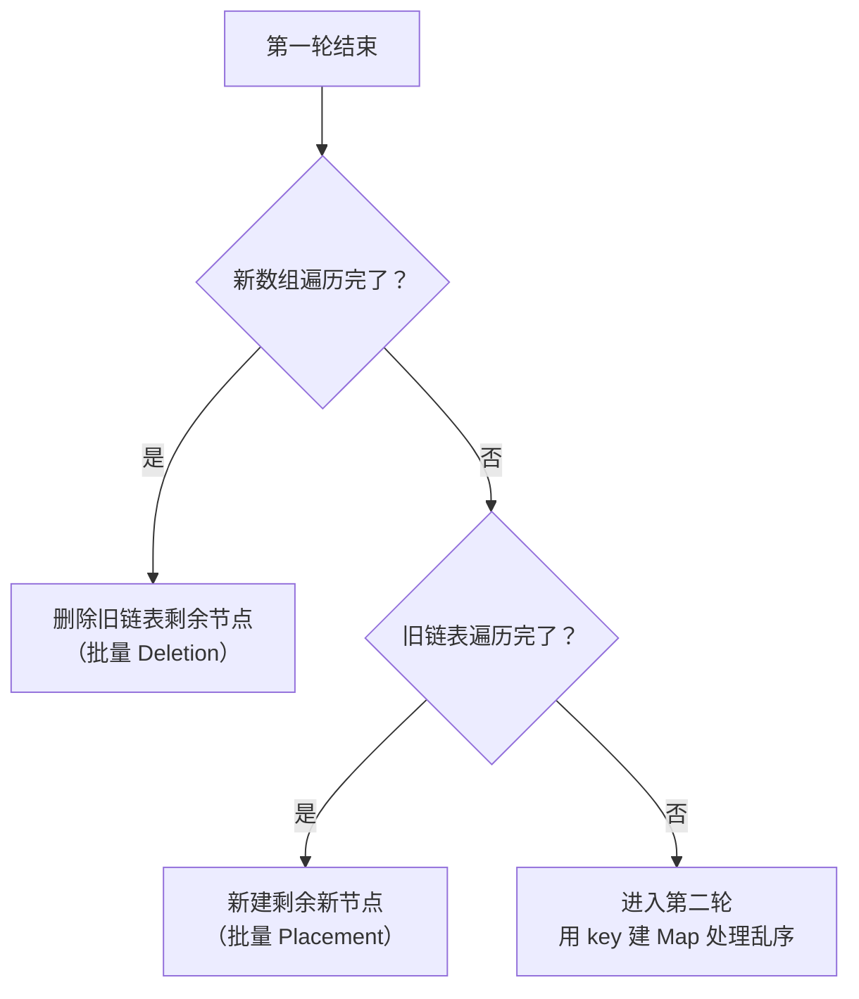

**第二轮：用 key 建 Map 处理乱序**

```js
// 把剩余旧节点建成 Map：key → Fiber
const existingChildren = new Map();
let existingChild = oldFiber;
while (existingChild !== null) {
  existingChildren.set(
    existingChild.key ?? existingChild.index,
    existingChild
  );
  existingChild = existingChild.sibling;
}

// 遍历剩余新节点，在 Map 里 O(1) 查找
for (; newIdx < newChildren.length; newIdx++) {
  const newChild = newChildren[newIdx];
  const matchedFiber = existingChildren.get(newChild.key ?? newIdx);
  if (matchedFiber && matchedFiber.type === newChild.type) {
    // 复用，标记是否需要移动（Placement）
  } else {
    // 新建
  }
}

// Map 里剩余的旧节点全部 Deletion
existingChildren.forEach(child => deleteChild(returnFiber, child));
```

**为什么用 Map 而不是数组遍历**

| 方式 | 查找复杂度 | 总遍历复杂度 |
|------|----------|------------|
| 数组遍历查找 | O(n) | O(n²) |
| key → Map 查找 | O(1) | O(n) |

#### 追问链路

- 第一轮正序遍历，在什么情况下会中断？
- 两边都有剩余时，Map 查找后怎么判断节点是否需要"移动"？
- 如果列表完全反转（`[A,B,C]` → `[C,B,A]`），第一轮结果是什么？

#### 追问答案

**第一轮什么情况会中断**
- key 不匹配（新节点 key 在旧链表当前位置找不到）
- type 不匹配（key 匹配但 type 变了）
- 其中一方（新数组或旧链表）先遍历完

**Map 查找后怎么判断是否需要移动**
- React 维护一个 `lastPlacedIndex` 变量记录"上一个复用节点在旧链表里的 index"
- 当前复用节点的旧 index 如果 >= `lastPlacedIndex` → 不需要移动（相对顺序对）
- 旧 index < `lastPlacedIndex` → 需要移动（打 `Placement` 标记）
- 这是 React 的"最右"策略：尽量移动旧 index 小的节点而非大的，减少 DOM 操作

**列表完全反转时**
- `[A,B,C]` → `[C,B,A]`，第一轮：C.key ≠ A.key，立即 break，第一轮几乎没处理任何节点
- 进入第二轮，旧链表三个节点都进 Map，新数组遍历查 C → 复用，查 B → 复用，查 A → 复用
- `lastPlacedIndex` 变化：查到 C(旧 index=2)，lastPlacedIndex=2；查到 B(旧 index=1) < 2 → 移动；查到 A(旧 index=0) < 2 → 移动
- 结果：C 不移动（留原位），B 和 A 依次移到 C 后面 → 2 次 DOM 移动

---

### Q6 key 的作用是什么？用数组 index 作 key 有什么具体问题？

> 频率：`高频` 来源：字节 / 百度 / 滴滴 / 小红书（几乎必问）

#### 口述版

- key 是 React/Vue 用于在列表 diff 时**识别同一个节点**的唯一标识
- 有 key → O(1) Map 查找，能识别移动；无 key → 按位置对比，移动=删除+新建
- 用 index 作 key 的问题：顺序变化时（插入/删除/排序），节点对应的 index 变了，React 认为是"不同节点"，导致不必要的销毁重建或状态错乱

#### 学习版

**无 key vs 有 key 的 diff 对比**

假设列表从 `[A, B, C]` 变为 `[X, A, B, C]`（头部插入）：

```
用 index 作 key（index 0→0, 1→1, 2→2, 3→3）：
  位置 0: old=A, new=X → type 不同，重建 X，销毁 A
  位置 1: old=B, new=A → 重建 A，销毁 B
  位置 2: old=C, new=B → 重建 B，销毁 C
  位置 3: old=空,  new=C → 新建 C
  结果：4 次 DOM 操作（完全没利用已有 DOM）

用稳定 id 作 key（key="a"→"a", "b"→"b"...）：
  React 识别出 X 是新增，A/B/C 只是移动
  结果：1 次 DOM 插入（X）+ 3 次移动标记（通常不真实移动 DOM）
```

**有输入框时 index 作 key 的 bug**

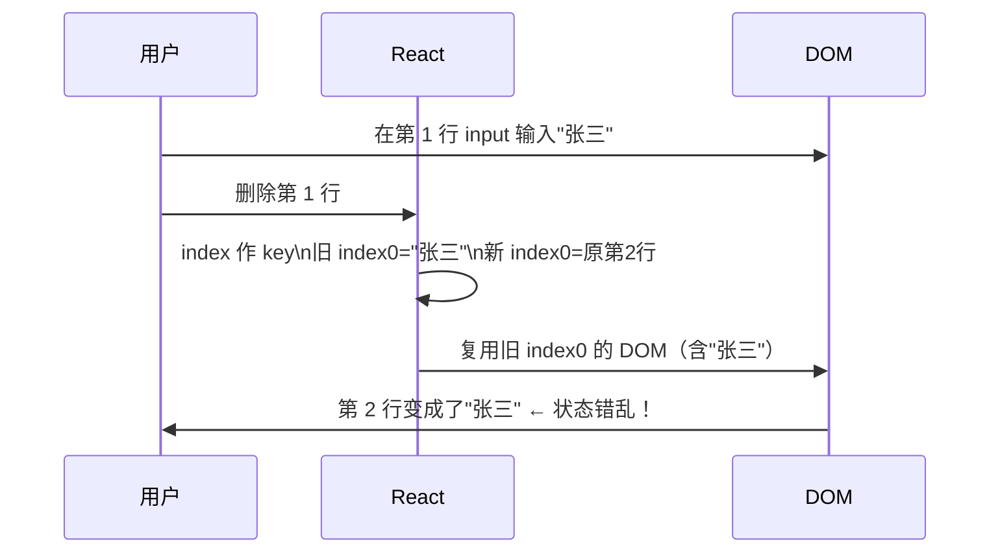

**什么情况用 index 安全**

| 场景 | 是否安全 |
|------|---------|
| 纯展示，不增删不排序 | ✅ 安全 |
| 列表项有输入框/状态 | ❌ 不安全 |
| 会增删/排序的列表 | ❌ 不安全 |
| 用随机数作 key | ❌ 最差，每次渲染都销毁重建 |

#### 追问链路

- `[A,B,C,D,E]` 删掉第一个，用 index 作 key，React 做几次 DOM 操作？
- 随机数作 key 会有什么后果？
- 有没有场景，不加 key 和加 index 效果一样？

#### 追问答案

**删掉第一项，index 作 key 几次 DOM 操作**
- `[A,B,C,D,E]` → `[B,C,D,E]`
- 位置 0: old=A → new=B → 更新（更新 DOM 内容）
- 位置 1: old=B → new=C → 更新
- 位置 2: old=C → new=D → 更新
- 位置 3: old=D → new=E → 更新
- 位置 4: old=E → new=空 → 删除
- 共 4 次更新 + 1 次删除 = **5 次 DOM 操作**
- 用稳定 key 只需 **1 次删除**（删 A，其余节点不动）

**随机数作 key 后果**
- 每次渲染随机数都变 → React 认为所有节点都是新节点
- 所有旧节点 Deletion + 所有新节点 Placement → 最大量 DOM 操作
- 组件 state 全部丢失（因为没有"复用"，每次都是全新组件）
- 可能触发 CSS 动画，因为每次都是新元素挂载

**不加 key 和加 index 的差异**
- 节点 type 相同时：两者效果完全一样（都按位置对比）
- 节点 type 不同时：不加 key → React 按位置尝试匹配，type 不同直接重建；加 index 作 key → 同样按位置，效果一样
- 结论：大多数情况下不加 key 和加 index 效果等价，但加了 key 的代码可读性更好（明确表达"按位置"）

---

## 层级三：Vue diff 细节

### Q7 Vue2 的双端对比算法怎么工作？为什么比 React 单端快？

> 频率：`中频` 来源：字节 / 腾讯 / 阿里

#### 口述版

- Vue2 用**双端对比**（四个指针）：`oldStart / oldEnd / newStart / newEnd`
- 每轮做 4 次比较：头头 / 尾尾 / 旧头新尾 / 旧尾新头，命中任意一条就移动指针
- 比 React 单端快的原因：在"头尾同时有变动"（如反转列表）的场景，双端能更快命中，减少 DOM 移动次数

#### 学习版

**四个指针的初始位置**

```
old: [A, B, C, D]    old 数组
      ↑           ↑
   oldStart     oldEnd

new: [D, B, C, A]    new 数组
      ↑           ↑
   newStart     newEnd
```

**四次比较的优先级和动作**

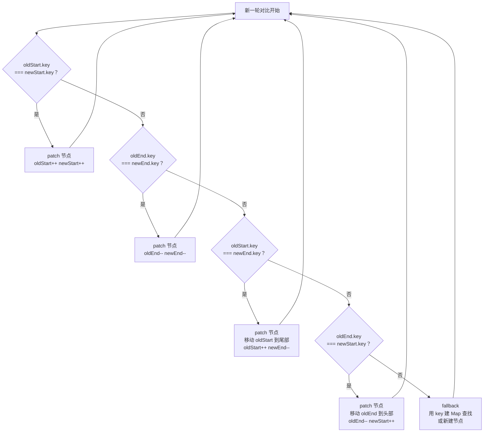

**经典场景：列表反转 `[A,B,C,D]` → `[D,C,B,A]`**

```
第 1 轮：
  oldEnd(D) === newStart(D) → 命中规则4！移动 D 到头部
  oldStart=A, oldEnd=C, newStart=B, newEnd=A

第 2 轮：
  oldEnd(C) === newStart(C) → 命中规则4！移动 C 到头部
  oldStart=A, oldEnd=B, newStart=B, newEnd=A

第 3 轮：
  oldEnd(B) === newStart(B) → 命中规则4！移动 B 到头部
  oldStart=A, oldEnd=A, newStart=A, newEnd=A

第 4 轮：
  oldStart(A) === newStart(A) → 命中规则1！就地更新
  所有指针重叠，结束

结果：3 次 DOM 移动
React 单端算法处理同样情况：需要移动 A/B/C 三个节点（因为 D 留原位）
```

**fallback：四次都没命中**

- 把旧子节点列表用 key 建一个 Map：`{ key: vnode }`
- 在 Map 里查找 `newStart` 对应的旧节点
- 找到 → 复用，移动到当前 newStart 位置
- 找不到 → 新建节点，插入当前位置
- `newStart++` 继续下一轮

#### 追问链路

- 四次比较都没命中时，fallback 是怎么处理的？
- 双端对比在什么场景优势最明显？有没有比双端更慢的情况？
- Vue2 双端和 Vue3 快速算法各自的适用场景？

#### 追问答案

**fallback 的处理流程**
- 以旧节点数组的 key 建 Map：`{ key → vnode }`（时间 O(n)，只做一次）
- 用 `newChildren[newStartIdx].key` 在 Map 里查找，O(1)
- 找到且 type 相同 → 原地复用，把旧节点移动到当前 newStart 指针位置前
- 找到但 type 不同 → 不能复用，新建节点
- 找不到 → 说明是全新节点，新建并插入
- 每次 fallback 后 `newStartIdx++`，旧链表被命中的节点打上"已使用"标记

**双端优势最明显的场景**
- 列表尾部追加（尾尾命中，O(n) 直接结束）
- 列表头部插入（头头命中或旧尾新头命中）
- 列表反转（交叉命中，移动次数少）
- 双端更慢的场景：随机乱序（四个指针都没命中，退化为 fallback）

**Vue2 双端 vs Vue3 快速算法**
- 双端：代码简单，在常见场景（头尾变动）下命中率高
- Vue3 快速算法：先处理前序/后序稳定部分（类似第一轮正序），再用 LIS 处理中间乱序
- LIS 保证最少移动次数（数学最优），双端只是"贪心"策略（不保证最优）
- 极端乱序时 Vue3 比 Vue2 做更少的 DOM 移动

---

### Q8 Vue3 为什么换掉双端对比，改用基于 LIS 的快速算法？

> 频率：`中频` 来源：字节 / 阿里

#### 口述版

- Vue3 快速算法的核心：**前序对比 + 后序对比 + 中间乱序段用 LIS（最长递增子序列）处理**
- LIS 的意义：不需要移动的节点尽可能多（它们的旧 index 本来就是递增的），只移动不在 LIS 里的节点
- 比双端更优的原因：双端是"贪心"（命中就操作），不保证最少移动；LIS 是"数学最优"，保证 DOM 移动次数最少

#### 学习版

**Vue3 快速算法的五个步骤**

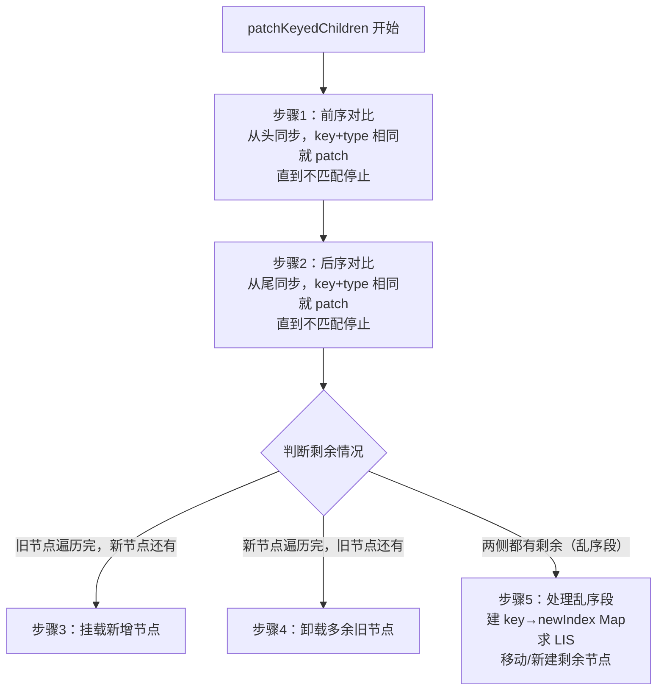

**步骤 5 乱序段的 LIS 原理**

假设乱序段（去掉前后匹配后的中间部分）：

```
旧: [B, C, D, E, F]   (旧 index: 0,1,2,3,4)
新: [D, C, B, G, F]

1. 建 key→newIndex Map：{ D:0, C:1, B:2, G:3, F:4 }

2. 遍历旧节点，记录每个旧节点在新数组里的 index（没有则 -1 代表需要删除）
   B→newIndex:2, C→newIndex:1, D→newIndex:0, E→-1(删除), F→newIndex:4

3. newIndexToOldIndexMap = [旧D的index+1, 旧C的index+1, 旧B的index+1, 0(新增G), 旧F的index+1]
                         = [3,              2,              1,            0,         5]

4. 对 newIndexToOldIndexMap 求 LIS：[1, 5]（即位置 2 和 4，对应 B 和 F）
   → B 和 F 不需要移动，D 和 C 需要移动

5. 倒序遍历新乱序段，LIS 之外的节点做 insertBefore：
   F → 不移动（在 LIS 里）
   G → 新增，insertBefore(F)
   B → 不移动（在 LIS 里）
   C → 移动，insertBefore(B)
   D → 移动，insertBefore(C)
```

**为什么 LIS 能保证最少移动**

```
LIS 的含义：在 newIndexToOldIndexMap 里找一个最长的递增子序列
递增意味着：这些节点在旧数组中的相对顺序，和在新数组中的相对顺序一致
相对顺序一致 = 这些节点不需要移动（保持原位就好）
LIS 最长 = 不移动的节点最多 = 需要移动的节点最少
```

**时间复杂度**

| 步骤 | 复杂度 |
|------|-------|
| 前序/后序对比 | O(n) |
| 建 key Map | O(n) |
| 求 LIS（贪心 + 二分） | O(n log n) |
| 倒序遍历移动 | O(n) |
| **总计** | **O(n log n)** |

#### 追问链路

- 为什么 LIS 能保证最少 DOM 移动次数？
- LIS 时间复杂度是多少？怎么用贪心 + 二分实现 O(n log n)？
- Vue3 快速算法一定比 Vue2 双端快吗？

#### 追问答案

**LIS 为何保证最少移动**
- 移动操作的本质：把一个节点从旧位置"搬"到新位置，是 DOM insertBefore 操作
- 不需要移动的节点 = 在旧数组和新数组里相对顺序都正确的节点
- 这些节点的旧 index 序列是"递增"的（保持了旧的相对顺序）
- 其中最长的递增序列 = 最多不移动的节点 = 最少的移动操作，数学最优

**LIS 如何 O(n log n) 实现**
- 朴素 dp 求 LIS 是 O(n²)，贪心 + 二分可以降到 O(n log n)
- 维护一个 `tails` 数组，`tails[i]` 表示长度为 i+1 的递增子序列的最小末尾值
- 遍历序列，对每个元素用二分查找找到 `tails` 中第一个 >= 当前值的位置，替换
- `tails` 的长度即为 LIS 长度，回溯找到具体序列

**Vue3 一定比 Vue2 快吗**
- 常规场景（头尾变动）：两者速度相近，双端甚至因为代码简单而稍快
- 乱序场景：Vue3 LIS 移动次数更少，对 DOM 更友好，整体更快
- 极端情况（完全反转大列表）：Vue3 明显优于 Vue2

---

### Q9 Vue3 的编译优化（PatchFlag、静态提升、Block Tree）怎么减少 diff 量？

> 频率：`中频` 来源：字节 / 阿里

#### 口述版

- **PatchFlag**：编译时给动态节点打标记，运行时只 diff 带标记的属性，静态属性跳过
- **静态提升**：把静态节点提到 render 函数外，每次 render 复用同一引用，不参与 diff
- **Block Tree**：把动态子节点收集成一维数组（dynamicChildren），diff 时直接遍历数组，跳过整棵树的层级遍历

#### 学习版

**PatchFlag 编译产物对比**

```vue
<!-- 模板 -->
<div :class="cls" id="static">{{ text }}</div>
```

```js
// Vue2 运行时：每次 patch 都要全量对比 class / id / text
// Vue3 编译产物：
createVNode('div',
  { class: cls, id: 'static' },
  text,
  3 /* PatchFlag: CLASS(1) | TEXT(2) = 3 */
)
// 运行时看到 PatchFlag=3，只检查 class 和 text，id 永远不比
```

**常见 PatchFlag 值（位掩码）**

| 值 | 含义 |
|----|------|
| 1 | TEXT — 动态文本 |
| 2 | CLASS — 动态 class |
| 4 | STYLE — 动态 style |
| 8 | PROPS — 动态 props（需指定具体 key） |
| 16 | FULL_PROPS — 动态 props（key 也是动态的） |
| 32 | NEED_HYDRATION — 需要水合的节点（SSR） |
| -1 | HOISTED — 静态提升节点，永不更新 |
| -2 | BAIL — 不优化，全量 diff |

**静态提升**

```js
// Vue3 编译后（静态节点提到外面）
const _hoisted_1 = createVNode('span', null, '我是静态文本')

function render() {
  return createVNode('div', null, [
    _hoisted_1,          // 每次 render 复用同一 VNode 对象
    createVNode('p', null, dynamic_text, 1) // 动态节点
  ])
}
// diff 时对比引用相等的节点直接跳过！
```

**Block Tree：把树 diff 变成数组 diff**

```mermaid
graph TD
  subgraph 不用 Block Tree（全树 diff）
    R1[App] --> C1[Header\n静态]
    R1 --> C2[Main]
    C2 --> D1[p 动态文本]
    C2 --> D2[span 静态]
    R1 --> C3[Footer\n静态]
  end
  subgraph 用 Block Tree
    R2[App Block\ndynamicChildren:\n只有 p 动态文本]
  end
```

```
不用 Block Tree：每次 diff 要遍历所有节点（Header/Main/Footer/p/span）
用 Block Tree：只遍历 dynamicChildren 数组，直接找到 p，其余全跳过
```

#### 追问链路

- PatchFlag 是位掩码，具体怎么用位运算检测？
- Block Tree 怎么收集 dynamicChildren？是运行时还是编译时？
- 这些优化对开发者透明吗？有没有边界失效的情况？

#### 追问答案

**PatchFlag 位运算检测**

```js
// 检测是否有 TEXT(1) 和 CLASS(2)
const patchFlag = 3; // 0b011
if (patchFlag & 1) updateText();   // 有 TEXT
if (patchFlag & 2) updateClass();  // 有 CLASS
if (patchFlag & 4) updateStyle();  // 没有 STYLE，跳过
```

位运算检测 O(1)，且一个 int 就能编码所有动态属性类型，节省内存。

**Block Tree 如何收集 dynamicChildren**
- 编译时：编译器分析模板，知道哪些节点是动态的，为它们生成 PatchFlag
- 运行时：组件 render 时，Block 节点（App、For 循环体等）自动追踪 render 期间创建的带 PatchFlag 的子节点
- 用一个全局栈 `currentBlock` 收集，render 完成后存入 `vnode.dynamicChildren`

**失效场景**
- 动态组件（`<component :is="...">`）无法静态分析，退化为全量 diff（PatchFlag=-2 BAIL）
- `v-html` 内容无法分析，退化全量
- 手写 render 函数（不经过编译器）完全没有 PatchFlag 优化
- 这些场景是可知的，Vue 会在控制台警告

---

## 层级四：React vs Vue 横向对比

### Q10 React diff 和 Vue diff 有什么本质区别？

> 频率：`高频` 来源：百度 / 阿里 / 字节

#### 口述版

- **更新范围**：React 每次从根 reconcile 整棵树；Vue 通过依赖收集知道哪个组件需要更新，只 patch 变化的组件
- **diff 粒度**：React 是 Fiber 节点级（每个节点都可能 diff）；Vue 是组件级（先定位到组件，再 diff 组件内部）
- **运行时 vs 编译时**：React 主要靠运行时算法；Vue3 大量靠编译时优化（PatchFlag）减少运行时工作量
- **两者共同点**：都只做同层 diff，都依赖 key 识别节点，都忽略跨层移动

#### 学习版

**根本原因：响应式模型不同**

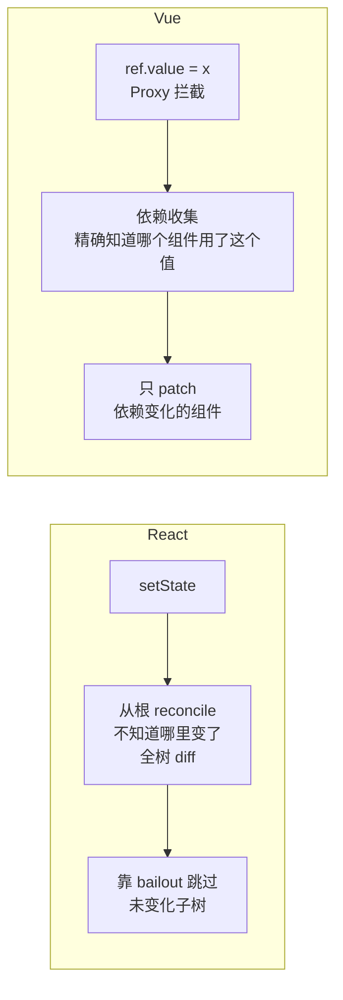

**详细差异对比**

| 维度 | React | Vue3 |
|------|-------|------|
| 如何找到变化组件 | 从根 reconcile，靠 `bailout` 跳过 | 依赖收集，直接定位到依赖变化的组件 |
| diff 入口 | 每次从 HostRoot 开始 | 每个响应式依赖变化触发对应组件更新 |
| 运行时优化 | Fiber 可中断、bailout | 组件级跳过（粒度更细） |
| 编译时优化 | React Compiler（较新） | PatchFlag + Block Tree（稳定） |
| 列表 diff | 两轮遍历 + key Map | 快速算法（LIS）+ key Map |
| 是否需要 Fiber | 需要（全树 reconcile 太重，需要切片） | 不需要（组件级更新轻量） |

**一句话总结两者差异**

> React 是"我不知道哪里变了，我来全部检查一遍"；Vue 是"我知道哪里变了，直接去更新那里"。这个根本差异导致了 Fiber、时间切片、React Compiler 等一系列 React 独有的东西。

#### 追问链路

- Vue 的依赖收集是怎么实现的？为什么 React 不用响应式？
- React 的 bailout 优化和 Vue 的组件级跳过，效果一样吗？
- React Compiler 出来后，两者还有本质差异吗？

#### 追问答案

**Vue 依赖收集原理**
- Vue3 用 `Proxy` 代理响应式对象，读取属性时自动收集当前正在执行的 effect（组件渲染函数）
- 写入属性时自动通知所有收集到的 effect 重新执行
- 结果：框架精确知道"哪个组件用了这个值"，数据变化时只调度这些组件更新

**为什么 React 不用响应式**
- React 的设计哲学是"数据不可变 + 单向数据流"，state 变化 = 整棵树可能变化
- 响应式需要代理所有数据，引入额外的订阅/取消订阅开销
- React 认为可预测性（知道什么时候 render）比自动追踪更重要

**React bailout vs Vue 组件级跳过**
- 两者目标相同（跳过不需要更新的部分），但粒度和时机不同
- React bailout：render 阶段，按 Fiber 节点判断（`oldProps === newProps && lanes === 0`）
- Vue 组件跳过：响应式调度阶段，组件的依赖没变化就根本不进入 render
- Vue 的跳过发生更早（不进入 render），React 的跳过在 render 阶段中判断
- 实际性能上 Vue 组件跳过更彻底，但 React Compiler 正在缩小这个差距

---

### Q11 React 的 key 和 Vue 的 key 作用机制一样吗？

> 频率：`中频` 来源：字节 / 校招

#### 口述版

- **相同**：都用于在列表 diff 时识别"同一个节点"，都通过 key 建 Map 实现 O(1) 查找
- **不同**：Vue 有个特殊用法——`<Transition :key="x">` 用 key 强制重建组件；React 也支持这种用法，key 变了组件就重建（包括非列表场景）
- **React 更彻底**：React 中任何位置的 key 变化都会强制重建，不限于列表；Vue 也支持但不那么强调

#### 学习版

**列表 diff 中 key 的作用（两者一致）**

```
React:
  reconcileChildrenArray 中用 key 建 Map，O(1) 查找旧 Fiber

Vue3:
  patchKeyedChildren 中用 key 建 keyToNewIndexMap，O(1) 查找新 index
```

**React 用 key 强制重建组件（非列表场景）**

```jsx
// 用 key 重置表单（经典技巧）
function Profile({ userId }) {
  return <Form key={userId} />;
  // userId 变化时 key 变 → Form 组件完全重建 → state 重置
}
```

**Vue 用 key 在 Transition 中强制重建**

```vue
<Transition>
  <div :key="currentPage">{{ content }}</div>
</Transition>
<!-- currentPage 变化时 key 变 → div 销毁重建 → 触发离开/进入动画 -->
```

**key 不稳定时谁代价更大**

| 场景 | React | Vue |
|------|-------|-----|
| key 随机变化 | 所有组件销毁重建，state 丢失 | 所有组件销毁重建，state 丢失 |
| 代价差异 | Fiber 节点重建 + 真实 DOM 重建 | VNode 重建 + 真实 DOM 重建 |
| 额外影响 | 更多 GC 压力（Fiber 对象多） | 相对轻量（VNode 对象简单） |

#### 追问链路

- 为什么 key 变了组件就会重建？这个行为在源码哪里？
- Vue 的 key 和 React 的 key 在数据类型上有什么限制？
- 实际工程中，key 不稳定的常见原因有哪些？

#### 追问答案

**key 变了为什么会重建**
- React：`reconcileSingleElement` 和 `reconcileChildrenArray` 都先对比 key，key 不同就跳过当前旧节点
- 如果新 key 在整个旧列表都找不到匹配，就创建新 Fiber，旧 Fiber 被标记 Deletion
- Vue：同样的逻辑，`patchKeyedChildren` 里 key 不在 Map 里就新建 VNode
- 本质：key 是节点的"身份证"，身份变了 = 是新人，旧的需要卸载

**key 的数据类型限制**
- React：key 必须是 `string | number`，null 表示无 key，undefined 会被忽略（视为无 key）
- Vue：key 可以是 `string | number | symbol`，Symbol 在 Vue3 中也是合法 key
- 建议都用 string 或 number，避免类型隐患

**key 不稳定的常见原因**
- 列表数据没有唯一 ID，用 `Math.random()` 临时生成
- 用对象引用作 key（每次 render 新建对象，引用不稳定）
- 从父组件传来的 key 本身不稳定（依赖了不稳定的计算）
- 后端返回数据没有 id，前端用 index 作 key

---

## 层级五：进阶与实战

### Q12 大列表场景下，diff 还能优化吗？还是要上虚拟列表？

> 频率：`中频` 来源：小红书 / 美团

#### 口述版

- diff 算法本身是 O(n)，10000 个节点 diff 就是 10000 次操作，算法层面基本到头了
- Vue3 Block Tree 可以把"动态节点"提取出来，但如果 10000 个都是动态的，没有帮助
- React 时间切片能缓解"diff 阻塞主线程"，但 diff 总量不减少
- **根本解法是虚拟列表**：只渲染可见区域（~30 个节点），diff 量从 10000 降到 30

#### 学习版

**各种方案的效果对比**

| 方案 | diff 节点数 | 是否根治 | 适用场景 |
|------|-----------|---------|---------|
| Vue3 Block Tree | 减少静态节点 diff，但动态节点不变 | ❌ | 静态内容多的大列表 |
| React 时间切片 | 不减少，只是分批执行 | ❌ | 缓解卡顿感知，不提升性能 |
| React.memo / shouldUpdate | 减少子组件 re-render | ⚠️ 部分 | 子组件 props 稳定时 |
| 虚拟列表 | ~30 个节点（只渲染可见区域） | ✅ | 所有大列表场景 |
| 分页 / 无限滚动 | 每次只渲染一页 | ✅ | 数据源可分页的场景 |

**虚拟列表原理**

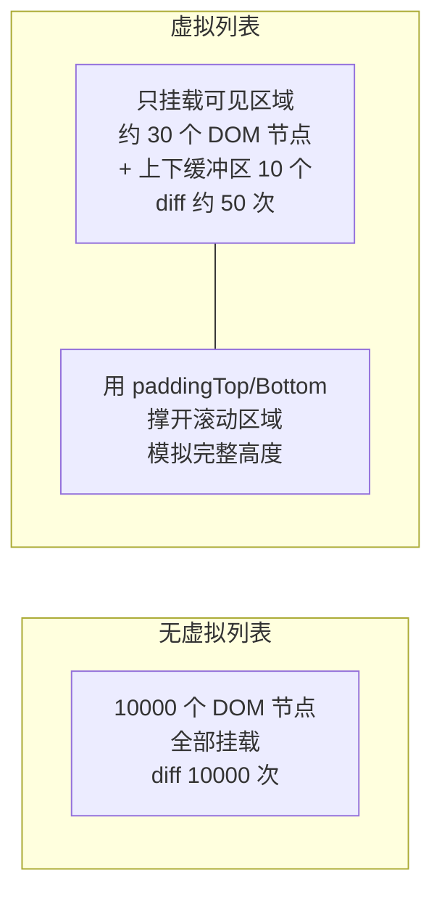

**React 时间切片 vs 虚拟列表**

```
时间切片：
  10000 个节点的 diff 分成 200 批（每批 50 个）
  用户感觉不到卡顿（每批 5ms 内完成）
  但总 diff 量不变，总时间不变，首屏慢

虚拟列表：
  任何时候只 diff ~50 个节点
  首屏快，滚动快，总时间大幅减少
  代价：实现复杂（需要动态高度计算），滚动惯性感略差
```

#### 追问链路

- 虚拟列表怎么处理高度不固定的列表项？
- React 时间切片和虚拟列表能一起用吗？
- 10000 个节点的 diff，如果 key 不稳定，会比 key 稳定慢多少？

#### 追问答案

**动态高度的虚拟列表**
- 给每个列表项设一个预估高度（如 50px）初始化
- 列表项渲染后测量真实高度，更新缓存
- 用 `ResizeObserver` 监听高度变化，动态调整 padding 和 visible range
- 代表库：`react-window`（简单）、`react-virtual`（支持动态高度）、`vue-virtual-scroller`

**时间切片 + 虚拟列表能一起用**
- 完全兼容，各解决不同问题
- 虚拟列表减少 diff 量（治本）
- 时间切片确保 diff 不阻塞用户输入（提升感知）
- 大多数情况虚拟列表就够了，时间切片是额外保障

**key 不稳定 vs 稳定的性能差距**
- key 不稳定：每次 diff 全部销毁重建，O(n) DOM 删除 + O(n) DOM 创建
- key 稳定：diff 只做 O(n) 属性对比 + O(移动数) DOM 移动
- 10000 个节点，key 不稳定时可能比 key 稳定慢 10x 以上（DOM 操作是瓶颈）

---

### Q13 Svelte/SolidJS 不用虚拟 DOM 和 diff，它们怎么做更新？diff 会被淘汰吗？

> 频率：`低频` 来源：字节（高级岗）/ 技术视野题

#### 口述版

- **Svelte**：编译时直接把模板编译成精准的 DOM 操作语句，没有运行时 diff
- **SolidJS**：细粒度响应式（Signal），每个响应式值直接绑定到具体的 DOM 属性，数据变化直接更新对应 DOM，不需要组件整体 re-render
- diff 会被优化但不会被完全淘汰：React Compiler 在缩小和编译优化的差距，虚拟 DOM 在跨平台场景无可替代

#### 学习版

**三种更新策略对比**

```mermaid
graph TD
  subgraph 虚拟DOM diff（React/Vue）
    A["数据变化\n→ 生成新 VNode\n→ diff 新旧 VNode\n→ patch 真实 DOM"]
  end
  subgraph 编译时直接操作（Svelte）
    B["数据变化\n→ 直接执行编译出的\nDOM 操作语句\n无 VNode，无 diff"]
  end
  subgraph 细粒度响应式（SolidJS）
    C["Signal 变化\n→ 只更新绑定了\n这个 Signal 的 DOM 属性\n无组件 re-render"]
  end
```

**Svelte 的编译产物**

```svelte
<!-- 模板 -->
<p>{message}</p>
```

```js
// Svelte 编译后（简化）
function create_fragment(ctx) {
  let p;
  return {
    c() { p = element('p'); },
    m(target, anchor) { insert(target, p, anchor); },
    p(ctx, [dirty]) {
      // dirty 标记哪些变量变了
      if (dirty & 1) set_data(p, ctx[0]); // 直接更新 p 的 textContent
    }
  }
}
```

没有 VNode，没有 diff，直接操作。

**SolidJS 的细粒度更新**

```jsx
// SolidJS
const [count, setCount] = createSignal(0);

// 编译时分析：这个表达式依赖 count Signal
// 运行时：count 变化时，只更新这一个 DOM 节点的 textContent
<p>{count()}</p>
```

SolidJS 的组件函数只执行一次（mount 时），之后的更新直接由 Signal 驱动到 DOM，不需要组件重新执行。

**diff 会被淘汰吗**

| 场景 | 虚拟 DOM 的价值 |
|------|--------------|
| 跨平台（React Native、Three.js Fiber） | 无可替代，抽象层是关键 |
| 服务端渲染 | 虚拟 DOM 可以在 Node.js 运行，生成 HTML |
| 大型应用复杂状态 | 依赖追踪在极度复杂的状态图中有额外开销 |
| 编译时无法分析的动态内容 | 需要运行时 diff |

**React Compiler 的影响**

React Compiler（原 React Forget）在编译时自动分析哪些组件/变量可以 memo，生成优化代码，让 React 接近 Vue3 PatchFlag 的效果，但它仍然有运行时 diff——只是减少了不必要的组件 re-render。

#### 追问链路

- Svelte 没有运行时 diff，那它的 bundle size 更小吗？
- SolidJS 和 Vue3 的响应式有什么异同？
- React Compiler 出来后，React 和 Vue3 的性能差距还有多大？

#### 追问答案

**Svelte 的 bundle size**
- Svelte 没有运行时框架代码（无 diff 引擎），但每个组件编译后代码量比 React/Vue 组件大
- 小应用（<10 个组件）：Svelte 总 bundle 更小（没有框架运行时）
- 大应用（>100 个组件）：Vue/React 更小（框架运行时是固定成本，组件代码可复用 diff 引擎）

**SolidJS vs Vue3 响应式异同**
- 相同：都基于细粒度依赖追踪，数据变化时只触发相关更新
- 不同：Vue 以"组件"为更新单位（即使响应式），SolidJS 精确到单个 DOM 节点
- SolidJS 组件函数只执行一次，Vue 组件函数每次数据变化都重新执行（只是跳过 diff 的 DOM 操作）
- SolidJS 性能更极致，但调试体验和生态不如 Vue

**React Compiler 后的性能差距**
- React Compiler 主要解决"不必要的 re-render"，让 React 不再需要手写 memo/useCallback
- 但它仍然有完整的运行时 diff（Fiber reconcile）
- Vue3 还有 PatchFlag（只 diff 动态属性）和 Block Tree（跳过静态子树），这些 React Compiler 目前还不能做到
- 差距从"大"变"小"，但短期内 Vue3 在纯渲染性能上仍有优势

---

## 面试速查表

| 题号 | 核心一句话 | 频率 | 大厂来源 |
|------|-----------|------|---------|
| Q1 | 虚拟 DOM + diff = 最小 patch；但不一定比直接操作 DOM 快 | 高频 | 百度/阿里/字节 |
| Q2 | 三条启发式假设把 O(n³) 降到 O(n)：不同 type 重建 + 同层比较 + key 标记 | 中频 | 字节/阿里 |
| Q3 | 不同 type 销毁重建；只比同层；key 标记稳定节点 | 高频 | 字节/阿里/百度 |
| Q4 | key+type 双重匹配；复用 = Fiber+state+DOM 复用；key 同 type 不同必须重建 | 中频 | 字节/校招 |
| Q5 | 第一轮正序处理简单情况；第二轮 key Map 处理新增/删除/移动 | 高频 | 字节/阿里 |
| Q6 | key 让 diff 从"按位置"变成"按身份"；index 作 key 顺序变化时状态错乱 | 高频必问 | 字节/百度/滴滴/小红书 |
| Q7 | Vue2 四指针双端对比：头头/尾尾/旧头新尾/旧尾新头，比 React 在头尾变动场景少移动 | 中频 | 字节/腾讯/阿里 |
| Q8 | Vue3 用 LIS 找最少移动节点：前后序对比 + 乱序段 LIS，O(n log n)，移动次数数学最优 | 中频 | 字节/阿里 |
| Q9 | PatchFlag 标记动态属性；静态提升复用引用；Block Tree 拍平动态节点为一维数组 | 中频 | 字节/阿里 |
| Q10 | React"全树检查"靠 bailout 跳过；Vue"精确定位"靠依赖收集；这导致 React 需要 Fiber | 高频 | 百度/阿里/字节 |
| Q11 | 两者都用 key 建 Map O(1) 查找；key 变了就重建；React 在非列表场景也支持 key 重建 | 中频 | 字节/校招 |
| Q12 | diff 是 O(n)，算法层面到头了；根本解是虚拟列表（节点数 10000→50） | 中频 | 小红书/美团 |
| Q13 | Svelte 编译出 DOM 操作无 diff；SolidJS Signal 细粒度绑定无 re-render；diff 不会被淘汰（跨平台价值） | 低频 | 字节高级岗 |
